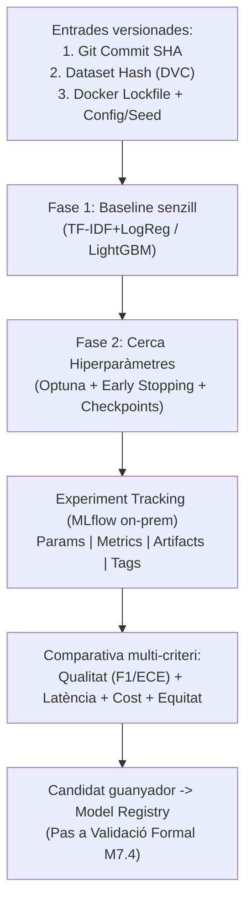

## A. Objectius d'aprenentatge

En completar aquesta lliçó, l'estudiant ha de ser capaç de:

1. **Garantir** la **reproduïbilitat absoluta d'un entrenament (*Training Reproducibility*)** controlant els **5 pilars**: (1) versió exacta del **codi** (commit Git), (2) versió exacta de les **dades** (hash DVC/SHA-256), (3) **entorn de dependències** (`requirements.lock` / imatge Docker immutable), (4) **hiperparàmetres i llavors aleatòries (*seeds*)** i (5) **maquinari/precisió numèrica** (CPU/GPU, FP16/BF16)!
2. **Implementar** el **seguiment estructurat d'experiments (*Experiment Tracking*, estil MLflow / Weights & Biases *on-premise*)** registrant automàticament en cada execució (*run*): paràmetres, mètriques per època, artefactes (model, matriu de confusió, corba calibratge) i metadades de llinatge!
3. **Aplicar** bones pràctiques d'**entrenament eficient i sostenible**: començar sempre amb una **línia base senzilla (*Baseline*)** abans de passar a models pesats, usar ***Early Stopping*** i **cerca intel·ligent d'hiperparàmetres** (*Random Search / Optimització Bayesiana — Optuna* en lloc de *Grid Search* exhaustiu!) i controlar el **cost energètic i de GPU**!
4. **Distingir** l'entrenament clàssic ML de l'entrenament en **LLMOps (*Fine-Tuning* amb LoRA/QLoRA + registre d'adaptadors i prompts)**: quan val la pena reentrenar vs. millorar el RAG/prompt, gestió de *checkpoints* i prevenció del *Catastrophic Forgetting*!
5. **Implementar** en Python pur un **mini-gestor de seguiment d'experiments (estil MLflow)** que registra cada *run* amb `git_commit`, `dataset_hash`, `seed`, hiperparàmetres, mètriques i selecció automàtica del millor model candidat segons la mètrica objectiu!

---

## B. Explicació introductòria

Quantes vegades hem sentit: *«La setmana passada vaig treure un F1 de 0,91 al notebook `model_final_v3_bo_definitiu.ipynb`, però ara torno a executar-lo i em surt 0,83 i no recordo quins paràmetres ni quin CSV vaig fer servir!»*? Aquesta manera artesanal de treballar és **inacceptable** en una administració pública que necessita **auditabilitat, continuïtat de servei i compliment normatiu (AI Act)**.

L'**entrenament reproduïble i el seguiment d'experiments (*Experiment Tracking*)** substitueixen els notebooks caòtics per **execucions traçables i immutables** (ex. amb **MLflow *on-premise***): cada prova deixa una fitxa exacta de codi, dades, entorn, llavor aleatòria, hiperparàmetres, mètriques i artefacte resultant, permetent comparar rigorosament 50 experiments i reproduir exactament el guanyador d'aquí a un any!

---

## C. Explicació tècnica avançada

### 1. Els 5 pilars de la reproduïbilitat en entrenament

1. **Codi (Git commit SHA)**: prohibir entrenar amb canvis locals sense comitejar (`git_dirty = False` en pipelines oficials!).
2. **Dades (Dataset Hash / DVC)**: hash SHA-256 exacte de `train`, `val` i `test`.
3. **Entorn (Docker + Lockfile)**: versions exactes de Python, `scikit-learn`, `PyTorch`, CUDA (`uv.lock` / `requirements.txt` pinejats dins imatge Docker).
4. **Configuració i aleatorietat**: fitxer declaratiu (`config.yaml`) + fixar totes les **llavors aleatòries** (`random`, `numpy`, `torch`, `CUDA deterministic`).
5. **Registre complet (*Experiment Tracking*)**: eina centralitzada (ex. **MLflow Tracking Server** en servidor propi) que emmagatzema:
   - **`Params`**: hiperparàmetres (`lr`, `max_depth`, `lora_r`, `batch_size`, `seed`).
   - **`Metrics`**: mètriques de validació (`macro_f1`, `pr_auc`, `ece`, `val_loss`, latència inferència, memòria).
   - **`Artifacts`**: model serialitzat (`Pipeline` complet!), gràfics (corba PR, calibratge), informe de biaixos i `config.yaml`.
   - **`Tags`**: `git_commit`, `dataset_hash`, `author`, `environment`.

### 2. Principis d'enginyeria d'entrenament (*Baseline-first*, HPO i *Early Stopping*)

- ***Baseline-first* obligatori**: abans d'entrenar un Transformer o un LLM *fine-tuned*, entrenar sempre un model base ràpid i interpretable (ex. *TF-IDF + Logistic Regression* o *LightGBM*). Si el *baseline* ja assoleix `F1 = 0,89` en `2 ms` sobre CPU i un model 100× més car només arriba a `0,90` en GPU, el guany marginal no justifica cost ni latència (**Principi de parsimònia i sostenibilitat — Green AI**!).
- **Cerca d'hiperparàmetres (*HPO*)**: evitar *Grid Search* exhaustiu en espais grans (explosió exponencial); preferir ***Random Search*** o **Optimització Bayesiana (ex. Optuna / TPE)** amb **poda primerenca (*Pruning / Hyperband*)** que cancel·la aviat les execucions clarament inferiors!
- ***Early Stopping* i *Checkpointing***: aturar l'entrenament quan la `val_loss` (o mètrica objectiu) deixa de millorar durant `patience` èpoques, guardant sempre els **millors pesos (`best_checkpoint`)** i no els de l'última època (evitant *overfitting*!).

### 3. Entrenament en **LLMOps** (*LoRA / QLoRA* i *Prompt Experiments*)

- En *fine-tuning* eficient (**PEFT / LoRA / QLoRA**, Mòdul 3), l'*Experiment Tracker* registra la versió exacta del **model base congelat** (`base_model_sha`), els hiperparàmetres LoRA (`r`, `alpha`, `target_modules`), la corba de pèrdua i l'artefacte petit de l'**adaptador LoRA** (~50–200 MB).
- En **RAG/Prompting**, un «experiment» registra: versió del **prompt del sistema**, model d'embeddings, mida de *chunk* i *overlap*, `top_k`, *reranker*, temperatura i les mètriques RAGAS (`Faithfulness`, `Context Recall`, `Refusal Accuracy`) sobre el *Golden Set*!

---

## D. Diagrames i recursos visuals

### Cicle d'entrenament reproduïble amb *Experiment Tracking* (MLflow *on-premise*)



---

## E. Aplicació a l'Administració pública

1. **Continuïtat i transferència de coneixement en equips públics**: si un tècnic o contractista marxa del projecte al cap d'un any, el servidor **MLflow *on-premise*** + Git + DVC permeten a qualsevol nou enginyer saber exactament com es va entrenar el model en producció i reentrenar-lo sense començar de zero!
2. **Sostenibilitat i contractació pública responsable (*Green AI*)**: registrar temps de GPU i consum estimat a l'*Experiment Tracker* i exigir sempre la comparativa contra un ***baseline* lleuger en CPU** evita sobredimensionar infraestructures GPU costoses i innecessàries.
3. **Documentació automàtica per a l'AI Act (Annex IV)**: les metadades registrades automàticament per l'*Experiment Tracker* (hiperparàmetres, mètriques de validació per subgrup, arquitectures provades, hash de dades) nodreixen directament la documentació tècnica i la ***Model Card*** del sistema!

---

## F. Exemple pràctic guiat

Implementem en **Python pur** un **mini-gestor d'*Experiment Tracking* (estil MLflow)** que:
1. Registra cada *run* amb `git_commit`, `dataset_hash`, `seed`, hiperparàmetres, mètriques (`macro_f1`, `latencia_ms`) i comprova que el repositori no estigui brut (`git_dirty=False`).
2. Selecciona automàticament el **millor candidat** aplicant una **restricció operativa real** (latència `<= 50 ms`, no només F1 màxim!) i demostra el principi ***Baseline-first***!

```python
"""Exemple 7.3: Mini Experiment Tracker (estil MLflow) amb restricció multi-criteri i reproduïbilitat."""
from dataclasses import dataclass, field


@dataclass
class RunExperiment:
    run_id: str
    model_nom: str
    git_commit: str
    dataset_hash: str
    seed: int
    params: dict[str, object]
    metrics: dict[str, float]
    tags: dict[str, str] = field(default_factory=dict)


class MiniMLflowTracker:
    def __init__(self) -> None:
        self.runs: list[RunExperiment] = []

    def registrar_run(self, run: RunExperiment, git_dirty: bool = False) -> None:
        if git_dirty:
            raise ValueError(f"Rebutjat {run.run_id}: prohibit entrenar un run oficial amb canvis sense comitejar!")
        self.runs.append(run)

    def millor_candidat(self, metrica: str = "macro_f1", max_latencia_ms: float = 50.0) -> RunExperiment | None:
        elegibles = [r for r in self.runs if r.metrics["latencia_ms"] <= max_latencia_ms]
        return max(elegibles, key=lambda r: r.metrics[metrica]) if elegibles else None


if __name__ == "__main__":
    tracker = MiniMLflowTracker()
    experiments = [
        RunExperiment("run-01", "Baseline_TFIDF_LogReg", "a1b2c3d", "sha256:9f8e7d", 42, {"C": 1.0}, {"macro_f1": 0.87, "latencia_ms": 4.2}),
        RunExperiment("run-02", "DistilBERT_Catala_v1", "a1b2c3d", "sha256:9f8e7d", 42, {"lr": 3e-5, "epochs": 4}, {"macro_f1": 0.91, "latencia_ms": 28.5}),
        RunExperiment("run-03", "LLM_70B_ZeroShot", "a1b2c3d", "sha256:9f8e7d", 42, {"temp": 0.0}, {"macro_f1": 0.92, "latencia_ms": 850.0}),
    ]
    for r in experiments:
        tracker.registrar_run(r, git_dirty=False)

    guanyador = tracker.millor_candidat(metrica="macro_f1", max_latencia_ms=50.0)
    print(f"Runs registrats: {len(tracker.runs)}")
    print(f"Guanyador sota SLA (<=50 ms): {guanyador.run_id} ({guanyador.model_nom}) | F1={guanyador.metrics['macro_f1']} | lat={guanyador.metrics['latencia_ms']} ms")
```

### Interpretació dels resultats (execució verificada)

- `run-03` (`LLM_70B_ZeroShot`) obté el F1 més alt (`0,92`), però triga **`850 ms`** (viola l'SLA de `<= 50 ms` i dispara el cost GPU per només `+0,01` de F1!).
- El tracker selecciona automàticament **`run-02` (`DistilBERT_Catala_v1`, F1 `0,91`, `28,5 ms`)** amb traçabilitat completa (`git_commit`, `dataset_hash`, `seed=42`), demostrant la selecció multi-criteri en MLOps!

---

## G. Exercici pràctic per resoldre

### Enunciat
Una empresa contractista lliura a una diputació un model de classificació d'expedients en un fitxer `.pkl` solt amb una presentació PowerPoint que diu «F1 = 0,90». No hi ha cap registre dels hiperparàmetres, ni del hash del dataset, ni de quina versió de `scikit-learn` es va fer servir, ni del *baseline* comparatiu, i en intentar carregar el `.pkl` al servidor de producció falla amb un error d'incompatibilitat de versions!

Redacta els **requisits mínims obligatoris d'entrega i reproduïbilitat d'entrenament** que exigiràs al contractista (i incorporaràs als plecs tècnics futurs) per poder acceptar el model!

### Objectius i restriccions
- Exigir els 5 pilars de reproduïbilitat (Git + DVC/hash + Docker/lockfile + config/seeds + MLflow Tracking), comparativa *Baseline-first* + selecció multi-criteri (F1/ECE/latència/cost) i format portàtil/segur (evitant vulnerabilitats de `pickle`!).

:::hint Pista 1 — Els 5 pilars exigibles a l'entrega
(1) Repositori **Git** complet del codi d'entrenament i inferència amb `commit SHA` exacte; (2) **Hash SHA-256 / DVC** dels datasets exactes (`train`/`val`/`test`); (3) **Imatge Docker + `lockfile`** amb versions exactes de dependències; (4) Fitxer de configuració + **llavors aleatòries (`seeds`)** + execució verificada reproduïble; (5) Registre d'experiments (**MLflow**) amb `baseline` inclòs!
:::

:::hint Pista 2 — Seguretat de formats i multi-criteri
A més de la reproduïbilitat, exigeix: (a) **format de serialització segur i portàtil** (**ONNX** o **SafeTensors** en lloc de `.pkl` arbitrari, ja que `pickle` pot executar codi arbitrari en carregar-se i es trenca entre versions!), i (b) comparativa multi-criteri (F1 per classe, ECE de calibratge, latència P95, memòria i biaix per subgrup)!
:::

### Criteris d'avaluació
- **45%**: Exigència detallada dels **5 pilars de reproduïbilitat** (Git, hash/DVC dades, Docker/lockfile, config/seeds, *Experiment Tracking*).
- **30%**: Exigència de ***Baseline-first*** + comparativa multi-criteri (qualitat + calibratge + latència + cost + equitat).
- **25%**: Substitució de `.pkl` insegur i fràgil per formats estàndards i segurs (**ONNX / SafeTensors / MLflow Model Format**) i verificació de re-execució independent abans de l'acceptació del contracte.

### Errors habituals
- Acceptar un `.pkl` sense poder re-executar l'entrenament des de zero en la infraestructura pròpia de l'Administració (*vendor lock-in* i impossibilitat de manteniment futur!).

:::solution Solució completa comentada i alternatives
### Clàusules tècniques d'acceptació d'entrenament (Plec MLOps)
1. **Reproduïbilitat extrem a extrem (els 5 pilars)**:
   - Codi font complet d'entrenament, preprocés i avaluació en **Git** (sense fitxers locals sense comitejar).
   - Versió exacta i **hash SHA-256 / DVC** dels conjunts `train`, `val` i `test` (i codi del pipeline que els genera).
   - **Dockerfile + `requirements.lock`** immutable (reproducció exacta de Python i llibreries).
   - Configuració declarativa (`config.yaml`) i **llavors aleatòries fixades** (*seeds*).
   - Exportació o registre directe al servidor **MLflow *on-premise*** de tots els *runs*, incloent-hi obligatòriament un ***baseline* lleuger**.
2. **Avaluació multi-criteri i format segur**:
   - Informe comparatiu amb F1 global i per classe, calibratge (ECE), latència P95, consum RAM/GPU i anàlisi de biaixos.
   - Entrega en format **segur i interoperable** (**ONNX** per a models clàssics/Transformer o **SafeTensors** per a pesos PyTorch/LoRA), rebutjant fitxers `.pkl` no auditats pel risc d'execució de codi arbitrari i fragilitat de versions!
3. **Prova d'acceptació**: re-executar el pipeline d'entrenament dins la infraestructura de la Diputació verificant que reprodueix les mètriques declarades dins la tolerància definida.
:::

---

## H. Test individual

Resol les 10 preguntes sobre els 5 pilars de reproduïbilitat, *Experiment Tracking* (MLflow), *Baseline-first*, *Early Stopping*, *Optuna* vs. *Grid Search*, selecció multi-criteri, seguretat de formats (ONNX/SafeTensors vs. `pickle`) i tracking en LLMOps.

---

## I. Preguntes de desenvolupament

### Pregunta 1
Enumera i explica els **5 pilars de la reproduïbilitat d'un entrenament MLOps** i justifica per què cap entrega d'un model d'IA a una administració pública no s'ha d'acceptar sense ells.

:::model-answer Resposta model i criteris de correcció (Pregunta 1)
**Resposta model**:
1. **Codi versionat (Git commit SHA, `dirty=False`)**: qualsevol entrenament oficial parteix d'un estat exacte i auditable del codi.
2. **Dades versionades (DVC / SHA-256)**: identifica exactament quins registres exactes han format `train`, `val` i `test`.
3. **Entorn immutable (Docker + lockfile)**: fixa versions exactes de Python, llibreries i CUDA per evitar errors de compatibilitat futurs.
4. **Hiperparàmetres declaratius i llavors aleatòries (*seeds*)**: fitxer `config.yaml` i seeds fixats (`random`, `numpy`, `torch`) per reproduir la inicialització i particions.
5. **Seguiment d'experiments (*Experiment Tracking*, MLflow)**: registra automàticament `params`, `metrics`, `artifacts` i `tags` (llinatge complet).
- **Justificació en el sector públic**: garanteix sobirania tecnològica (evita *vendor lock-in* si canvia el contractista o l'equip), permet reentrenar davant *drift* i proporciona la prova documental exigible per auditories i per l'Annex IV de l'AI Act!

**Criteris de correcció (10 punts)**:
- Explicació exacta dels 5 pilars: 7 punts.
- Justificació en clau d'Administració pública (continuïtat, sobirania, auditoria/AI Act): 3 punts.
:::

### Pregunta 2
Per què el principi ***Baseline-first*** i la **selecció multi-criteri** (qualitat + latència + cost + sostenibilitat) són essencials en MLOps públic, i quan prefereixes **Optimització Bayesiana (*Optuna* + *Pruning*)** sobre *Grid Search*?

:::model-answer Resposta model i criteris de correcció (Pregunta 2)
**Resposta model**:
- ***Baseline-first***: entrenar primer un model ràpid i interpretable (ex. *TF-IDF + Logistic Regression* o *LightGBM*) estableix un sòl de qualitat i latència en minuts. Si un model pesat (ex. LLM 70B) només millora el F1 en `+0,01` però multiplica la latència per 30× i requereix GPUs costoses, la **selecció multi-criteri** descarta l'excés de complexitat (principi de parsimònia i *Green AI*).
- ***Grid Search* vs. Optimització Bayesiana (*Optuna*)**: *Grid Search* creix exponencialment amb el nombre d'hiperparàmetres (malbaratant hores de GPU en combinacions dolentes); l'optimització Bayesiana (ex. TPE a *Optuna*) aprèn dels *runs* anteriors per explorar zones prometedores, i amb **poda primerenca (*Pruning / Hyperband*)** talla a les primeres èpoques els experiments clarament inferiors!

**Criteris de correcció (10 punts)**:
- Explicació de *Baseline-first* i decisió multi-criteri: 5 punts.
- Contrast clar entre *Grid Search* i Optimització Bayesiana amb *Pruning*: 5 punts.
:::

### Pregunta 3
Quines dades específiques registra l'*Experiment Tracker* en un projecte **LLMOps** (tant en **RAG/Prompting** com en ***Fine-Tuning* LoRA/QLoRA**), i per què es prefereix **SafeTensors / ONNX** sobre fitxers **`.pkl` (`pickle`)**?

:::model-answer Resposta model i criteris de correcció (Pregunta 3)
**Resposta model**:
- **Tracking en RAG/Prompting**: versió exacta del *system prompt*, model d'embeddings, estratègia i mida de *chunking/overlap*, `top_k`, *reranker*, temperatura, versió de la base documental i mètriques sobre el *Golden Set* (`Faithfulness`, `Context Recall`, `Refusal Accuracy`, latència P95 i cost/consulta).
- **Tracking en *Fine-Tuning* LoRA/QLoRA**: hash exacte del model base congelat, hiperparàmetres LoRA (`r`, `alpha`, `dropout`, `target_modules`), corba `train/val loss` per pas, *Early Stopping* i artefacte d'adaptador resultant.
- **Per què SafeTensors / ONNX sobre `.pkl`**: `pickle` de Python executa codi arbitrari en deserialitzar (risc crític de seguretat ENS/supply-chain!) i es trenca fàcilment entre versions de Python/`scikit-learn`; **SafeTensors** (pesos neuronals/LoRA) només guarda tensors purs sense execució de codi, i **ONNX** ofereix un format portàtil, ràpid i independent de la versió de llibreria!

**Criteris de correcció (10 punts)**:
- Registre específic en RAG i en LoRA/QLoRA: 6 punts.
- Riscos de seguretat i portabilitat de `.pkl` vs. SafeTensors/ONNX: 4 punts.
:::

---

## J. Resum per memoritzar

### Conceptes clau
- **5 pilars de reproduïbilitat**: (1) **Git SHA** (`dirty=False`), (2) **Dataset Hash / DVC**, (3) **Docker + lockfile**, (4) **Config + *seeds***, (5) ***Experiment Tracking*** (MLflow *on-premise*: `Params`, `Metrics`, `Artifacts`, `Tags`).
- ***Baseline-first* + Selecció multi-criteri**: sempre un *baseline* senzill primer; escollir el guanyador ponderant **F1 + calibratge (ECE) + latència SLA + cost GPU/energia (*Green AI*)**!
- **HPO eficient**: **Optimització Bayesiana (*Optuna*) + *Pruning* + *Early Stopping*** (millor que *Grid Search* exhaustiu!).
- **Formats segurs**: **ONNX** i **SafeTensors** (evitar `.pkl` no auditats per risc d'execució de codi arbitrari i fragilitat de versions!).
- **LLMOps Tracking**: registra versió de prompt, *chunking*, embeddings, `top_k`, model base i adaptador LoRA + mètriques RAGAS/abstenció.

### Definicions essencials
- ***Experiment Tracking***: registre sistemàtic i automatitzat de paràmetres, mètriques, artefactes i metadades de llinatge de cada execució d'entrenament o avaluació (ex. MLflow).
- ***Early Stopping***: tècnica que atura l'entrenament quan la mètrica de validació deixa de millorar durant `patience` èpoques, conservant els millors pesos (*best checkpoint*) per prevenir sobreajustament.

### Errors conceptuals freqüents
1. Entrenar models oficials en notebooks amb canvis locals sense comitejar ni registrar el hash del dataset.
2. Escollir el model només pel F1 màxim (`0,92` en `850 ms`) ignorant una alternativa `0,91` en `28 ms` que compleix l'SLA i costa 20× menys.
3. Acceptar entregues de proveïdors com un `.pkl` solt sense codi, entorn Docker ni proves de reproduïbilitat.

### Possibles preguntes d'examen
- Enumera els 5 pilars de reproduïbilitat d'un entrenament MLOps i com els exigeixes en un plec de contractació pública.
- Per què un model amb F1 `0,91` i `28 ms` guanya un model amb F1 `0,92` i `850 ms` en una selecció multi-criteri?
- Per què són preferibles ONNX i SafeTensors respecte dels fitxers `.pkl` en producció?
