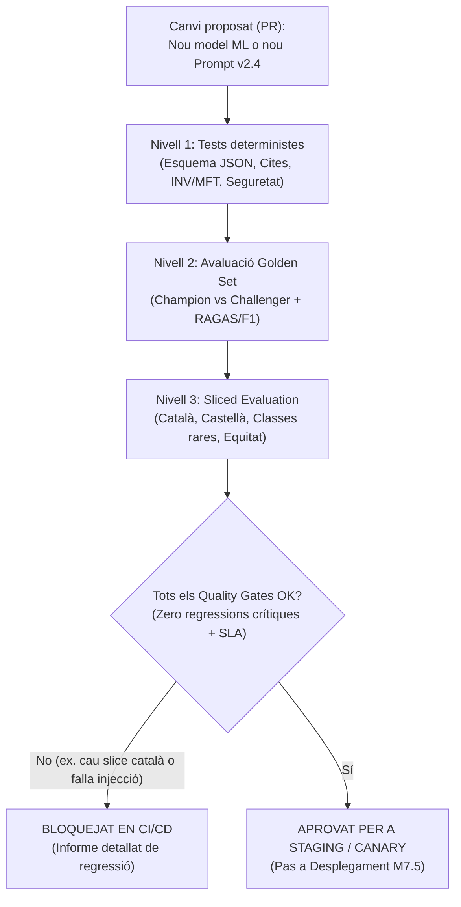

## A. Objectius d'aprenentatge

En completar aquesta lliçó, l'estudiant ha de ser capaç de:

1. **Dissenyar** **portes de qualitat (*Quality Gates*)** automatitzades pre-desplegament que bloquegen automàticament qualsevol candidat (model ML o nou prompt LLM) que pateixi regressions respecte del **model campió (*Champion vs. Challenger*)**!
2. **Aplicar** l'**avaluació segmentada (*Sliced Evaluation*)**: comprovar mètriques no només globals, sinó per **subgrups crítics** (classe minoritària, idioma català vs. castellà, municipis petits vs. grans, documents escanejats vs. digitals, i col·lectius protegits) per detectar degradacions ocultes rere una mitjana global bona!
3. **Executar** **avaluació rigorosa de prompts (*Prompt Evaluation / PromptOps*)** (estil *Promptfoo* / *DeepEval* / *RAGAS*): tractar els prompts com a **codi versionat amb tests automàtics de regressió**, combinant assercions deterministes (format JSON vàlid, cites existents, zero paraules prohibides, latència) amb avaluació semàntica (*LLM-as-a-Judge* calibrat)!
4. **Avaluar** proves **comportamentals i de robustesa** (*Invariance Tests*, *Directional Tests*, *Minimum Functionality Tests* — metodologia *CheckList* — i proves adversarials de *prompt injection* i abstenció fora de domini).
5. **Implementar** en Python pur un **motor de *Quality Gates* de validació (Champion vs. Challenger + *Sliced Evaluation* + *Prompt Regression Suite*)** que decideix automàticament `APROVAT` o `BLOQUEJAT_REGRESSIO`!

---

## B. Explicació introductòria

En el desenvolupament d'assistents LLM existeix un vici molt estès anomenat ***«Vibe Checking»***: un desenvolupador modifica dues frases del *system prompt*, prova manualment 3 preguntes al xat, li sembla que «ara sona millor» i ho puja directament a producció... i l'endemà descobreix que ha trencat el format JSON, que el bot ja no cita ordenances en català o que torna a caure en *prompt injection*!

La **validació formal de models i l'avaluació sistemàtica de prompts** substitueixen les impressions subjectives per **portes de qualitat (*Quality Gates*) reproduïbles i automatitzades**: cap model ni cap canvi de prompt entra a producció si no supera el *Champion* actual sobre el ***Golden Set***, manté el rendiment en tots els **subgrups (*Sliced Evaluation*)**, supera les proves de seguretat/abstenció i respecta l'SLA de latència!

---

## C. Explicació tècnica avançada

### 1. Les 4 dimensions d'un *Quality Gate* pre-desplegament

1. **Mètriques globals vs. *Champion***: el nou model (*Challenger*) ha de millorar o igualar el model en producció (*Champion*) en les mètriques primàries (`Macro-F1`, `PR-AUC`, `ECE`, `Faithfulness`, `Refusal Accuracy`) sobre un *Golden Test Set* congelat.
2. **Avaluació segmentada (*Sliced Evaluation*)**: una mitjana global del `91%` pot amagar que en **català col·loquial** o en **municipis petits (<5.000 hab.)** o en la classe **`SERVEIS_SOCIALS`** el rendiment ha caigut del `88%` al `64%`! Cada *slice* crític té el seu propi llindar mínim infranquejable.
3. **Proves comportamentals (metodologia *CheckList*) i seguretat**:
   - **MFT (*Minimum Functionality Test*)**: casos bàsics essencials que el model NO pot fallar mai (ex. saber l'horari de l'OAC o que `NIF invàlid` → error).
   - **INV (*Invariance Test*)**: petits canvis irrellevants (majúscules, accents, canviar el nom del ciutadà «Joan» per «Fàtima» o «Montserrat»!) **NO han d'alterar la predicció** (prova directa contra biaixos!).
   - **DIR (*Directional Expectation Test*)**: canviar una variable en una direcció coneguda ha de moure la predicció en la direcció esperada.
   - **Bateria adversarial (*Red Teaming* automàtic)**: 20–50 intents de *prompt injection*, exfiltració i preguntes fora de base (`Refusal Accuracy >= 95%`).
4. **Restriccions no funcionals (SLA)**: latència P95, memòria, cost mitjà per consulta i **100% de validesa d'esquema JSON** en sortides estructurades.

### 2. Piràmide d'avaluació de prompts (*PromptOps*)

| Nivell | Tipus d'avaluació | Cost / Velocitat | Què valida |
|---|---|---|---|
| **Nivell 1 (Base)** | **Assercions deterministes** (`json.loads`, esquema Pydantic, regex de cites `[doc#c]`, longitud, paraules prohibides) | Mil·lisegons, 0 € | **100% obligatori en cada Pull Request** (CI) |
| **Nivell 2 (Mig)** | **Mètriques semàntiques i RAG** (`Context Recall`, similitud amb referència, ***LLM-as-a-Judge* calibrat** en fidelitat/to) | Segons/minuts, cost baix | Executat sobre el *Golden Set* abans de cada *release* |
| **Nivell 3 (Cim)** | **Revisió experta humana** (mostreig cegament comparat *Champion vs. Challenger* — *Side-by-Side*) | Hores de tècnics | Obligatori abans de canvis majors de model base o arquitectura! |

---

## D. Diagrames i recursos visuals

### Porta de qualitat (*Quality Gate*) automatitzada: *Champion vs. Challenger* + *Sliced Evaluation*



---

## E. Aplicació a l'Administració pública

1. **Canvi de model base o actualització de prompt sense ensurts**: quan un proveïdor o equip proposa passar de `Llama-3.1-8B` a `Qwen2.5-14B` o modificar el prompt de l'assistent tributari, el *Quality Gate* executa automàticament les 200 preguntes del *Golden Set* (català/castellà, cites, abstenció, injecció) i mostra en una taula exacta quins casos milloren i quins empitjoren abans de tocar producció!
2. **Proves d'invariància (*INV*) contra biaixos lingüístics o de nom**: provar sistemàticament que substituir un nom propi català per un nom d'origen àrab o llatinoamericà, o formular la consulta en català vs. castellà, produeix exactament el mateix resultat de triatge/classificació (`diferència = 0,00`)!
3. **Contractació pública amb acceptació objectiva**: el *Quality Gate* sobre un *Golden Set* custodiat per la Diputació (no vist pel proveïdor!) constitueix la prova objectiva d'acceptació d'un contracte d'IA!

---

## F. Exemple pràctic guiat

Implementem en **Python pur** un **avaluador de *Quality Gates* (*Champion vs. Challenger* + *Sliced Evaluation* + assercions deterministes de prompt)** que bloqueja automàticament un candidat que millora la mitjana global (`0,90 → 0,92`) però amaga una **regressió greu en el *slice* de català normatiu (`0,88 → 0,74`)**!

```python
"""Exemple 7.4: Quality Gate (Champion vs Challenger + Sliced Evaluation + Prompt Assertions)."""
import json


def avaluar_quality_gate(
    champion: dict[str, float],
    challenger: dict[str, float],
    slices_challenger: dict[str, float],
    llindar_minim_slice: float = 0.85,
    respostes_json_prompt: list[str] | None = None,
) -> tuple[bool, list[str]]:
    errors: list[str] = []

    # 1. Comparativa global Champion vs Challenger (no regressió)
    if challenger["f1_global"] < champion["f1_global"]:
        errors.append(f"Regressió global F1: {challenger['f1_global']:.3f} < {champion['f1_global']:.3f}")
    if challenger["refusal_acc"] < 0.95:
        errors.append(f"Abstenció fora de domini insuficient: {challenger['refusal_acc']:.2%} (<95%)")
    if challenger["p95_ms"] > 1500.0:
        errors.append(f"Latència P95 supera SLA: {challenger['p95_ms']:.0f} ms (>1500 ms)")

    # 2. Sliced Evaluation (cap subgrup crític per sota del llindar!)
    for nom_slice, valor in slices_challenger.items():
        if valor < llindar_minim_slice:
            errors.append(f"Regressió en slice '{nom_slice}': {valor:.3f} < {llindar_minim_slice:.3f}")

    # 3. Assercions deterministes de PromptOps (esquema JSON + cita obligatòria)
    for i, raw in enumerate(respostes_json_prompt or []):
        try:
            obj = json.loads(raw)
            if not obj.get("resposta") or not obj.get("cites"):
                errors.append(f"Prompt test #{i}: falten camps obligatoris 'resposta' o 'cites'.")
        except json.JSONDecodeError:
            errors.append(f"Prompt test #{i}: sortida NO és JSON vàlid!")

    return len(errors) == 0, errors


if __name__ == "__main__":
    champion = {"f1_global": 0.90, "refusal_acc": 0.96, "p95_ms": 920.0}
    challenger = {"f1_global": 0.92, "refusal_acc": 0.97, "p95_ms": 980.0}  # Sembla millor globalment!
    slices_chal = {"castella": 0.95, "catala_normatiu": 0.74, "serveis_socials": 0.89}
    sortides_prompt = [
        '{"resposta": "Bonificació del 50%.", "cites": ["OF01-2026#c1"]}',
        '{"resposta": "Bonificació del 50%.", "cites": []}',  # Sense cita!
    ]
    ok, errs = avaluar_quality_gate(champion, challenger, slices_chal, 0.85, sortides_prompt)
    print("Quality Gate APROVAT?:", ok)
    for e in errs:
        print("  [BLOQUEIG]", e)
```

### Interpretació dels resultats (execució verificada)

- Malgrat que el *Challenger* **millora la mitjana global (`0,90 → 0,92`)**, la porta de qualitat el **BLOQUEJA automàticament (`APROVAT?: False`)** per dos errors crítics invisibles a la mitjana:
  1. Caiguda greu al *slice* **`catala_normatiu` (`0,74 < 0,85`)**,
  2. Sortida de prompt `#1` amb **`cites: []`** buit!

---

## G. Exercici pràctic per resoldre

### Enunciat
L'equip d'un assistent virtual municipal fa un ajust «petit» al *system prompt* (afegeix *«Respon sempre de forma molt amable i completa»*), ho prova amb 3 preguntes de tràmits habituals (*«Vibe Checking»*) i ho puja a producció un divendres al matí. A la tarda arriben 3 incidències:
1. L'aplicació web falla perquè l'assistent ha començat a afegir text fora del bloc JSON esperat (*«Aquí tens el JSON: ...»*).
2. Quan li pregunten sobre tràmits de la DGT (fora de competència municipal), en lloc d'abstenir-se, intenta «ser amable i complet» i inventa requisits!
3. En consultes en català de municipis petits, ha deixat de citar els articles de l'ordenança.

Dissenya una **suite automatitzada de validació de prompts (*PromptOps Quality Gate*) en CI/CD** que hauria bloquejat aquest canvi abans d'arribar a producció!

### Objectius i restriccions
- Eliminar *Vibe Checking*, versionar prompts a Git, aplicar la piràmide de 3 nivells (assercions deterministes JSON/cites + *Golden Set* amb casos d'abstenció i *Sliced Evaluation* català/castellà + bateria *CheckList*/adversarial) com a *gate* bloquejant en Pull Request.

:::hint Pista 1 — Capturar les 3 regressions en CI/CD
(1) **Asserció determinista de Nivell 1**: `json.loads()` + validació estricta Pydantic (`Strict JSON / Structured Outputs`) sobre el 100% dels casos (0% tolerància!);
(2) **Subconjunt d'abstenció obligatòria** (`Refusal Accuracy >= 95%`, incloent consultes DGT/Agència Tributària);
(3) ***Sliced Evaluation* per idioma i municipi** + comprovació determinista que cada resposta vigent inclou `cites` no buides i existents!
:::

:::hint Pista 2 — Governança de prompts (*PromptOps*)
Tractar cada prompt com a codi en **Git** (Pull Request obligatori, revisió per parells, prohibir editar prompts «en calent» directament a la base de dades de producció sense passar el *Quality Gate*!) + executar proves ***INV* (Invariància)** i *prompt injection* abans de promocionar a *Staging/Canary*!
:::

### Criteris d'avaluació
- **40%**: Cobertura exacta de les 3 regressions mitjançant tests automàtics concrets (esquema JSON estricte, *Refusal Accuracy* >= 95%, *Sliced Evaluation* català + validador de cites).
- **35%**: Estructuració de la piràmide d'avaluació (Nivell 1 determinista en PR, Nivell 2 semàntic/RAGAS sobre *Golden Set*, Nivell 3 revisió humana *Side-by-Side* en canvis majors).
- **25%**: Governança *PromptOps* (prompts versionats en Git, prohibició de canvis directes a producció i *Champion vs. Challenger* bloquejant en CI/CD).

### Errors habituals
- Confiar únicament en un *LLM-as-a-Judge* per detectar si el JSON és vàlid o si les cites existeixen (aquestes comprovacions són **100% deterministes**, instantànies i gratuïtes en Nivell 1!).

:::solution Solució completa comentada i alternatives
### Suite automatitzada *PromptOps Quality Gate* (CI/CD)
1. **Prompts com a codi (*Prompt-as-Code*)**: cada versió del *system prompt* viu en un fitxer versionat a Git (`prompts/assistent_v2.4.yaml`). Qualsevol modificació requereix Pull Request i passa automàticament la suite de validació (prohibit editar prompts en calent a producció!).
2. **Nivell 1 — Assercions deterministes bloquejants (execució en cada PR)**:
   - Validació estricta d'esquema JSON/Pydantic (**100% pass rate**; bloqueja immediatament qualsevol text previ tipus *«Aquí tens el JSON»*!).
   - Verificació determinista que tota resposta informativa conté cites `[doc_id#c]` existents al context recuperat.
   - Bateria de *prompt injection* i paraules prohibides (promeses vinculants).
3. **Nivell 2 — *Golden Set* + *Sliced Evaluation* (*Champion vs. Challenger*)**:
   - Subconjunt **fora de competència** (DGT, passaport, hisenda estatal): exigeix **`Refusal Accuracy >= 95%`** (bloquejaria el «ser amable i inventar requisits»!).
   - **Avaluació per *slices***: `catala`, `castella`, `municipis_petits`, `tributs`, `socials` (cap *slice* pot caure per sota del llindar ni baixar més de `1%` respecte del *Champion*!).
   - Mètriques RAGAS (`Faithfulness`, `Answer Relevance`) amb *LLM-as-a-Judge* calibrat + proves ***INV*** (canvi de nom propi/idioma).
4. **Nivell 3 — Validació humana *Side-by-Side***: per a canvis estructurals de prompt o de model base, revisió cega de 30–50 respostes per tècnics OAC abans d'aprovar el desplegament *Canary*.
:::

---

## H. Test individual

Resol les 10 preguntes sobre *Quality Gates*, *Champion vs. Challenger*, *Sliced Evaluation*, metodologia *CheckList* (MFT, INV, DIR), piràmide *PromptOps*, prevenció del *Vibe Checking*, *Refusal Accuracy* i validació pre-desplegament.

---

## I. Preguntes de desenvolupament

### Pregunta 1
Explica què és l'**avaluació segmentada (*Sliced Evaluation*)** i per què una millora de la **mètrica global** (ex. `F1: 0,90 → 0,92`) pot amagar regressions greus inacceptables en una administració pública.

:::model-answer Resposta model i criteris de correcció (Pregunta 1)
**Resposta model**:
- La ***Sliced Evaluation*** consisteix a desglossar les mètriques de validació per **subgrups significatius** (idioma català vs. castellà, classes minoritàries crítiques com Serveis Socials, municipis petits vs. grans, documents escanejats de baixa qualitat, grups demogràfics protegits).
- **Per què la mitjana global enganya**: si un subgrup majoritari (ex. consultes simples o castellà, 75% del trànsit) millora del 90% al 96%, la mitjana global puja a 0,92 **encara que un subgrup minoritari crític (ex. català normatiu o Serveis Socials) s'enfonsi del 88% al 72%**! En el sector públic, això genera discriminació lingüística/territorial o fallades greus en col·lectius vulnerables; per això cada *slice* crític ha de tenir un llindar bloquejant propi al *Quality Gate*.

**Criteris de correcció (10 punts)**:
- Definició clara i exemples de *slices* públics rellevants: 5 punts.
- Demostració de com la mitjana global oculta regressions en subgrups i solució via llindars per *slice*: 5 punts.
:::

### Pregunta 2
Descriu la **piràmide de 3 nivells d'avaluació de prompts (*PromptOps*)** per eliminar el *Vibe Checking*, detallant què s'executa a cada nivell i amb quina freqüència.

:::model-answer Resposta model i criteris de correcció (Pregunta 2)
**Resposta model**:
1. **Nivell 1 — Assercions deterministes (cada Pull Request, mil·lisegons, 0 €)**: validació estricta d'esquema JSON/Pydantic (100% obligatori), verificació que les cites `[doc#c]` existeixen als chunks recuperats, absència de promeses vinculants, bateria de *prompt injection* i latència P95.
2. **Nivell 2 — Avaluació semàntica i RAG sobre *Golden Set* (abans de cada *release* / canvi de prompt)**: *Champion vs. Challenger* mesurant `Faithfulness`, `Context Recall`, `Refusal Accuracy` (>=95% en preguntes fora de domini) i *Sliced Evaluation* (català/castellà/temàtiques), usant *LLM-as-a-Judge* calibrat amb Kappa.
3. **Nivell 3 — Revisió humana *Side-by-Side* (canvis majors de model base o arquitectura)**: tècnics del domini comparen cegament respostes del *Champion* vs. *Challenger* sobre 30–50 casos complexos per detectar matisos jurídics i de to institucional que les mètriques automàtiques no capturen.

**Criteris de correcció (10 punts)**:
- Detall rigorós dels 3 nivells, exemples concrets i cadència d'execució (~3,3 punts per nivell).
:::

### Pregunta 3
Explica les **3 categories de proves comportamentals de la metodologia *CheckList* (`MFT`, `INV`, `DIR`)** aplicades a la validació d'un model d'IA administratiu.

:::model-answer Resposta model i criteris de correcció (Pregunta 3)
**Resposta model**:
1. **`MFT` (*Minimum Functionality Test*)**: proves unitàries senzilles que verifiquen capacitats bàsiques imprescindibles que el sistema mai no pot fallar (ex. classificar «Fanal fos al carrer Major» com a `VIA_PUBLICA`, o abstenir-se davant «Com renovo el passaport?»).
2. **`INV` (*Invariance Test*)**: introdueix perturbacions irrellevants que **no han de canviar la sortida del model** — fonamental per auditar **equitat i robustesa** (ex. canviar el nom del sol·licitant de «Jordi» a «Youssef» o «Maria», afegir un error tipogràfic menor o canviar majúscules ha de mantenir idèntica predicció!).
3. **`DIR` (*Directional Expectation Test*)**: modifica una dada d'entrada en una direcció coneguda i comprova que la sortida es mou en el sentit esperat (ex. afegir «emergència» o «cable elèctric pelat» a una incidència ha d'augmentar o mantenir la prioritat, mai baixar-la!).

**Criteris de correcció (10 punts)**:
- Definició precisa i exemple administratiu encertat per a cada categoria (~3,3 punts cadascuna).
:::

---

## J. Resum per memoritzar

### Conceptes clau
- **Fi del *Vibe Checking***: els prompts es gestionen com a **codi versionat en Git (*PromptOps*)** amb ***Quality Gates* bloquejants** en CI/CD!
- ***Champion vs. Challenger***: cap candidat passa a producció si retrocedeix respecte del *Champion* actual en qualitat, abstenció (`Refusal Acc >= 95%`), seguretat o SLA!
- ***Sliced Evaluation***: avaluar per **subgrups crítics** (català/castellà, classes rares, municipis petits, col·lectius protegits) — la mitjana global pot pujar mentre un *slice* crític s'enfonsa!
- **Piràmide *PromptOps***: (1) **Assercions deterministes** (JSON, cites, injecció — cada PR); (2) ***Golden Set* + RAGAS / *LLM-as-a-Judge* calibrat** (cada *release*); (3) **Revisió humana *Side-by-Side*** (canvis majors).
- **Proves *CheckList***: **`MFT`** (funcionalitat mínima), **`INV`** (invariància — clau contra biaixos de nom/gènere!), **`DIR`** (expectativa direccional).

### Definicions essencials
- ***Quality Gate***: conjunt de llindars i proves automàtiques en CI/CD que tot model o prompt ha de superar obligatòriament abans de poder promocionar-se a *Staging* o producció.
- ***Sliced Evaluation***: desglossament de les mètriques de validació per subpoblacions o segments crítics per detectar degradacions o discriminacions ocultes rere la mitjana global.

### Errors conceptuals freqüents
1. Modificar un *system prompt* en calent a producció després de provar-lo manualment amb 3 preguntes (*Vibe Checking*).
2. Aprovar un model només perquè puja el `F1 global` sense revisar els *slices* de català, classes minoritàries o *Refusal Accuracy*.
3. Fer servir un LLM jutge per comprovar sintaxi JSON o existència de cites quan són assercions 100% deterministes.

### Possibles preguntes d'examen
- Per què una pujada del F1 global (`0,90 → 0,92`) pot bloquejar-se igualment en un *Quality Gate* ben dissenyat?
- Dissenya la piràmide *PromptOps* (3 nivells) per evitar que un canvi de prompt trenqui el JSON, l'abstenció i les cites en català.
- Posa un exemple administratiu de cada prova *CheckList* (`MFT`, `INV`, `DIR`).
