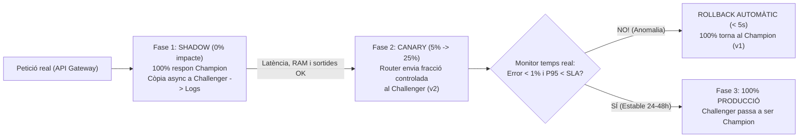

## A. Objectius d'aprenentatge

En completar aquesta lliçó, l'estudiant ha de ser capaç de:

1. **Seleccionar** el **patró d'inferència adequat** segons l'SLA i el cas d'ús: **inferència *Batch* (per lots)** (ex. liquidacions nocturnes, revisió massiva de 5.000 expedients — cost mínim!), **inferència *Online* (API REST síncrona, ex. FastAPI + Uvicorn/ONNX/vLLM)** (ex. chatbot, validació en temps real a la Seu) o **inferència *Streaming* / asíncrona per cues** (ex. processament OCR/IDP pesat via *RabbitMQ/Kafka/Celery* retornant `202 Accepted`!).
2. **Comparar** les **4 estratègies de desplegament progressiu (*Progressive Delivery*)**: ***Shadow Deployment*** (execució en paral·lel sense impactar l'usuari!), ***Canary Release*** (5% → 25% → 100% amb rollback automàtic!), ***Blue-Green Deployment*** (canvi instantani i retorn en segons) i ***A/B Testing*** (avaluació estadística d'impacte en negoci/CSAT).
3. **Dissenyar** una **API d'inferència robusta per a producció** (FastAPI + Docker immutable): contracte estricte Pydantic, endpoints de salut **`/health/live` i `/health/ready`** (carregant el model *una sola vegada* a l'arrencada, mai a cada petició!), *timeouts*, *rate limiting*, *circuit breaker*, autenticació i **traça `model_version`** a cada resposta!
4. **Aplicar** les especificitats del **desplegament d'LLMs (*LLM Serving*)**: motors optimitzats amb ***Continuous Batching* i *PagedAttention*** (ex. **vLLM**, **TGI**, **Ollama** per a prototips locals), **quantització segura (`INT8/AWQ/FP8`)**, *streaming* de tokens (**SSE**) per minimitzar el ***TTFT* (*Time To First Token*)** i aïllament *on-premise* (ENS).
5. **Implementar** en Python pur un **enrutador de desplegament *Shadow + Canary* amb *rollback* automàtic** que monitora la taxa d'error i la latència del *Challenger* i torna instantàniament al 100% *Champion* si se supera l'SLA!

---

## B. Explicació introductòria

Un model amb `F1 = 0,94` guardat dins d'un ordinador portàtil genera exactament **zero valor públic**. El salt a producció (**Desplegament / *Model Serving***) és el moment de màxim risc: un desplegament «de cop al 100%» (*Big Bang*) d'un model o LLM nou pot tombar la Seu Electrònica per falta de memòria VRAM, multiplicar la latència per 5 o introduir un error massiu abans que ningú s'adoni!

Les bones pràctiques MLOps/LLMOps eliminen el drama dels desplegaments mitjançant **contenidors immutables (Docker)**, **APIs resilients amb contractes estrictes**, **estratègies segures (*Shadow → Canary → Blue-Green*)** i **motors de servei optimitzats (ONNX Runtime / vLLM)** amb *rollback* en segons!

---

## C. Explicació tècnica avançada

### 1. Patrons d'arquitectura d'inferència: *Batch* vs. *Online* vs. *Async Queue*

| Patró | Latència típica | Quan escollir-lo en l'Administració pública | Avantatges / Clau |
|---|---|---|---|
| ***Batch* (Per lots)** | Minuts / hores (programat nocturn) | Predicció mensual de risc d'impagament, classificació massiva d'arxiu històric, re-indexació nocturna | **Cost mínim**, màxima simplicitat, sense requerir alta disponibilitat 24/7 en temps real |
| ***Online* Síncron (API REST / gRPC)** | `< 50–200 ms` (ML) / `< 1–3 s` (LLM amb SSE) | Chatbot ciutadà, validació *Shift-Left* al formulari, enrutament instantani al registre | Resposta immediata; exigeix **model precarregat a l'arrencada**, `/health/ready`, *timeouts* i *autoscaling* |
| **Asíncron per cua (*Message Queue*)** | Segons / minuts (`202 Accepted` + *webhook/polling*) | **IDP/OCR de PDFs de 60 pàgines**, anonimització de decrets pesats, resums d'expedients extensos | **No bloqueja mai l'API web** ni provoca *HTTP 504 Timeout*; absorbeix pics estacionals (beques!) amb cua resilient |

### 2. Estratègies de desplegament segur (*Progressive Delivery*)

| Estratègia | Com funciona | Risc per al ciutadà | Quan usar-la |
|---|---|---|---|
| ***Shadow Deployment* (Ombra)** | El trànsit real s'envia al *Champion* (que respon al ciutadà) i **una còpia asíncrona** s'envia al *Challenger* (que només es registra per comparar latència, errors i sortides!) | **ZERO risc!** (el ciutadà mai no veu la resposta del *Challenger*) | **Primer pas obligatori** abans de posar un model nou o *fine-tuned* davant ciutadans reals! |
| ***Canary Release*** | S'envia progressivament un **5% → 25% → 50% → 100%** del trànsit real al *Challenger* vigilant mètriques en temps real; si pugen errors o latència → ***rollback* automàtic a 0%**! | Molt acotat (màx. 5% inicial) | Desplegament estàndard de noves versions d'APIs ML/LLM i prompts |
| ***Blue-Green Deployment*** | Dos entorns idèntics (*Blue* = producció actual, *Green* = nova versió verificada); el *Load Balancer* commuta el 100% del trànsit en 1 segon (i torna a *Blue* en 1 segon si falla!) | Baix, amb **retorn instantani** | Quan no es poden barrejar versions en paral·lel (canvis d'esquema o dependències) |
| ***A/B Testing*** | Divisió aleatòria controlada (ex. 50/50) per mesurar amb significació estadística quina versió millora una **mètrica de negoci** (CSAT, taxa de resolució, rebots) | Controlat (ambdós models ja validats) | Comparar impacte real en valor públic (NO per provar si un model «petarà»!) |

### 3. Enginyeria d'inferència en producció (ML i **LLM Serving**)

- **Regla bàsica de FastAPI + Docker**: carregar els pesos del model al *lifespan* d'arrencada (**mai dins de l'endpoint `/predict`!**); exposar **`/health/live`** (el procés és viu) i **`/health/ready`** (el model ja està carregat a RAM/VRAM i llest per rebre trànsit del *Load Balancer*!).
- **LLM Serving a escala (*vLLM* / *TGI*)**: un servidor naïf (com `transformers` cru o bucle seqüencial) col·lapsa amb 10 usuaris concurrents; motors de producció com **vLLM** implementen ***PagedAttention*** (gestiona la *KV-Cache* sense fragmentació de VRAM, multiplicant per 3–10× el *throughput*!) i ***Continuous Batching*** (agrupa tokens de peticions concurrents dinàmicament) + **SSE *Streaming*** per reduir la latència percebuda (***TTFT*** < 500 ms)!

---

## D. Diagrames i recursos visuals

### Desplegament progressiu segur: *Shadow* → *Canary* (5%→25%→100%) amb *Rollback* automàtic



---

## E. Aplicació a l'Administració pública

1. **IDP de PDFs pesats en campanya de subvencions (Arquitectura Asíncrona)**: quan 800 entitats pugen memòries de 50 pàgines el darrer dia de termini, una API síncrona causaria milers de *504 Gateway Timeout*; l'API retorna immediatament **`202 Accepted + job_id`**, encola el PDF a *RabbitMQ/Redis* i els *workers* GPU/OCR processen el lot de forma estable i escalable!
2. **Pas d'un nou classificador del Registre amb *Shadow → Canary***: durant 7 dies s'executa en ***Shadow*** comparant les seves prediccions contra el classificador antic i els rebots reals (risc zero!), i només quan confirma menor taxa de rebot i latència `< 40 ms`, puja per ***Canary* (`10% → 50% → 100%`)**!
3. **LLM Serving *on-premise* sobirà (ENS)**: desplegar models *open-weights* quantitzats (`FP8/AWQ`) darrere de **vLLM** en contenidors Docker interns amb autenticació mTLS/API Key interna, *rate limiting* per servei i **streaming SSE** perquè el ciutadà vegi aparèixer la resposta en `< 0,5 s`!

---

## F. Exemple pràctic guiat

Implementem en **Python pur** un **enrutador de desplegament *Canary* amb vigilància d'SLA i *rollback* automàtic**:
1. Distribueix trànsit segons `percentatge_canary` (ex. `20%` al *Challenger* v2, `80%` al *Champion* v1).
2. Registra en temps real els errors i latències del *Challenger*.
3. Si la taxa d'error del *Challenger* supera el llindar (ex. `> 10%` o latència `> 500 ms`), executa **immediatament el *rollback* automàtic (`percentatge_canary = 0%`)** tornant el 100% del trànsit al *Champion*!

```python
"""Exemple 7.5: Enrutador Canary amb monitoratge d'SLA i rollback automàtic instantani."""


class CanaryRouter:
    def __init__(self, percentatge_canary: int = 20, max_taxa_error: float = 0.10, max_lat_ms: float = 500.0) -> None:
        self.percentatge_canary = percentatge_canary
        self.max_taxa_error = max_taxa_error
        self.max_lat_ms = max_lat_ms
        self.peticions_canary = 0
        self.errors_canary = 0
        self.rollback_activat = False

    def triar_versio(self, request_idx: int) -> str:
        if self.rollback_activat or self.percentatge_canary == 0:
            return "v1_champion"
        # Assignació determinista per franja (ex. 20% = 1 de cada 5)
        return "v2_challenger" if (request_idx % 100) < self.percentatge_canary else "v1_champion"

    def registrar_resultat(self, versio: str, error: bool, latencia_ms: float) -> str:
        if versio != "v2_challenger":
            return "OK_CHAMPION"
        self.peticions_canary += 1
        if error or latencia_ms > self.max_lat_ms:
            self.errors_canary += 1
        # Avalua circuit breaker de rollback després d'un mínim de 4 peticions canary
        if self.peticions_canary >= 4 and (self.errors_canary / self.peticions_canary) > self.max_taxa_error:
            self.rollback_activat = True
            self.percentatge_canary = 0
            return "ROLLBACK_AUTOMATIC_A_V1!"
        return "OK_CANARY"


if __name__ == "__main__":
    router = CanaryRouter(percentatge_canary=20, max_taxa_error=0.10, max_lat_ms=500.0)
    # Simulem 25 peticions on v2_challenger comença a patir timeouts/errors!
    for idx in range(25):
        v = router.triar_versio(idx)
        # Simulem error de latència en 2 de les 4 primeres crides a v2_challenger
        es_error = (v == "v2_challenger") and (idx in (1, 3))
        lat = 780.0 if es_error else 45.0
        estat = router.registrar_resultat(v, error=False, latencia_ms=lat)
        if v == "v2_challenger" or idx in (0, 20):
            print(f"Req #{idx:02d} -> {v:13s} | lat={lat:5.1f} ms | {estat} | canary%={router.percentatge_canary}%")
```

### Interpretació dels resultats (execució verificada)

- Les peticions `#00, #01, #02, #03` van a `v2_challenger` (dins la franja `< 20%`); dues d'elles superen l'SLA (`780 ms > 500 ms` → `50% > 10%` d'errors!).
- A la 4a petició *Canary* (`Req #03`), el router dispara **`ROLLBACK_AUTOMATIC_A_V1!`** i fixa **`canary% = 0%`**; a partir d'aquell instant (`Req #04..#24`, inclosa `#20`), el **100% del trànsit queda protegit servint `v1_champion`** sense intervenció manual!

---

## G. Exercici pràctic per resoldre

### Enunciat
Un equip municipal vol posar en producció dos nous serveis d'IA el mes vinent:
- **Servei A**: Un sistema **IDP (OCR + extracció multimodal)** que processa expedients adjunts de subvencions en PDF d'entre 10 i 80 pàgines (triga entre 15 i 90 segons per PDF!), amb pics de 600 sol·licituds l'últim dia de termini.
- **Servei B**: Una nova versió (`v2`) del **xatbot normatiu LLM** desplegat *on-premise* (que serveix 40 consultes concurrents en hora punta), substituint la `v1` actual sense arriscar-se a caigudes ni regressions!

Dissenya l'**arquitectura de desplegament adequada per a cada servei** (patró d'inferència, motor de servei, gestió de salut `/health`, i estratègia de pas a producció pas a pas)!

### Objectius i restriccions
- Triar inferència asíncrona per cua (`202 Accepted` + *workers*) per al Servei A, i *Online* amb **vLLM (*Continuous Batching* + *PagedAttention*) + SSE *streaming*** i pas progressiu ***Shadow → Canary → 100%*** amb *rollback* automàtic per al Servei B.

:::hint Pista 1 — Servei A (PDFs de 15–90 segons amb pics de 600!)
**MAI síncron HTTP** (provocaria *504 Gateway Timeout* i col·lapse de *threads*!). Usar **arquitectura asíncrona per cua** (API FastAPI retorna **`202 Accepted + job_id`** → cua *RabbitMQ/Redis* → pool de *workers* escalables que desa el resultat + notifica via *webhook* o *polling*, amb idempotència i *dead-letter queue*!).
:::

:::hint Pista 2 — Servei B (Chatbot LLM `v2` amb 40 concurrents!)
Usar **vLLM *on-premise*** (*PagedAttention* + *Continuous Batching* + **SSE streaming** per *TTFT* baix), contenidor Docker immutable amb `/health/live` i `/health/ready` (model precarregat a l'arrencada!), i desplegament progressiu: **7 dies en *Shadow*** (0% risc) → ***Canary* (`5% → 25% → 100%`)** amb *rollback* automàtic si pugen errors, latència P95 o fallades de cites!
:::

### Criteris d'avaluació
- **40%**: Servei A: descart argumentat d'HTTP síncron + disseny complet **asíncron per cua** (`202 Accepted`, *workers*, control de pics, *Dead-Letter Queue*).
- **40%**: Servei B: **vLLM** (*PagedAttention*, *Continuous Batching*, quantització, **SSE streaming**), contenidors immutables i endpoints **`/health/live` i `/health/ready`**.
- **20%**: Estratègia segura ***Shadow → Canary → 100%*** amb mètriques de *rollback* automàtic i traça `model_version` a cada resposta.

### Errors habituals
- Posar l'OCR de 90 segons darrere d'un endpoint HTTP síncron, o carregar el model pesat dins la funció de cada petició en lloc del *lifespan* d'arrencada!

:::solution Solució completa comentada i alternatives
### 1. Servei A — IDP de PDFs pesats (Arquitectura Asíncrona per Cua)
- **Per què NO HTTP síncron**: 15–90 s per PDF + pics de 600 peticions saturarien els *workers* HTTP i causarien errors `504 Gateway Timeout`.
- **Disseny**:
  1. L'API FastAPI valida el PDF, el desa a emmagatzematge segur (S3/MinIO), posa un missatge a la cua (*RabbitMQ / Redis Streams*) i retorna en `< 100 ms` **`HTTP 202 Accepted` + `job_id`**.
  2. Un pool de *workers* IDP consumeix la cua a ritme sostenible (autoescalat per profunditat de cua), guarda el JSON extret, i notifica el gestor d'expedients via *webhook* (o consulta de `GET /jobs/{job_id}`).
  3. Els PDFs corruptes que fallen després de 3 reintents passen a una ***Dead-Letter Queue* (DLQ)** per a revisió humana!

### 2. Servei B — Chatbot LLM `v2` *on-premise* (Online Streaming + *Shadow → Canary*)
- **Motor de servei**: **vLLM** (o TGI) sobre GPUs internes amb ***PagedAttention*** i ***Continuous Batching*** per suportar 40 peticions concurrents eficientment + **SSE *Streaming*** per oferir *TTFT* `< 500 ms`.
- **Resiliència API**: model precarregat a l'arrencada, sondes Kubernetes/Docker **`/health/live`** i **`/health/ready`** (el balancejador no envia trànsit fins que la GPU té els pesos carregats!), *timeouts*, *rate limiting* i camp `model_version` en cada resposta.
- **Pas a producció sense risc**:
  1. ***Shadow* (5–7 dies)**: `v2` rep còpia asíncrona del trànsit real sense respondre al ciutadà; es comparen latència, VRAM, errors i qualitat de cites contra `v1`.
  2. ***Canary* (`5% → 25% → 50% → 100%`)**: amb ***rollback* automàtic** a `v1` si la taxa d'error supera `1%`, el *TTFT* supera l'SLA o es disparen fallades de *guardrails*!
:::

---

## H. Test individual

Resol les 10 preguntes sobre *Batch* vs. *Online* vs. *Async Queue*, *Shadow*, *Canary*, *Blue-Green*, *A/B Testing*, `/health/live` vs. `/health/ready`, *vLLM* (*PagedAttention* / *Continuous Batching*), SSE *streaming* i *rollback* automàtic.

---

## I. Preguntes de desenvolupament

### Pregunta 1
Compara les **4 estratègies de desplegament progressiu** (***Shadow***, ***Canary***, ***Blue-Green*** i ***A/B Testing***), indicant per a cadascuna el risc per al ciutadà i el moment exacte en què convé aplicar-la.

:::model-answer Resposta model i criteris de correcció (Pregunta 1)
**Resposta model**:
1. ***Shadow Deployment***: el *Challenger* rep una còpia asíncrona del trànsit real però només respon el *Champion*. **Risc zero** per al ciutadà; ideal com a primera prova real de latència, memòria, errors i discrepàncies de predicció abans d'exposar-lo.
2. ***Canary Release***: deriva progressivament `5% → 25% → 100%` del trànsit real al *Challenger* amb *rollback* automàtic davant qualsevol anomalia. **Risc molt acotat**; estàndard per promocionar noves versions de models/prompts.
3. ***Blue-Green Deployment***: manté dos entorns complets (*Blue* actual i *Green* nou) i commuta el 100% al *Load Balancer* instantàniament (amb retorn a *Blue* en segons si falla). Ideal quan no es poden barrejar versions en paral·lel (canvis d'esquema).
4. ***A/B Testing***: divideix trànsit aleatòriament entre dues versions ja estables per mesurar amb significació estadística quina millora un KPI de negoci (CSAT, resolució, rebots).

**Criteris de correcció (10 punts)**:
- Explicació precisa, nivell de risc i cas d'ús òptim per a cada estratègia (2,5 punts cadascuna).
:::

### Pregunta 2
Justifica quan has d'escollir **inferència *Batch***, **inferència *Online* síncrona** o **inferència *Asíncrona per cua*** en projectes d'IA de l'Administració pública, posant un exemple concret de cadascuna.

:::model-answer Resposta model i criteris de correcció (Pregunta 2)
**Resposta model**:
- ***Batch* (per lots programats)**: quan no cal resposta immediata i es processen milers de registres periòdicament (ex. càlcul mensual de risc d'impagament o re-indexació nocturna de normes). Màxima simplicitat i mínim cost d'infraestructura.
- ***Online* síncrona (API REST/gRPC)**: quan l'usuari o un formulari espera resposta immediata (`< 200 ms` en ML o `< 1–2 s` amb SSE en LLM) — ex. chatbot ciutadà, validació *Shift-Left* o auto-enrutament instantani al Registre. Exigeix alta disponibilitat, model precarregat i `/health/ready`.
- **Asíncrona per cua (`202 Accepted` + *RabbitMQ/Redis* + *workers*)**: quan cada inferència és pesada (`10–90 s`) i pateix pics de volum (ex. **OCR/IDP de PDFs de 80 pàgines** l'últim dia d'una convocatòria). Evita *timeouts* HTTP, esmorteeix pics i gestiona fallades amb reintents i *Dead-Letter Queue*.

**Criteris de correcció (10 punts)**:
- Criteri tècnic + exemple administratiu encertat per als 3 patrons (~3,3 punts cadascun).
:::

### Pregunta 3
Quines optimitzacions fan que un motor de servei especialitzat com **vLLM** sigui indispensable per desplegar un **LLM *on-premise*** en producció (enfront d'un script bàsic amb `transformers`), i quina diferència hi ha entre `/health/live` i `/health/ready`?

:::model-answer Resposta model i criteris de correcció (Pregunta 3)
**Resposta model**:
- **Optimitzacions de *LLM Serving* (vLLM / TGI)**:
  1. ***PagedAttention***: gestiona la memòria de la *KV-Cache* en blocs paginats (com la memòria virtual del SO), eliminant fragmentació de VRAM i permetent servir molts més usuaris concurrents a la mateixa GPU.
  2. ***Continuous Batching***: agrupa dinàmicament generacions de peticions concurrents a nivell d'iteració/token sense esperar que acabi la resposta més llarga del lot, multiplicant el *throughput*.
  3. **Quantització eficient (`FP8/AWQ/INT8`) + *Streaming* SSE**: redueix memòria/cost i entrega els primers tokens en `< 500 ms` (*TTFT*).
- **`/health/live` vs. `/health/ready`**: **`/health/live`** (*Liveness*) indica si el procés està viu (si falla, Kubernetes/Docker el reinicia); **`/health/ready`** (*Readiness*) indica si el model (que pot trigar 30–60 s a carregar a GPU!) ja està completament carregat i llest per rebre trànsit del *Load Balancer* (evitant errors 500 durant l'arrencada!).

**Criteris de correcció (10 punts)**:
- *PagedAttention*, *Continuous Batching*, quantització i SSE streaming: 6 punts.
- Distinció exacta `/health/live` vs. `/health/ready` aplicada a càrrega de models: 4 punts.
:::

---

## J. Resum per memoritzar

### Conceptes clau
- **3 patrons d'inferència**: ***Batch*** (nocturn, mínim cost), ***Online* síncron** (temps real, model precarregat a l'arrencada!), **Asíncron per cua** (`202 Accepted` + *workers* + DLQ — obligatori per a PDFs/OCR pesats!).
- **4 estratègies de desplegament**: ***Shadow*** (0% risc, còpia paral·lela), ***Canary*** (5%→25%→100% + *rollback* automàtic!), ***Blue-Green*** (canvi i retorn en 1 s), ***A/B Testing*** (impacte estadístic en negoci).
- **Sondes de salut**: `/health/live` (procés viu) vs. **`/health/ready`** (model carregat en RAM/VRAM i llest per rebre trànsit!).
- **LLM Serving (vLLM / TGI)**: ***PagedAttention*** (KV-Cache sense fragmentació) + ***Continuous Batching*** (alt *throughput* concurrent) + **SSE *Streaming*** (baixa ***TTFT***!).
- **API resilient**: Docker immutable, contracte Pydantic, *timeouts*, *rate limiting*, *circuit breaker* i `model_version` a cada resposta!

### Definicions essencials
- ***Shadow Deployment***: desplegament en què el nou model rep una còpia asíncrona del trànsit real de producció per comparar latència, errors i prediccions sense retornar mai respostes als usuaris finals.
- ***PagedAttention* i *Continuous Batching***: tècniques clau de motors de servei LLM (com vLLM) que eliminen la fragmentació de VRAM de la *KV-Cache* i agrupen peticions concurrents dinàmicament per multiplicar el rendiment en producció.

### Errors conceptuals freqüents
1. Carregar el model des del disc dins de cada petició `/predict` en lloc d'una sola vegada a l'arrencada.
2. Posar OCR/IDP de 60 segons en una API síncrona (provoca *504 Gateway Timeout* en pics de campanya).
3. Fer desplegaments *Big Bang* al 100% sense passar per *Shadow* ni *Canary* amb *rollback* automàtic.

### Possibles preguntes d'examen
- Triar i dissenyar el desplegament òptim per a un IDP de PDFs pesats (asíncron per cua) i un chatbot LLM concurrent (vLLM + SSE + *Shadow → Canary*).
- Diferencia *Shadow*, *Canary*, *Blue-Green* i *A/B Testing*.
- Per què són crítics `/health/ready`, *PagedAttention* i *Continuous Batching* en servir LLMs en producció?
