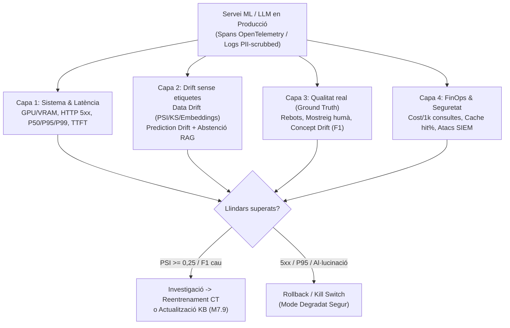

## A. Objectius d'aprenentatge

En completar aquesta lliçó, l'estudiant ha de ser capaç de:

1. **Establir** una **observabilitat completa en 4 capes** per a sistemes ML/LLM en producció: (1) **Infraestructura i sistema** (CPU, GPU/VRAM, errors HTTP 5xx, cua), (2) **Latència i rendiment** (**P50, P95, P99**, **TTFT**, **tokens/segon**), (3) **Qualitat de dades i model** (***Data Drift***, ***Prediction Drift***, ***Concept Drift***, *ground truth* diferit) i (4) **Costos i eficiència (*FinOps*)** (cost per 1.000 consultes, tokens entrada/sortida, encert de *cache*)!
2. **Distingir** amb total precisió ***Data Drift* (canvi en \(P(X)\))**, ***Prediction Drift* (canvi en \(P(\hat{Y})\))** i ***Concept Drift* (canvi en \(P(Y|X)\))**, seleccionant els **tests estadístics adequats** per detectar cada tipus: **PSI (*Population Stability Index*)**, **test de Kolmogorov-Smirnov (KS)**, **divergència de Jensen-Shannon / Wasserstein** (numèriques), **Chi-quadrat (\(\chi^2\))** (categòriques) i **distància de centroides d'embeddings** (text/LLM)!
3. **Diagnosticar** el problema de les **etiquetes diferides (*Delayed Ground Truth*)** (ex. trigar 6 mesos a saber si un contribuent va impagar!) i utilitzar **senyals *proxy* primerencs** (PSI en entrades, caiguda de confiança mitjana, pics d'abstenció RAG o rebots) per detectar degradacions abans que arribin les etiquetes reals!
4. **Aplicar** el **monitoratge específic d'LLMOps (*LLM Observability*)**: *traces* distribuïdes de cada pas del RAG (*retrieval latency*, *rerank latency*, *generation latency*, tokens prompt/sortida — estil *OpenTelemetry / Langfuse on-premise*), **taxa d'abstenció**, **taxa d'error de cites**, **intents d'atac bloquejats** i **alertes de pressupost (*FinOps*)**!
5. **Implementar** en Python pur el **càlcul exacte del PSI (*Population Stability Index*)** sobre distribucions d'entrades, detectant automàticament `ESTABLE (<0.10)`, `AVIS_DRIFT_MODERAT (0.10–0.25)` o `ALERTA_DRIFT_GREU (>=0.25)`, juntament amb un **detector de pics de latència P95 i cost per consulta**!

---

## B. Explicació introductòria

En el programari tradicional, quan alguna cosa es trenca salta un error `500 Internal Server Error` i tothom ho veu. En canvi, **els models d'IA fallen en silenci (*Silent Failure*)**: l'API continua retornant `200 OK` en 30 mil·lisegons, zero excepcions al log... mentre la seva precisió real ha caigut del `92%` al `68%` perquè ha canviat una ordenança, ha entrat una crisi econòmica o un departament ha començat a escanejar factures amb un nou format!

El **monitoratge i observabilitat MLOps/LLMOps** actuen com els sensors vitals del sistema 24/7: detecten quan les dades canvien (***Data Drift***), quan canvia la relació entre dades i resultat (***Concept Drift***), quan la latència de cua (**P95/P99**) o els costos de tokens (**FinOps**) es disparen, i activen alertes accionables (i reentrenament controlat o *rollback*) **abans** que el servei públic es degradi!

---

## C. Explicació tècnica avançada

### 1. *Data Drift* vs. *Prediction Drift* vs. *Concept Drift* (Pregunta clàssica d'examen!)

| Fenomen | Què canvia matemàticament | Exemple administratiu real | Com es detecta |
|---|---|---|---|
| ***Data Drift* (Covariate Shift)** | Canvia la distribució de les **entrades \(P(X)\)**, però la relació \(P(Y\|X)\) no canvia | Arriba una onada de sol·licituds de microempreses molt més petites que les de l'entrenament, o canvien els temes de consultes ciutadanes per una nova campanya | **PSI**, **KS test**, **Wasserstein** (numèriques), **\(\chi^2\)** (categòriques), **desplaçament d'embeddings** (text) — **NO necessita etiquetes reals!** |
| ***Prediction Drift*** | Canvia la distribució de les **sortides del model \(P(\hat{Y})\)** | Un classificador d'instàncies passa de predir `12%` d'`Urbanisme` a `38%` en una setmana, o la confiança mitjana baixa de `0,91` a `0,74` | PSI / \(\chi^2\) sobre classes predites i distribució de probabilitats — **alerta primerenca sense etiquetes!** |
| ***Concept Drift*** | Canvia la **relació real \(P(Y\|X)\)** entre entrades i etiqueta veritable (les mateixes dades ara signifiquen una altra cosa!) | Canvia la llei de subvencions o els estafadors canvien el modus operandi: expedients amb idèntiques característiques que abans eren `APTE` ara són `EXCLOS` o `FRAU`! | **Requereix etiquetes reals (*Ground Truth*)** o **mostreig humà continu** (mesurant caiguda de F1 / pujada de rebots / caiguda de calibratge!) |

### 2. **PSI (*Population Stability Index*)**: fórmula i llindars estàndard

El **PSI** mesura quant s'ha desplaçat la distribució actual (\(A_i\)) respecte de la distribució de referència d'entrenament (\(E_i\)) dividida en \(B\) franges (*bins*):

\[
\text{PSI} = \sum_{i=1}^{B} (A_i - E_i)\cdot \ln\!\left(\frac{A_i}{E_i}\right)
\]

- **`PSI < 0,10`**: sense canvi significatiu (**ESTABLE**).
- **`0,10 <= PSI < 0,25`**: desplaçament moderat (**AVÍS / Investigar**).
- **`PSI >= 0,25`**: desplaçament greu (**ALERTA CRÍTICA → investigar / reentrenar!**).

### 3. Per què **P95 / P99** (i MAI només la mitjana!) + Observabilitat **LLMOps & FinOps**

- **Trampa de la latència mitjana**: si el 95% de peticions triguen `200 ms` i el 5% triguen `12 segons`, la mitjana sembla acceptable (`790 ms`), però **1 de cada 20 ciutadans pateix una espera de 12 segons**! Cal monitorar sempre percentils de cua (**P95**, **P99**) i en LLMs específicament ***TTFT*** (*Time To First Token*) i ***TPOT*** (*Time Per Output Token*)!
- **Traces distribuïdes LLMOps (*OpenTelemetry / Langfuse on-premise*)**: desglossar cada consulta en *spans* (`guardrail_in: 12ms` → `embedding: 25ms` → `qdrant_search: 30ms` → `rerank: 90ms` → `llm_ttft: 420ms` → `llm_total: 1850ms`) per saber exactament **quin pas és el coll d'ampolla**!
- ***FinOps* en LLMs**: monitorar tokens d'entrada/sortida per servei, **taxa d'encert de *cache* semàntica** (estalvia 30–50% en FAQs repetitives!), pressupostos diaris i **enrutament per complexitat (*Model Routing*)** (model petit 7B/8B per a consultes simples, model gran només per a consultes complexes!).

---

## D. Diagrames i recursos visuals

### Observabilitat MLOps/LLMOps en 4 capes (de les traces en temps real a les alertes d'acció)



---

## E. Aplicació a l'Administració pública

1. **Detecció primerenca en *Delayed Ground Truth* (tributs i subvencions)**: en predicció d'impagaments, no sabràs si el contribuent paga fins 6 mesos després; monitorar el **PSI** de les variables econòmiques i el ***Prediction Drift*** mensual permet detectar un canvi estructural (inflació, canvi de tipus impositiu) **5 mesos abans** que arribin les etiquetes definitives!
2. **Optimització *FinOps* en portals ciutadans**: amb una **memòria cau semàntica** per a les 50 preguntes més freqüents de la campanya de l'IBI (invalidada automàticament quan canvia la versió de la base de coneixement!) i enrutament de consultes senzilles a un model lleuger *on-premise*, es redueix fins a un **60% el consum de GPU/energia** i la latència P95!
3. **Eines sobiranes *on-premise***: pila estàndard oberta **Prometheus + Grafana** (sistema, latència P95/P99, cues, GPU), **Evidently AI** (informes de *Data/Prediction Drift* i PSI) i **Langfuse / Phoenix (OpenTelemetry)** desplegats internament (traçabilitat de *spans* RAG/LLM sense PII!).

---

## F. Exemple pràctic guiat

Implementem en **Python pur** un **monitor MLOps/LLMOps** que:
1. Calcula exactament el **PSI (*Population Stability Index*)** entre la distribució de referència d'entrenament i la de producció actual, classificant-lo automàticament (`ESTABLE`, `DRIFT_MODERAT`, `ALERTA_DRIFT_GREU`).
2. Calcula la **latència mitjana vs. P95** (demostrant com la mitjana amaga pics greus de cua!) i el **cost *FinOps* per 1.000 consultes**!

```python
"""Exemple 7.6: Càlcul exacte de PSI (Data Drift), comparativa Mitjana vs P95 i FinOps LLM."""
import math


def calcular_psi(esperat: list[float], actual: list[float], eps: float = 1e-6) -> tuple[float, str]:
    psi = 0.0
    for e, a in zip(esperat, actual):
        e_c, a_c = max(e, eps), max(a, eps)
        psi += (a_c - e_c) * math.log(a_c / e_c)
    estat = "ESTABLE" if psi < 0.10 else ("DRIFT_MODERAT" if psi < 0.25 else "ALERTA_DRIFT_GREU")
    return round(psi, 4), estat


def percentil(valors: list[float], p: float) -> float:
    s = sorted(valors)
    idx = min(len(s) - 1, math.ceil((p / 100.0) * len(s)) - 1)
    return s[max(0, idx)]


if __name__ == "__main__":
    # 1. Data Drift en distribució d'imports d'expedients (4 franges)
    ref_train = [0.40, 0.35, 0.20, 0.05]     # Entrenament 2024
    prod_ok = [0.38, 0.36, 0.21, 0.05]       # Producció estable
    prod_drift = [0.15, 0.25, 0.35, 0.25]    # Nova convocatòria amb imports molt més alts!
    print("PSI Producció estable:", calcular_psi(ref_train, prod_ok))
    print("PSI Producció amb drift:", calcular_psi(ref_train, prod_drift))

    # 2. Trampa de la mitjana vs P95 (20 peticions: 19 ràpides de 200 ms, 1 lenta de 12.000 ms)
    latencies_ms = [200.0] * 19 + [12000.0]
    mitjana = sum(latencies_ms) / len(latencies_ms)
    p95 = percentil(latencies_ms, 95)
    p99 = percentil(latencies_ms, 99)
    print(f"Latències: Mitjana={mitjana:.0f} ms | P95={p95:.0f} ms | P99={p99:.0f} ms")
```

### Interpretació dels resultats (execució verificada)

- `prod_ok`: **`PSI = 0.0018 (ESTABLE)`** (`< 0,10`); `prod_drift`: **`PSI = 0.6847 (ALERTA_DRIFT_GREU)`** (`>= 0,25`), disparant alerta immediata abans que arribi cap etiqueta diferida!
- En el lot de 20 peticions (`19 × 200 ms` + `1 × 12.000 ms`), la mitjana és `790 ms` (aparentment tolerable), mentre que el **`P99` (i el màxim del 5% pitjor)** destapa el pic crític de **`12.000 ms`**!

---

## G. Exercici pràctic per resoldre

### Enunciat
Tres mesos després de desplegar un classificador d'instàncies i un assistent RAG en un ajuntament, el panell actual **només mostra `HTTP 200 OK = 99,9%`, `CPU = 35%` i `Latència mitjana = 620 ms`**, de manera que l'equip d'operacions creu que «tot va perfecte». Però en una reunió amb l'OAC i els departaments salten tres problemes reals:
1. Un 10% dels ciutadans al xat es queixen que la resposta triga **més de 10 segons** i abandonen!
2. La factura mensual de tokens del model LLM de suport s'ha multiplicat per **3,5×** perquè milers de ciutadans fan exactament les mateixes 30 preguntes de la campanya de l'IBI.
3. El classificador d'instàncies ha baixat silenciosament la seva precisió real del `91%` al `71%` després d'una reestructuració municipal que va traspassar competències de «terrasses de bars» d'Activitats a Via Pública!

Classifica **tècnicament cada un dels 3 problemes** (incloent el tipus exacte de *drift* del punt 3!) i dissenya el **nou quadre d'observabilitat en 4 capes** i les mesures concretes de solució (*FinOps*, P95/spans i detecció de *drift*).

### Objectius i restriccions
- Identificar **Concept Drift** (punt 3: canvia \(P(Y|X)\) per reestructuració de competències!), trampa de la mitjana vs. **P95/P99 + spans OpenTelemetry** (punt 1), i **FinOps + cache semàntica + model routing** (punt 2).

:::hint Pista 1 — Identifica el tipus exacte de *drift* al punt 3!
Les sol·licituds de «terrasses de bars» tenen exactament el mateix text \(X\) que abans, però ara la resposta correcta \(Y\) ha canviat d'Activitats a Via Pública! Canvia \(P(Y|X)\) = ***Concept Drift*** pur! Només es detecta ràpidament monitorant **etiquetes reals / taxa de rebots per classe** i mostreig humà (el PSI d'entrades podria continuar baix!).
:::

:::hint Pista 2 — Punts 1 i 2 (Latència de cua + FinOps)
(1) Substituir la mitjana per **P95 / P99 + *TTFT*** + ***traces* per *span*** (`retrieval`, `rerank`, `llm`) en *Prometheus/Grafana + Langfuse on-prem* per trobar el pas lent (ex. consultes llargues sense límit de `max_tokens` o *reranker* en CPU!).
(2) ***FinOps***: **cache semàntica/FAQ** (invalidada per versió de KB!) per a les 30 preguntes virals de l'IBI + **enrutament de model** (model lleuger local per a FAQs) + alertes de pressupost diari de tokens!
:::

### Criteris d'avaluació
- **35%**: Diagnòstic exacte del punt 3 com a ***Concept Drift*** (canvi en \(P(Y|X)\) per canvi organitzatiu), explicant per què el *Data Drift* sol no ho detectaria i com es monitora (taxa de rebots per classe + mostreig humà).
- **35%**: Diagnòstic del punt 1 (trampa de la mitjana → **P95/P99 + TTFT + spans distribuïts**) i del punt 2 (**FinOps**: tokens/consulta, *cache* semàntica amb invalidació per versió KB, *model routing* i límits de pressupost).
- **30%**: Disseny coherent de l'observabilitat en 4 capes (*Prometheus/Grafana + Evidently + Langfuse/OpenTelemetry on-premise*) amb alertes accionables.

### Errors habituals
- Classificar el canvi de competències de «terrasses de bars» com a *Data Drift* (el text de la instància no ha canviat; ha canviat el seu significat/destí \(P(Y|X)\) → és ***Concept Drift***!).

:::solution Solució completa comentada i alternatives
### 1. Diagnòstic i solució dels 3 problemes
1. **Queixes de >10 segons invisibles a la mitjana (620 ms)**:
   - *Diagnòstic*: la mitjana amaga les cues lentes; el 10% afectat apareix immediatament al **P90/P95/P99**!
   - *Solució*: monitorar **P50/P95/P99 + TTFT** i activar **traçabilitat distribuïda per *spans*** (*OpenTelemetry / Langfuse on-prem*: `guardrail`, `embedding`, `vector_db`, `rerank`, `llm`) per localitzar el coll d'ampolla + aplicar *streaming* SSE i límits de `max_tokens`.
2. **Cost de tokens multiplicat per 3,5× durant campanya IBI**:
   - *Diagnòstic*: manca de governança ***FinOps*** i re-execució innecessària de l'LLM sobre les mateixes 30 preguntes repetitives.
   - *Solució*: implantar **memòria cau semàntica/FAQ** (invalidada automàticament en canviar la versió de la base de coneixement!), **enrutament per complexitat** (model petit local per a consultes simples) i **alertes de pressupost diari de tokens**.
3. **Caiguda silenciosa del classificador (91% → 71%) per canvi de competències**:
   - *Diagnòstic*: ***Concept Drift*** pur! Les entrades \(X\) (sol·licituds de terrasses) són idèntiques, però ha canviat la relació real \(P(Y|X)\) (ara van a Via Pública, no a Activitats).
   - *Solució*: monitorar la **taxa de rebots desglossada per departament** (alerta immediata quan Activitats comença a rebotar terrasses!), re-etiquetar els casos afectats i llançar un **reentrenament controlat (CI/CD/CT, M7.9)** validat amb el *Quality Gate*.

### 2. Nou quadre d'observabilitat en 4 capes (*on-premise*)
- **Prometheus + Grafana**: sistema/GPU/5xx + **P50/P95/P99 + TTFT** + **FinOps** (tokens, cost/1k, *cache hit %*).
- **Evidently AI**: **PSI / KS / embeddings** (*Data & Prediction Drift*).
- **Langfuse / OpenTelemetry**: *spans* RAG + abstenció + cites + rebots per classe (*Concept Drift*).
:::

---

## H. Test individual

Resol les 10 preguntes sobre fallades silencioses, *Data Drift* vs. *Prediction Drift* vs. *Concept Drift*, fórmula i llindars del PSI, *Delayed Ground Truth*, P95/P99 vs. mitjana, *spans* OpenTelemetry en LLMOps i *FinOps* (cache semàntica i model routing).

---

## I. Preguntes de desenvolupament

### Pregunta 1
Diferencia rigorosament ***Data Drift***, ***Prediction Drift*** i ***Concept Drift***, posant un exemple administratiu concret de cadascun i indicant amb quin test o senyal es detecta cadascun!

:::model-answer Resposta model i criteris de correcció (Pregunta 1)
**Resposta model**:
1. ***Data Drift* (Covariate Shift — canvia \(P(X)\))**: canvia la distribució de les dades d'entrada (ex. arriben sol·licituds amb imports molt més alts que els d'entrenament o temes nous de consulta). **Detecció (sense etiquetes)**: **PSI** (`>=0,25` greu), test **KS** / Wasserstein (numèriques), **\(\chi^2\)** (categòriques) o desplaçament d'embeddings (text).
2. ***Prediction Drift* (canvia \(P(\hat{Y})\))**: canvia la distribució de classes o probabilitats predites pel model (ex. caiguda brusca de confiança mitjana o pic d'abstenció RAG). **Detecció (sense etiquetes)**: PSI/\(\chi^2\) sobre les sortides predites — excel·lent alerta primerenca!
3. ***Concept Drift* (canvia \(P(Y|X)\))**: per a les mateixes entrades exactes, canvia la resposta correcta real (ex. reestructuració municipal que traspassa «terrasses de bars» d'Activitats a Via Pública, o canvi normatiu de requisits). **Detecció**: requereix **etiquetes reals (*Ground Truth*)** o senyals directes d'error humà (taxa de rebots per classe, mostreig humà continu, caiguda de F1/calibratge).

**Criteris de correcció (10 punts)**:
- Definició matemàtica/conceptual + exemple administratiu + mètode de detecció per als 3 tipus (~3,3 punts cadascun).
:::

### Pregunta 2
Explica què és el problema de les **etiquetes diferides (*Delayed Ground Truth*)** en MLOps públic i com dissenyes un sistema d'alertes primerenques que combini **PSI** i **mostreig humà**.

:::model-answer Resposta model i criteris de correcció (Pregunta 2)
**Resposta model**:
- ***Delayed Ground Truth***: en molts processos públics (risc d'impagament tributari, frau en subvencions, resolució de recursos) passen mesos fins a conèixer el resultat real \(Y\). Esperar 6 mesos per mesurar el F1 significaria operar mig any a cegues!
- **Sistema d'alertes primerenques en dues vies**:
  1. **Senyals immediats sense etiquetes (diaris/setmanals)**: monitorar **PSI / KS** sobre les variables d'entrada crítiques (*Data Drift*), ***Prediction Drift*** (desplaçament de scores/confiança) i taxa de nuls o canvis d'esquema (*Data Contracts*). Si `PSI >= 0,25`, s'obre investigació immediata.
  2. **Mostreig humà continu estratificat**: revisar setmanalment una mostra petita però estratificada de prediccions recents (ex. casos de baixa confiança + mostra aleatòria) per detectar ***Concept Drift*** aviat sense esperar el tancament anual de l'expedient.

**Criteris de correcció (10 punts)**:
- Explicació clara de *Delayed Ground Truth* amb exemple públic: 4 punts.
- Combinació operativa de senyals *proxy* (PSI, Prediction Drift) + mostreig humà continu: 6 punts.
:::

### Pregunta 3
Com s'implementa l'**observabilitat *FinOps* i de latència** en un assistent virtual LLM en producció per controlar simultàniament experiència d'usuari (**P95/P99/TTFT**) i pressupost de tokens/GPU?

:::model-answer Resposta model i criteris de correcció (Pregunta 3)
**Resposta model**:
- **Latència real i diagnòstic per *spans***: mesurar sempre percentils de cua (**P95, P99**) i ***TTFT*** (mai només la mitjana, que oculta cues lentes!) i instrumentar cada pas amb **OpenTelemetry / Langfuse *on-premise*** (`guardrail_in`, `embedding`, `vector_search`, `rerank`, `llm_generation`, `guardrail_out`) per identificar exactament el coll d'ampolla.
- **Control ***FinOps*** (costos i eficiència)**:
  1. Monitorar tokens d'entrada/sortida i cost estimat per 1.000 consultes desglossat per servei/canal, amb **alertes de pressupost diari**.
  2. **Memòria cau semàntica / FAQ** per a preguntes repetitives de campanyes punta (amb **invalidació automàtica** quan s'actualitza un document de la KB!).
  3. **Enrutament per complexitat (*Model Routing*)**: atendre consultes simples amb un model lleuger i ràpid, reservant models pesats per a raonament complex + limitar `max_tokens` i mida de context RAG innecessari.

**Criteris de correcció (10 punts)**:
- P95/P99/TTFT + traçabilitat distribuïda per *spans*: 5 punts.
- Mesures *FinOps* (mètriques/alertes, *cache* semàntica amb invalidació, *model routing*): 5 punts.
:::

---

## J. Resum per memoritzar

### Conceptes clau
- **Fallada silenciosa (*Silent Failure*)**: un model ML/LLM pot retornar `HTTP 200 OK` en `30 ms` mentre la seva precisió cau en picat!
- **Els 3 *drifts***:
  - ***Data Drift*** (canvia \(P(X)\)): detectat sense etiquetes amb **PSI**, **KS**, **\(\chi^2\)** o embeddings.
  - ***Prediction Drift*** (canvia \(P(\hat{Y})\)): alerta primerenca sense etiquetes.
  - ***Concept Drift*** (canvia \(P(Y|X)\), ex. canvi de llei o competències): exigeix **etiquetes reals / rebots / mostreig humà**!
- **Llindars PSI**: `< 0,10` = estable; `0,10–0,25` = moderat (investigar); **`>= 0,25` = greu (alerta crítica!)**.
- **Latència**: MAI confiar només en la mitjana → **P95, P99, TTFT** + ***spans* distribuïts** (*OpenTelemetry / Langfuse on-premise*).
- ***FinOps* LLM**: tokens/consulta, alertes pressupostàries, **cache semàntica (invalidada en actualitzar KB!)** i ***Model Routing***!

### Definicions essencials
- ***Concept Drift***: canvi en la relació estadística real entre les variables d'entrada \(X\) i l'etiqueta objectiu \(Y\) (\(P(Y|X)\)), fent que el model quedi obsolet tot i que les entrades semblin iguals.
- **PSI (*Population Stability Index*)**: mesura estàndard de divergència entre la distribució d'una variable en entrenament i en producció (`<0,10` estable, `0,10–0,25` moderat, `>=0,25` greu).

### Errors conceptuals freqüents
1. Monitorar només `HTTP 200`, CPU i latència mitjana (ceguesa total davant cues P95/P99, *drift* i al·lucinacions!).
2. Confondre *Data Drift* (canvia \(X\)) amb *Concept Drift* (canvia el significat/regla \(P(Y|X)\)).
3. Implantar una *cache* semàntica sense invalidació en actualitzar la base de coneixement (serviria respostes caducades!).

### Possibles preguntes d'examen
- Classifica un canvi de competències municipals («terrasses de bars» d'Activitats a Via Pública) com a *Data*, *Prediction* o *Concept Drift* i explica com el detectes.
- Interpreta un `PSI = 0,68` i explica per què una mitjana de `790 ms` pot amagar una crisi de `P99 = 12.000 ms`.
- Proposa 3 mesures *FinOps* concretes quan el cost de tokens d'un chatbot es triplica durant la campanya de l'IBI.
