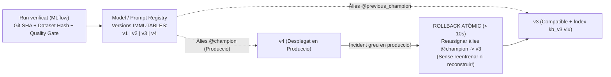

## A. Objectius d'aprenentatge

En completar aquesta lliçó, l'estudiant ha de ser capaç de:

1. **Aplicar** el **versionat holístic en 5 dimensions** necessari en IA en producció (molt més enllà del codi Git!): (1) **Codi**, (2) **Dades** (DVC/SHA-256), (3) **Models / Pesos** (*Model Registry*), (4) **Prompts i configuració RAG** (*Prompt Registry*: prompt, *chunking*, embeddings, `top_k`) i (5) **Entorn d'execució** (imatges Docker identificades per ***digest SHA-256***, mai només `:latest`!).
2. **Gestionar** el cicle de vida d'un ***Model Registry*** (estil **MLflow Model Registry** amb **àlies immutables**: `@challenger`, `@staging`, `@champion`, `@archived`), mantenint **artefactes immutables** (mai sobreescriure `v2`!) i **llinatge complet (*Model Lineage*)**!
3. **Executar** un ***rollback* segur en segons** quan una versió falla en producció: canviar únicament l'àlies `@champion` de `v4` cap a `v3` (ja validada i immutable) i **verificar la compatibilitat d'esquema** (tant de l'API com de l'índex vectorial d'embeddings!)!
4. **Identificar** el risc ocult del **versionat d'embeddings i índexs vectorials** en LLMOps: canviar de model d'embeddings sense mantenir un índex versionat en paral·lel (`index_v2` vs. `index_v1`) trenca instantàniament tota la cerca semàntica i impedeix el *rollback*!
5. **Implementar** en Python pur un **registre immutable de models i prompts (*Model & Prompt Registry*)** amb promoció per àlies (`@staging` → `@champion`), auditoria de llinatge i ***rollback* atòmic en 1 pas**!

---

## B. Explicació introductòria

Imagina que a les 10:15 h del matí desplegues la versió `v4` d'un classificador o d'un assistent RAG i 10 minuts després els usuaris detecten un error greu. Quant trigues a tornar a la situació exactament funcional de les 10:00 h? Si algú va sobreescriure el fitxer `model_produccio.onnx`, si la imatge Docker era `:latest` o si va re-indexar la base vectorial damunt de l'antiga... trigaràs **hores o dies**!

El **versionat integral i el *Model/Prompt Registry*** garanteixen la **immutabilitat absoluta de cada versió** i separen la *versió física* (`v1, v2, v3, v4`) del *punter d'entorn* (`@champion`, `@staging`). Així, fer un ***rollback* complet i verificat** es redueix a moure un àlies de `v4 → v3` en **menys de 10 segons** — i alhora permet auditar exactament quina combinació de codi, dades, model i prompt va emetre una resposta fa 14 mesos!

---

## C. Explicació tècnica avançada

### 1. Les 5 dimensions del versionat en MLOps i LLMOps

| Dimensió | Eina / Estàndard | Antipatró prohibidíssim | Bona pràctica obligatòria |
|---|---|---|---|
| **1. Codi** | Git + **SemVer** (`MAJOR.MINOR.PATCH`) | Treballar sense tags ni branches | Tags immutables (`v2.3.1`) + commit SHA vinculat |
| **2. Dades** | DVC / LakeFS / SHA-256 | `dataset_bo_final2.csv` sobreescrit | Snapshots immutables amb hash SHA-256 |
| **3. Model** | **MLflow Model Registry** (ONNX / SafeTensors) | Sobreescriure `model_prod.onnx` | Versions incrementals immutables (`v1, v2, v3`) + **àlies** (`@champion`, `@challenger`) |
| **4. Prompt i RAG** | **Prompt Registry** / Git YAML + índex versionat | Editar prompts directament a la BD de producció | Cada prompt + model d'embeddings + `chunk_size` versionat conjuntament! |
| **5. Entorn** | Docker Registry privat | Desplegar etiquetes mutables `:latest` | **Tag SemVer + digest `@sha256:...` immutable!** |

### 2. Cicle de vida al *Model Registry* i *Rollback* atòmic

- **Immutabilitat absoluta**: una versió registrada (`v3`) **mai no es modifica ni es reescriu**; qualsevol correcció crea una nova versió (`v4`).
- **Promoció per àlies (MLflow modern)**:
  1. `v4` es registra des del *run* d'entrenament amb el seu llinatge (`git_sha`, `dataset_hash`, `metrics`, `model_card`).
  2. Se li assigna `@staging` → passa *Quality Gates* i proves en preproducció.
  3. Se li assigna `@challenger` → proves *Shadow / Canary*.
  4. En validar-se, `@champion` passa a apuntar a `v4` i `@previous_champion` conserva el punter a `v3`!
- ***Rollback* en segons**: si `v4` falla en producció, moure `@champion` de tornada a `v3` restaura instantàniament el model anterior!
- **Atenció als *rollbacks* que es trenquen (Compatibilitat!)**:
  - **Esquema d'API**: si `v4` ha canviat el contracte JSON de sortida i els consumidors ja esperen el nou format, el *rollback* a `v3` trencarà els consumidors! Regla: mantenir **retrocompatibilitat (*Backward Compatibility*)** durant la transició (*Expand & Contract*).
  - **Índex vectorial d'embeddings**: si `v4` canvia de model d'embeddings (p. ex. de 768 a 1024 dimensions), cal construir un **índex paral·lel `kb_v4`** i mantenir `kb_v3` viu durant la finestra de seguretat perquè el *rollback* funcioni instantàniament!

---

## D. Diagrames i recursos visuals

### *Model & Prompt Registry* immutable amb àlies i *Rollback* atòmic



---

## E. Aplicació a l'Administració pública

1. **Auditoria jurídica i recursos administratius a 18 mesos vista**: si un ciutadà presenta un recurs contenciós sobre un expedient classificat o informat fa un any i mig, el registre d'execució guarda `model_version=v2` + `prompt_version=p1.4` + `kb_version=2025.03`, i el *Registry* immutable permet **reconstruir exactament el comportament del sistema en aquella data**!
2. **Canvi de model d'embeddings sense tall de servei (*Zero-Downtime Re-indexing*)**: en passar d'un model d'embeddings antic a un de nou per a les 15.000 normes municipals, es crea la col·lecció paral·lela `normativa_emb_v2` a Qdrant; el chatbot `v2` consulta `normativa_emb_v2` mentre `v1` segueix sobre `normativa_emb_v1` — permetent *Canary* i *rollback* instantanis!
3. **Prohibició de `:latest` en desplegaments ENS**: totes les imatges Docker i pesos *open-weights* (ex. Hugging Face / Ollama) es fixen amb el seu **digest criptogràfic `sha256`** per impedir canvis silenciosos de proveïdor o atacs de cadena de subministrament!

---

## F. Exemple pràctic guiat

Implementem en **Python pur** un ***Model & Prompt Registry* immutable** amb:
1. Registre d'artefactes vinculant les 5 dimensions (`versio`, `git_sha`, `dataset_hash`, `prompt_versio`, `kb_index`, `docker_digest`).
2. Promoció controlada per àlies (`@staging` → `@champion`) conservant `@previous_champion`.
3. ***Rollback* atòmic en 1 pas** amb registre d'auditoria del motiu i verificació de l'índex vectorial associat!

```python
"""Exemple 7.7: Model & Prompt Registry immutable amb promoció per àlies i rollback atòmic."""
from dataclasses import dataclass


@dataclass(frozen=True)
class ArtefacteIA:
    versio: str
    git_sha: str
    dataset_hash: str
    prompt_versio: str
    kb_index: str
    docker_digest: str


class RegistryImmutable:
    def __init__(self) -> None:
        self.versions: dict[str, ArtefacteIA] = {}
        self.alies: dict[str, str] = {}
        self.historial_auditoria: list[str] = []

    def registrar(self, art: ArtefacteIA) -> None:
        if art.versio in self.versions:
            raise ValueError(f"Immutabilitat violada: la versió {art.versio} ja existeix!")
        if ":latest" in art.docker_digest:
            raise ValueError("Prohibit desplegar etiquetes mutables ':latest'; cal digest @sha256!")
        self.versions[art.versio] = art
        self.historial_auditoria.append(f"REGISTRAT {art.versio} (kb={art.kb_index}, git={art.git_sha})")

    def promocionar_champion(self, versio: str, motiu: str) -> None:
        if versio not in self.versions:
            raise KeyError(f"Versió inexistent: {versio}")
        if "champion" in self.alies:
            self.alies["previous_champion"] = self.alies["champion"]
        self.alies["champion"] = versio
        self.historial_auditoria.append(f"PROMOCIO @champion -> {versio} | {motiu}")

    def rollback(self, motiu: str) -> ArtefacteIA:
        anterior = self.alies.get("previous_champion")
        if not anterior:
            raise RuntimeError("No hi ha cap @previous_champion disponible per fer rollback.")
        fallida = self.alies["champion"]
        self.alies["champion"] = anterior
        self.historial_auditoria.append(f"ROLLBACK @champion: {fallida} -> {anterior} | {motiu}")
        return self.versions[anterior]


if __name__ == "__main__":
    reg = RegistryImmutable()
    reg.registrar(ArtefacteIA("v1.0", "c1a2b3", "sha256:111a", "prompt_v1", "kb_emb_v1", "img@sha256:aaaa"))
    reg.promocionar_champion("v1.0", "Pas inicial a producció")
    reg.registrar(ArtefacteIA("v2.0", "d4e5f6", "sha256:222b", "prompt_v2", "kb_emb_v2", "img@sha256:bbbb"))
    reg.promocionar_champion("v2.0", "Nou model d'embeddings v2")

    # Incident en producció amb v2.0 -> Rollback atòmic a v1.0 (i recupera kb_emb_v1!)
    restaurat = reg.rollback("Pic d'abstenció en consultes tributàries catalanes")
    print("Versió activa després del rollback:", restaurat)
    print("Historial d'auditoria:")
    for linia in reg.historial_auditoria:
        print(" -", linia)
```

### Interpretació dels resultats (execució verificada)

- El *Registry* bloqueja tant sobreescriure una versió existent com utilitzar etiquetes Docker mutables `:latest`.
- En detectar un incident en `v2.0`, `reg.rollback(...)` restaura atòmicament `@champion -> v1.0` recuperant simultàniament el seu `prompt_v1`, `docker_digest` i l'índex vectorial **`kb_emb_v1`** intacte, deixant traça completa a l'historial d'auditoria!

---

## G. Exercici pràctic per resoldre

### Enunciat
Un equip municipal decideix actualitzar l'assistent RAG a un nou model d'embeddings (`emb_v2`, 1024 dimensions en lloc de 768) i a un nou *system prompt*. Per «estalviar disc», **esborren l'índex vectorial antic (`kb_v1`)**, re-indexen damunt del mateix nom, sobreescriuen el fitxer `prompt_prod.txt` i pugen la imatge Docker etiquetada com `assistent:latest`. Al cap de 30 minuts, el servei comença a donar respostes errònies i necessiten tornar urgentment enrere!

Explica **per què ara mateix el *rollback* és impossible en menys de 6 hores**, identifica les **4 violacions de versionat comeses** i dissenya el **procediment correcte de versionat i *rollback* en < 10 segons**!

### Objectius i restriccions
- Identificar les 4 infraccions d'immutabilitat (esborrar índex `kb_v1`, sobreescriure `prompt_prod.txt`, usar `:latest`, no acoblar versions al Registry) i establir el protocol de versionat en 5 dimensions + índex paral·lel + àlies immutables.

:::hint Pista 1 — Les 4 violacions que han trencat el *rollback*
1. **Esborrar `kb_v1` (768d) i sobreescriure'l amb `emb_v2` (1024d)**: el model antic no pot consultar vectors de 1024 dimensions; tocarà re-indexar des de zero durant hores!
2. **Sobreescriure `prompt_prod.txt`** sense versionat immutable al *Prompt Registry* / Git.
3. **Imatge Docker mutable `:latest`** sense digest `@sha256` (ja no es pot arrencar el contenidor exacte anterior!).
4. **Absència d'àlies i bundle atòmic al *Registry*** que vinculi `(model + prompt + kb_index + docker_digest)`!
:::

:::hint Pista 2 — Protocol de *rollback* en < 10 segons
Crear sempre versions immutables (`v2.0` en paral·lel a `v1.0`) amb **índex vectorial paral·lel `kb_v2`**, promoure mitjançant **àlies `@champion`** conservant `@previous_champion` + `kb_v1` vius durant una finestra mínima de seguretat (ex. 7–14 dies) i fixar sempre imatges per `@sha256`!
:::

### Criteris d'avaluació
- **45%**: Diagnòstic precís de les 4 violacions (especialment la incompatibilitat dimensional 768d vs. 1024d en esborrar `kb_v1`!).
- **35%**: Disseny del versionat holístic en 5 dimensions (codi, dades, model, prompt+índex paral·lel, Docker `@sha256`).
- **20%**: Procediment de promoció per àlies (`@champion` / `@previous_champion`) i finestra de retenció de l'índex antic per a *rollback* en < 10 segons.

### Errors habituals
- Pensar que fer `git revert` del codi soluciona el problema (si l'índex vectorial antic de 768d s'ha esborrat, el codi antic continuarà fallant!).

:::solution Solució completa comentada i alternatives
### 1. Per què el *rollback* triga hores (4 violacions d'immutabilitat)
1. **Destrucció de l'índex vectorial antic `kb_v1` (768d)**: en sobreescriure'l amb vectors de `emb_v2` (1024d), la versió antiga de l'assistent és incompatible dimensionalment i obliga a re-indexar tot el corpus des de zero!
2. **Sobreescriptura de `prompt_prod.txt`**: pèrdua de la versió exacta provada del prompt.
3. **Etiqueta Docker mutable `:latest`**: sobreescriu el contenidor anterior, impedint recuperar exactament les dependències prèvies.
4. **Manca de *Registry* atòmic**: codi, prompt, embeddings i índex no estan vinculats en una única versió immutable.

### 2. Procediment correcte (Rollback en < 10 segons)
1. **Immutabilitat de les 5 dimensions**: registrar `v2.0` com a paquet immutable vinculant `(git_sha, dataset_hash, prompt_v2, emb_v2, kb_v2, docker@sha256:...)`.
2. **Índex paral·lel (*Blue-Green* d'índex vectorial)**: construir `kb_v2` en paral·lel sense tocar `kb_v1` i mantenir `kb_v1` actiu com a mínim **7–14 dies** després del pas a producció.
3. **Promoció per àlies**: moure `@champion` de `v1.0` a `v2.0` conservant `@previous_champion -> v1.0`.
4. **Rollback instantani**: davant qualsevol incidència, reassignar `@champion -> v1.0` (que apunta automàticament a `prompt_v1`, `emb_v1`, `kb_v1` i imatge `@sha256` anterior) en **< 10 segons**!
:::

---

## H. Test individual

Resol les 10 preguntes sobre les 5 dimensions del versionat, immutabilitat al *Model/Prompt Registry*, àlies (`@champion`, `@previous_champion`), prohibició de `:latest` (digest `@sha256`), índexs vectorials paral·lels, retrocompatibilitat d'esquema i auditoria històrica.

---

## I. Preguntes de desenvolupament

### Pregunta 1
Explica les **5 dimensions del versionat integral en MLOps/LLMOps** i per què versionar únicament el codi a Git és insuficient per reproduir o revertir un sistema d'IA en producció.

:::model-answer Resposta model i criteris de correcció (Pregunta 1)
**Resposta model**:
- En programari clàssic, el comportament depèn gairebé exclusivament del codi. En IA, el comportament real en producció depèn de **5 dimensions acoblades**:
  1. **Codi** (Git commit SHA + SemVer).
  2. **Dades** (snapshots immutables via DVC / SHA-256).
  3. **Model / Pesos** (*Model Registry* immutable amb ONNX / SafeTensors i àlies `@champion`).
  4. **Prompts i configuració RAG** (*Prompt Registry* + versió del model d'embeddings + `chunk_size` + índex vectorial paral·lel).
  5. **Entorn d'execució** (imatges Docker fixades per **digest `@sha256`**, mai `:latest`!).
- Si només versiones el codi, un canvi de dades, prompt, índex d'embeddings o llibreria dins `:latest` altera completament el comportament del sistema i impedeix tant auditar decisions passades com fer un *rollback* fiable!

**Criteris de correcció (10 punts)**:
- Detall precís de les 5 dimensions amb eines/bones pràctiques: 7 punts.
- Argumentació clara de per què Git sol no basta en IA: 3 punts.
:::

### Pregunta 2
Descriu com funciona la **promoció per àlies** (`@staging`, `@challenger`, `@champion`, `@previous_champion`) en un *Model Registry* modern (estil MLflow) i explica **dos obstacles reals** que poden impedir un *rollback* instantani si no s'han previst.

:::model-answer Resposta model i criteris de correcció (Pregunta 2)
**Resposta model**:
- **Promoció per àlies**: les versions registrades (`v1, v2, v3, v4`) són estrictament immutables; els entorns de desplegament consumeixen **àlies** (`@staging` → `@challenger` → `@champion`). En promoure `v4` a `@champion`, `@previous_champion` conserva el punter a `v3`, de manera que un *rollback* només reassigna l'àlies `@champion -> v3` en segons!
- **Dos obstacles reals al *rollback***:
  1. **Trencament d'esquema d'API/BD**: si `v4` canvia camps obligatoris del JSON i els sistemes consumidors ja s'han adaptat al format nou, tornar a `v3` provocarà errors d'integració (solució: retrocompatibilitat *Expand & Contract*).
  2. **Destrucció de l'índex vectorial antic**: en LLMOps, si `v4` canvia de model d'embeddings (ex. 768d → 1024d) i esborra l'índex `kb_v3`, tornar a `v3` falla immediatament (solució: mantenir `kb_v3` i `kb_v4` en paral·lel durant la finestra de seguretat!).

**Criteris de correcció (10 punts)**:
- Funcionament clar d'immutabilitat i àlies de promoció/rollback: 5 punts.
- Explicació exacta dels dos obstacles (esquema d'API i índex vectorial) + solucions: 5 punts.
:::

### Pregunta 3
Per què les normes de seguretat (ENS) i bones pràctiques MLOps **prohibeixen desplegar imatges Docker etiquetades com `:latest`** o baixar pesos d'un model *open-weights* sense fixar-ne el **commit/digest criptogràfic `sha256`**?

:::model-answer Resposta model i criteris de correcció (Pregunta 3)
**Resposta model**:
- Una etiqueta com `:latest` (o la branca `main` d'un repositori Hugging Face) és **mutable**: avui apunta a un binari i demà pot apuntar a una versió diferent sense canviar una sola línia del nostre fitxer de desplegament!
- **Riscos greus**: (1) **Trencament inesperat en reiniciar un contenidor** (un node nou baixa una versió diferent de la que tenen els altres nodes!); (2) **Impossibilitat de *rollback* ni reproducció exacta** en auditoria; (3) **Atac de cadena de subministrament (*Supply-Chain Attack*)** si un compte extern substitueix la imatge o els pesos!
- **Solució**: fixar sempre el **digest criptogràfic immutable `@sha256:...`** tant en imatges Docker del registre privat corporatiu com en els pesos SafeTensors verificats.

**Criteris de correcció (10 punts)**:
- Explicació de la mutabilitat de `:latest` i els 3 riscos (inconsistència entre nodes, pèrdua de rollback/auditoria, *supply-chain*): 6 punts.
- Solució via digest `@sha256` i registre privat corporatiu (ENS): 4 punts.
:::

---

## J. Resum per memoritzar

### Conceptes clau
- **5 dimensions del versionat IA**: (1) **Codi** (Git + SemVer), (2) **Dades** (DVC / SHA-256), (3) **Model** (*Model Registry* immutable), (4) **Prompt + RAG** (*Prompt Registry* + **índex vectorial paral·lel**!), (5) **Entorn** (Docker **`@sha256:...`**, MAI `:latest`!).
- **Immutabilitat absoluta**: una versió registrada (`v3`) **MAI es sobreescriu**; qualsevol canvi crea `v4`.
- **Promoció per àlies (MLflow)**: `@staging` → `@challenger` → `@champion` (conservant sempre `@previous_champion`!).
- ***Rollback* en < 10 s**: moure `@champion` de `v4` → `v3` mantenint vius durant 7–14 dies tant l'esquema retrocompatible com l'**índex vectorial antic `kb_v3`**!
- **Auditoria a llarg termini**: el bundle immutable `(model + prompt + kb + docker_sha256)` permet reconstruir exactament una resposta o decisió de fa 18 mesos!

### Definicions essencials
- ***Model Registry***: repositori centralitzat de versions immutables de models amb metadades de llinatge (codi, dades, mètriques), control d'accés i gestió de cicle de vida per àlies (`@staging`, `@champion`).
- **Digest `@sha256` immutable**: identificador criptogràfic únic del contingut exacte d'una imatge Docker o artefacte que garanteix que cap canvi silenciós ni etiqueta mutable `:latest` no alterarà el desplegament.

### Errors conceptuals freqüents
1. Esborrar l'índex vectorial antic en canviar de model d'embeddings (768d → 1024d) — destrueix la capacitat de *rollback*!
2. Desplegar contenidors amb l'etiqueta mutable `:latest` o editar prompts directament a la BD de producció.
3. Sobreescriure `model_produccio.onnx` perdent el llinatge i el retorn a la versió anterior.

### Possibles preguntes d'examen
- Explica les 5 dimensions del versionat en LLMOps i com fer un *rollback* en < 10 segons quan s'ha canviat el model d'embeddings.
- Per què està prohibit desplegar `:latest` en entorns ENS i com es substitueix?
- Quins obstacles de retrocompatibilitat poden fer fallar un *rollback* de `v4` a `v3`?
