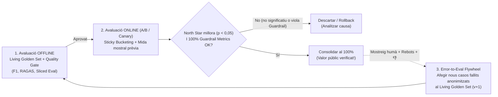

## A. Objectius d'aprenentatge

En completar aquesta lliçó, l'estudiant ha de ser capaç de:

1. **Distingir** l'**avaluació *offline*** (pre-desplegament sobre *Golden Set* històric: ràpida, barata i segura, però estàtica!) de l'**avaluació *online*** (en producció sobre interaccions reals: mesura l'impacte real en ciutadans i funcionaris, però exigeix rigor estadístic i salvaguardes!).
2. **Dissenyar** una **jerarquia de mètriques d'avaluació contínua** en 3 nivells: (a) **Mètrica Nord d'impacte públic (*North Star / Business KPI*)** (temps de resolució d'expedients, taxa de resolució en primer contacte, reducció de *non-take-up*), (b) **Mètriques tècniques del model** (F1, ECE, Faithfulness, taxa de rebot) i (c) **Mètriques salvaguarda (*Guardrail Metrics*)** (equitat per subgrup, 0 fuites PII, latència P95, taxa d'al·lucinació, CSAT)!
3. **Executar** proves ***Online A/B Testing*** rigoroses en entorns públics: aleatorització consistent (per `session_id` o `expedient_id`, mai canviant de versió a meitat d'una conversa!), càlcul de **mida mostral i potència estadística** (evitant el ***peeking*** prematur!), control de l'efecte novetat i límits ètics (mai fer A/B sobre drets legals diferents!).
4. **Establir** el **cicle viu d'evolució del *Golden Set*** (*Living Evaluation Harness*): convertir contínuament els **errors reals detectats en producció** (rebots, queixes `👎`, al·lucinacions trobades al mostreig) en nous casos de regressió del *Golden Set* perquè un error greu **no es repeteixi mai dues vegades**!
5. **Implementar** en Python pur un **avaluador estadístic d'experiment *online* A/B (test Z de proporcions + verificació de *Guardrail Metrics*)** que decideix automàticament si la millora de la versió B és **estadísticament significativa** i compleix totes les salvaguardes!

---

## B. Explicació introductòria

Un error molt freqüent en projectes d'IA és pensar que «l'avaluació acaba el dia que el model surt a producció». En realitat, **el dia que surt a producció és quan comença l'avaluació de veritat!** Sovint un model que guanya `+2%` en F1 *offline* no millora gens el temps de tramitació real dels funcionaris (perquè la interfície no mostra bé l'explicació!), o una millora aparent durant 2 dies d'un experiment *online* resulta ser pur soroll estadístic per mostra massa petita!

L'**avaluació contínua** connecta el laboratori (*offline*) amb la realitat del servei públic (*online*): mesura si la IA aporta **valor públic verificable**, protegeix l'equitat i la seguretat amb ***Guardrail Metrics***, aplica **rigor estadístic en experiments A/B** i converteix cada error real en un nou test permanent del ***Living Golden Set***!

---

## C. Explicació tècnica avançada

### 1. Avaluació *Offline* vs. Avaluació *Online*

| Dimensió | Avaluació *Offline* | Avaluació *Online* (Producció) |
|---|---|---|
| **Dades** | *Golden Test Set* històric i congelat | Trànsit real viu (ciutadans / funcionaris) |
| **Avantatges** | Ràpida, reproduïble, 0 risc per als usuaris, permet provar 50 idees al dia | Mesura l'**impacte real** (temps de tramitació, resolució 010, CSAT, rebots reals) |
| **Limitacions** | Estàtica (pot quedar desfasada respecte del món actual); no captura la reacció humana a la UI | Lenta (cal acumular mostra estadísticament significativa), exigeix salvaguardes estrictes i límits ètics |
| **Funció en MLOps** | **Filtre obligatori (*Quality Gate*)** abans de tocar producció | **Validació final d'impacte públic** i monitoratge continu (*Living Eval*) |

### 2. Jerarquia de mètriques: *North Star* + Tècniques + *Guardrail Metrics*

Una bona avaluació contínua **mai no mira una sola xifra**:
1. **Mètrica Nord (*North Star* / Valor públic)**: allò que importa a la ciutadania i a l'Administració (ex. reducció dels dies mitjans fins a la resolució d'una subvenció, taxa de resolució satisfactòria sense re-contacte al 010).
2. **Mètriques tècniques del model**: `Macro-F1`, `ECE`, taxa de rebot (`< 5%`), `Faithfulness`, `Refusal Accuracy`.
3. **Mètriques salvaguarda (*Guardrail Metrics* — Línies vermelles infranquejables!)**: encara que la Mètrica Nord millori, una versió es **rebutja immediatament** si viola qualsevol *guardrail*:
   - **Equitat**: cap empitjorament de disparitat entre col·lectius, barris o català vs. castellà (`> 2%`).
   - **Seguretat i privacitat**: `0` fuites PII, `0` fallades en detecció d'emergències `112`, taxa de cites invàlides `< 1%`.
   - **SLA i *FinOps***: latència P95 dins límit i cost/consulta dins pressupost.

### 3. Rigor estadístic i ètic en ***Online A/B Testing*** públic

- **Unitat d'aleatorització consistent (*Sticky Bucketing*)**: assignar la variant `A` o `B` per `hash(session_id)` o `hash(expedient_id)` — **mai** canviar un ciutadà de `A` a `B` a meitat de conversa!
- **Mida mostral prèvia i prohibició del ***Peeking*** (mirar abans d'hora)**: si vas mirant el *p-valor* cada hora i atures l'experiment el primer cop que veus `p < 0,05`, dispares els falsos positius del 5% a més del 25%! Cal fixar prèviament la mida mostral (o usar tests seqüencials vàlids) i executar l'experiment mínim **1–2 setmanes completes** (capturant cicles dilluns–diumenge!).
- **Límit ètic irrenunciable en el sector públic**: fer A/B sobre *UX, resum d'ajuda o velocitat d'enrutament* entre dues versions ja validades és legítim; **MAI** fer A/B que atorgui drets, puntuacions de barem o requisits legals diferents a ciutadans iguals (vulneraria el principi constitucional d'igualtat!).

### 4. *Living Golden Set* (*Error-to-Eval Flywheel*)

El *Golden Set* no pot quedar congelat 3 anys mentre el món canvia! Cada setmana, els casos reals fallits trobats al mostreig humà, rebots o `👎` (anonimitzats!) s'incorporen a una nova versió del *Golden Set* (`golden_v2026_Q2`), construint un escut acumulatiu contra regressions!

---

## D. Diagrames i recursos visuals

### Bucle complet d'avaluació contínua (*Offline ↔ Online* + *Living Golden Set*)



---

## E. Aplicació a l'Administració pública

1. **Avaluació real d'impacte en un assistent de redacció interna**: en provar un nou prompt d'esborranys d'informes amb tècnics municipals, la mètrica *offline* (ROUGE/LLM-Judge) pujava `+4%`, però l'avaluació *online* (temps real d'edició humana fins a signatura) va revelar si realment estalviava minuts al funcionari o li feia perdre temps corregint cites!
2. **Control d'equitat com a *Guardrail Metric* permanent**: en tots els experiments *online* de classificadors o chatbots municipals, la paritat de qualitat entre **català i castellà** i entre **municipis grans i petits** actua com a *Guardrail* bloquejant.
3. **Memòria institucional contra errors repetits (*Error-to-Eval Flywheel*)**: quan un ciutadà descobreix una confusió subtil entre «bonificació IBI família nombrosa» i «bonificació plaques solars», aquell cas exacte (anonimitzat) passa automàticament al *Living Golden Set* permanent — cap futura versió tornarà a cometre aquell error!

---

## F. Exemple pràctic guiat

Implementem en **Python pur** un **avaluador d'experiment *online* A/B** que:
1. Aplica un **test Z bilateral de diferència de proporcions** (taxa de resolució sense re-contacte al 010) amb nivell de significació `alpha = 0,05` (`|z| >= 1,96`).
2. Comprova simultàniament totes les ***Guardrail Metrics*** (latència P95, taxa d'error de cites i disparitat màxima català vs. castellà) abans de recomanar `PROMOCIONAR_B`!

```python
"""Exemple 7.8: Avaluació estadística A/B online (test Z de proporcions) + Guardrail Metrics."""
import math


def test_z_proporcions(exits_a: int, n_a: int, exits_b: int, n_b: int) -> tuple[float, float, float]:
    p_a, p_b = exits_a / n_a, exits_b / n_b
    p_pool = (exits_a + exits_b) / (n_a + n_b)
    se = math.sqrt(p_pool * (1.0 - p_pool) * (1.0 / n_a + 1.0 / n_b))
    z = (p_b - p_a) / se if se > 0 else 0.0
    # p-valor bilateral exacte usant la funció d'error complementar (erfc) de la normal estàndard
    p_val = math.erfc(abs(z) / math.sqrt(2.0))
    return p_a, p_b, p_val


def decidir_experiment(
    exits_a: int, n_a: int, exits_b: int, n_b: int, guardrails_b: dict[str, float]
) -> dict[str, object]:
    p_a, p_b, p_val = test_z_proporcions(exits_a, n_a, exits_b, n_b)
    violacions = []
    if guardrails_b["p95_ms"] > 1500.0:
        violacions.append(f"Guardrail SLA violat: P95={guardrails_b['p95_ms']} ms (>1500)")
    if guardrails_b["error_cites"] > 0.01:
        violacions.append(f"Guardrail fidelitat violat: cites errònies={guardrails_b['error_cites']:.2%} (>1%)")
    if guardrails_b["gap_cat_es"] > 0.02:
        violacions.append(f"Guardrail equitat violat: bretxa cat/es={guardrails_b['gap_cat_es']:.2%} (>2%)")

    significatiu = (p_b > p_a) and (p_val < 0.05)
    if violacions:
        decisio = "REBUTJAR_B_VIOLACIO_GUARDRAIL"
    elif significatiu:
        decisio = "PROMOCIONAR_B_A_100"
    else:
        decisio = "MANTENIR_A_NO_SIGNIFICATIU"

    return {
        "decisio": decisio,
        "res_A": f"{p_a:.2%}",
        "res_B": f"{p_b:.2%}",
        "millora_pp": round((p_b - p_a) * 100, 2),
        "p_valor": round(p_val, 5),
        "violacions_guardrail": violacions,
    }


if __name__ == "__main__":
    # Cas 1: Mostra massa petita (+4 pp però p=0.45 -> soroll estadístic!)
    print("Exp 1 (mostra petita):", decidir_experiment(36, 50, 38, 50, {"p95_ms": 900, "error_cites": 0.005, "gap_cat_es": 0.01}))
    # Cas 2: Millora real i significativa (+5 pp sobre n=1000 cadascun, guardrails OK!)
    print("Exp 2 (guanyador real):", decidir_experiment(720, 1000, 770, 1000, {"p95_ms": 950, "error_cites": 0.004, "gap_cat_es": 0.008}))
    # Cas 3: Millora significativa però viola Guardrail de cites i bretxa lingüística!
    print("Exp 3 (viola guardrail):", decidir_experiment(720, 1000, 785, 1000, {"p95_ms": 980, "error_cites": 0.024, "gap_cat_es": 0.035}))
```

### Interpretació dels resultats (execució verificada)

- **Exp 1** (`72% vs 76%` sobre només `n=50` per grup): **`p_valor = 0.648`** (`>= 0.05`) → **`MANTENIR_A_NO_SIGNIFICATIU`** (evita promoure per pur soroll estadístic!).
- **Exp 2** (`72% vs 77%` sobre `n=1000` per grup): **`p_valor = 0.0103`** (`< 0.05`) i 0 violacions → **`PROMOCIONAR_B_A_100`**!
- **Exp 3** (`72% vs 78,5%`, altament significatiu!), però dispara les *Guardrail Metrics* (`error_cites = 2,4% > 1%` i `bretxa cat/es = 3,5% > 2%`) → **`REBUTJAR_B_VIOLACIO_GUARDRAIL`**!

---

## G. Exercici pràctic per resoldre

### Enunciat
Un equip fa un experiment *online* A/B per a una nova versió (`B`) d'un assistent virtual municipal i presenta un informe demanant passar `B` al 100% perquè «en només 24 hores (60 consultes per grup), la versió B té un 80% de clics positius enfront del 72% de la versió A!». En revisar els detalls de l'experiment descobreixes 4 defectes greus:
1. L'assignació es feia a l'atzar en cada **missatge** (no per sessió!), de manera que un mateix ciutadà rebia el torn 1 de la versió A i el torn 2 de la versió B!
2. Van mirar els resultats cada hora i van aturar l'experiment exactament el primer moment que B anava guanyant (`n=60`, 24 hores d'un dimecres).
3. No van mesurar ni la taxa d'al·lucinació/cites ni la latència P95 ni la diferència entre català i castellà.
4. No van recollir els 12 errors reals detectats aquella setmana per afegir-los al *Golden Set*.

Diagnostica **els 4 errors metodològics** i dissenya el **protocol rigorós d'avaluació contínua** (A/B + *Guardrails* + *Living Golden Set*) per repetir la prova correctament!

### Objectius i restriccions
- Corregir unitat d'aleatorització (*Sticky Bucketing* per sessió), eliminar *peeking* amb càlcul previ de mida mostral i durada mínima (1–2 setmanes), incorporar *Guardrail Metrics* bloquejants i activar el *Living Golden Set* (*Error-to-Eval Flywheel*).

:::hint Pista 1 — Els 4 errors exactes
(1) Barrejar A i B dins la mateixa sessió = **contaminació creuada** (cal *Sticky Bucketing* per `session_id`); (2) Mirar cada hora i aturar amb `n=60` = ***Peeking* + mostra insuficient + efecte dia de la setmana** (un +8 pp sobre `n=60` ni tan sols és estadísticament significatiu!); (3) Absència de ***Guardrail Metrics*** (fidelitat/cites, P95, equitat lingüística); (4) Pèrdua dels errors reals → falta ***Living Golden Set***!
:::

:::hint Pista 2 — Protocol complet
(a) Definir Mètrica Nord (taxa de resolució sense re-contacte 010) + 3 *Guardrail Metrics* bloquejants; (b) Calcular prèviament la mida mostral (ex. `n >= 1.000` sessions per variant) i fixar durada mínima de **14 dies** (dos cicles setmanals complets) sense *peeking*; (c) *Sticky Bucketing* per `hash(session_id)`; (d) Tancar el cicle convertint els errors anonimitzats de producció en nous tests del *Living Golden Set*!
:::

### Criteris d'avaluació
- **40%**: Diagnòstic rigorós dels 4 errors (*cross-contamination*, *peeking*/baixa potència/estacionalitat, absència de *Guardrails*, falta d'*Error-to-Eval Flywheel*).
- **40%**: Protocol A/B correcte (*Sticky Bucketing*, càlcul previ de mida mostral, durada 1–2 setmanes, test estadístic `p < 0,05` + jerarquia de mètriques).
- **20%**: Cicle de *Living Golden Set* i menció dels límits ètics de l'A/B en sector públic (mai variar drets o barems legals entre ciutadans!).

### Errors habituals
- Acceptar un resultat A/B amb `n=60` en 24 hores només perquè «80% > 72%» (sense fer el test de significació estadística ni comprovar *Guardrail Metrics*!).

:::solution Solució completa comentada i alternatives
### 1. Diagnòstic dels 4 errors metodològics
1. **Aleatorització per missatge (Contaminació creuada)**: un mateix ciutadà parla alhora amb A i B, trencant la independència de les mostres i degradant la coherència de la conversa.
2. ***Peeking* + baixa potència estadística (`n=60`) + biaix de 24 h**: mirar cada hora i aturar al primer pic dispara falsos positius (`>25%`); amb `n=60` la diferència `80% vs 72%` té `p ≈ 0,30` (pur atzar!) i un sol dimecres no representa caps de setmana ni pics de dilluns.
3. **Ceguesa davant *Guardrail Metrics***: B podria estar obtenint més clics sent més «xerraire» però cometent el doble d'errors de cites o empitjorant el català!
4. **Desaprofitament d'errors reals**: no incorporar els 12 errors de producció al *Golden Set* condemna l'equip a repetir els mateixos errors en futures versions.

### 2. Protocol rigorós d'avaluació contínua
1. **Jerarquia de mètriques**: *North Star* = resolució satisfactòria sense re-contacte al 010; *Guardrails* bloquejants = cites errònies `< 1%`, `P95 <= 1500 ms`, bretxa català/castellà `<= 2%`, `0` fuites PII.
2. **Disseny A/B vàlid**: ***Sticky Bucketing*** determinista per `hash(session_id)`, càlcul previ de mida mostral (`power = 80%`, `alpha = 0,05`, ex. `n >= 1.000` sessions per variant) i finestra fixa de **14 dies** (sense *peeking*!).
3. **Límit ètic**: assegurar que A i B donen informació jurídicament equivalent (mai experimentar amb drets o requisits legals diferents!).
4. ***Living Golden Set* (*Error-to-Eval Flywheel*)**: afegir setmanalment els errors reals anonimitzats de producció com a nous casos de regressió del *Golden Set* per a futurs *Quality Gates*.
:::

---

## H. Test individual

Resol les 10 preguntes sobre avaluació *offline* vs. *online*, jerarquia de mètriques (*North Star* + *Guardrail Metrics*), *Sticky Bucketing*, mida mostral i *peeking*, límits ètics de l'A/B públic, test Z de proporcions i *Living Golden Set*.

---

## I. Preguntes de desenvolupament

### Pregunta 1
Explica per què l'**avaluació *offline*** i l'**avaluació *online*** són complementàries i irreemplaçables entre si, detallant la **jerarquia de mètriques en 3 nivells** (*North Star*, mètriques tècniques i *Guardrail Metrics*).

:::model-answer Resposta model i criteris de correcció (Pregunta 1)
**Resposta model**:
- **Complementarietat *Offline* vs. *Online***: l'avaluació *offline* (*Golden Set* + *Quality Gate*) permet iterar ràpidament amb risc zero i bloquejar regressions abans de producció, però és estàtica i no captura la interacció humana real. L'avaluació *online* mesura si el canvi genera valor públic real en producció, però és més lenta i exigeix salvaguardes.
- **Jerarquia en 3 nivells**:
  1. ***North Star* (Valor públic)**: mètrica d'impacte real (dies de tramitació, resolució en 1r contacte sense re-contacte al 010, reducció del *non-take-up*).
  2. **Mètriques tècniques**: `Macro-F1`, `ECE`, taxa de rebot, `Faithfulness`, `Refusal Accuracy`.
  3. ***Guardrail Metrics* (Línies vermelles)**: equitat lingüística/territorial, `0` fuites PII, taxa de cites errònies `< 1%`, latència P95 i cost FinOps; violar-ne una rebutja la versió encara que pugi la *North Star*!

**Criteris de correcció (10 punts)**:
- Complementarietat exacta *Offline* vs. *Online*: 4 punts.
- Detall precís dels 3 nivells de mètriques amb exemples administratius: 6 punts.
:::

### Pregunta 2
Quins **4 requisits estadístics i ètics** ha de complir un experiment ***Online A/B Testing*** en una administració pública perquè les seves conclusions siguin vàlides i legítimes?

:::model-answer Resposta model i criteris de correcció (Pregunta 2)
**Resposta model**:
1. ***Sticky Bucketing* (unitat d'aleatorització coherent)**: assignar A o B per `hash(session_id)` o `hash(expedient_id)` — mai per missatge individual — per evitar contaminació creuada i incoherència conversacional.
2. **Càlcul previ de mida mostral i prohibició del *Peeking***: fixar prèviament la potència (`80%`), `alpha = 0,05` i una durada mínima d'**1–2 setmanes completes** (capturant cicles setmanals) sense aturar l'experiment el primer moment que surti `p < 0,05` (que infla els falsos positius!).
3. ***Guardrail Metrics* bloquejants**: verificar que la versió guanyadora no degrada equitat, fidelitat de cites, seguretat ni SLA.
4. **Límit ètic irrenunciable en el sector públic**: només experimentar sobre UX, velocitat o qualitat d'assistència entre versions igualment vàlides; **MAI** sotmetre ciutadans a requisits, barems o drets legals diferents (principi d'igualtat davant la llei!).

**Criteris de correcció (10 punts)**:
- Explicació rigorosa dels 4 requisits (2,5 punts cadascun).
:::

### Pregunta 3
Què és el ***Living Golden Set* (*Error-to-Eval Flywheel*)** i com manté vigent l'avaluació contínua al llarg dels anys sense perdre la comparabilitat històrica?

:::model-answer Resposta model i criteris de correcció (Pregunta 3)
**Resposta model**:
- El ***Living Golden Set*** és un conjunt d'avaluació versionat que evoluciona de manera controlada (`golden_v2026_Q1 → Q2 → Q3`): cada error real greu descobert en producció (rebots departamentals, `👎`, al·lucinacions trobades al mostreig humà, nous casos normatius) s'anonimitza i s'incorpora com a nou cas de regressió amb resposta experta validada!
- **Com preserva la comparabilitat històrica**: cada ampliació crea una **nova versió immutable** del *Golden Set* (sense esborrar les anteriors) i sempre s'avalua el *Champion* i el *Challenger* **sobre exactament la mateixa versió** (`golden_v2026_Q2`) abans de promocionar, retirant amb etiqueta d'arxiu només els casos lligats a normes oficialment derogades!

**Criteris de correcció (10 punts)**:
- Explicació del cicle *Error-to-Eval Flywheel* (errors producció → nous tests regressius): 5 punts.
- Gestió del versionat del *Golden Set*, comparabilitat *Champion vs. Challenger* i baixa de casos derogats: 5 punts.
:::

---

## J. Resum per memoritzar

### Conceptes clau
- ***Offline* vs. *Online***: *Offline* = filtre ràpid i segur pre-desplegament (*Quality Gate*); *Online* = mesura real de valor públic en producció!
- **3 nivells de mètriques**: (1) ***North Star*** (valor públic real), (2) **Mètriques tècniques** (F1, rebots, Faithfulness), (3) ***Guardrail Metrics* bloquejants** (equitat, `0` PII, cites errònies `< 1%`, P95, cost!).
- **A/B Testing rigorós**: ***Sticky Bucketing*** (`hash(session_id)`), **mida mostral prèvia**, **1–2 setmanes completes**, **prohibit *Peeking***, test estadístic (`p < 0,05`).
- **Límit ètic públic**: MAI fer A/B sobre drets, barems o requisits legals diferents!
- ***Living Golden Set* (*Error-to-Eval Flywheel*)**: cada error real de producció (anonimitzat) es converteix en un test de regressió permanent perquè no torni a passar mai més!

### Definicions essencials
- ***Guardrail Metrics***: mètriques de seguretat, equitat, qualitat mínima i SLA que actuen com a línies vermelles bloquejants en qualsevol experiment *online*, impedint promoure una versió encara que millori la Mètrica Nord.
- ***Peeking* en A/B Testing**: antipatró estadístic consistent a revisar contínuament el *p-valor* i aturar l'experiment tan bon punt baixa de `0,05`, inflant dràsticament la taxa real de falsos positius.

### Errors conceptuals freqüents
1. Aleatoritzar per missatge individual en lloc de per sessió/expedient (*Sticky Bucketing*).
2. Declarar guanyadora una versió després de 24 hores amb `n=60` sense significació estadística ni *Guardrail Metrics*.
3. Deixar congelat un *Golden Set* de fa 3 anys sense incorporar els errors reals ni les noves normes de producció.

### Possibles preguntes d'examen
- Detecta els 4 errors d'un experiment A/B de 24 hores amb `n=60` aleatoritzat per missatge i redissenya'l rigorosament.
- Per què una versió B que millora `+6,5 pp` la resolució amb `p < 0,01` pot ser igualment rebutjada? (*Guardrail Metrics*!).
- Explica el *Living Golden Set* (*Error-to-Eval Flywheel*) i com manté la comparabilitat *Champion vs. Challenger*.
