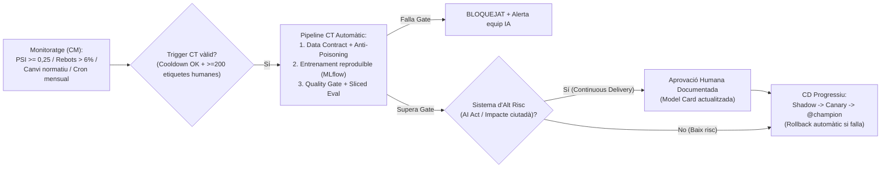

## A. Objectius d'aprenentatge

En completar aquesta lliçó, l'estudiant ha de ser capaç de:

1. **Explicar** l'arquitectura completa **CI / CD / CT** en MLOps: **CI (*Continuous Integration*)** (tests de codi, esquema de dades i prompts en cada commit/PR), **CD (*Continuous Delivery/Deployment*)** (desplegament automatitzat i segur via *Staging → Shadow → Canary* amb *rollback*) i **CT (*Continuous Training*)** (reentrenament automatitzat i validat dels models quan canvien les dades o apareix *drift*)!
2. **Seleccionar** l'**estratègia d'activació (*Trigger*) del reentrenament** més adequada per a cada servei públic: **periòdica (*Scheduled*)** (ex. mensual/anual en campanyes estacionals), **basada en esdeveniments (*Event/Drift-Triggered*)** (quan `PSI >= 0,25` o la taxa de rebots supera el `6%`), o **sota demanda (*On-Demand*)** (davant un canvi legal o de competències municipals)!
3. **Diferenciar** les estratègies d'actualització en **LLMOps** per ordre de cost, velocitat i seguretat: **(1) Actualització de la base RAG** (minuts, cost quasi zero — primera opció sempre per a noves normes!), **(2) Actualització de prompt / *few-shot*** (hores + *PromptOps Quality Gate*), **(3) *Fine-tuning* LoRA** (dies — només per estil/format/domini estable!) i **(4) Migració de model base** (planificada + re-avaluació completa del *Golden Set*)!
4. **Blindar** el reentrenament automàtic (CT) contra els **3 grans riscos de producció**: (a) **auto-alimentació / bucles de biaix (*Feedback Loops*)** (entrenar sobre les pròpies prediccions sense revisió humana!), (b) **enverinament de dades (*Data Poisoning*)** i (c) **promoció cega sense *Quality Gate* ni aprovació humana en sistemes d'alt risc**!
5. **Implementar** en Python pur un **orquestrador de decisió CI/CD/CT** que avalua disparadors (*drift*, rebots, volum d'etiquetes noves, temps des de l'últim entrenament), aplica un **període de refredament (*Cooldown*)** anti-oscil·lació i exigeix aprovació del *Quality Gate* (+ firma humana si és alt risc) abans de promoure!

---

## B. Explicació introductòria

Un model d'IA no és un pont de formigó que es construeix un cop i dura 50 anys: és un organisme viu que envellirà tan bon punt canviïn les ordenances, l'economia, els formularis o el llenguatge ciutadà. Però actualitzar-lo manualment cada 12 mesos és lent i propens a errors, mentre que deixar-lo «reentrenar-se i pujar a producció sol sense supervisió» és una bomba de rellotgeria (podria aprendre dades corruptes, amplificar biaixos o fallar en silenci!).

El paradigma **CI / CD / CT** (Integració Contínua, Lliurament Continu i **Entrenament Continu**) automatitza de manera segura i governada tot el cicle d'actualització: detecta quan toca actualitzar, valida les noves dades contra *Data Contracts* i *poisoning*, entrena el nou *Challenger*, l'obliga a superar el ***Quality Gate*** i el promociona progressivament (*Shadow → Canary*) — amb **aprovació humana explícita** en serveis d'alt risc!

---

## C. Explicació tècnica avançada

### 1. Diferència exacta: **CI** vs. **CD** vs. **CT** (i **CM** — *Continuous Monitoring*)

| Fase | Què prova / automatitza | Disparador (*Trigger*) | Sortida / Artefacte |
|---|---|---|---|
| **CI (*Continuous Integration*)** | Tests unitaris de codi, linting, tests de *Data Contracts*, validació estàtica de prompts/JSON (`Nivell 1`) i construcció Docker `@sha256` | Cada `git push` / Pull Request | Imatge Docker immutable + paquet de pipeline verificat |
| **CT (*Continuous Training*)** | Pipeline automatitzat de dades → entrenament reproduïble (MLflow) → calibratge → validació contra *Living Golden Set* (*Quality Gate*) | **Periòdic** (*cron* mensual), **per *Drift*** (`PSI >= 0,25` o rebots `> 6%`), **per volum d'etiquetes noves** o **manual** (canvi legal) | Nou model candidat registrat al *Model Registry* (`@staging`) |
| **CD (*Continuous Delivery / Deployment*)** | Desplegament progressiu (*Staging → Shadow → Canary 5%→25%→100%*) amb *rollback* automàtic i (en alt risc) **porta d'aprovació humana (*Manual Approval Gate*)** | Candidat aprovat pel *Quality Gate* | Nou `@champion` actiu en producció |

### 2. La «jerarquia d'actualització» en **LLMOps** (del més àgil al més pesat)

En un assistent públic basat en LLM, **no tot s'actualitza reentrenant pesos**:
1. **Nivell 1 — Actualització de coneixement (RAG SSOT)**: ha sortit una nova ordenança o subvenció? → Sincronització incremental de la base de coneixement (minuts, 0 cost GPU, zero risc de *catastrophic forgetting*!).
2. **Nivell 2 — Actualització de *Prompt* / *Few-shot* / *Guardrails***: cal ajustar format o restriccions → *Prompt-as-Code* en Git + *PromptOps Quality Gate* (hores).
3. **Nivell 3 — *Fine-tuning* (LoRA/QLoRA)**: canvia l'estil administratiu corporatiu o cal especialitzar un model petit *on-premise* → CT controlat amb validació anti-*catastrophic forgetting* (dies).
4. **Nivell 4 — Migració de model base / embeddings**: canvi major (ex. passar a un nou model open-weights o nous embeddings 1024d) → índex paral·lel + re-avaluació completa de *Golden Set* + revisió humana *Side-by-Side* + *Shadow → Canary*!

### 3. Salvaguardes crítiques del reentrenament automàtic (CT)

- **Període de refredament (*Cooldown*) i volum mínim d'etiquetes**: no disparar reentrenaments cada 2 hores per pics puntuals (*thrashing*); exigir un *cooldown* mínim (ex. 7–14 dies) i prou dades noves **etiquetades/verificades per humans** (ex. `>= 200` mostres).
- **Protecció contra *Feedback Loops* i *Data Poisoning***: MAI reentrenar automàticament sobre prediccions del propi model ni sobre text ciutadà cru no filtrat; passar **Data Contracts + detecció d'anomalies d'etiquetes** i mantenir un pes equilibrat de dades històriques vs. recents (*Sliding Window* o *Exponential Decay*).
- ***Continuous Delivery* (amb aprovació humana) vs. *Continuous Deployment* (100% autònom)**: en sistemes públics d'alt risc (AI Act Annex III: serveis socials, priorització, inspecció), aplicar **sempre *Continuous Delivery*** (tot automatitzat fins a `@staging`, però l'últim clic cap a producció exigeix **aprovació humana documentada** del responsable tècnic/funcional!).

---

## D. Diagrames i recursos visuals

### Pipeline governat **CI / CT / CD** amb *Cooldown*, *Quality Gate* i aprovació humana



---

## E. Aplicació a l'Administració pública

1. **Reentrenament anual estacional + disparador per reestructuració**: en el classificador d'instàncies municipals, combinar un **CT programat trimestral** (incorporant els rebots validats dels funcionaris) amb un **CT disparat per *Concept Drift*** (taxa de rebot `> 6%`), sempre passant pel *Quality Gate* i *Shadow* 48 h!
2. **Separar actualització normativa (RAG, minuts) de reentrenament (CT, setmanes)**: cada vegada que el BOPB publica una nova convocatòria, el pipeline d'actualització RAG la posa en producció en 10 minuts sense tocar ni un sol pes del model LLM!
3. **Compliment de l'AI Act en actualitzacions substantives**: en sistemes d'alt risc (AI Act), documentar prèviament els canvis predefinits del cicle de reentrenament dins l'avaluació de conformitat (evitant que cada reentrenament rutinari compti com una «modificació substancial» no controlada!) i mantenir sempre l'aprovació humana final (*Continuous Delivery*)!

---

## F. Exemple pràctic guiat

Implementem en **Python pur** un **orquestrador de decisió CI/CD/CT** que:
1. Avalua si cal disparar **CT (*Continuous Training*)** verificant els disparadors (`psi >= 0.25`, `taxa_rebots > 0.06` o `dies_ultim_entrenament >= 90`).
2. Bloqueja reentrenaments prematurs si no es compleix el ***Cooldown*** (`>= 14 dies`) o falten **etiquetes humanes verificades (`>= 200`)**!
3. Decideix la ruta **CD** correcta: *Continuous Delivery* amb **aprovació humana obligatòria** per a sistemes d'alt risc vs. promoció automàtica per *Canary* en baix risc!

```python
"""Exemple 7.9: Orquestrador de decisió CI/CD/CT amb Cooldown, volum mínim i Continuous Delivery."""
from dataclasses import dataclass


@dataclass
class EstatModel:
    nom: str
    alt_risc: bool
    psi_actual: float
    taxa_rebots: float
    dies_des_ultim_ct: int
    etiquetes_humanes_noves: int


def avaluar_politica_ct_cd(m: EstatModel, qualitat_gate_ok: bool = True) -> dict[str, str]:
    disparadors = []
    if m.psi_actual >= 0.25:
        disparadors.append(f"DATA_DRIFT (PSI={m.psi_actual:.2f})")
    if m.taxa_rebots > 0.06:
        disparadors.append(f"CONCEPT_DRIFT (rebots={m.taxa_rebots:.1%})")
    if m.dies_des_ultim_ct >= 90:
        disparadors.append(f"SCHEDULED ({m.dies_des_ultim_ct} dies)")

    if not disparadors:
        return {"model": m.nom, "accio": "CAP_ACCIO_ESTABLE", "motiu": "Mètriques dins rangs normals."}

    # Proteccions anti-oscil·lació (Cooldown) i suficiència estadística
    if m.dies_des_ultim_ct < 14:
        return {"model": m.nom, "accio": "ESPERAR_COOLDOWN", "motiu": f"Només {m.dies_des_ultim_ct}d (<14d cooldown)."}
    if m.etiquetes_humanes_noves < 200:
        return {
            "model": m.nom,
            "accio": "SOL·LICITAR_ETIQUETATGE_ACTIVE_LEARNING",
            "motiu": f"Disparat ({', '.join(disparadors)}) però només hi ha {m.etiquetes_humanes_noves} etiquetes (<200).",
        }
    if not qualitat_gate_ok:
        return {"model": m.nom, "accio": "CT_BLOQUEJAT_QUALITY_GATE", "motiu": "El Challenger no supera el Champion."}

    ruta_cd = (
        "CONTINUOUS_DELIVERY_APROVACIO_HUMANA_OBLIGATORIA -> Shadow -> Canary"
        if m.alt_risc
        else "CD_AUTOMATIC -> Shadow -> Canary"
    )
    return {"model": m.nom, "accio": "PROMOCIO_LLESTA", "triggers": ", ".join(disparadors), "ruta_cd": ruta_cd}


if __name__ == "__main__":
    casos = [
        EstatModel("Classificador_Instancies", False, psi_actual=0.08, taxa_rebots=0.09, dies_des_ultim_ct=5, etiquetes_humanes_noves=310),
        EstatModel("Prioritzador_ServeisSocials", True, psi_actual=0.31, taxa_rebots=0.04, dies_des_ultim_ct=45, etiquetes_humanes_noves=120),
        EstatModel("Prioritzador_ServeisSocials", True, psi_actual=0.31, taxa_rebots=0.07, dies_des_ultim_ct=45, etiquetes_humanes_noves=260),
    ]
    for c in casos:
        print(avaluar_politica_ct_cd(c))
```

### Interpretació dels resultats (execució verificada)

- **Cas 1**: detecta `CONCEPT_DRIFT` (`rebots=9%`), però com que fa només 5 dies de l'últim entrenament (`< 14d`), activa **`ESPERAR_COOLDOWN`** (evita oscil·lació *thrashing* i alerta per investigar el pic sobtat!).
- **Cas 2**: detecta `DATA_DRIFT` (`PSI=0.31`), però només té `120` etiquetes humanes (`< 200`) → activa **`SOL·LICITAR_ETIQUETATGE_ACTIVE_LEARNING`** abans de reentrenar a cegues!
- **Cas 3**: compleix tots els criteris (`45d`, `260` etiquetes humanes, *Quality Gate* OK) i, en ser un sistema d'**alt risc (`alt_risc=True`)**, exigeix **`CONTINUOUS_DELIVERY_APROVACIO_HUMANA_OBLIGATORIA -> Shadow -> Canary`**!

---

## G. Exercici pràctic per resoldre

### Enunciat
Un ajuntament vol «automatitzar al 100%» l'actualització dels seus dos sistemes d'IA:
1. Un **assistent normatiu RAG** (que respon consultes ciutadanes sobre ordenances i subvencions), on algú proposa fer ***fine-tuning* complet setmanal** de l'LLM cada vegada que surt un decret o convocatòria nova!
2. Un **model de priorització de vulnerabilitat en Serveis Socials** (sistema d'alt risc AI Act Annex III), on algú proposa configurar un cron que **cada nit reentrena el model amb les seves pròpies prediccions del dia i el puja directament al 100% a producció sense revisió humana**!

Desmunta tècnicament i normativament totes dues propostes i dissenya l'**estratègia correcta d'actualització (CI/CD/CT i jerarquia LLMOps)** per a cada sistema!

### Objectius i restriccions
- Aplicar la jerarquia d'actualització LLMOps (RAG incremental vs. *fine-tuning*) al sistema 1, i substituir el reentrenament cec nocturn del sistema 2 per **CT governat amb etiquetes humanes verificades, anti-*Feedback Loop*, *Cooldown*, *Quality Gate* i *Continuous Delivery* amb aprovació humana**!

:::hint Pista 1 — Sistema 1 (RAG vs. *Fine-tuning* setmanal)
Fer *fine-tuning* setmanal per incorporar decrets nous és **car, lent, propens a *catastrophic forgetting* i deixa normes derogades gravades als pesos**! Per a coneixement canviant, l'actualització correcta és **Nivell 1: sincronització incremental de la base RAG SSOT** (en minuts, amb `valid_from/valid_until` i zero cost de GPU)!
:::

:::hint Pista 2 — Sistema 2 (Reentrenament nocturn amb pròpies prediccions + desplegament autònom)
Doble desastre: (a) entrenar amb les **pròpies prediccions** crea un **bucle de retroalimentació (*Feedback Loop*)** que amplifica biaixos i degrada el model ràpidament; (b) pujar al 100% sense *Quality Gate* ni aprovació humana viola la governança d'**alt risc (AI Act Annex III)**! Solució: **CT amb *Cooldown* + dades etiquetades/verificades per treballadors socials + *Data Contract* + *Quality Gate* (*Sliced Eval* equitat) + *Continuous Delivery* (aprovació humana obligatòria) + *Shadow → Canary***!
:::

### Criteris d'avaluació
- **40%**: Sistema 1: justificació exacta de la jerarquia LLMOps (**actualització RAG SSOT** en lloc de *fine-tuning* setmanal).
- **40%**: Sistema 2: identificació de **bucle de retroalimentació (*Feedback Loop*)**, risc de *Data Poisoning*, absència de *Quality Gate* i vulneració de supervisió en sistema d'alt risc AI Act.
- **20%**: Disseny complet del pipeline **CI/CT/Continuous Delivery** (triggers, *Cooldown*, volum mínim d'etiquetes humanes, aprovació documentada i *Shadow → Canary*).

### Errors habituals
- Acceptar *Continuous Deployment* 100% autònom sense intervenció humana en un sistema de Serveis Socials classificat d'alt risc a l'Annex III de l'AI Act!

:::solution Solució completa comentada i alternatives
### 1. Sistema 1 — Assistent normatiu RAG (Jerarquia LLMOps)
- **Per què rebutjar el *fine-tuning* setmanal**: costosíssim en GPU, risc de *catastrophic forgetting*, impossibilitat d'esborrar normes derogades dels pesos i zero garantia de cites exactes!
- **Solució correcta**: aplicar el **Nivell 1 (Actualització RAG SSOT)**: pipeline automatitzat de sincronització incremental del repositori oficial (hash SHA-256 + `valid_until`) + execució automàtica del *PromptOps Quality Gate* només quan canvia el prompt o el model base!

### 2. Sistema 2 — Priorització de Serveis Socials (Alt Risc AI Act — CI/CT/Continuous Delivery)
- **Errors letals de la proposta inicial**:
  1. Reentrenar amb les **pròpies prediccions** = **bucle auto-reforçat (*Feedback Loop*)** que amplifica errors i biaixos socials exponencialment!
  2. Reentrenament nocturn sense *Cooldown* ni *Quality Gate* = inestabilitat i risc de *Data Poisoning*.
  3. Desplegament 100% autònom = inacceptable en un sistema d'**alt risc (Annex III AI Act)**.
- **Pipeline correcte**:
  1. **Disparadors governats**: CT trimestral o per `PSI >= 0,25` / caiguda de qualitat, amb *Cooldown* (`>= 14–30 dies`) i mínim de **casos verificats per treballadors socials humans** (mai pròpies prediccions!).
  2. **Validació estricte**: *Data Contracts*, revisió de biaixos per barri/col·lectiu (*Sliced Evaluation*) i *Champion vs. Challenger*.
  3. ***Continuous Delivery* (NO desplegament cec!)**: el candidat entra a `@staging` amb la *Model Card* actualitzada → **aprovació humana documentada** del comitè tècnic/funcional → desplegament progressiu ***Shadow → Canary*** amb *rollback* atòmic!
:::

---

## H. Test individual

Resol les 10 preguntes sobre CI vs. CD vs. CT, estratègies de *trigger* (periòdic, *drift*, volum, canvi legal), *Cooldown*, jerarquia d'actualització LLMOps, *Feedback Loops*, *Data Poisoning*, *Continuous Delivery* vs. *Deployment* en alt risc AI Act i *Sliding Window*.

---

## I. Preguntes de desenvolupament

### Pregunta 1
Explica les diferències entre **CI (*Continuous Integration*)**, **CT (*Continuous Training*)** i **CD (*Continuous Delivery vs. Continuous Deployment*)** en MLOps, indicant per què els sistemes públics d'alt risc han d'utilitzar ***Continuous Delivery*** i no *Continuous Deployment* completament autònom.

:::model-answer Resposta model i criteris de correcció (Pregunta 1)
**Resposta model**:
- **CI**: automatitza tests de codi, *Data Contracts*, validació estàtica de prompts/esquemes i construcció d'imatges Docker `@sha256` en cada canvi de Git.
- **CT**: automatitza l'execució del pipeline de dades, reentrenament reproduïble (MLflow), calibratge i validació contra el *Living Golden Set* (*Quality Gate*) davant *triggers* programats o de *drift*.
- **CD (*Delivery* vs. *Deployment*)**: en *Continuous Deployment*, el nou model passa automàticament fins a producció sense intervenció humana; en ***Continuous Delivery***, tot està automatitzat fins a `@staging` (llest per desplegar en 1 clic), però el pas a producció exigeix una **porta d'aprovació humana documentada**.
- **Per què *Continuous Delivery* en alt risc públic (AI Act Annex III)**: sistemes de Serveis Socials, priorització o inspecció afecten drets fonamentals i exigeixen supervisió humana efectiva (art. 14 AI Act), validació de la *Model Card*/equitat i responsabilitat administrativa abans de posar una nova versió davant la ciutadania!

**Criteris de correcció (10 punts)**:
- Explicació rigorosa de CI, CT i diferència Delivery vs. Deployment: 6 punts.
- Justificació jurídica/operativa de *Continuous Delivery* en sistemes d'alt risc públics: 4 punts.
:::

### Pregunta 2
Ordena i justifica la **jerarquia de 4 nivells d'actualització en LLMOps** (RAG, Prompting, *Fine-tuning* LoRA i Migració de model base), posant un exemple concret d'administració pública que correspon a cada nivell.

:::model-answer Resposta model i criteris de correcció (Pregunta 2)
**Resposta model**:
1. **Nivell 1 — Actualització de la base RAG SSOT** (minuts, cost mínim, 0 *forgetting*): quan s'aprova una nova ordenança fiscal, convocatòria de subvencions o canvi d'horaris d'OAC. Sempre primera opció per a coneixement canviant!
2. **Nivell 2 — Actualització de *Prompt* / *Few-shot* / *Guardrails*** (hores + *PromptOps Quality Gate*): quan cal corregir el format JSON, reforçar la política d'abstenció o afinar el to institucional.
3. **Nivell 3 — *Fine-tuning* (LoRA/QLoRA)** (dies + validació anti-*forgetting*): quan cal adaptar un model *open-weights* petit *on-premise* a un estil administratiu molt específic (ex. redacció de decrets catalans o extracció d'esquemes complexos) sobre un domini estable.
4. **Nivell 4 — Migració de model base / embeddings** (setmanes + índex paral·lel + revisió humana *Side-by-Side* + *Shadow → Canary*): quan apareix una nova generació de models molt superior o més eficient/econòmica.

**Criteris de correcció (10 punts)**:
- Els 4 nivells ben ordenats amb criteri de cost/risc i un exemple administratiu encertat per nivell (2,5 punts cadascun).
:::

### Pregunta 3
Què és un **bucle de retroalimentació (*Feedback Loop*)** en reentrenament continu (CT) i quines **3 salvaguardes tècniques** el prevenen juntament amb el ***Data Poisoning*** i l'oscil·lació (*thrashing*)?

:::model-answer Resposta model i criteris de correcció (Pregunta 3)
**Resposta model**:
- **Bucle de retroalimentació (*Feedback Loop*)**: es produeix quan el pipeline CT entrena la versió `v+1` utilitzant com a «veritat» les **pròpies prediccions** del model `v` (o només les dades que el propi model va seleccionar, ex. només els expedients que el model va marcar per inspeccionar!). Això crea una càmera d'eco que **amplifica errors i biaixos** i fa col·lapsar la qualitat del model (*Model Collapse*)!
- **3 salvaguardes tècniques**:
  1. **Etiquetes humanes independents i mostra aleatòria d'exploració**: entrenar CT únicament amb etiquetes verificades per humans + incloure un 10–20% de casos revisats aleatòriament (no només els triats pel model!).
  2. ***Data Contracts* + detecció d'anomalies anti-*Data Poisoning***: validar distribucions, rebutjar lots anòmals i comparar sempre contra un ***Living Golden Set* humà** abans de promoure.
  3. **Període de refredament (*Cooldown*) + volum mínim d'etiquetes**: impedir reentrenaments massa freqüents per pics passatgers (*thrashing*).

**Criteris de correcció (10 punts)**:
- Explicació clara de *Feedback Loop* (i *selection bias* / *model collapse*): 4 punts.
- Les 3 salvaguardes concretes (2 punts cadascuna): 6 punts.
:::

---

## J. Resum per memoritzar

### Conceptes clau
- **CI / CT / CD**: **CI** (tests codi, *Data Contracts*, prompts, Docker `@sha256`); **CT** (reentrenament reproduïble + *Quality Gate*); **CD** (*Shadow → Canary → @champion* + *rollback*).
- **Alt risc AI Act → *Continuous Delivery*** (aprovació humana documentada abans de producció!), MAI *Continuous Deployment* cec!
- **Disparadors de CT**: **Periòdic** (estacional/trimestral), **Per *Drift*** (`PSI >= 0,25` o rebots `> 6%`), **Per volum d'etiquetes** (`>= 200`), **Manual** (canvi normatiu). Protegir amb ***Cooldown*** (`>= 14 dies`) anti-oscil·lació!
- **Jerarquia LLMOps** (de més àgil a més pesat): **(1) RAG SSOT** (minuts — normes noves!) → **(2) Prompt/Guardrails** (hores) → **(3) LoRA** (dies — estil estable) → **(4) Migració model base / embeddings** (índex paral·lel + *Side-by-Side*).
- **Salvaguardes CT**: MAI reentrenar sobre les pròpies prediccions (*Feedback Loop* / *Model Collapse*); validar contra *Data Poisoning* i *Living Golden Set* humà!

### Definicions essencials
- **CT (*Continuous Training*)**: automatització governada del reentrenament, calibratge i validació de models davant canvis de dades, *drift* o cicles programats.
- ***Continuous Delivery* vs. *Continuous Deployment***: *Delivery* automatitza tot el procés fins a tenir el candidat validat i llest per desplegar subjecte a aprovació humana; *Deployment* promociona automàticament fins a producció sense clic humà.

### Errors conceptuals freqüents
1. Fer *fine-tuning* setmanal d'un LLM per actualitzar ordenances o convocatòries (això es resol amb RAG incremental!).
2. Reentrenar automàticament sobre les pròpies prediccions del model sense verificació humana (*Feedback Loop*!).
3. Configurar desplegament 100% autònom sense aprovació humana en un sistema d'alt risc (Serveis Socials / priorització).

### Possibles preguntes d'examen
- Per què NO s'ha de fer *fine-tuning* setmanal per actualitzar decrets en un assistent municipal i quina alternativa LLMOps toca aplicar?
- Quins riscos té reentrenar un model cada nit amb les seves pròpies prediccions i desplegar-lo automàticament al 100%?
- Diferencia CI, CT, *Continuous Delivery* i *Continuous Deployment* i explica el paper del *Cooldown*.
