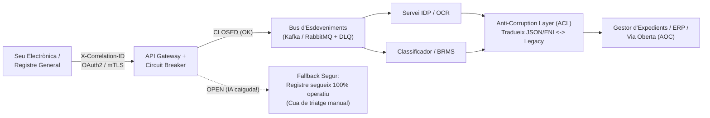

## A. Objectius d'aprenentatge

En completar aquesta lliçó final del Mòdul 7, l'estudiant ha de ser capaç de:

1. **Dissenyar** la **integració desacoblada** d'un servei d'IA (ML / IDP / LLM) dins l'ecosistema real d'una administració pública: **Seu Electrònica**, **Registre General (SIR/GEISER/Mux)**, **Gestor d'Expedients (Gestiona / Audifilm / T-Systems)**, **ERP comptable**, **Via Oberta (AOC)** i **Gestor Documental (ENI)**!
2. **Seleccionar** el **patró d'integració òptim** per a cada enllaç: **API REST/OpenAPI síncrona** (validacions ràpides), **Arquitectura orientada a esdeveniments (*Event-Driven* via Kafka / RabbitMQ + *Outbox Pattern*)** (desacoblament total entre Registre → IDP → Classificador → Gestor d'Expedients!), **Webhooks signats (HMAC)** o **Adaptador ACL (*Anti-Corruption Layer*)** davant sistemes *legacy*!
3. **Blindar** les integracions amb **patrons de resiliència** obligatoris en producció: ***Timeouts* estrictes**, **reintents amb *Exponential Backoff + Jitter***, ***Circuit Breaker*** (evitar caigudes en cascada si cau el servidor d'IA — el gestor d'expedients HA DE CONTINUAR FUNCIONANT en mode degradat sense IA!), **claus d'idempotència** i ***Dead-Letter Queue* (DLQ)**!
4. **Aplicar** la **seguretat d'integració corporativa (ENS)**: **API Gateway**, autenticació servei-a-servei (**OAuth2 Client Credentials / mTLS**), **Zero Trust / segmentació de xarxa**, propagació de **`X-Correlation-ID`** de punta a punta per a traçabilitat distribuïda i gestió de secrets en **Vault**!
5. **Implementar** en Python pur un **client d'integració resilient amb *Circuit Breaker* (estats `CLOSED` → `OPEN` → `HALF_OPEN`), *fallback* degradat segur i propagació de `correlation_id`** perquè una caiguda del servei d'IA **mai** no bloquegi el Registre General!

---

## B. Explicació introductòria

Un servei d'IA perfecte que viu aïllat en un servidor sense connectar-se al Gestor d'Expedients, al Registre General ni a la Seu Electrònica no transforma cap procediment. Però integrar IA amb sistemes administratius crítics té una regla d'or d'arquitectura: **el servei d'IA és un component auxiliar desacoblat; si el servidor d'IA o la GPU cauen a les 11:00 h del matí, el Registre General i la Seu Electrònica HAN DE CONTINUAR FUNCIONANT al 100%!**

Aquesta lliçó tanca el Mòdul 7 explicant com acoblar netament ML i LLMs dins la infraestructura pública real mitjançant **contractes OpenAPI**, **arquitectures orientades a esdeveniments (*Event-Driven*)**, **capes anticorrupció (*Anti-Corruption Layer*)**, **seguretat Zero Trust (OAuth2 / mTLS / ENS)** i **resiliència (*Circuit Breaker* + degradació elegant)**!

---

## C. Explicació tècnica avançada

### 1. Patrons d'integració dins l'ecosistema públic

| Patró | Com funciona | Quan usar-lo | Benefici clau |
|---|---|---|---|
| **API REST + OpenAPI 3.1 (Síncron)** | Crida HTTP amb esquema tipat, `timeout < 2 s`, `X-Correlation-ID` i `model_version` | Validació *Shift-Left*, consulta ràpida de chatbot, suggeriment instantani al Registre | Simplicitat i contracte formal generat automàticament |
| ***Event-Driven* (*Message Broker*: Kafka / RabbitMQ)** | El Registre publica l'esdeveniment `expedient.registrat`; IDP, Classificador i Validador s'hi subscriuen de forma independent! | Fluxos multi-pas (Registre → OCR → Classificació → Via Oberta → Gestor d'Expedients) | **Desacoblament total**, absorció de pics estacionals i tolerància a fallades (*DLQ*)! |
| **Capa Anticorrupció (*Anti-Corruption Layer — ACL*)** | Microservei adaptador que tradueix formats *legacy* (SOAP/XML antic, codis críptics d'ERP) al model de domini net de la IA (JSON/ENI) | Integració amb aplicacions municipals heretades o múltiples ERPs en 311 ajuntaments (DIBA!) | Aïlla els models d'IA de les rareses del *legacy*; si es canvia d'ERP només es canvia l'adaptador! |
| **Webhooks signats (HMAC-SHA256)** | Quan acaba un *job* asíncron d'IDP, el servei d'IA notifica el Gestor d'Expedients amb signatura criptogràfica HMAC | Notificar resultats de processos pesats (PDFs de 80 pàgines) | Evita *polling* constant i garanteix autenticitat del remitent! |

### 2. Patrons de resiliència obligatoris (Zero caigudes en cascada!)

1. ***Timeout* estricte**: tota crida del Gestor d'Expedients cap a l'API d'IA porta un *timeout* curt (ex. `1,5 s` en ML) — mai connexions obertes indefinidament!
2. **Reintent idempotent amb *Exponential Backoff + Jitter***: en errors transitoris (`503`, `timeout`), esperar `1s → 2s → 4s` + soroll aleatori (*jitter*) per evitar el fenomen *Thundering Herd* (tots els clients reintentant alhora el mateix mil·lisegon!), només en operacions idempotents!
3. ***Circuit Breaker* (3 estats: `CLOSED` → `OPEN` → `HALF_OPEN`)**:
   - **`CLOSED`** (normal): totes les crides passen al servei d'IA.
   - **`OPEN`** (disparat després de ex. 5 fallades seguides): **talla les crides immediatament (< 1 ms)** i retorna el ***fallback* degradat segur** (ex. `ENVIAR_A_CUA_TRIATGE_HUMA`), impedint saturar el Registre General esperant *timeouts*!
   - **`HALF_OPEN`** (després de `30 s` de recuperació): deixa passar 1 crida de prova; si reïx → torna a `CLOSED`; si torna a fallar → torna a `OPEN`!
4. ***Dead-Letter Queue* (DLQ) + *Outbox Pattern***: missatges que fallen repetidament passen a la DLQ per a revisió/reprocessament sense perdre mai cap expedient registrat!

### 3. Seguretat i traçabilitat *End-to-End* (ENS)

- **API Gateway corporatiu**: punt únic d'entrada que aplica **OAuth2 (*Client Credentials*) / mTLS**, *rate limiting* per aplicació clienta, validació de mida màxima de càrrega i registre al SIEM.
- **Propagació de `X-Correlation-ID`**: un identificador UUID creat a la Seu Electrònica viatja per totes les capçaleres HTTP i esdeveniments Kafka (`Seu → Registre → IDP → Classificador → Gestor d'Expedients`), permetent reconstruir en segons tota la vida d'un expedient a través de 6 sistemes diferents!

---

## D. Diagrames i recursos visuals

### Integració desacoblada *Event-Driven* + *API Gateway* + *Circuit Breaker* en l'Administració



---

## E. Aplicació a l'Administració pública

1. **Plataforma compartida de la Diputació per a 311 ajuntaments (*Multi-ERP* amb *Anti-Corruption Layer*)**: cada ajuntament pot tenir un gestor d'expedients diferent (*Gestiona*, *Audifilm*, *T-Systems*, *e-Tram*); un contracte intern únic basat en **ENI + OpenAPI** separat per un adaptador **ACL** per fabricant permet desplegar exactament el mateix motor d'IA a tots 311 ens locals!
2. **Registre General 100% immune a caigudes de GPU**: si el node GPU del classificador pateix una avaria o manteniment, el ***Circuit Breaker*** passa a `OPEN` en 5 segons i el Registre segueix enregistrant instàncies a velocitat normal enviant-les a la cua de triatge del funcionari — **zero parades de la Seu Electrònica**!
3. **Resolució d'incidències multi-sistema amb `X-Correlation-ID`**: quan un ajuntament pregunta *«Què ha passat amb l'expedient `REG-2026-8841`?»*, buscar el seu `correlation_id` a Grafana/SIEM mostra la seqüència exacta a través del Gateway, IDP, Classificador, Via Oberta i Gestor d'Expedients!

---

## F. Exemple pràctic guiat

Implementem en **Python pur** un **client d'integració resilient amb *Circuit Breaker* (`CLOSED → OPEN → HALF_OPEN`), propagació de `correlation_id` i degradació segura** que protegeix el Registre General davant una caiguda del microservei d'IA!

```python
"""Exemple 7.10: Client d'integració resilient amb Circuit Breaker (CLOSED/OPEN/HALF_OPEN) i fallback."""
import uuid


class CircuitBreakerIA:
    def __init__(self, max_fallades: int = 3) -> None:
        self.estat = "CLOSED"  # CLOSED | OPEN | HALF_OPEN
        self.fallades_consecutives = 0
        self.max_fallades = max_fallades

    def invocar_classificador(self, servei_disponible: bool, correlation_id: str) -> dict[str, str]:
        if self.estat == "OPEN":
            return {
                "correlation_id": correlation_id,
                "circuit": "OPEN",
                "resultat": "FALLBACK_CUA_TRIATGE_HUMA (fail-fast 0ms, Registre operatiu!)",
            }

        # Intent de crida real (en estat CLOSED o sonda HALF_OPEN)
        if servei_disponible:
            self.estat = "CLOSED"
            self.fallades_consecutives = 0
            return {
                "correlation_id": correlation_id,
                "circuit": "CLOSED",
                "resultat": "AUTO_ENRUTAT_URBANISME (model_v2)",
            }

        self.fallades_consecutives += 1
        if self.fallades_consecutives >= self.max_fallades or self.estat == "HALF_OPEN":
            self.estat = "OPEN"
        return {
            "correlation_id": correlation_id,
            "circuit": self.estat,
            "resultat": "ERROR_TIMEOUT -> FALLBACK_CUA_TRIATGE_HUMA",
        }

    def obrir_sonda_recuperacio(self) -> None:
        if self.estat == "OPEN":
            self.estat = "HALF_OPEN"


if __name__ == "__main__":
    cb = CircuitBreakerIA(max_fallades=3)
    # 1. Tres fallades seguides del servei d'IA obren el circuit!
    for i in range(1, 5):
        cid = f"corr-{uuid.uuid4().hex[:6]}"
        print(f"Petició #{i}:", cb.invocar_classificador(servei_disponible=False, correlation_id=cid))

    # 2. Passat el temps d'espera, passa a HALF_OPEN i prova recuperació -> Servei IA recuperat!
    cb.obrir_sonda_recuperacio()
    print("Petició #5 (HALF_OPEN recuperat):", cb.invocar_classificador(servei_disponible=True, correlation_id="corr-rec001"))
```

### Interpretació dels resultats (execució verificada)

- Petició `#1` i `#2`: fallada transitòria (`CLOSED` → `fallback`). Petició `#3`: assoleix `max_fallades = 3` → **`circuit = OPEN`**!
- Petició `#4`: en estar **`OPEN`**, el client aplica ***fail-fast* instantani (`0 ms`)** sense esperar cap *timeout* i deriva a `FALLBACK_CUA_TRIATGE_HUMA` mantenint el Registre General 100% fluid!
- Petició `#5`: després de passar a **`HALF_OPEN`**, la sonda confirma que el servei d'IA s'ha recuperat i tanca automàticament el circuit (**`CLOSED`**)!

---

## G. Exercici pràctic per resoldre

### Enunciat
Una diputació vol oferir un servei centralitzat d'**IDP + Classificació automàtica d'instàncies** a 80 ajuntaments que utilitzen **4 gestors d'expedients diferents** (alguns amb API REST moderna i d'altres amb SOAP/XML *legacy*). En una primera prova pilot, un ajuntament va cridar directament i síncronament el servidor d'IA des del botó «Registrar instància» de la seva Seu Electrònica sense *timeout* ni *Circuit Breaker*: el dia que el servidor d'IA va fer un reinici de 15 minuts, **els ciutadans d'aquell ajuntament no van poder registrar cap instància a la Seu Electrònica!**

Redissenya l'**arquitectura completa d'integració corporativa** per a tots 80 ajuntaments garantint: (1) zero parades de les Seus Electròniques davant caigudes d'IA, (2) suport net als 4 gestors d'expedients diferents, i (3) seguretat ENS i traçabilitat extrem a extrem!

### Objectius i restriccions
- Combinar *API Gateway* (OAuth2/mTLS + *rate limiting*), integració desacoblada *Event-Driven* (o *Circuit Breaker* + *fallback* segur), *Anti-Corruption Layer* per als 4 fabricants sobre contracte canònic ENI/OpenAPI, idempotència + DLQ i propagació de `X-Correlation-ID`.

:::hint Pista 1 — Zero parades de la Seu Electrònica!
**Mai** bloquejar el registre oficial d'entrada (obligació legal 24/7 LPACAP!) esperant síncronament la IA! El Registre desa l'expedient immediatament i **publica un esdeveniment asíncron (`expedient.registrat`)** al bus (*Kafka/RabbitMQ*), o si fa una crida ràpida síncrona la protegeix amb **`timeout <= 1,5 s` + *Circuit Breaker* + *fallback* a cua manual**!
:::

:::hint Pista 2 — 4 gestors d'expedients diferents + Seguretat ENS
Definir un **contracte canònic OpenAPI / ENI** al nucli d'IA i construir 4 petits adaptadors ***Anti-Corruption Layer (ACL)*** (un per fabricant REST/SOAP) per no embrutar mai el servei d'IA amb formats *legacy*; protegir l'**API Gateway** amb **OAuth2 *Client Credentials* / mTLS + aïllament `tenant_id` (municipi)** + **webhooks HMAC** + **`X-Correlation-ID`** propagat a tots els sistemes!
:::

### Criteris d'avaluació
- **35%**: Desacoblament total del Registre 24/7 (*Event-Driven* amb cues + DLQ + idempotència, o *timeout* + *Circuit Breaker* + *fallback* degradat).
- **35%**: Suport escalable als 4 gestors d'expedients via **contracte canònic ENI/OpenAPI + *Anti-Corruption Layer* (ACL)** per fabricant.
- **30%**: Seguretat i observabilitat ENS (**API Gateway**, **OAuth2/mTLS**, aïllament multi-tenant per municipi, secrets en Vault, **HMAC** en webhooks i propagació **`X-Correlation-ID`**).

### Errors habituals
- Programar 4 versions diferents del motor d'IA (una per a cada gestor d'expedients!) en lloc d'aïllar les diferències dins d'una *Anti-Corruption Layer*.

:::solution Solució completa comentada i alternatives
### 1. Zero parades del Registre Electrònic 24/7 (Desacoblament i Resiliència)
- El Registre General **registra i expedeix el justificant al ciutadà de manera 100% independent de la IA**.
- A continuació publica un esdeveniment asíncron `expedient.registrat` (amb **`idempotency_key`** i **`X-Correlation-ID`**) a un bus de missatges (*RabbitMQ / Kafka* amb **DLQ**). Si el servidor d'IA es reinicia 15 minuts, els missatges s'acumulen sense perdre's i es processen automàticament en tornar!
- Per a qualsevol crida síncrona auxiliar (ex. suggeriment en pantalla), aplicar **`timeout <= 1,5 s` + *Circuit Breaker* (`CLOSED → OPEN → HALF_OPEN`)** amb *fallback* immediat a triatge humà!

### 2. Suport als 4 gestors d'expedients (*Anti-Corruption Layer*)
- El nucli d'IA exposa un únic **contracte canònic OpenAPI 3.1 + metadades ENI**.
- Es despleguen **4 adaptadors lleugers *Anti-Corruption Layer (ACL)*** (un per cada fabricant de gestor d'expedients, traduint SOAP/XML o JSON propi al format canònic), evitant acoblar ni duplicar mai el codi d'IA!

### 3. Seguretat ENS i traçabilitat *End-to-End*
- **API Gateway corporatiu**: autenticació mútua (**mTLS** o **OAuth2 Client Credentials**), *rate limiting* per ajuntament, validació estricta del `tenant_id` (aïllament entre els 80 municipis!), secrets en **Vault** i **webhooks signats amb HMAC-SHA256**.
- **`X-Correlation-ID`**: propagat en totes les capçaleres i cues per rastrejar qualsevol expedient extrem a extrem en segons!
:::

---

## H. Test individual

Resol les 10 preguntes sobre arquitectura *Event-Driven*, *Anti-Corruption Layer (ACL)*, *Circuit Breaker* (`CLOSED`/`OPEN`/`HALF_OPEN`), *Exponential Backoff + Jitter*, *Dead-Letter Queue (DLQ)*, *webhooks* HMAC, API Gateway (OAuth2/mTLS) i `X-Correlation-ID`.

---

## I. Preguntes de desenvolupament

### Pregunta 1
Explica els **3 estats del patró *Circuit Breaker* (`CLOSED`, `OPEN`, `HALF_OPEN`)** i justifica per què és obligatori en integrar un servei d'IA amb un sistema administratiu crític com la Seu Electrònica o el Registre General.

:::model-answer Resposta model i criteris de correcció (Pregunta 1)
**Resposta model**:
- **Els 3 estats del *Circuit Breaker***:
  1. **`CLOSED`** (estat normal): les peticions passen cap al servei d'IA; es compten les fallades consecutives o la taxa d'error.
  2. **`OPEN`** (disparat en superar el llindar d'errors, ex. 3–5 fallades seguides): bloqueja temporalment les crides cap a la IA i retorna immediatament (*fail-fast* en `< 1 ms`) el ***fallback* degradat segur** (ex. cua de triatge manual), protegint tant el sistema client com la IA col·lapsada!
  3. **`HALF_OPEN`** (després del temps d'espera de recuperació, ex. 30 s): deixa passar 1 o poques peticions sonda; si funcionen, torna a `CLOSED`; si fallen, torna a `OPEN`.
- **Justificació en el sector públic**: el Registre General i la Seu Electrònica són serveis públics 24/7 subjectes a terminis legals (LPACAP); sense *Circuit Breaker* ni *timeouts*, una avaria del servidor GPU congelaria els fils del Registre i impediria als ciutadans presentar sol·licituds dins termini (caiguda en cascada!).

**Criteris de correcció (10 punts)**:
- Explicació exacta dels 3 estats i les seves transicions: 6 punts.
- Justificació de prevenció de caigudes en cascada sobre sistemes públics 24/7: 4 punts.
:::

### Pregunta 2
Com resol el patró ***Anti-Corruption Layer (ACL)*** combinat amb una **arquitectura orientada a esdeveniments (*Event-Driven*)** la integració d'una plataforma d'IA supramunicipal (Diputació) amb desenes d'ajuntaments que utilitzen diferents gestors d'expedients *legacy*?

:::model-answer Resposta model i criteris de correcció (Pregunta 2)
**Resposta model**:
- ***Anti-Corruption Layer (ACL)***: situa petits adaptadors de traducció a la frontera entre el **model canònic net del servei d'IA** (OpenAPI 3.1 + metadades ENI) i els formats heterogenis dels gestors d'expedients municipals (SOAP/XML antics, JSON propietaris). Així, el nucli d'IA és únic i agnòstic del fabricant; si un ajuntament canvia de proveïdor de gestor d'expedients, només es canvia l'adaptador!
- ***Event-Driven* (Kafka / RabbitMQ + DLQ)**: desacobla temporalment l'emissió d'expedients del processament IA pesat (OCR/IDP/Classificació), absorbeix pics estacionals de convocatòries sense caigudes i assegura amb idempotència i *Dead-Letter Queue* que **cap expedient registrat es perd**!

**Criteris de correcció (10 punts)**:
- Paper i avantatges de l'*Anti-Corruption Layer* en entorns multi-fabricant: 5 punts.
- Paper i resiliència de l'arquitectura *Event-Driven* (desacoblament, pics, DLQ, idempotència): 5 punts.
:::

### Pregunta 3
Detalla els **controls de seguretat i traçabilitat d'integració (ENS)** necessaris per exposar una API d'IA corporativa a altres sistemes interns: **API Gateway, OAuth2/mTLS, *Jitter*, Webhooks HMAC i `X-Correlation-ID`**.

:::model-answer Resposta model i criteris de correcció (Pregunta 3)
**Resposta model**:
1. **API Gateway + OAuth2 *Client Credentials* / mTLS**: autenticació forta servei-a-servei (zero credencials incrustades al codi; secrets en Vault), control d'accés multi-tenant (`tenant_id`), xifratge TLS en trànsit i *rate limiting* per protegir recursos GPU.
2. **Webhooks signats amb HMAC-SHA256**: en notificacions asíncrones (ex. resultat d'IDP cap al Gestor d'Expedients), verifica la integritat del payload i l'autenticitat criptogràfica del remitent.
3. **Reintents amb *Exponential Backoff + Jitter***: evita saturar un servei en recuperació amb onades sincronitzades de reintents (*Thundering Herd*).
4. **Propagació de `X-Correlation-ID`**: un UUID generat al punt d'entrada viatja per totes les capçaleres HTTP i missatges de cua, permetent auditar i depurar en segons el recorregut complet d'un expedient a través de tots els sistemes corporatius!

**Criteris de correcció (10 punts)**:
- Explicació rigorosa i aplicada dels 4 blocs (2,5 punts cadascun).
:::

---

## J. Resum per memoritzar

### Conceptes clau
- **Regla d'or d'integració**: la IA és un **component desacoblat** — si cau la GPU o l'API d'IA, la **Seu Electrònica i el Registre General HAN DE CONTINUAR FUNCIONANT 24/7**!
- **Patrons d'integració**: **API REST/OpenAPI** (ràpida síncrona), ***Event-Driven*** (Kafka/RabbitMQ + **DLQ** + idempotència — desacoblament i pics!), ***Anti-Corruption Layer (ACL)*** (aïlla formats *legacy* SOAP/XML de múltiples gestors d'expedients!), **Webhooks signats HMAC**.
- **Resiliència obligatòria**: ***Timeout* estricte** + ***Exponential Backoff + Jitter*** (anti-*Thundering Herd*!) + ***Circuit Breaker*** (`CLOSED` → `OPEN` *fail-fast* + *fallback* → `HALF_OPEN` sonda!).
- **Seguretat i traçabilitat ENS**: **API Gateway**, **OAuth2 *Client Credentials* / mTLS**, **Vault**, aïllament **`tenant_id`** i propagació **`X-Correlation-ID`** de punta a punta!

### Definicions essencials
- ***Circuit Breaker***: patró de resiliència amb 3 estats (`CLOSED`, `OPEN`, `HALF_OPEN`) que talla ràpidament les crides cap a un servei d'IA degradat i retorna un *fallback* segur per evitar caigudes en cascada.
- ***Anti-Corruption Layer (ACL)***: capa adaptadora que tradueix protocols i esquemes *legacy* externs al model canònic net del servei d'IA, evitant acoblament amb fabricants d'ERP/gestors d'expedients.

### Errors conceptuals freqüents
1. Fer crides síncrones sense *timeout* ni *Circuit Breaker* des del botó de registre d'entrada cap al servidor d'IA (una caiguda d'IA atura la Seu Electrònica!).
2. Reintentar immediatament sense *Exponential Backoff + Jitter* ni idempotència (*Thundering Herd* i duplicats!).
3. Acoblar el codi dels models d'IA directament als formats XML propietaris d'un gestor d'expedients concret (sense ACL).

### Possibles preguntes d'examen
- Dissenya la integració d'una plataforma d'IA de la Diputació amb 80 ajuntaments i 4 gestors d'expedients diferents sense risc de parar cap Seu Electrònica.
- Explica les transicions `CLOSED → OPEN → HALF_OPEN` d'un *Circuit Breaker* i per què cal *Jitter* als reintents.
- Per a què serveixen `X-Correlation-ID`, mTLS/OAuth2 i les signatures HMAC en webhooks?
