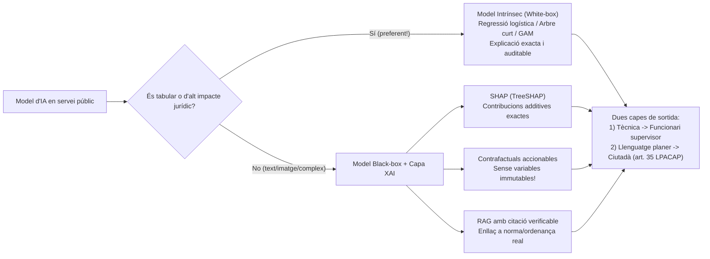

## A. Objectius d'aprenentatge

En completar aquesta lliçó seràs capaç de:

1. **Diferenciar** amb rigor **transparència algorítmica** (obligació jurídica i organitzativa d'informar ciutadans i funcionaris sobre l'existència, finalitat, funcionament i límits d'un sistema d'IA), **interpretabilitat intrínseca** (*white-box*: regressió logística, arbres curts, GAMs) i **explicabilitat *post-hoc* (XAI — *Explainable AI*)** (*black-box*: **SHAP**, **LIME**, explicacions **contrafactuals**).
2. **Distingir** entre **obligacions legals vigents** (**AI Act Reglament UE 2024/1689 art. 13 i art. 50**, **RGPD art. 13–15**, **Llei 39/2015 LPACAP art. 35** sobre motivació dels actes administratius, **Llei 19/2014 de transparència de Catalunya**), **teoria establerta** (valors de Shapley, aproximacions lineals locals) i **bones pràctiques** (registres públics d'algorismes i fitxes *Model Cards*).
3. **Aplicar** el dilema **precisió vs. interpretabilitat** amb criteri públic: quan un model intrínsecament interpretable (regressió lineal/logística, arbre poc profund) iguala o s'apropa a una xarxa profunda sobre dades tabulars, és **sempre preferible** per garantir motivació jurídica i auditabilitat!
4. **Comparar** el funcionament, avantatges i limitacions de **SHAP** (*SHapley Additive exPlanations* — explicacions globals i locals additives coherents amb teoria de jocs), **LIME** (*Local Interpretable Model-agnostic Explanations* — inestabilitat per pertorbació aleatòria) i **explicacions contrafactuals** (*«Què hauria de canviar mínimament perquè la sol·licitud fos aprovada?»*).
5. **Implementar** en Python pur un **calculador exacte d'atribució de contribucions lineals (tipus SHAP additiu en model lineal)** combinat amb un **generador d'explicacions contrafactuals accionables** (prohibint modificar variables immutables com l'edat o el gènere!) per redactar motivacions comprensibles per a la ciutadania!

---

## B. Explicació introductòria

Imagina que una família demana una beca menjador o una ajuda al lloguer a un ajuntament de la província de Barcelona i rep aquesta resposta: *«Sol·licitud denegada. Puntuació de l'algorisme: 0,41 (llindar: 0,50)»*.

En l'Administració pública, això és **inacceptable tant jurídica com èticament**! Per l'**article 35 de la Llei 39/2015 (LPACAP)**, els actes administratius que limiten drets o interessos legítims han d'estar **degudament motivats** amb succinta referència de fets i fonaments de dret. Un funcionari o una ciutadana que no entenen **per què** el sistema ha puntuat així no poden detectar un error de dades, ni exercir efectivament el dret de defensa i recurs!

Distingim dues dimensions complementàries:
1. **Transparència (visibilitat i rendició de comptes)**: informar clarament la ciutadania **que** hi intervé un sistema d'IA (obligació legal en xatbots — **art. 50 AI Act**), per a quina finalitat, quines dades fa servir, quins són els seus límits i qui n'és l'òrgan responsable.
2. **Explicabilitat (*XAI — Explainable AI*)**: la capacitat tècnica d'oferir raons **comprensibles per a humans** (tant per a l'empleat públic que supervisa com per a la persona afectada) sobre com pren decisions el model globalment o en un expedient concret.

---

## C. Explicació tècnica avançada

### 1. Taxonomia de la interpretabilitat i l'explicabilitat (*Teoria establerta*)

| Dimensió | Categories | Exemples i propietats |
|---|---|---|
| **Naturalesa del model** | **Intrínseca (*White-box / Glass-box*)** vs. ***Post-hoc* (*Black-box* + XAI)** | Intrínseca: regressió lineal/logística, arbres de decisió poc profunds, EBM/GAM. *Post-hoc*: aplicar SHAP/LIME a un XGBoost o xarxa neuronal. |
| **Abast** | **Global** vs. **Local** | Global: quines variables pesen més en tot el model. Local: per què concretament **aquest** expedient #2026-0412 ha obtingut un 0,41. |
| **Dependència** | **Agnòstica del model** vs. **Específica** | Agnòstica: KernelSHAP, LIME, Permutation Importance. Específica: TreeSHAP (exacte i ràpid per XGBoost/LightGBM), Integrated Gradients (xarxes neuronals). |

### 2. Mètodes XAI de referència (*Teoria establerta i pràctica d'enginyeria*)

1. **SHAP (*SHapley Additive exPlanations*)**:
   - Basat en els **valors de Shapley** de la teoria de jocs cooperatius: reparteix exactament la diferència entre la predicció concreta \(f(x)\) i la predicció mitjana base \(E[f(X)]\) entre cada variable \(j\):
     \[
     f(x) = \phi_0 + \sum_{j=1}^{M} \phi_j
     \]
   - Compleix propietats matemàtiques fortes (**exactitud local**, **consistència** i **absència de contribució nul·la**). **TreeSHAP** calcula valors exactes en temps polinòmic per a models d'arbres (XGBoost/LightGBM/Random Forest); **KernelSHAP** és agnòstic però lent.
2. **LIME (*Local Interpretable Model-agnostic Explanations*)**:
   - Pertorba aleatòriament l'entrada \(x\) al seu voltant, consulta el model caixa negra sobre els punts pertorbats i ajusta un **model lineal senzill local** ponderat per proximitat.
   - **Limitació crítica**: com depèn de mostreig aleatori i de l'amplada del nucli (*kernel width*), dues execucions sobre el mateix expedient poden donar explicacions lleugerament diferents (**inestabilitat**), i pot generar punts sintètics irreals fora de la distribució!
3. **Explicacions contrafactuals (*Counterfactual Explanations*)**:
   - Responen a la pregunta més útil per al ciutadà: *«Quin és el canvi mínim i accionable en les teves variables que canviaria la decisió de denegat a favorable?»* (ex. *«Si l'eficiència energètica de la caldera millorés de classe D a classe B, la sol·licitud superaria el llindar de subvenció»*).
   - **Regla d'enginyeria obligatòria**: filtrar sempre **restriccions d'accionabilitat i immutabilitat**! Mai no proposis un contrafactual absurd com *«redueix la teva edat en 5 anys»* o *«canvia el teu codi postal de naixement»*!
4. **Explicabilitat en LLMs i RAG (*Pràctica d'enginyeria*)**:
   - Els pesos d'atenció (*attention weights*) **NO són una explicació causal fidel**, i el *Chain-of-Thought* generat per un LLM pot ser una **racionalització *post-hoc* no fidel** (*unfaithful CoT*)!
   - Per això, en RAG administratiu, la transparència real s'aconsegueix mitjançant **citacions verificables amb enllaç directe al fragment normatiu recuperat** (Mòdul 3.6 i 5.6), permetent al ciutadà i al funcionari comprovar la font primària!

### 3. Marc legal vigent de transparència (*Obligacions legals vigents*)

:::callout-legal
**Diferenciació estricta entre obligacions legals vigents i bones pràctiques:**
- **Obligacions legals vigents**:
  1. **AI Act (Reglament UE 2024/1689) — Art. 13** (sistemes d'alt risc): dissenyats perquè el seu funcionament sigui prou transparent perquè els responsables del desplegament (*deployers*) interpretin els resultats i els utilitzin adequadament, acompanyats d'**instruccions d'ús** clares (capacitats, límits, mètriques de precisió, riscos previsibles i mesures de supervisió humana).
  2. **AI Act — Art. 50** (obligacions de transparència específiques):
     - **Art. 50.1**: informar les persones físiques que estan interactuant amb un sistema d'IA (ex. un **xatbot municipal**), llevat que sigui evident per a una persona raonablement informada.
     - **Art. 50.2 i 50.4**: marcar contingut sintètic d'àudio/imatge/vídeo/text (format llegible per màquina) i etiquetar *deepfakes* i textos generats per informar el públic sobre assumptes d'interès públic si no hi ha hagut revisió humana i responsabilitat editorial.
     - **Art. 50.3**: informar persones exposades a sistemes de reconeixement d'emocions o categorització biomètrica.
  3. **RGPD (Reglament UE 2016/679) — Art. 13.2.f, 14.2.g i 15.1.h**: quan hi hagi decisions automatitzades de l'art. 22, dret a rebre **«informació significativa sobre la lògica aplicada»**, així com la importància i les conseqüències previstes d'aquest tractament.
  4. **Llei 39/2015 (LPACAP) — Art. 35**: obligació de **motivar** els actes administratius que limiten drets o resolen recursos (l'algorisme no substitueix la motivació jurídica!).
  5. **Llei 19/2014 de transparència de Catalunya** (i Llei estatal 19/2013): publicitat activa i dret d'accés a la informació pública, incloent-hi criteris d'interpretació i instruments de decisió que afecten drets (subjecte als límits legals de seguretat i propietat intel·lectual ponderats cas per cas).
- **Recomanacions / bones pràctiques**:
  - Publicació de **registres públics d'algorismes** (com el registre municipal d'algorismes de Barcelona o l'estàndard europeu Eurocities/Algorithm Register), **Model Cards** accessibles en llenguatge planer i publicació en codi obert quan no comprometi la seguretat ni incentivi el frau (*gaming*).
:::

---

## D. Diagrames i recursos visuals



| Mètode | Abast | Estabilitat | Fidelitat al model | Ús ideal en l'Administració pública |
|---|---|---|---|---|
| **Model intrínsec** (Logística / Arbre) | Global + Local | Màxima (determinista) | **100% exacta** | Barem de subvencions, priorització social, risc tributari tabular |
| **TreeSHAP** | Global + Local | Alta (exacte en arbres) | **Exacta** (propietats Shapley) | Models XGBoost/LightGBM de detecció de frau o predicció d'impagaments |
| **LIME** | Només Local | Baixa–Mitjana (aleatori) | Aproximada localment | Exploració ràpida; evitar com a única prova legal per inestabilitat |
| **Contrafactuals** | Local | Depèn de restriccions | Exacta en la frontera | Explicar a un ciutadà què ha de millorar o esmenar per accedir a un ajut |
| **Citació RAG verificable** | Local (font) | Alta (enllaç real) | Verificable en font primària | Xatbots d'atenció ciutadana i assistents de redacció normativa |

---

## E. Aplicació a l'Administració pública

1. **Transparència en capes (*Layered Transparency*)**: no expliquis el mateix a tothom!
   - **Capa 1 (Ciutadà)**: avís clar d'interacció amb IA (art. 50 AI Act), llenguatge planer amb els 2–3 factors determinants i contrafactual accionable, més via de revisió humana.
   - **Capa 2 (Empleat públic supervisor)**: quadre de comandament amb desglossament SHAP local, interval de confiança, alertes de *drift* i instruccions d'ús (art. 13 AI Act).
   - **Capa 3 (Auditor / DPD / Síndic)**: documentació tècnica completa (Annex IV AI Act), mètriques desagregades per col·lectius i traçabilitat de dades i versions.
2. **El límit del *Gaming* (manipulació fraudulenta)**: publicar el pes exacte de cada indicador d'un detector de frau fiscal pot facilitar que els defraudadors eludeixin els llindars! En aquests casos, la transparència es combina amb la ponderació legal dels límits d'accés: es fa pública l'existència, la finalitat i els criteris generals, mentre que els llindars interns antifrau s'auditen per òrgans de control (Intervenció, Sindicatura, autoritat de control) sense revelar els secrets operatius d'inspecció.
3. **Avís obligatori en assistents virtuals (art. 50.1 AI Act)**: tot xatbot de la Seu Electrònica o del 010 ha d'incloure una capçalera visible des del primer missatge indicant que és un assistent automàtic d'IA, que pot cometre errors i com contactar amb un agent humà.

---

## F. Exemple pràctic guiat

### Exemple 8.1: Explicabilitat additiva exacta (tipus SHAP lineal) + Contrafactual accionable amb restricció d'immutabilitat

Aquest script Python pur demostra en un model transparent d'avaluació d'ajuts a la rehabilitació energètica com:
1. Descomposar exactament una puntuació \(f(x) = \phi_0 + \sum \phi_j\) (propietat d'exactitud additiva).
2. Generar una explicació **contrafactual accionable** que **bloqueja variables immutables** (com `edat_sollicitant`) i busca el canvi mínim en variables modificables (`millora_eficiencia_kwh`, `certificat_energetic_score`) per superar el llindar d'aprovació (`0.50`)!

```python
"""Exemple 8.1: Atribució additiva (SHAP lineal) i contrafactual accionable."""

from dataclasses import dataclass


@dataclass
class ModelTransparent:
    intercept: float
    pesos: dict[str, float]
    mitjanes_ref: dict[str, float]
    immutables: set[str]
    llindar: float = 0.50

    def predir(self, x: dict[str, float]) -> float:
        return self.intercept + sum(self.pesos[k] * x[k] for k in self.pesos)

    def explicar_shap_lineal(self, x: dict[str, float]) -> tuple[float, dict[str, float], float]:
        """En un model lineal amb independència, phi_j = w_j * (x_j - E[X_j])."""
        base = self.predir(self.mitjanes_ref)
        contribucions = {
            k: round(self.pesos[k] * (x[k] - self.mitjanes_ref[k]), 4)
            for k in self.pesos
        }
        pred = round(self.predir(x), 4)
        return round(base, 4), contribucions, pred

    def generar_contrafactual_accionable(self, x: dict[str, float]) -> dict[str, str]:
        pred_actual = self.predir(x)
        if pred_actual >= self.llindar:
            return {"estat": "JA_FAVORABLE", "missatge": "La sol·licitud supera el llindar."}

        marge_faltant = self.llindar - pred_actual
        # Busquem la variable ACCIONABLE (no immutable) amb pes positiu més gran
        candidates = [
            (k, w) for k, w in self.pesos.items()
            if k not in self.immutables and w > 0
        ]
        candidates.sort(key=lambda item: item[1], reverse=True)
        var_millor, pes_millor = candidates[0]
        increment_necessari = round(marge_faltant / pes_millor + 0.01, 2)
        nou_valor = round(x[var_millor] + increment_necessari, 2)
        return {
            "estat": "CONTRAFACTUAL_GENERAT",
            "variable_accionable": var_millor,
            "valor_actual": str(x[var_millor]),
            "valor_objectiu": str(nou_valor),
            "missatge": (
                f"Per superar el llindar ({self.llindar}), augmenta '{var_millor}' "
                f"de {x[var_millor]} a {nou_valor} (+{increment_necessari}). "
                f"(Variables immutables protegides: {sorted(self.immutables)})"
            ),
        }


if __name__ == "__main__":
    model = ModelTransparent(
        intercept=0.20,
        pesos={
            "estalvi_energetic_pct": 0.008,    # Accionable
            "certificat_obra_punts": 0.05,     # Accionable
            "edat_edifici_anys": 0.002,        # Immutable!
        },
        mitjanes_ref={
            "estalvi_energetic_pct": 30.0,
            "certificat_obra_punts": 2.0,
            "edat_edifici_anys": 40.0,
        },
        immutables={"edat_edifici_anys"},
        llindar=0.50,
    )

    expedient = {
        "estalvi_energetic_pct": 15.0,
        "certificat_obra_punts": 1.0,
        "edat_edifici_anys": 35.0,
    }

    base, phis, pred = model.explicar_shap_lineal(expedient)
    print(f"Predicció base E[f(X)]: {base}")
    print(f"Contribucions SHAP (phi_j): {phis}")
    print(f"Verificació additivitat (base + sum(phi)): {round(base + sum(phis.values()), 4)} == {pred}")
    print("Contrafactual ciutadà:", model.generar_contrafactual_accionable(expedient)["missatge"])
```

#### Interpretació del resultat
- Predicció base \(E[f(X)] = 0.62\). L'expedient obté **`0.44`** (`< 0.50`, denegat) perquè `estalvi_energetic_pct` resta **`-0.12`**, `certificat_obra_punts` resta **`-0.05`** i `edat_edifici_anys` resta **`-0.01`** (`0.62 - 0.12 - 0.05 - 0.01 = 0.44` — exactitud additiva perfecta!).
- El contrafactual **ignora `edat_edifici_anys`** (immutable!) i selecciona `certificat_obra_punts` (major pes accionable: `0.05`), indicant un canvi concret i accionable (`+1.21` punts, fins a `2.21`) comprensible per al ciutadà i motivable sota l'art. 35 LPACAP!

---

## G. Exercici pràctic per resoldre

### Enunciat i context
L'Ajuntament d'un municipi mitjà vol desplegar dos sistemes d'IA:
- **Sistema A**: Model predictiu d'assignació de punts de prioritat en ajuts d'emergència habitacional sobre dades tabulars (8 variables). L'equip tècnic dubta entre una **regressió logística** (`AUC = 0,85`) i una **xarxa neuronal profunda** (`AUC = 0,86`) explicada amb **LIME**.
- **Sistema B**: Xatbot RAG ciutadà a la Seu Electrònica per respondre dubtes d'ordenances fiscals.

### Objectius i requisits
1. Selecciona i justifica tècnicament i jurídicament l'arquitectura del **Sistema A** (model + explicació ciutadana i al funcionari).
2. Defineix les obligacions de transparència del **Sistema B** segons l'**art. 50 AI Act** i les bones pràctiques RAG.
3. Redacta una llista de **4 riscos de falsa explicabilitat** que cal evitar.

:::hint Pista sobre precisió vs. interpretabilitat i inestabilitat de LIME
Una diferència d'`AUC` de només `0,01` en dades tabulars d'alt risc mai no justifica perdre interpretabilitat intrínseca ni dependre d'un mètode aleatori local com LIME! I recorda: en un LLM, el *Chain-of-Thought* no és garantia de fidelitat; les citacions verificables del RAG sí!
:::

:::solution Solució comentada
1. **Sistema A (Ajuts d'emergència habitacional — Alt Risc, Annex III punt 5 AI Act)**:
   - **Elecció obligada**: **Regressió logística** (`AUC = 0,85`, *white-box* intrínsecament interpretable). Renunciar a un 0,01 marginal d'AUC evita l'opacitat de caixa negra i la **inestabilitat de LIME** (que podria donar explicacions canviants a dos expedients idèntics, invalidant la motivació jurídica de l'art. 35 LPACAP!).
   - **Doble capa de sortida**: (a) al treballador social, coeficients exactes + contribució de cada variable + instruccions d'ús (art. 13 AI Act); (b) al ciutadà, motivació redactada en llenguatge planer amb factors determinants i **contrafactual accionable** (excloent variables immutables) + avís del dret a revisió humana.
2. **Sistema B (Xatbot RAG fiscal)**:
   - **Obligació legal (art. 50.1 AI Act)**: informar explícitament des del primer missatge que l'usuari interactua amb un sistema d'IA.
   - **Transparència tècnica RAG**: citar obligatòriament l'article exacte de l'ordenança fiscal i oferir enllaç directe al PDF oficial del BOPB/Seu; abstenir-se si no hi ha suport documental (*grounding*); indicar clarament el canal d'atenció humana i que la resposta és informativa (no vinculant jurídicament).
3. **4 riscos de falsa explicabilitat (*Explainability Washing*)**:
   - Tractar les correlacions de SHAP/LIME com si fossin relacions **causals** reals.
   - Confiar en **LIME** amb pertorbacions aleatòries inestables com a motivació d'un acte administratiu.
   - Presentar el ***Chain-of-Thought* d'un LLM** com a explicació fidel del seu procés intern.
   - Generar **contrafactuals no accionables o discriminatoris** (ex. suggerir canviar edat, origen o composició familiar).

**Alternativa**: si un model lineal no capturés interaccions no lineals reals rellevants en tabular, optar per un **GAM / EBM (*Explainable Boosting Machine*)** o un **arbre de decisió regularitzat / XGBoost amb TreeSHAP exacte** abans que una xarxa neuronal amb LIME.
:::

---

## H. Test individual

Resol les 10 preguntes sobre transparència algorítmica vs. explicabilitat, *white-box* vs. *post-hoc*, SHAP vs. LIME vs. contrafactuals, fidelitat en LLMs/RAG, art. 13 i 50 de l'AI Act, art. 13–15 del RGPD i art. 35 de la LPACAP.

---

## I. Preguntes de desenvolupament

### Pregunta 1
Compara **SHAP**, **LIME** i les **explicacions contrafactuals** en termes de fonament tècnic, estabilitat, fidelitat i utilitat específica per a (a) un tècnic municipal que supervisa expedients i (b) un ciutadà que rep una resolució desfavorable.

:::model-answer Resposta model i criteris de correcció
- **SHAP (valors de Shapley)**: reparteix exactament \(f(x) - E[f(X)]\) entre variables complint additivitat local i consistència. Amb **TreeSHAP** és exacte i determinista en arbres. **Ús ideal**: per al **tècnic supervisor i l'auditor** (tant globalment per veure quines variables dominen el model com localment per revisar un expedient).
- **LIME**: ajusta un model lineal local mitjançant pertorbacions aleatòries al voltant de l'expedient. **Limitació**: pot ser inestable entre execucions i generar punts fora de la distribució real. Poc recomanable com a única base de motivació jurídica en actes administratius.
- **Contrafactuals**: identifiquen el canvi mínim i **accionable** (sense tocar variables immutables) que capgira el veredicte del model. **Ús ideal**: per al **ciutadà**, perquè li explica de manera intuïtiva i pràctica què ha de millorar o acreditar (sense necessitat d'entendre coeficients matemàtics!).
- **Criteris de correcció (10 punts)**: definició precisa dels 3 mètodes (5 punts), anàlisi d'estabilitat/immutabilitat (2,5 punts), assignació diferenciada tècnic vs. ciutadà (2,5 punts).
:::

### Pregunta 2
Distingeix clarament quines exigències de transparència són **obligacions legals vigents** (citant les normes i articles aplicables) i quines són **recomanacions o bones pràctiques** en una administració local catalana.

:::model-answer Resposta model i criteris de correcció
- **Obligacions legals vigents**:
  1. **AI Act (Reglament UE 2024/1689)**: **art. 13** (transparència i instruccions d'ús en sistemes d'alt risc per als *deployers*), **art. 50** (avís obligatori d'interacció amb IA en xatbots, marcatge de contingut sintètic i *deepfakes*, avís en reconeixement d'emocions/categorització biomètrica), **art. 49** (registre a la base de dades de la UE per a sistemes d'alt risc per autoritats públiques).
  2. **RGPD (Reglament UE 2016/679)**: **art. 13–15** (informació significativa sobre la lògica aplicada, importància i conseqüències en decisions automatitzades de l'art. 22).
  3. **Llei 39/2015 (LPACAP)**: **art. 35** (motivació dels actes administratius que limiten drets).
  4. **Llei 19/2014 de transparència de Catalunya**: publicitat activa i dret d'accés a la informació pública ponderat amb límits legals.
- **Recomanacions / bones pràctiques**: publicació voluntària en un **registre municipal d'algorismes** en llenguatge planer, **Model Cards** públiques, explicacions contrafactuals ciutadanes i publicació del codi font obert quan no faciliti el frau.
- **Criteris de correcció (10 punts)**: separació nítida obligació legal vs. bona pràctica (4 punts), cites precises i correctes sense invencions (4 punts), aplicació local catalana (2 punts).
:::

### Pregunta 3
Per què el *Chain-of-Thought* (CoT) d'un LLM o els pesos d'atenció d'un Transformer **NO** garanteixen explicabilitat fidel, i quins mecanismes alternatius s'han d'implantar en un assistent jurídic municipal basat en IA generativa?

:::model-answer Resposta model i criteris de correcció
- **Per què no són fidels**:
  - Els pesos d'*attention* no tenen una correspondència causal directa amb la decisió final (s'ha demostrat empíricament que distribucions d'atenció diferents poden produir la mateixa sortida).
  - El *Chain-of-Thought* generat per un LLM és text predictiu autoregressiu que pot ser una **racionalització *post-hoc* plausible però infidel** al veritable motiu (o fins i tot al·lucinar un raonament convincent per justificar un error!).
- **Mecanismes alternatius en assistents públics**:
  1. **Arquitectura RAG amb citació verificable obligatòria**: cada afirmació enllaça al fragment exacte i vigent del BOPB, ordenança o llei recuperada.
  2. **Separació de rols (motor determinista + LLM narrador)**: les regles elegibles i càlculs d'ajuts els executa un motor de regles o model *white-box* auditable; l'LLM només redacta en llenguatge planer el resultat ja motivat.
  3. **Abstenció explícita** si no hi ha suport documental suficient i **revisió humana obligatòria** abans de qualsevol acte administratiu.
- **Criteris de correcció (10 punts)**: crítica rigorosa a CoT i attention (4 punts), arquitectura RAG citable + separació motor determinista/LLM (4 punts), revisió humana i abstenció (2 punts).
:::

---

## J. Resum per memoritzar

- **Idees clau**:
  - **Transparència** = visibilitat, avís i rendició de comptes (jurídic/organitzatiu); **Explicabilitat (XAI)** = comprensió tècnica del perquè d'una decisió.
  - En dades tabulars d'alt impacte, prefereix sempre un **model intrínsec (*white-box*)** si la pèrdua de precisió és negligible!
  - **SHAP** = contribucions additives exactes (teoria de jocs; **TreeSHAP** determinista); **LIME** = aproximació local per pertorbació aleatòria (**inestable**); **Contrafactuals** = canvi mínim **accionable** (sense variables immutables!).
  - En LLMs, el CoT no és explicabilitat fidel: la transparència real és **RAG amb citacions verificables** + **avís d'IA (art. 50.1 AI Act)**.
- **Normes essencials**:
  - **AI Act art. 13**: transparència i instruccions d'ús (alt risc).
  - **AI Act art. 50**: avís d'interacció amb IA (xatbots) i marcatge de contingut sintètic/*deepfakes*.
  - **RGPD art. 13–15**: informació significativa sobre la lògica aplicada (decisions art. 22).
  - **LPACAP art. 35**: motivació obligatòria dels actes administratius.
- **Errors freqüents d'examen**:
  - Confondre **correlació SHAP** amb **causalitat**.
  - Recomanar **LIME** en un acte administratiu sense advertir la seva inestabilitat aleatòria.
  - Afirmar que publicar el codi font és sempre obligatori per a tot algorisme (oblidant el risc de *gaming* antifrau i els límits legals ponderats!).
- **Flashcards associades**: consulta `flashcards/module-08/m08-01-transparencia.json` (5 targetes).
- **Possibles preguntes d'examen**:
  - Quan és preferible una regressió logística a una xarxa neuronal en una convocatòria d'ajuts?
  - Quina diferència hi ha entre l'art. 13 i l'art. 50 de l'AI Act?
  - Què és una explicació contrafactual accionable i quin error cal evitar amb les variables immutables?
