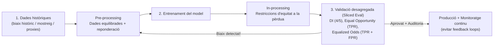

## A. Objectius d'aprenentatge

En completar aquesta lliçó seràs capaç de:

1. **Classificar** els principals **tipus de biaixos** al llarg del cicle de vida de la IA: **biaix històric** (desigualtats estructurals als expedients passats), **biaix de representació / mostreig** (infrarepresentació de col·lectius o del català), **biaix de mesura / etiquetatge** (*proxy* erroni de l'objectiu), **biaix d'agregació**, **biaix de confirmació / retroalimentació** (*feedback loop*) i **biaixos en LLMs** (estereotips de gènere, origen o llengua).
2. **Desmuntar** el mite de la **«ceguesa als atributs protegits» (*Fairness through Unawareness*)**: eliminar simplement la columna `genere` o `origen` **NO garanteix equitat** a causa de les **variables *proxy*** (codi postal, nom propi, trajectòria laboral discontínua, idioma).
3. **Calcular i interpretar** les mètriques formals d'equitat (*group fairness*): **Paritat Demogràfica (*Demographic Parity*)**, **Ràtio d'Impacte Dispar (*Disparate Impact* — regla orientativa dels 4/5 = `0,80`)**, **Igualtat d'Oportunitats (*Equal Opportunity* — igualar TPR)** i **Probabilitats Igualades (*Equalized Odds* — igualar TPR i FPR)**, entenent el **teorema d'impossibilitat** (no es poden satisfer simultàniament totes les definicions quan les taxes base difereixen!).
4. **Aplicar** estratègies de mitigació en les tres etapes tècniques (**Pre-processing**, **In-processing** i **Post-processing**) en coherència amb l'**article 10 de l'AI Act (Reglament UE 2024/1689)** i el **principi d'igualtat i no discriminació (art. 14 CE i art. 21 CDFUE)**.
5. **Implementar** en Python pur un **auditor d'equitat algorítmica** que calcula *Demographic Parity*, *Disparate Impact (4/5)*, *TPR* (*Equal Opportunity*) i *FPR* (*Equalized Odds*) per grups, demostrant com una variable *proxy* reprodueix discriminació indirecta!

---

## B. Explicació introductòria

Un error molt habitual és creure que «un algorisme és objectiu perquè és matemàtica pura». En realitat, un model d'aprenentatge automàtic és un **mirall amplificador de les dades històriques** amb què s'ha entrenat!

Si una administració entrena un model de selecció de personal o de priorització d'inspeccions amb expedients dels darrers 15 anys on determinats barris o col·lectius van rebre històricament més controls o menys contractacions, el model aprendrà aquesta pauta com si fos una «llei estadística» i la **reproduirà a escala industrial** — i a més, alimentarà un **bucle de retroalimentació** (*feedback loop*): com més inspeccions envia al barri A, més infraccions hi detecta, i el model es convenç encara més que només cal inspeccionar el barri A!

---

## C. Explicació tècnica avançada

### 1. Taxonomia dels biaixos al cicle de vida (*Teoria establerta*)

| Tipus de biaix | On apareix | Exemple realista en l'Administració pública |
|---|---|---|
| **Històric** | Món real i registres passats | Barem de selecció entrenat amb històric masculinitzat en places tècniques que penalitza interrupcions per maternitat |
| **De representació (mostreig)** | Recollida de dades | Xatbot o ASR entrenat amb un 95% de castellà/anglès i un 5% de català (i 0% català nord-occidental/valencià/balear) |
| **De mesura (etiquetatge / *proxy*)** | Definició de la variable objectiu \(Y\) | Mesurar «necessitat sanitària/social» mitjançant la **despesa històrica** en lloc de la vulnerabilitat real (qui tenia menys accés al sistema sembla «menys necessitat»!) |
| **D'agregació** | Model únic per a poblacions heterogènies | Aplicar un mateix model de predicció de demanda de transport a l'àrea metropolitana de Barcelona i a un micropoble del Berguedà |
| **De retroalimentació (*Feedback Loop*)** | Producció + reentrenament | Enviar inspectors només als barris predits com «alt risc» confirma el biaix en els nous logs d'entrenament |
| **D'automatització (humà)** | Interacció humà-IA | El funcionari accepta acríticament les recomanacions del model (vegeu Mòdul 8.3!) |

### 2. El fracàs de *Fairness through Unawareness* i les variables *proxy*

Eliminar la columna `genere` o `nacionalitat` del dataset (**ceguesa als atributs protegits**) **NO evita la discriminació indirecta**!
- **Variables *proxy***: atributs aparentment neutres altament correlacionats amb l'atribut protegit (ex. `codi_postal` amb nivell socioeconòmic i origen; `nom_propi` o `parada_laboral` amb gènere; `institut_estudis` o `codi_llengua` amb origen).
- **Conseqüència legal i pràctica (AI Act art. 10.5)**: paradoxalment, per poder **detectar i corregir biaixos** (auditoria desagregada), sovint cal disposar temporalment i de forma estrictament controlada dels atributs protegits per **auditar** (mai per discriminar!). L'**art. 10.5 de l'AI Act** autoritza excepcionalment, sota salvaguardes estrictes (anonimització/pseudonimització, control d'accés, supressió posterior), el tractament de categories especials de dades únicament en la mesura estrictament necessària per detectar i corregir biaixos en sistemes d'alt risc!

### 3. Mètriques matemàtiques d'equitat de grup (*Teoria establerta*)

Sigui \(A \in \{0, 1\}\) un atribut protegit (grup no privilegiat vs. privilegiat), \(\hat{Y} \in \{0, 1\}\) la predicció favorable i \(Y \in \{0, 1\}\) la realitat:

1. **Paritat Demogràfica (*Demographic Parity / Statistical Parity*)**:
   \[
   P(\hat{Y}=1 \mid A=0) \approx P(\hat{Y}=1 \mid A=1)
   \]
   - Mesura associada: **Ràtio d'Impacte Dispar (*Disparate Impact — DI*)**:
     \[
     \text{DI} = \frac{P(\hat{Y}=1 \mid A=0)}{P(\hat{Y}=1 \mid A=1)}
     \]
   - **Regla orientativa dels 4/5 (*pràctica d'auditoria*, originària de l'EEOC dels EUA)**: un `DI < 0,80` (o `> 1,25`) dispara un senyal d'alerta d'impacte dispar que exigeix investigació immediata! *(Nota: és un heurístic d'auditoria, no una fórmula màgica de la llei europea!)*
2. **Igualtat d'Oportunitats (*Equal Opportunity*)**: iguala la **taxa de veritables positius (TPR / Recall)** entre grups:
   \[
   P(\hat{Y}=1 \mid Y=1, A=0) \approx P(\hat{Y}=1 \mid Y=1, A=1)
   \]
   - *Interpretació pública*: entre totes les persones que **realment mereixen** un ajut o una plaça (\(Y=1\)), tots els grups han de tenir la mateixa probabilitat de rebre'l!
3. **Probabilitats Igualades (*Equalized Odds*)**: més estricta — exigeix igualar tant el **TPR** com la **taxa de falsos positius (FPR)** entre grups!
   - *Interpretació pública*: essencial en **detecció de frau o alertes punitives**, on un FPR més alt en un col·lectiu significa que se sotmet a més inspeccions injustes persones innocents d'aquest col·lectiu!
4. **Teorema d'impossibilitat de l'equitat** (Chouldechova / Kleinberg et al.): quan les **taxes base reals** \(P(Y=1 \mid A=a)\) difereixen entre grups i el model no és perfecte, és **matemàticament impossible** satisfer alhora *Demographic Parity*, *Equalized Odds* i *Predictive Parity* (calibració)! Per tant, **triar la mètrica d'equitat no és només una decisió tècnica: és una decisió jurídica i de política pública**!

### 4. Mitigació en tres fases (*Pràctica d'enginyeria*)

- **Pre-processing (abans d'entrenar)**: recol·lecció de dades més representatives (ex. ampliar corpus català), reponderació d'exemples (*reweighing*), revisió d'etiquetes amb biaix de mesura i eliminació de *proxies* innecessaris.
- **In-processing (durant l'entrenament)**: afegir termes de regularització/penalització d'equitat a la funció de pèrdua (*adversarial debiasing*, restriccions d'Equalized Odds amb biblioteques com *Fairlearn* o *AIF360*).
- **Post-processing (després d'entrenar)**: calibrar llindars de decisió específics o ajustar la sortida (*ThresholdOptimizer* — **atenció jurídica**: en l'Administració pública, aplicar llindars diferents per gènere o origen en temps d'inferència pot vulnerar la igualtat formal llevat habilitació legal expressa d'acció positiva! Prioritza sempre corregir les dades i el model en pre/in-processing!).

---

## D. Diagrames i recursos visuals



| Mètrica d'equitat | Què iguala entre grups | Quan és la més crítica en el sector públic |
|---|---|---|
| **Demographic Parity / DI (4/5)** | Taxa de selecció positiva \(P(\hat{Y}=1)\) | Accés universal o detecció inicial d'impacte dispar en ajuts/selecció |
| **Equal Opportunity** | **TPR (Recall)**: \(P(\hat{Y}=1 \mid Y=1)\) | **Ajuts socials, beques, selecció de personal** (no excloure qui compleix requisits!) |
| **Equalized Odds** | **TPR i FPR** simultàniament | **Inspeccions antifrau, alertes de risc** (no acusar injustament més un col·lectiu!) |

---

## E. Aplicació a l'Administració pública

1. **Biaix lingüístic en serveis públics de Catalunya**: un xatbot o sistema de resum que rendeix un 92% en castellà i un 74% en català genera una **discriminació lingüística directa** contrària als drets lingüístics de la ciutadania! L'avaluació desagregada (*Sliced Evaluation*) per idioma és obligatòria en qualsevol licitació pública catalana.
2. **Obligació legal en alt risc (AI Act art. 10)**: els conjunts de dades d'entrenament, validació i prova de sistemes d'alt risc han de ser pertinents, prou representatius i sotmesos a examen i mesures adequades de detecció, prevenció i mitigació de biaixos que puguin afectar la salut, la seguretat o els drets fonamentals.
3. **Biaix en selecció de personal públic (Annex III punt 4 AI Act)**: l'ús d'IA per filtrar currículums o avaluar candidats en processos selectius està classificat expressament com a **alt risc**; mai no pot vulnerar els principis constitucionals d'**igualtat, mèrit i capacitat** (art. 23.2 i 103.3 CE).

---

## F. Exemple pràctic guiat

### Exemple 8.2: Auditor d'equitat algorítmica (*Disparate Impact 4/5*, *Equal Opportunity* i *Equalized Odds*)

Aquest script Python pur audita les prediccions d'un model fictici de selecció de sol·licituds comparant dos grups (`Grup_A` privilegiat vs. `Grup_B` protegit) i mostra com una exactitud global aparentment bona (`80%`) amaga un **impacte dispar greu (`DI < 0,80`)** i una bretxa forta en **Equal Opportunity (TPR)**!

```python
"""Exemple 8.2: Auditor d'equitat algorítmica (DI 4/5, Equal Opportunity i Equalized Odds)."""

from dataclasses import dataclass


@dataclass
class Registre:
    grup: str
    y_real: int
    y_pred: int


def auditar_equitat(registres: list[Registre], grup_ref: str, grup_prot: str) -> dict[str, object]:
    def stats(g: str) -> dict[str, float]:
        sub = [r for r in registres if r.grup == g]
        n = len(sub)
        tp = sum(1 for r in sub if r.y_real == 1 and r.y_pred == 1)
        fp = sum(1 for r in sub if r.y_real == 0 and r.y_pred == 1)
        fn = sum(1 for r in sub if r.y_real == 1 and r.y_pred == 0)
        tn = sum(1 for r in sub if r.y_real == 0 and r.y_pred == 0)
        taxa_pos = (tp + fp) / n
        tpr = tp / (tp + fn) if (tp + fn) else 0.0
        fpr = fp / (fp + tn) if (fp + tn) else 0.0
        acc = (tp + tn) / n
        return {
            "n": n,
            "accuracy": round(acc, 4),
            "taxa_seleccio": round(taxa_pos, 4),
            "TPR": round(tpr, 4),
            "FPR": round(fpr, 4),
        }

    s_ref = stats(grup_ref)
    s_prot = stats(grup_prot)
    di = round(s_prot["taxa_seleccio"] / s_ref["taxa_seleccio"], 4) if s_ref["taxa_seleccio"] else 0.0
    gap_tpr = round(abs(s_ref["TPR"] - s_prot["TPR"]), 4)
    gap_fpr = round(abs(s_ref["FPR"] - s_prot["FPR"]), 4)

    alertes = []
    if di < 0.80:
        alertes.append(f"ALERTA_DISPARATE_IMPACT: DI={di} < 0.80 (regla orientativa 4/5)")
    if gap_tpr > 0.10:
        alertes.append(f"ALERTA_EQUAL_OPPORTUNITY: bretxa TPR={gap_tpr} > 0.10")
    if gap_fpr > 0.10:
        alertes.append(f"ALERTA_EQUALIZED_ODDS_FPR: bretxa FPR={gap_fpr} > 0.10")

    return {
        grup_ref: s_ref,
        grup_prot: s_prot,
        "disparate_impact": di,
        "bretxa_TPR": gap_tpr,
        "bretxa_FPR": gap_fpr,
        "veredicte": "APROVAT" if not alertes else "BLOQUEJAT_PER_BIAIX",
        "alertes": alertes,
    }


if __name__ == "__main__":
    # Grup_A (10 casos): 5 positius reals (5 encerts -> TPR=1.0), 5 negatius (1 FP -> FPR=0.2)
    # Grup_B (10 casos): 5 positius reals (2 encerts -> TPR=0.4!), 5 negatius (0 FP -> FPR=0.0)
    dades = (
        [Registre("Grup_A", 1, 1)] * 5
        + [Registre("Grup_A", 0, 1)] * 1
        + [Registre("Grup_A", 0, 0)] * 4
        + [Registre("Grup_B", 1, 1)] * 2
        + [Registre("Grup_B", 1, 0)] * 3
        + [Registre("Grup_B", 0, 0)] * 5
    )

    acc_global = sum(1 for r in dades if r.y_real == r.y_pred) / len(dades)
    res = auditar_equitat(dades, "Grup_A", "Grup_B")
    print(f"Exactitud global aparent: {acc_global:.0%}")
    print(f"Grup_A: {res['Grup_A']}")
    print(f"Grup_B: {res['Grup_B']}")
    print(f"DI={res['disparate_impact']} | Bretxa TPR={res['bretxa_TPR']} | Bretxa FPR={res['bretxa_FPR']}")
    print("Veredicte:", res["veredicte"], "->", res["alertes"])
```

#### Interpretació del resultat
- L'exactitud global sembla raonable (**`80%`**!), però l'auditoria desagregada destapa una discriminació severa contra `Grup_B`:
  - `Grup_A`: taxa de selecció `0.60`, `TPR = 1.0`, `FPR = 0.2`.
  - `Grup_B`: taxa de selecció `0.20`, `TPR = 0.4`, `FPR = 0.0`.
  - **`DI = 0.3333`** (molt per sota de `0.80`!), **`bretxa TPR = 0.60`** (el 60% dels candidats qualificats del `Grup_B` són rebutjats injustament!) i **`bretxa FPR = 0.20`** → **`BLOQUEJAT_PER_BIAIX`**!

---

## G. Exercici pràctic per resoldre

### Enunciat i context
Una diputació rep la proposta d'un proveïdor d'un model predictiu de **detecció de frau en subvencions** entrenat amb inspeccions històriques. El proveïdor assegura: *«El model és 100% imparcial perquè hem esborrat la columna de nacionalitat, gènere i comarca del dataset, i té un F1 global de 0,88!»*.

### Objectius i requisits
1. Refuta tècnicament els **tres errors** de l'afirmació del proveïdor (*unawareness/proxies*, biaix de selecció/*feedback loop* en inspeccions històriques, i insuficiència de l'F1 global).
2. Indica quina **mètrica d'equitat** és la més crítica en un detector de frau (i per què!) i com s'ha d'auditar segons l'**AI Act art. 10**.

:::hint Pista sobre falsos positius en inspeccions antifrau
En un detector de frau, un **Fals Positiu (FPR)** significa sotmetre un ciutadà o entitat innocent a una inspecció o bloqueig d'ajut! Si un grup pateix un FPR del doble que un altre, viola **Equalized Odds**!
:::

:::solution Solució comentada
1. **Refutació dels 3 errors del proveïdor**:
   - **Error 1 (*Fairness through Unawareness*)**: esborrar `nacionalitat`, `gènere` o `comarca` no elimina la discriminació indirecta, perquè altres columnes (codi postal, sector econòmic, nom de l'entitat, import històric) actuen com a **variables *proxy***!
   - **Error 2 (Biaix històric i *Feedback Loop*)**: les «inspeccions històriques» només contenen etiquetes dels expedients que anteriorment es van decidir inspeccionar (biaix de mostreig/selecció); entrenar-hi un model perpetuarà i amplificarà el focus d'inspecció sobre els mateixos col·lectius o territoris!
   - **Error 3 (Insuficiència de l'F1 global)**: un F1 global de 0,88 pot amagar una taxa de falsos positius (FPR) inacceptable en un subgrup minoritari (cal ***Sliced Evaluation*** per grup!).
2. **Mètrica d'equitat crítica i auditoria (art. 10 AI Act)**:
   - Mètrica prioritària: **Equalized Odds** (especialment igualtat de **FPR** perquè cap col·lectiu no pateixi acusacions/inspeccions infundades desproporcionades, juntament amb **TPR** equilibrat).
   - **Mesura correctiva i auditoria**: exigir auditar sobre un conjunt de prova representatiu (incloent-hi mostreig aleatori d'expedients no inspeccionats per trencar el *feedback loop*), revisar variables *proxy* en *pre-processing* i documentar els resultats sota l'**art. 10 de l'AI Act** (usant dades sensibles únicament de manera controlada i temporal per auditar equitat si cal, art. 10.5).
:::

---

## H. Test individual

Resol les 10 preguntes sobre tipus de biaixos, *Fairness through Unawareness* i *proxies*, *Demographic Parity* / regla 4/5, *Equal Opportunity*, *Equalized Odds*, teorema d'impossibilitat, mitigació pre/in/post-processing i l'article 10 de l'AI Act.

---

## I. Preguntes de desenvolupament

### Pregunta 1
Explica per què eliminar les columnes d'atributs protegits (*Fairness through Unawareness*) no evita la discriminació algorítmica i quin paper té excepcionalment l'**article 10.5 de l'AI Act** en l'auditoria de biaixos.

:::model-answer Resposta model i criteris de correcció
- **Fracàs de la ceguesa als atributs**: en dades reals, existeixen **variables *proxy*** (codi postal, nom propi, trajectòria laboral, idioma, entitat) fortament correlacionades amb atributs protegits (gènere, origen, edat, discapacitat). El model aprèn patrons que reprodueixen discriminació indirecta sense necessitar la columna explícita. A més, si s'esborra del tot l'atribut fins i tot del conjunt d'avaluació, **resulta impossible mesurar si el model discrimina**!
- **Paper de l'art. 10.5 de l'AI Act**: permet de manera excepcional i estrictament limitada tractar categories especials de dades personals per **detectar i corregir biaixos** en sistemes d'alt risc, sempre que no es pugui aconseguir amb dades sintètiques/anonimitzades i sota salvaguardes tècniques rigoroses (limitació d'accés, pseudonimització/xifrat, prohibició de transmissió a tercers i supressió immediata un cop corregit el biaix).
- **Criteris de correcció (10 punts)**: explicació clara de *proxies* i discriminació indirecta (4 punts), paradoxa de no poder auditar sense dades de grup (2 punts), abast i salvaguardes de l'art. 10.5 AI Act (4 punts).
:::

### Pregunta 2
Explica el **teorema d'impossibilitat de l'equitat** i justifica quina mètrica d'equitat prioritzaries en (a) un sistema de selecció de beques d'estudi i (b) un sistema d'alerta de risc de frau fiscal.

:::model-answer Resposta model i criteris de correcció
- **Teorema d'impossibilitat**: quan les taxes base reals \(P(Y=1 \mid A)\) són diferents entre grups i el model no és perfecte, és matemàticament impossible complir simultàniament Paritat Demogràfica, Equalized Odds i calibració/Predictive Parity. Triar la mètrica és una decisió normativa i ètica segons el dany principal a evitar!
- **(a) Beques d'estudi (recurs beneficiós)**: el dany greu és excloure algú que compleix els requisits (**Fals Negatiu**). Prioritat: **Equal Opportunity (igualar TPR/Recall)** entre grups, comprovant també el **Disparate Impact** global.
- **(b) Alerta de frau fiscal (intervenció gravosa)**: el dany greu per a la ciutadania és ser investigat o penalitzat injustament (**Fals Positiu**). Prioritat: **Equalized Odds** (especialment igualar el **FPR** entre col·lectius i territoris, sense perdre TPR).
- **Criteris de correcció (10 punts)**: enunciat correcte del teorema d'impossibilitat (4 punts), selecció justificada per a beques (3 punts) i per a frau fiscal (3 punts).
:::

### Pregunta 3
Compara les tècniques de mitigació de biaixos en **Pre-processing**, **In-processing** i **Post-processing**, assenyalant els riscos jurídics específics del *Post-processing* en una administració pública.

:::model-answer Resposta model i criteris de correcció
- **Pre-processing**: millorar la qualitat i representativitat de les dades abans d'entrenar (ampliar mostres infrarepresentades, corregir etiquetes esbiaixades, reponderar, auditar *proxies*). És l'opció més sòlida perquè ataca l'arrel del problema.
- **In-processing**: incorporar restriccions o penalitzacions d'equitat dins la funció de pèrdua durant l'entrenament (ex. reduir la bretxa TPR/FPR sense usar l'atribut protegit en inferència).
- **Post-processing**: ajustar les prediccions o aplicar llindars de decisió diferents per grup després de l'entrenament. **Risc jurídic públic**: aplicar llindars explícitament diferents segons gènere, origen o raça en temps d'inferència sobre ciutadans individuals pot incórrer en discriminació directa prohibida (art. 14 CE) si no existeix una habilitació legal expressa d'acció positiva! Per això, en el sector públic cal prioritzar **pre-processing + in-processing** i supervisió humana.
- **Criteris de correcció (10 punts)**: descripció de les 3 fases (6 punts), anàlisi del risc jurídic del *post-processing* en l'Administració pública (4 punts).
:::

---

## J. Resum per memoritzar

- **Idees clau**:
  - Els models d'IA **no són neutres**: hereten i amplifiquen biaixos **històrics**, de **mostreig**, de **mesura** i creen ***feedback loops***.
  - **Ceguesa als atributs (*Fairness through Unawareness*) NO funciona**: els ***proxies*** (codi postal, idioma, nom) reprodueixen discriminació indirecta!
  - **Mètriques**: **DI < 0,80** (regla 4/5 orientativa d'impacte dispar), **Equal Opportunity** (igualar **TPR** — ideal en ajuts/selecció), **Equalized Odds** (igualar **TPR i FPR** — ideal en inspeccions/frau).
  - **Teorema d'impossibilitat**: no es poden maximitzar totes les definicions d'equitat alhora si difereixen les taxes base → triar la mètrica és una decisió de política pública!
  - **AI Act art. 10**: governança de dades i examen/mitigació de biaixos en alt risc (art. 10.5 autoritza ús excepcional i salvaguardat de dades sensibles només per auditar i corregir biaixos).
- **Errors freqüents d'examen**:
  - Creure que esborrar la columna `genere` garanteix absència de biaix.
  - Confondre la regla dels 4/5 (`0,80`) amb un article vinculant de l'AI Act (és un criteri orientatiu d'auditoria).
  - Aplicar *post-processing* amb llindars diferenciats per origen/gènere sense habilitació legal.
- **Flashcards associades**: consulta `flashcards/module-08/m08-02-biaixos.json` (5 targetes).
- **Possibles preguntes d'examen**:
  - Calcula el *Disparate Impact* i les bretxes de TPR/FPR a partir d'una taula de confusió de dos grups.
  - Explica què és un *feedback loop* en inspeccions administratives i com trencar-lo.
