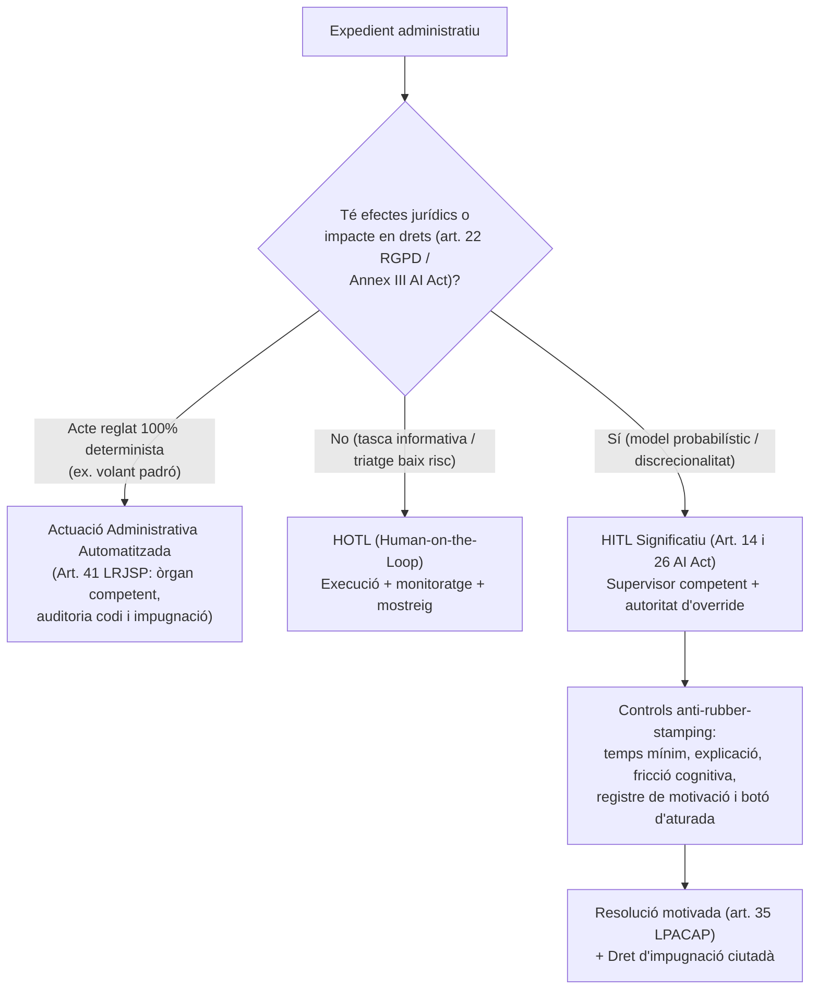

## A. Objectius d'aprenentatge

En completar aquesta lliçó seràs capaç de:

1. **Distingir** amb total rigor els tres models de supervisió humana: **HITL (*Human-in-the-Loop*)**, **HOTL (*Human-on-the-Loop*)** i **HIC (*Human-in-Command*)**, assignant el model adequat segons el nivell de risc jurídic i operatiu del procediment administratiu.
2. **Dominar** el marc legal vigent sobre **decisions individuals automatitzades**: **article 22 del RGPD** (prohibició general de decisions **únicament** automatitzades amb efectes jurídics o similars, excepcions taxades i salvaguardes obligatòries: dret a intervenció humana, a expressar el punt de vista i a impugnar), **article 14 i article 26 de l'AI Act** (mesures de supervisió humana i competència del supervisor) i **article 41 de la Llei 40/2015 (LRJSP)** sobre **actuació administrativa automatitzada (AAA)**.
3. **Identificar i neutralitzar** el **biaix d'automatització (*automation bias*)** i el fenomen del ***rubber-stamping*** (validació humana merament formal en 2 segons que, segons la doctrina i les guies de les autoritats de protecció de dades, **NO trenca el caràcter «únicament automatitzat» de l'art. 22 RGPD**!).
4. **Dissenyar** interfícies i protocols de supervisió humana **efectiva i significativa** (*meaningful human oversight*): temps raonable de revisió, autoritat real per revocar el model, informació d'incertesa/explicació, **botó d'aturada** (art. 14.4.e AI Act) i registre obligatori de motivació d'anomalies.
5. **Implementar** en Python pur un **gestor de supervisió humana efectiva (HITL)** que detecta *rubber-stamping* (revisions massa ràpides o taxa d'acceptació cega > 99%), aplica el principi dels **quatre ulls** en alt risc i exigeix motivació humana auditada!

---

## B. Explicació introductòria

Posar un botó verd gegant d'«Acceptar recomanació de la IA» a la pantalla d'un funcionari sobrecarregat que ha de validar 400 expedients en un matí **NO és supervisió humana**: és un **escut cosmètic** (*rubber-stamping*)!

Si el funcionari acaba clicant «Acceptar» en 1,5 segons sense ni temps ni informació ni autoritat per discrepar del model, a efectes tant psicològics (**biaix d'automatització**) com jurídics (**art. 22 RGPD** i jurisprudència/guies del Comitè Europeu de Protecció de Dades — CEPD/EDPB), la decisió continua essent **únicament automatitzada**! En l'Administració pública, la supervisió humana ha de ser **real, competent, informada i dotada de capacitat efectiva d'invalidar o aturar el sistema**.

---

## C. Explicació tècnica avançada

### 1. Models de supervisió humana (*Teoria establerta i pràctica d'enginyeria*)

| Model | Significat | Rol de la persona | Quan aplicar-lo en l'Administració pública |
|---|---|---|---|
| **HITL (*Human-in-the-Loop*)** | Humà **dins** el bucle de cada decisió | Cap decisió o acte no s'executa sense revisió i aprovació humana explícita | **Obligatori** en resolucions desfavorablement limitatives, sancions, barems socials amb discrecionalitat, selecció de personal i sistemes d'alt risc amb impacte jurídic individual |
| **HOTL (*Human-on-the-Loop*)** | Humà **supervisant** el bucle | El sistema executa accions rutinàries de baix risc mentre un humà monitora alertes, audita mostres i pot intervenir o aturar | Triatge d'incidències de via pública, classificació de consultes informatives no vinculants, extraccions OCR d'alta confiança amb cua d'excepcions |
| **HIC (*Human-in-Command*)** | Humà al **comandament estratègic** | Governa el disseny global, decideix **quan i on** s'activa o es desconnecta la IA (botó d'aturada), fixa llindars i polítiques | Comitè d'IA, Direcció de Servei, DPD i Òrgan competent (art. 41 LRJSP) |

### 2. Marc legal vigent (*Obligacions legals vigents*)

:::callout-legal
**Les tres columnes normatives de la supervisió humana en el sector públic:**

1. **RGPD (Reglament UE 2016/679) — Article 22 (Decisions individuals automatitzades, inclosa l'elaboració de perfils)**:
   - **Regla general (art. 22.1)**: tota persona interessada té dret a **NO ser objecte d'una decisió basada únicament en el tractament automatitzat**, inclosa l'elaboració de perfils, que produeixi **efectes jurídics** en ella o l'afecti significativament de manera similar.
   - **Excepcions taxades (art. 22.2)**: només és admissible si (a) és necessària per a un contracte, (b) està **autoritzada pel Dret de la Unió o dels Estats membres** que estableixi mesures adequades per salvaguardar els drets, llibertats i interessos legítims — **via habitual en l'Administració pública!** — o (c) es basa en el consentiment explícit.
   - **Salvaguardes obligatòries (art. 22.3)**: fins i tot en les excepcions (a) i (c), i com a estàndard essencial de garantia, dret a obtenir **intervenció humana**, a **expressar el seu punt de vista** i a **impugnar la decisió**. A més, **art. 22.4** restringeix molt severament decisions automatitzades sobre **categories especials de dades (art. 9)**.
   - **Criteri del CEPD (EDPB) / AEPD / APDCAT**: per no ser «únicament automatitzada», la intervenció humana ha de ser **significativa** (realitzada per algú amb autoritat i competència per canviar la decisió, analitzant totes les dades pertinents i no limitant-se a validar automàticament la sortida del sistema).

2. **AI Act (Reglament UE 2024/1689) — Article 14 (Supervisió humana) i Article 26.2 (*Deployers*)**:
   - Els sistemes d'IA d'alt risc s'han de dissenyar perquè puguin ser vigilats eficaçment per persones físiques durant el seu ús (art. 14.1), amb l'objectiu de **prevenir o minimitzar riscos** per a la salut, la seguretat o els drets fonamentals (art. 14.2).
   - Les mesures de l'**art. 14.4** han de permetre que el supervisor humà pugui:
     - (a) Comprendre adequadament les **capacitats i limitacions** del sistema i detectar anomalies o disfuncions.
     - (b) Ser conscient de la tendència a confiar automàticament o excessivament en les sortides (**biaix d'automatització**!).
     - (c) Interpretar correctament els resultats tenint en compte les eines d'explicabilitat.
     - (d) Decidir **no utilitzar** el sistema o **desestimar, invalidar o revertir** el seu resultat (*override*).
     - (e) **Intervenir en el funcionament o interrompre'l** mitjançant un «botó d'aturada» o procediment segur similar.
   - **Art. 26.2 AI Act**: el responsable del desplegament (*deployer*, ex. l'ajuntament) ha d'encomanar la supervisió humana a persones físiques amb la **competència, formació i autoritat necessàries**, així com el suport adequat!

3. **Llei 40/2015 (LRJSP) — Article 41 (Actuació administrativa automatitzada — AAA)**:
   - Defineix l'AAA com qualsevol acte o actuació realitzada íntegrament a través de mitjans electrònics per una Administració pública sense intervenció directa d'un empleat públic (p. ex. certificats d'empadronament o comprovacions reglades deterministes!).
   - **Requisit obligatori (art. 41.2 LRJSP)**: s'ha d'establir **prèviament** l'òrgan o òrgans competents per a la definició d'especificacions, programació, manteniment, supervisió i control de qualitat, i, si escau, **auditoria del sistema d'informació i del seu codi font**, així com indicar l'**òrgan responsable a efectes d'impugnació**! *(Nota clau: l'AAA determinista reglada és molt diferent d'un model probabilístic/LLM caixa negra; delegar discrecionalitat administrativa en un model probabilístic sense supervisió humana vulnera principis bàsics del dret administratiu!)*
:::

### 3. Biaix d'automatització i disseny anti-*rubber-stamping* (*Pràctica d'enginyeria*)

El **biaix d'automatització (*automation bias*)** és la tendència cognitiva documentada dels humans a confiar en excés en les recomanacions automatitzades, ignorant senyals contradictoris (errors d'omissió) o executant accions errònies suggerides per la màquina (errors de comissió).

**Tècniques de disseny UX per combatre'l**:
1. **Fricció cognitiva constructiva (*Cognitive Forcing Functions*)**: en expedients d'alt risc o baixa confiança, exigir que l'empleat llegeixi primer els fets i documents abans de revelar la recomanació del model, o obligar a marcar explícitament els criteris verificats.
2. **Mostrar incertesa i evidència, no només un veredicte binari**: en lloc de «DENEGAT», mostrar `Puntuació = 0,48 (Zona gris: 0,40–0,60)` + els 3 factors SHAP + enllaç directe als documents adjunts.
3. **Principi dels quatre ulls** (*double-check* obligatori per a resolucions desfavorables o de gran quantia) i **dret real d'*override*** sense penalitzar productivitat per discrepar de la IA!
4. **Monitoratge de la qualitat de la supervisió**: alertar si un supervisor aprova el `99,8%` de les recomanacions en `< 2 segons` de mitjana (indicador inequívoc de *rubber-stamping*!).

---

## D. Diagrames i recursos visuals



| Factor | Supervisió aparent (*Rubber-stamping*) | Supervisió humana significativa (*Meaningful HITL*) |
|---|---|---|
| **Temps i càrrega** | 1–2 segons per expedient, pressió de volum | Temps realista assignat; cua prioritzada per risc/incertesa |
| **Informació mostrada** | Només «Aprovar / Rebutjar» | Fets, documents originals, incertesa i explicació XAI |
| **Autoritat** | Penalitzat o limitat si discrepa del model | Competència, formació i autoritat plena per fer *override* o aturar (art. 14 i 26.2 AI Act) |
| **Efecte jurídic (art. 22 RGPD)** | Continua essent **únicament automatitzada**! | Intervenció humana real que trenca l'automatització exclusiva |

---

## E. Aplicació a l'Administració pública

1. **Formació i alfabetització en IA dels supervisors (art. 4 i art. 26.2 AI Act)**: des del **2 de febrer de 2025** és exigible l'**article 4 de l'AI Act** (alfabetització en matèria d'IA)! Un empleat públic assignat a supervisar un sistema d'alt risc ha de rebre formació específica sobre com funciona el sistema, quins biaixos pot tenir, què és el biaix d'automatització i com exercir l'*override* o activar el procediment d'aturada.
2. **Distinció crítica: AAA determinista (art. 41 LRJSP) vs. IA probabilística**: generar automàticament un certificat de residència comprovant un camp exacte del padró és una **Actuació Administrativa Automatitzada** plenament emparada per l'art. 41 LRJSP (prèvia resolució de creació i segell electrònic). En canvi, denegar una prestació social mitjançant una xarxa neuronal o un LLM sense revisió humana significativa és il·lícit sota l'art. 22 RGPD, l'art. 14 AI Act i els principis del procediment administratiu!
3. **Traçabilitat de la discrepància (*Override Logging*)**: registrar quan i per què un funcionari corregeix la IA compleix una doble funció: demostra davant una auditoria que la supervisió és real (no *rubber-stamping*) i genera **dades d'or etiquetades** per reentrenar i millorar el model!

---

## F. Exemple pràctic guiat

### Exemple 8.3: Gestor de supervisió humana efectiva (HITL) amb detector de *rubber-stamping* i principi dels quatre ulls

Aquest script Python pur simula una cua de supervisió humana per a expedients d'ajuts socials que:
1. Bloqueja qualsevol intent de validació en `< 5 segons` (alerta de *rubber-stamping*!).
2. Exigeix **motivació escrita obligatòria** tant en *override* com en resolucions desfavorables.
3. Activa el principi dels **quatre ulls** (segon supervisor) en expedients d'alt risc o zona gris de confiança!

```python
"""Exemple 8.3: Supervisor HITL significatiu amb detecció de rubber-stamping i 4 ulls."""

from dataclasses import dataclass


@dataclass
class RevisioHumana:
    expedient_id: str
    supervisor_id: str
    recomanacio_ia: str          # "FAVORABLE" | "DESFAVORABLE"
    confianca_ia: float
    decisio_humana: str          # "FAVORABLE" | "DESFAVORABLE"
    segons_revisio: float
    motivacio: str
    segon_supervisor_id: str | None = None


def validar_supervisio_significativa(
    rev: RevisioHumana,
    temps_minim_seg: float = 5.0,
) -> dict[str, object]:
    alertes: list[str] = []

    # 1. Detector de rubber-stamping (acceptació exprés)
    if rev.segons_revisio < temps_minim_seg:
        alertes.append(
            f"RUBBER_STAMPING: revisió massa ràpida ({rev.segons_revisio}s < {temps_minim_seg}s)"
        )

    # 2. Motivació obligatòria en resolució desfavorable o override (art. 35 LPACAP + traçabilitat)
    es_override = rev.decisio_humana != rev.recomanacio_ia
    if (rev.decisio_humana == "DESFAVORABLE" or es_override) and len(rev.motivacio.strip()) < 15:
        alertes.append("MOTIVACIO_INSUFICIENT: cal justificació fàctica i jurídica explícita")

    # 3. Principi dels quatre ulls en zona gris (< 0.70) o denegació
    requereix_4_ulls = rev.decisio_humana == "DESFAVORABLE" or rev.confianca_ia < 0.70
    if requereix_4_ulls and (
        not rev.segon_supervisor_id or rev.segon_supervisor_id == rev.supervisor_id
    ):
        alertes.append("FALTA_SEGON_SUPERVISOR: requerit principi de quatre ulls independent")

    return {
        "expedient_id": rev.expedient_id,
        "es_override": es_override,
        "estat": "VALIDADA_HITL" if not alertes else "BLOQUEJADA_REVISIO",
        "alertes": alertes,
    }


if __name__ == "__main__":
    cas_rubber = RevisioHumana(
        expedient_id="EXP-2026-01",
        supervisor_id="FUNC_01",
        recomanacio_ia="DESFAVORABLE",
        confianca_ia=0.62,
        decisio_humana="DESFAVORABLE",
        segons_revisio=1.4,
        motivacio="OK",
    )
    cas_bo = RevisioHumana(
        expedient_id="EXP-2026-02",
        supervisor_id="FUNC_01",
        recomanacio_ia="DESFAVORABLE",
        confianca_ia=0.62,
        decisio_humana="FAVORABLE",
        segons_revisio=48.0,
        motivacio="Acreditada renda actualitzada via certificat AEAT adjunt; supera requisits.",
        segon_supervisor_id="FUNC_02",
    )

    for cas in (cas_rubber, cas_bo):
        print(validar_supervisio_significativa(cas))
```

#### Interpretació del resultat
- `EXP-2026-01` queda **`BLOQUEJADA_REVISIO`** amb 3 alertes simultànies (`RUBBER_STAMPING` per `1.4s`, `MOTIVACIO_INSUFICIENT` per posar només `"OK"`, i `FALTA_SEGON_SUPERVISOR`).
- `EXP-2026-02` supera tots els controls (`VALIDADA_HITL`), registra **`es_override: True`** (demostrant autoritat humana real davant el model!) i aporta motivació jurídica verificada per dos funcionaris independents!

---

## G. Exercici pràctic per resoldre

### Enunciat i context
Un consell comarcal desplega un sistema d'IA que puntua automàticament sol·licituds de beques de transport escolar. Per complir formalment l'art. 22 RGPD, l'empresa proveïdora afegeix una pantalla on un administratiu veu 50 expedients en taula i un botó global **«Aprovar tots els suggeriments de la IA»**. Al cap d'un mes, el 99,9% dels suggeriments s'han aprovat en bloc sense modificacions.

### Objectius i requisits
1. Avalua jurídicament aquesta pràctica sota l'**art. 22 RGPD**, l'**art. 14 AI Act** i l'**art. 26.2 AI Act**.
2. Dissenya **5 mesures tècniques i organitzatives concretes** per transformar aquest flux en una supervisió humana significativa real.

:::hint Pista sobre el botó «Aprovar tots»
Un botó d'aprovació massiva en bloc amb un 99,9% d'acceptació acrítica és la definició de manual de *rubber-stamping*! Comprova els 5 requisits de l'art. 14.4 AI Act i els criteris del CEPD sobre intervenció humana significativa.
:::

:::solution Solució comentada
1. **Avaluació jurídica**:
   - **Art. 22 RGPD**: l'aprovació massiva en bloc amb un 99,9% d'acceptació sense anàlisi individual és *rubber-stamping*; **no constitueix intervenció humana significativa**, de manera que la decisió continua essent **únicament automatitzada** (il·lícita sense habilitació legal específica i salvaguardes reals!).
   - **Art. 14 AI Act**: no prevé el **biaix d'automatització** (al contrari, l'incentiva!) ni permet interpretar els resultats ni invalidar individualment de manera operativa.
   - **Art. 26.2 AI Act**: vulnera el deure del *deployer* d'assignar supervisió humana amb competència, formació, temps i autoritat efectiva.
2. **5 mesures concretes de redisseny**:
   - **Eliminar el botó «Aprovar tots»** en expedients desfavorables o de zona gris; obligar a revisió individualitzada.
   - **Fricció cognitiva i explicació visible**: mostrar les dades clau, documents i factors SHAP abans d'habilitar la decisió, destacant la incertesa.
   - **Principi dels quatre ulls + motivació obligatòria** en qualsevol resolució desfavorable o en casos de baixa confiança.
   - **Monitoratge de mètriques de supervisió**: alertes de temps de revisió anòmalament baix (`< 5 s`), taxa d'*override* pròxima a 0% i auditories aleatòries de qualitat.
   - **Formació específica (art. 4 i 26.2 AI Act) + botó d'aturada (art. 14.4.e)**: capacitar els funcionaris sobre biaix d'automatització, donar-los autoritat expressa per discrepar sense penalització i establir un protocol clar d'interrupció del sistema si es detecta error sistemàtic.
:::

---

## H. Test individual

Resol les 10 preguntes sobre HITL/HOTL/HIC, art. 22 RGPD, art. 14 i 26.2 AI Act, art. 41 LRJSP (actuació administrativa automatitzada), biaix d'automatització, *rubber-stamping* i disseny de supervisió humana significativa.

---

## I. Preguntes de desenvolupament

### Pregunta 1
Explica què és el **biaix d'automatització (*automation bias*)**, per què el ***rubber-stamping*** invalida el compliment de l'**art. 22 RGPD** i quines mesures concretes d'interfície i organització implantaries per evitar-lo.

:::model-answer Resposta model i criteris de correcció
- **Biaix d'automatització**: tendència humana a confiar excessivament en les recomanacions d'un sistema automatitzat (errors d'omissió en no detectar fallades i errors de comissió en seguir recomanacions errònies).
- **Efecte jurídic del *rubber-stamping* (art. 22 RGPD)**: segons les directrius del CEPD/EDPB i de les autoritats de protecció de dades, una validació merament formal i acrítica sense anàlisi real ni autoritat per canviar el resultat **no elimina el caràcter «únicament automatitzat»** de la decisió, fent-la il·lícita si no concorre una excepció legal amb salvaguardes!
- **Mesures preventives**: eliminar aprovacions en bloc en actes limitatius; *cognitive forcing functions* (mostrar evidència i incertesa abans del veredicte); temps realista i càrrega sostenible; formació específica sobre biaix d'automatització (art. 4 i 26.2 AI Act); autoritat plena d'*override* sense penalització; auditoria de temps de revisió i taxes d'*override*; principi dels quatre ulls en denegacions.
- **Criteris de correcció (10 punts)**: definició del biaix (2,5 punts), anàlisi jurídica de l'art. 22 RGPD (3,5 punts), conjunt coherent de mesures UX i organitzatives (4 punts).
:::

### Pregunta 2
Enumera les capacitats que exigeix l'**article 14.4 de l'AI Act** per a les mesures de supervisió humana en sistemes d'alt risc i vincula-les amb les obligacions del responsable del desplegament (*deployer*) de l'**article 26.2**.

:::model-answer Resposta model i criteris de correcció
- **Capacitats de l'art. 14.4 AI Act** (disseny del sistema pel proveïdor):
  1. Comprendre adequadament les **capacitats i limitacions** i vigilar anomalies o funcionament inesperat.
  2. Mantenir-se conscient del risc de **biaix d'automatització** (confiança excessiva o automàtica).
  3. **Interpretar correctament** les sortides del sistema amb l'ajuda d'eines d'explicabilitat.
  4. Decidir **no utilitzar** el sistema en una situació concreta o **desestimar, invalidar o revertir** el resultat (*override*).
  5. **Intervenir o interrompre** el funcionament amb un **botó d'aturada** o procediment segur equivalent.
- **Obligació complementària del *deployer* (art. 26.2 AI Act)**: l'Administració pública que desplega el sistema ha d'encomanar la supervisió a **persones físiques amb la competència, formació i autoritat necessàries** i proporcionar-los el suport adequat (sense formació ni autoritat real, el disseny de l'art. 14 queda en paper mullat!).
- **Criteris de correcció (10 punts)**: les 5 capacitats de l'art. 14.4 (6 punts), vinculació precisa amb l'art. 26.2 (4 punts).
:::

### Pregunta 3
Distingeix entre una **Actuació Administrativa Automatitzada (AAA)** regulada per l'**article 41 de la Llei 40/2015 (LRJSP)** i un sistema de decisió basat en **IA probabilística o generativa** en un procediment administratiu.

:::model-answer Resposta model i criteris de correcció
- **AAA (art. 41 LRJSP)**: actuació realitzada íntegrament per mitjans electrònics sense intervenció directa d'empleat públic, pensada típicament per a actes **reglats i deterministes** (certificats d'empadronament, comprovacions automàtiques de requisits objectius). Exigeix definir prèviament l'òrgan competent per a especificacions, programació, manteniment, supervisió, control de qualitat, auditoria del sistema i del codi font, i indicar l'òrgan responsable a efectes d'impugnació (signatura amb segell electrònic o CSV — art. 42 LRJSP).
- **IA probabilística / LLM**: opera amb incertesa estadística, risc d'al·lucinacions o biaixos i opacitat potencial. No pot substituir l'exercici de potestats discrecionals ni emetre actes limitatius de drets sense habilitació legal, garanties reforçades de l'art. 22 RGPD, supervisió humana significativa (HITL — art. 14 AI Act) i motivació jurídica (art. 35 LPACAP).
- **Criteris de correcció (10 punts)**: requisits exactes de l'art. 41 LRJSP (5 punts), diferenciació rigorosa amb IA probabilística/discrecionalitat (5 punts).
:::

---

## J. Resum per memoritzar

- **Idees clau**:
  - **HITL** (dins cada decisió — obligatori en alt risc/drets), **HOTL** (supervisant + alertes — baix risc), **HIC** (comandament estratègic i governança).
  - **Art. 22 RGPD**: dret a NO ser objecte de decisió **únicament** automatitzada amb efectes jurídics/similars (excepcions taxades + dret a intervenció humana, expressar punt de vista i impugnar).
  - **El *rubber-stamping* NO compta com a supervisió humana!**
  - **Art. 14 AI Act**: comprendre límits, prevenir **biaix d'automatització**, interpretar, fer ***override*** i tenir **botó d'aturada**.
  - **Art. 26.2 AI Act**: el *deployer* assigna persones amb **competència, formació i autoritat**.
  - **Art. 41 LRJSP**: l'**AAA** requereix designar prèviament òrgan competent (especificacions, manteniment, control, auditoria de codi) i òrgan d'impugnació.
- **Errors freqüents d'examen**:
  - Afirmar que posar un botó d'«Acceptar tots» compleix l'art. 22 RGPD.
  - Confondre una AAA determinista (art. 41 LRJSP) amb carta blanca per automatitzar resolucions discrecionals amb un LLM.
- **Flashcards associades**: consulta `flashcards/module-08/m08-03-supervisio-humana.json` (5 targetes).
- **Possibles preguntes d'examen**:
  - Enumera els 5 requisits de supervisió humana de l'art. 14.4 de l'AI Act.
  - Quines salvaguardes exigeix l'art. 22 del RGPD i quan s'entén que la intervenció humana és significativa?
