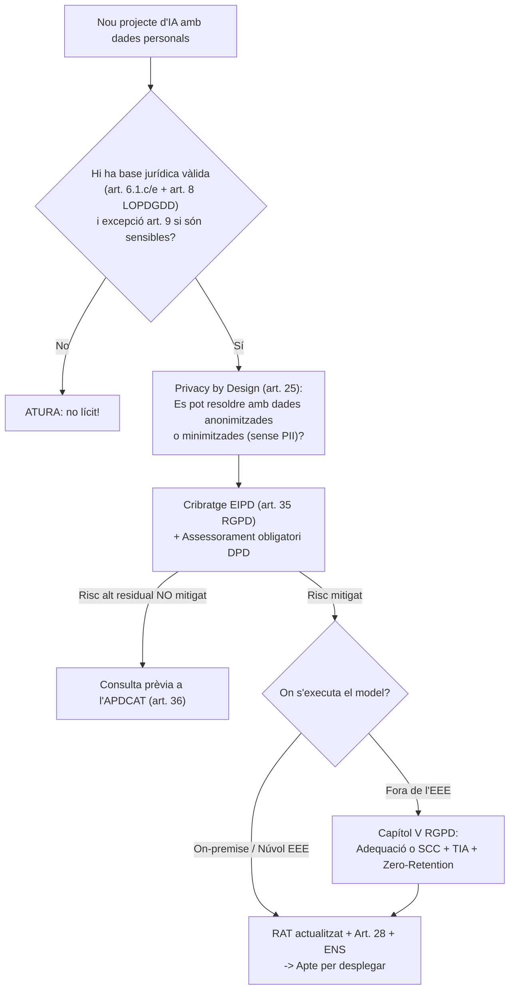

## A. Objectius d'aprenentatge

En completar aquesta lliçó seràs capaç de:

1. **Aplicar** els **principis de l'article 5 del RGPD** (licitud, lleialtat i transparència, limitació de la finalitat, **minimització de dades**, exactitud, limitació del termini de conservació, integritat i confidencialitat, i responsabilitat proactiva) al cicle complet d'un projecte d'IA (entrenament, *fine-tuning*, RAG, *prompting* i logs).
2. **Seleccionar** la **base jurídica adequada (art. 6 RGPD)** en l'Administració pública (prioritàriament **art. 6.1.c obligació legal** o **art. 6.1.e missió en interès públic / exercici de poders públics** amb rang legal — art. 8 LOPDGDD — i **NO el consentiment** quan hi ha desequilibri!), així com gestionar les prohibicions i excepcions de **categories especials (art. 9 RGPD)**.
3. **Executar** el procés obligatori d'**Avaluació d'Impacte relativa a la Protecció de Dades (EIPD / DPIA — art. 35 RGPD)**, determinant quan és preceptiva en projectes d'IA, integrant el **Delegat de Protecció de Dades (DPD — art. 37–39 RGPD i art. 34 LOPDGDD)** i diferenciant la competència de l'**APDCAT** (administracions públiques catalanes) i l'**AEPD** (àmbit estatal).
4. **Dissenyar** controls de **protecció de dades des del disseny i per defecte (art. 25 RGPD)**: anonimització real (irreversible, fora del RGPD) vs. pseudonimització (segueix essent dada personal!), no reutilització de *prompts* per reentrenar models externs (*zero-data-retention*), sobirania i **transferències internacionals (Capítol V RGPD: art. 44–49)**.
5. **Implementar** en Python pur un **cribratge automatitzat de necessitat d'EIPD (criteris art. 35 RGPD / CEPD)** i un **filtre de minimització i pseudonimització prèvia a inferència** que bloqueja l'enviament de dades personals o categories especials a APIs fora de l'EEE!

---

## B. Explicació introductòria

Un error molt freqüent en els primers pilots d'IA generativa a les administracions ha estat que un empleat copiï un informe social o una denúncia amb noms, DNI i dades de salut dins una eina pública gratuïta d'IA al núvol per «fer un resum ràpid».

Aquest gest de 10 segons pot comportar simultàniament **quatre infraccions greus del RGPD**: (1) comunicació de dades personals (i categories especials de l'art. 9!) a un tercer sense base jurídica ni contracte d'encarregat de tractament (art. 28); (2) **transferència internacional il·lícita** fora de l'EEE (Capítol V); (3) **pèrdua de control i ús secundari** per reentrenar el model comercial (violació de la limitació de finalitat, art. 5.1.b); i (4) **bretxa de seguretat** notificable a l'**APDCAT** en menys de **72 hores** (art. 33 RGPD)!

---

## C. Explicació tècnica avançada

### 1. Principis de l'article 5 RGPD aplicats a la IA (*Obligacions legals vigents*)

| Principi (art. 5 RGPD) | Impacte directe en projectes d'IA i LLMs | Mesura d'enginyeria obligatòria |
|---|---|---|
| **Licitud, lleialtat i transparència (5.1.a)** | Cal base jurídica vàlida (art. 6) i informar clarament la ciutadania (art. 13–14) | Base **6.1.c** o **6.1.e** (+ art. 8 LOPDGDD); avís clar d'IA i clàusula informativa |
| **Limitació de la finalitat (5.1.b)** | Dades recollides per tramitar un ajut **NO** es poden reaprofitar automàticament per entrenar un model comercial o una altra finalitat incompatible! | Comprovació de compatibilitat (art. 6.4) o **anonimització irreversible real** abans d'entrenar |
| **Minimització de dades (5.1.c)** | Recollir i passar al model **només** els atributs estrictament necessaris | Redacció/emmascarament de PII abans del *prompt* o de la vectorització RAG; no entrenar amb noms/DNI! |
| **Exactitud (5.1.d)** | Les **al·lucinacions d'un LLM** sobre una persona física poden vulnerar directament el principi d'exactitud! | RAG verificat, prohibició de perfilar persones amb LLMs generatius sense verificació i dret de rectificació |
| **Limitació del termini de conservació (5.1.e)** | Els pesos d'un model entrenat poden memoritzar PII si no es filtren; els logs i índexs vectorials no poden ser eterns! | TTL en logs de *prompts*, sincronització del dret de supressió a la base vectorial RAG, evitar PII en *fine-tuning* |
| **Integritat i confidencialitat (5.1.f)** | Protecció contra fuites de *prompts*, atacs d'extracció i accessos no autoritzats | Xifratge, RBAC, desplegament *on-premise* / núvol EEE sobirà, **ENS (RD 311/2022)** |
| **Responsabilitat proactiva (5.2)** | Cal **demostrar** el compliment documentalment i tècnicament | Registre d'Activitats de Tractament (RAT), EIPD, contractes art. 28, auditories |

### 2. Bases jurídiques (art. 6 i 9 RGPD + LOPDGDD) i autoritats de control

- **Per què el consentiment (art. 6.1.a) sol ser invàlid en l'Administració pública?** El **Considerant 43 del RGPD** adverteix que el consentiment **no és lliure** quan existeix un **desequilibri clar** entre l'interessat i el responsable, **especialment quan el responsable és una autoritat pública**! Les bases habituals en el sector públic són:
  - **Art. 6.1.c**: compliment d'una obligació legal.
  - **Art. 6.1.e**: compliment d'una missió realitzada en interès públic o en l'exercici de poders públics (que a Espanya requereix **norma amb rang de llei**, art. 8.2 **LOPDGDD 3/2018**!).
- **Categories especials de dades (art. 9 RGPD)**: salut, origen ètnic o racial, opinions polítiques, conviccions religioses, afiliació sindical, dades genètiques, **dades biomètriques dirigides a identificar unívocament una persona física**, vida/orientació sexual. **Prohibides per defecte**, llevat excepcions molt taxades (art. 9.2, ex. interès públic essencial sobre la base del Dret de la UE o estatal proporcional).
- **Autoritats de control competents**:
  - **APDCAT (Autoritat Catalana de Protecció de Dades)**: competent sobre la Generalitat de Catalunya, les **diputacions provincials (inclosa la Diputació de Barcelona)**, els **ajuntaments**, consells comarcals i ens locals de Catalunya!
  - **AEPD (Agència Espanyola de Protecció de Dades)**: àmbit estatal (Administració General de l'Estat, sector privat i guies tècniques de referència molt usades també en IA, com l'*Adequació al RGPD de tractaments que incorporen IA*).

### 3. EIPD / DPIA (art. 35 RGPD), Privacitat des del disseny (art. 25) i Transferències (Cap. V)

:::callout-legal
**Quan és OBLIGATÒRIA una EIPD / DPIA (art. 35 RGPD)?**
Sempre que sigui probable que un tipus de tractament — **en particular si utilitza noves tecnologies** com la IA — comporti un **alt risc** per als drets i llibertats de les persones físiques!
Segons els criteris del CEPD/AEPD/APDCAT, és preceptiva (en general si concorren **2 o més criteris de risc**, o per inclusió directa a les llistes oficials de l'APDCAT/AEPD):
1. Avaluació o puntuació (*scoring* / elaboració de perfils).
2. Decisions automatitzades amb efectes jurídics o similars significatius (art. 22).
3. Observació sistemàtica (ex. càmeres intel·ligents en via pública).
4. Dades sensibles o molt personals (categories especials art. 9, infraccions penals art. 10).
5. Tractament a gran escala o combinació/creuament de conjunts de dades.
6. Col·lectius vulnerables (menors, persones dependents, sol·licitants d'ajuts socials).
7. Ús innovador de noves tecnologies (IA / biometria / LLMs).
- **Important**: la EIPD s'ha de fer **ABANS** d'iniciar el tractament, amb l'assessorament obligatori del **DPD** (art. 35.2 RGPD), i si persisteix un alt risc residual no mitigat, exigeix **consulta prèvia** a l'autoritat de control (**APDCAT**, art. 36 RGPD)!
:::

- **Anonimització vs. Pseudonimització (Recital 26 i art. 4.5 RGPD)**:
  - **Pseudonimització**: substitueix identificadors directes per pseudònims o claus separades → **CONTINUA ESSENT DADA PERSONAL** subjecta al RGPD (és una excel·lent mesura de seguretat i minimització de l'art. 25/32, però NO exclou el RGPD!).
  - **Anonimització real**: elimina la possibilitat de reidentificar la persona per qualsevol mitjà raonablement probable (incloent-hi atacs de vinculació / *singling out* / inferència; tècniques com *k-anonimat*, *l-diversitat* o privacitat diferencial). Només les dades **realment i irreversiblement anonimitzades** queden fora de l'àmbit del RGPD!
- **Transferències internacionals (Capítol V RGPD, art. 44–49)**: enviar *prompts* amb dades personals a servidors d'un proveïdor d'IA situats fora de l'Espai Econòmic Europeu (EEE) requereix: (a) **contracte d'encarregat de tractament (art. 28)** amb clàusula explícita de **no ús per a entrenament (*zero-data-retention*)**, i (b) mecanisme vàlid del Capítol V (**decisió d'adequació** de la Comissió Europea — ex. *EU-US Data Privacy Framework* per a entitats certificades — o **Clàusules Contractuals Tipus (SCC)** + **Avaluació d'Impacte de Transferència (TIA)** i mesures suplementàries de xifratge!). **Bona pràctica prioritària**: desplegament *on-premise* o regió sobirana dins l'EEE!

---

## D. Diagrames i recursos visuals



| Concepte RGPD | Obligació legal / Regla clau | Error habitual a evitar |
|---|---|---|
| **Pseudonimització** | Segueix essent **dada personal** (mesura art. 25/32) | Creure que canviar el nom per `USER_123` eximeix del RGPD! |
| **Anonimització** | Irreversible (resistent a reidentificació) → fora del RGPD | Fer una «anonimització feble» fàcilment reidentificable per codi postal + data de naixement + sexe! |
| **Base jurídica pública** | Art. **6.1.c** o **6.1.e** (+ rang legal art. 8 LOPDGDD) | Demanar «consentiment» (6.1.a) en un tràmit obligatori on no hi ha llibertat real! |
| **DPD (art. 37 RGPD)** | Obligatori en **totes** les autoritats i organismes públics | Fer una EIPD o contractar una API d'IA sense consultar el DPD! |
| **Autoritat local catalana** | **APDCAT** (ens locals de Catalunya, Diputació de Barcelona) | Notificar una bretxa local a una autoritat equivocada o fora del termini de **72 hores** (art. 33)! |

---

## E. Aplicació a l'Administració pública

1. **Dret de supressió en sistemes RAG vs. *Fine-tuning***: esborrar les dades d'una persona en un índex vectorial **RAG** és trivial (només cal esborrar els *chunks* vinculats al seu `doc_id`!). En canvi, esborrar dades personals que s'han incorporat als pesos d'un LLM via ***fine-tuning*** (*Machine Unlearning*) és extraordinàriament difícil i costós! **Regla d'or d'arquitectura**: **MAI** no facis *fine-tuning* de models generatius amb dades personals identificables!
2. **Gestió de bretxes de seguretat en IA (art. 33–34 RGPD)**: si un error de configuració provoca que un xatbot filtri l'historial d'un ciutadà a un altre usuari (*cross-tenant leakage*), és una **violació de seguretat de dades personals**: cal contenir-la immediatament, avaluar el risc amb el DPD i notificar-la a l'**APDCAT en un màxim de 72 hores** (i comunicar-ho als afectats si hi ha alt risc, art. 34).
3. **EIPD + FRIA integrades**: per a sistemes d'alt risc en entitats públiques, la **EIPD (art. 35 RGPD)** i la **FRIA (art. 27 AI Act)** es poden complementar i coordinar (de fet, l'art. 27.4 AI Act preveu expressament complementar la EIPD ja realitzada per evitar duplicitats innecessàries!).

---

## F. Exemple pràctic guiat

### Exemple 8.4: Cribratge automàtic d'EIPD (art. 35 RGPD) + Porta de minimització i control de transferències internacionals

Aquest script Python pur implementa dos controls operatius de *Privacy by Design* (art. 25 RGPD):
1. Avalua els criteris de risc del CEPD/APDCAT per decidir si una **EIPD és obligatòria** abans d'iniciar el projecte.
2. Verifica si una petició cap a un model d'IA conté PII / categories especials i **bloqueja automàticament** enviaments fora de l'EEE sense salvaguardes!

```python
"""Exemple 8.4: Cribratge d'EIPD (art. 35 RGPD) i porta Privacy by Design."""

import re


def avaluar_necessitat_eipd(caracteristiques: dict[str, bool]) -> dict[str, object]:
    """Aplica el criteri orientatiu CEPD/APDCAT (>= 2 factors de risc -> EIPD obligatòria)."""
    criteris_risc = {
        "perfilat_o_scoring",
        "decisio_automatitzada_art22",
        "categories_especials_art9",
        "gran_escala",
        "collectius_vulnerables",
        "nova_tecnologia_ia",
        "observacio_sistematica",
    }
    activats = sorted(k for k in criteris_risc if caracteristiques.get(k, False))
    obligatoria = len(activats) >= 2 or caracteristiques.get("decisio_automatitzada_art22", False)
    return {
        "criteris_activats": activats,
        "total_criteris": len(activats),
        "eipd_obligatoria": obligatoria,
        "accio": "EXECUTAR_EIPD_AMB_DPD_ABANS_DESPLEGAR" if obligatoria else "DOCUMENTAR_AL_RAT_I_REVISAR_DPD",
    }


def porta_privacitat_inferencia(
    text: str,
    regio_servei: str,         # "ON_PREMISE" | "EEE" | "FORA_EEE"
    te_scc_i_zero_retention: bool = False,
) -> dict[str, object]:
    te_dni = bool(re.search(r"\b\d{8}[A-Za-z]\b", text))
    te_salut = any(p in text.lower() for p in ("diagnòstic", "discapacitat", "informe mèdic"))

    # Bloqueig de transferència internacional no garantida amb PII
    if regio_servei == "FORA_EEE" and (te_dni or te_salut) and not te_scc_i_zero_retention:
        return {
            "permes": False,
            "motiu": "BLOQUEJAT: transferència fora EEE amb PII/art. 9 sense garanties Cap. V ni zero-retention.",
        }

    # Minimització per defecte (art. 25): emmascarar DNI abans de passar al model
    text_minimitzat = re.sub(r"\b\d{8}[A-Za-z]\b", "[DNI_MINIMITZAT]", text)
    return {
        "permes": True,
        "alerta_art9": te_salut,
        "text_enviat": text_minimitzat,
    }


if __name__ == "__main__":
    projecte = {
        "perfilat_o_scoring": True,
        "categories_especials_art9": True,
        "collectius_vulnerables": True,
        "nova_tecnologia_ia": True,
    }
    print("Cribratge EIPD:", avaluar_necessitat_eipd(projecte))

    prompt = "Revisa l'informe mèdic de la persona amb DNI 12345678A per ajut de dependència."
    print("Enviament API EUA sense garanties:", porta_privacitat_inferencia(prompt, "FORA_EEE", False))
    print("Enviament model On-Premise:", porta_privacitat_inferencia(prompt, "ON_PREMISE"))
```

#### Interpretació del resultat
- El projecte activa **4 criteris de risc** (`categories_especials_art9`, `collectius_vulnerables`, `nova_tecnologia_ia`, `perfilat_o_scoring`) → **`eipd_obligatoria: True`** (`EXECUTAR_EIPD_AMB_DPD_ABANS_DESPLEGAR`).
- La porta de privacitat **bloqueja** l'enviament a una API fora de l'EEE sense garanties del Capítol V, mentre que en el desplegament *on-premise* aplica **minimització per defecte (art. 25)** substituint `12345678A` per `[DNI_MINIMITZAT]` i marca **`alerta_art9: True`**!

---

## G. Exercici pràctic per resoldre

### Enunciat i context
L'Àrea de Serveis Socials d'una diputació vol crear un assistent d'IA que resumeixi expedients de dependència (contenen noms, DNI, situació econòmica i informes mèdics). Proposen fer ***fine-tuning*** d'un model allotjat en una API d'un proveïdor dels EUA (sense clàusula de no reentrenament) demanant el «consentiment» obligatori al formulari d'ajut, després de canviar els noms per un codi intern (`EXP-001`) creient que així «ja són dades anònimes fora del RGPD».

### Objectius i requisits
Identifica i corregeix els **5 errors greus de protecció de dades** d'aquesta proposta, proposant una **arquitectura alternativa complidora** (base jurídica, tècnica RAG vs. *fine-tuning*, EIPD, DPD/APDCAT i ubicació).

:::hint Pista dels 5 errors
Revisa: (1) pseudonimització vs. anonimització, (2) consentiment en autoritat pública (Considerant 43), (3) *fine-tuning* amb dades personals i dret de supressió, (4) transferència internacional Capítol V + ús per reentrenament, i (5) absència d'EIPD (art. 35) amb DPD per categories especials (art. 9) i col·lectius vulnerables!
:::

:::solution Solució comentada
1. **Els 5 errors greus detectats**:
   - **Error 1 (Falsa anonimització)**: substituir noms per `EXP-001` és **pseudonimització** (no anonimització!), continua essent **dada personal** subjecta plenament al RGPD (i les dades clíniques i socioeconòmiques permeten reidentificació!).
   - **Error 2 (Base jurídica invàlida)**: el «consentiment» dins un formulari obligatori d'ajuts de dependència **no és lliure** (desequilibri manifest, Considerant 43 RGPD). Cal fonamentar-lo en **art. 6.1.e** (missió en interès públic amb rang legal, art. 8 LOPDGDD) i una excepció vàlida de l'**art. 9.2 RGPD** per a dades de salut!
   - **Error 3 (*Fine-tuning* amb PII / art. 9)**: incorporar expedients personals als pesos d'un model compromet la limitació de finalitat, la seguretat contra memorització i impedeix exercir el dret de supressió!
   - **Error 4 (Transferència internacional il·lícita + reentrenament extern)**: enviar dades de salut a EUA sense contracte art. 28, sense *zero-data-retention* ni salvaguardes del Capítol V (adequació o SCC + TIA) infringeix el RGPD.
   - **Error 5 (Omissió d'EIPD i DPD)**: tractar dades de salut de col·lectius vulnerables amb IA exigeix obligatòriament **EIPD prèvia (art. 35 RGPD)** amb assessorament del **DPD** (i consulta prèvia a l'**APDCAT**, art. 36, si queda alt risc residual).
2. **Arquitectura alternativa complidora**:
   - Model open-weights desplegat ***on-premise*** o en núvol sobirà dins l'**EEE** amb contracte art. 28 i conformitat **ENS** (categoria ALT per dades de salut).
   - **Zero *fine-tuning* amb dades personals**: usar el model preentrenat en inferència efímera (*stateless*) o RAG amb control d'accés estricte (RBAC) per expedient i filtre de minimització de PII abans de la inferència.
   - EIPD + registre al RAT + validació del DPD abans d'entrar en producció + revisió humana obligatòria del resum.
:::

---

## H. Test individual

Resol les 10 preguntes sobre els principis de l'art. 5 RGPD, bases jurídiques art. 6 i 9, LOPDGDD, pseudonimització vs. anonimització, EIPD (art. 35), DPD, APDCAT vs. AEPD, transferències internacionals (Capítol V) i dret de supressió en RAG vs. *fine-tuning*.

---

## I. Preguntes de desenvolupament

### Pregunta 1
Explica per què una administració pública **no ha d'utilitzar el consentiment (art. 6.1.a RGPD)** com a base jurídica habitual per als seus sistemes d'IA, i indica quines bases jurídiques són procedents (tant per a dades ordinàries com per a categories especials de l'art. 9).

:::model-answer Resposta model i criteris de correcció
- **Invalidesa del consentiment en l'Administració pública**: segons el **Considerant 43 del RGPD**, el consentiment no pot ser lliure quan existeix un desequilibri clar entre la persona interessada i el responsable, situació típica de les autoritats públiques (el ciutadà no pot negar-se lliurement si necessita un servei o ajut públic!). A més, el consentiment seria revocable en qualsevol moment.
- **Bases jurídiques procedents (art. 6 RGPD + art. 8 LOPDGDD)**: **art. 6.1.c** (compliment d'una obligació legal) o **art. 6.1.e** (missió realitzada en interès públic o exercici de poders públics), que a Espanya requereixen previsió en una **norma amb rang de llei** (art. 8 LOPDGDD 3/2018).
- **Categories especials (art. 9 RGPD)**: prohibides per defecte (salut, origen ètnic, biometria d'identificació unívoca, etc.); requereixen concórrer **addicionalment** una excepció taxada de l'art. 9.2 (habitualment **art. 9.2.g** interès públic essencial sobre la base del Dret de la UE o estatal proporcional amb mesures adequades i específiques, o **art. 9.2.h** assistència sanitària/social).
- **Criteris de correcció (10 punts)**: raonament del desequilibri/Considerant 43 (3 punts), art. 6.1.c/e + art. 8 LOPDGDD (4 punts), requisit acumulatiu de l'art. 9.2 (3 punts).
:::

### Pregunta 2
Detalla el procediment complet d'una **EIPD / DPIA (art. 35 RGPD)** en un projecte d'IA d'un ens local de Catalunya: quan és obligatòria, contingut mínim, rol del DPD i relació amb l'**APDCAT** (art. 36 RGPD).

:::model-answer Resposta model i criteris de correcció
- **Quan és obligatòria**: abans d'iniciar qualsevol tractament probable d'entrar en **alt risc** (especialment noves tecnologies com IA + perfilat, decisions art. 22, gran escala, dades art. 9 o col·lectius vulnerables; criteri CEPD/APDCAT de >= 2 factors o llista preceptiva).
- **Contingut mínim (art. 35.7 RGPD)**: (1) descripció sistemàtica del tractament i finalitats; (2) avaluació de la **necessitat i proporcionalitat**; (3) avaluació dels riscos per als drets i llibertats; (4) **mesures previstes per afrontar els riscos** (seguretat, minimització, supervisió humana, drets).
- **Rol del DPD (art. 35.2 i 37–39 RGPD)**: el responsable ha de demanar obligatòriament l'assessorament del DPD, que verifica l'execució de la EIPD i recomana salvaguardes (és independent i no pot ser sancionat per exercir les seves funcions).
- **Relació amb l'APDCAT (art. 36 RGPD)**: en ens locals de Catalunya (ajuntaments, Diputació de Barcelona), l'autoritat de control competent és l'**APDCAT**; si després d'aplicar mesures el risc residual continua essent alt, és obligatòria la **consulta prèvia** a l'APDCAT abans d'iniciar el tractament!
- **Criteris de correcció (10 punts)**: supòsits obligatoris (2,5 punts), 4 elements mínims art. 35.7 (3 punts), rol del DPD (2 punts), competència APDCAT i consulta prèvia art. 36 (2,5 punts).
:::

### Pregunta 3
Compara els riscos de protecció de dades entre incorporar documentació administrativa amb PII mitjançant ***Fine-tuning*** d'un LLM vs. mitjançant una arquitectura **RAG** amb control d'accés.

:::model-answer Resposta model i criteris de correcció
- ***Fine-tuning* amb dades personals**: (1) risc de **memorització** i extracció inadvertida de PII en respostes a altres usuaris; (2) pràcticament **impossible exercir el dret de supressió (art. 17 RGPD)** o rectificació (art. 16) sense reentrenar completament el model; (3) manca d'aïllament de permisos (*RBAC*) a nivell de document dins els pesos; (4) risc de vulnerar la limitació de termini de conservació (art. 5.1.e).
- **Arquitectura RAG ben dissenyada**: (1) les dades es mantenen a la base documental/vectorial amb permisos **RBAC pre-recuperació** (cada funcionari només recupera expedients autoritzats); (2) el dret de supressió o rectificació és **immediat** esborrant o actualitzant els *chunks* del `doc_id`; (3) facilita la minimització (emmascarament de PII abans del *prompt*) i la traçabilitat de fonts.
- **Criteris de correcció (10 punts)**: anàlisi dels 4 riscos del *fine-tuning* (5 punts), avantatges del RAG amb RBAC, supressió immediata i minimització (5 punts).
:::

---

## J. Resum per memoritzar

- **Idees clau**:
  - **Principis art. 5 RGPD**: licitud/transparència, limitació de finalitat, **minimització**, exactitud (al·lucinacions!), conservació limitada, integritat/confidencialitat i responsabilitat proactiva.
  - **Bases jurídiques públiques**: **art. 6.1.c** o **6.1.e** (+ rang legal art. 8 LOPDGDD); evita el consentiment (Considerant 43). Per a **categories especials (art. 9)** cal excepció taxada (ex. art. 9.2.g).
  - **Pseudonimització = continua essent dada personal!** Només l'**anonimització irreversible** queda fora del RGPD.
  - **EIPD / DPIA (art. 35 RGPD)**: obligatòria **ABANS** de desplegar IA d'alt risc, amb el **DPD** obligatori i **consulta prèvia a l'APDCAT (art. 36)** si persisteix alt risc residual.
  - **Autoritats de control**: **APDCAT** (ens locals de Catalunya, Diputació de Barcelona) i **AEPD** (estatal). Bretxes de seguretat: notificació en **<= 72 hores** (art. 33 RGPD).
  - **MAI** *fine-tuning* amb PII; prioritza **RAG amb RBAC + desplegament *on-premise* o EEE** (si surt de l'EEE: Capítol V + art. 28 + *zero-data-retention*).
- **Errors freqüents d'examen**:
  - Confondre pseudonimització amb anonimització.
  - Posar el consentiment com a base jurídica d'un tràmit administratiu obligatori.
  - Oblidar que a Catalunya l'autoritat de control dels ajuntaments i diputacions és l'**APDCAT**.
- **Flashcards associades**: consulta `flashcards/module-08/m08-04-proteccio-dades.json` (5 targetes).
- **Possibles preguntes d'examen**:
  - Quan és obligatòria una EIPD i quin paper hi tenen el DPD i l'APDCAT?
  - Quins requisits exigeix el RGPD per enviar dades personals a una API d'IA ubicada fora de l'EEE?
