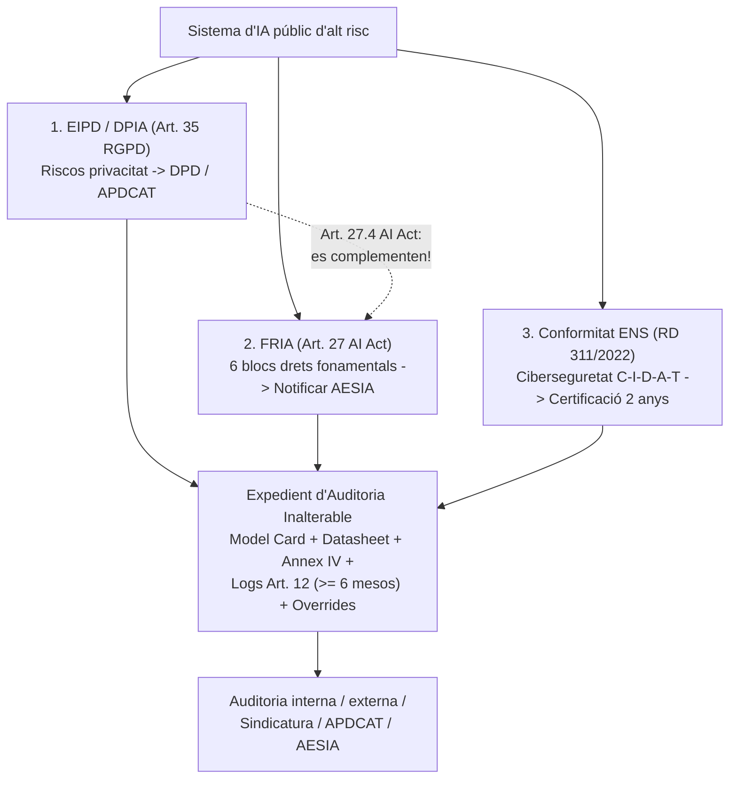

## A. Objectius d'aprenentatge

En completar aquesta lliçó seràs capaç de:

1. **Diferenciar** els tipus d'**auditoria algorítmica** en l'Administració pública: **auditoria de caixa blanca (*white-box*)**, **de caixa negra (*black-box*)** i **d'evidències / procés**, així com els tres nivells d'auditoria (**interna**, **externa independent** i **d'òrgans de control públic**: Intervenció, Sindicatura de Comptes, **APDCAT** i **AESIA**).
2. **Dominar** les obligacions legals de **documentació, traçabilitat i avaluació** de l'**AI Act (Reglament UE 2024/1689)**:
   - **Art. 11 i Annex IV**: documentació tècnica del sistema d'alt risc.
   - **Art. 12 i art. 26.6**: **registres automàtics (*logging*)** per garantir traçabilitat, conservats pel *deployer* un **mínim de 6 mesos** (si estan sota el seu control).
   - **Art. 27**: **Avaluació d'Impacte relativa als Drets Fonamentals (FRIA — *Fundamental Rights Impact Assessment*)**, obligatòria per als **organismes de dret públic** abans de desplegar sistemes d'IA d'alt risc!
   - **Art. 43**: **Avaluació de conformitat** (control intern Annex VI vs. organisme notificat Annex VII, declaració UE de conformitat i marcatge CE).
3. **Estructurar** els artefactes estàndard de rendició de comptes (*bones pràctiques* i suport a l'Annex IV): ***Model Cards*** (Mitchell et al.), ***Datasheets for Datasets*** (Gebru et al.) i **matriu d'evidències d'auditoria**.
4. **Distingir** amb precisió entre **EIPD/DPIA (art. 35 RGPD)**, **FRIA (art. 27 AI Act)** i **auditoria de conformitat ENS (RD 311/2022)**, sabent com integrar-les sense duplicitats!
5. **Implementar** en Python pur un **generador i verificador automatitzat d'expedient d'auditoria (FRIA + Art. 12 + Model Card)** que comprova la completitud dels 6 blocs obligatoris de la FRIA (art. 27.1 AI Act) i la cadena d'evidències inalterables!

---

## B. Explicació introductòria

Una administració pública pot tenir les millors intencions del món amb un sistema d'IA, però en dret públic regeix el principi de **responsabilitat proactiva demostrada (*accountability*)**: **allò que no està documentat, registrat i auditat, jurídicament no existeix!**

Imagina que, dos anys després de posar en marxa un sistema de priorització d'ajuts, un ciutadà recorre la resolució davant el contenciós administratiu o la Sindicatura de Comptes obre una fiscalització. L'Administració ha de poder respondre amb evidències verificables: *«Quina versió exacta del model i del prompt va puntuar aquest expedient el 14 de març? Quina avaluació prèvia d'impacte en drets fonamentals (FRIA) es va aprovar? Quin funcionari ho va supervisar? Quina era la taxa d'error i d'equitat per grups aquell mes?»*. Aquesta capacitat és l'**auditoria algorítmica**!

---

## C. Explicació tècnica avançada

### 1. La **FRIA (Avaluació d'Impacte relativa als Drets Fonamentals — art. 27 AI Act)** (*Obligació legal vigent a partir del 2/08/2026*)

:::callout-legal
**Article 27 del Reglament (UE) 2024/1689 (AI Act) — Obligació específica de l'Administració pública!**
Abans de desplegar un sistema d'IA d'alt risc (tots els de l'Annex III excepte el punt 2 sobre infraestructures crítiques), **els responsables del desplegament (*deployers*) que siguin organismes de dret públic** (ajuntaments, diputacions, consells comarcals, Generalitat) o entitats privades que presten serveis públics han de fer una **FRIA** que contingui com a mínim els **6 elements obligatoris de l'art. 27.1**:
1. Descripció dels **processos** del responsable del desplegament en què s'utilitzarà el sistema d'IA d'alt risc conforme a la seva finalitat prevista.
2. Descripció del **període de temps** i de la **freqüència** amb què es preveu utilitzar-lo.
3. Categories de **persones físiques i grups** que probablement es veuran afectats pel seu ús en el context específic.
4. **Riscos específics de perjudici** susceptibles d'afectar aquestes categories de persones o grups (tenint en compte la informació de l'art. 13 facilitada pel proveïdor).
5. Descripció de l'aplicació de les **mesures de supervisió humana**, d'acord amb les instruccions d'ús.
6. **Mesures que s'adoptaran en cas que es materialitzin aquests riscos**, inclosos els mecanismes de **governança interna i tramitació de reclamacions**!

- **Notificació obligatòria (art. 27.3)**: un cop realitzada la FRIA, el *deployer* ha de **notificar els resultats a l'autoritat de vigilància del mercat** (a Espanya, **AESIA**), fent servir la plantilla proporcionada per l'Oficina Europea d'IA (excepte exempcions de seguretat pública de l'art. 46.1).
- **Coordinació amb la EIPD (art. 27.4)**: si alguna obligació ja s'ha complert en la **EIPD (art. 35 RGPD)**, la FRIA **complementarà** la EIPD existent per evitar duplicitats!
- **Actualització (art. 27.2)**: s'ha d'actualitzar si canvia qualsevol dels 6 elements durant l'ús del sistema!
:::

### 2. Traçabilitat (*Logging* — art. 12 i 26.6), Documentació tècnica (art. 11) i Conformitat (art. 43)

1. **Registres automàtics (*Logging*, art. 12 i art. 26.6 AI Act)**:
   - Els sistemes d'alt risc han d'incorporar registre automàtic d'esdeveniments durant tot el cicle de vida (períodes d'ús, dades de referència contrastades, dades d'entrada i identificació de les persones físiques que intervenen en la verificació dels resultats!).
   - **Termini de conservació (art. 26.6 AI Act)**: el *deployer* ha de conservar els registres generats automàticament sota el seu control durant un període adequat i **com a mínim de 6 mesos** (llevat que el Dret de la UE o nacional — p. ex. terminis de prescripció administrativa o RGPD — exigeixi un termini diferent!).
2. **Avaluació de conformitat (art. 43 AI Act)**:
   - Abans d'introduir al mercat o posar en servei un sistema d'alt risc (inclòs un sistema desenvolupat *in-house* per una administració per a ús propi com a proveïdor!), cal superar l'**avaluació de conformitat**, elaborar la **declaració UE de conformitat (art. 47)**, col·locar el **marcatge CE (art. 48)** i inscriure'l a la **base de dades de la UE (art. 49)**.
   - En la majoria de sistemes de l'Annex III (ex. ajuts públics, selecció de personal), el proveïdor pot aplicar el procediment de **control intern (Annex VI)**; per a sistemes biomètrics o si no s'apliquen normes harmonitzades, intervé un **organisme notificat extern (Annex VII)**.
3. **Art. 41.2 LRJSP (Auditoria del codi font en AAA)**: recorda que en dret administratiu espanyol, per a actuacions administratives automatitzades, s'ha de designar expressament l'òrgan competent per a l'**auditoria del sistema d'informació i del seu codi font**!

### 3. Modalitats d'auditoria i artefactes estàndard (*Pràctica d'enginyeria i bones pràctiques*)

- **Auditoria *White-box***: l'auditor té accés complet al codi, pesos, datasets, *prompts*, logs i *pipelines* (ideal en auditories internes, desenvolupament *in-house* o clàusules contractuals públiques d'auditoria).
- **Auditoria *Black-box***: l'auditor només interactua via API enviant casos sintètics de prova (*audit probes*) per detectar biaixos, al·lucinacions o vulnerabilitats de seguretat sense veure el codi font del proveïdor.
- **Auditoria d'evidències / governança**: verifica l'existència i rigor de la FRIA, la EIPD, el RAT, la certificació ENS, els registres d'*overrides* i les actes del Comitè d'IA.
- **Artefactes estàndard de documentació (*bones pràctiques*)**:
  - ***Model Card*** (Mitchell et al.): fitxa viva del model — ús previst i **usos fora d'abast (*out-of-scope*)**, arquitectura, mètriques globals i **desagregades per subgrups**, limitacions conegudes i riscos ètics.
  - ***Datasheet for Datasets*** (Gebru et al.): fitxa del conjunt de dades — motivació, composició, procés de recollida, preprocés/neteja, distribucions, usos permesos i manteniment.

---

## D. Diagrames i recursos visuals



| Instrument | Norma i article | Focus principal | Obligat en ens locals? | Autoritat vinculada |
|---|---|---|---|---|
| **EIPD / DPIA** | **RGPD art. 35** | Drets i llibertats en **protecció de dades personals** | Sí, en tractaments d'alt risc (abans d'iniciar) | DPD + **APDCAT** (art. 36 si alt risc residual) |
| **FRIA** | **AI Act art. 27** | **Tots els drets fonamentals** (igualtat, no discriminació, bona administració, etc.) | Sí, **organismes de dret públic** en alt risc Annex III (des 2/08/2026) | Notificació a autoritat vigilància (**AESIA**) |
| **Auditoria ENS** | **RD 311/2022** | Ciberseguretat (**C-I-D-A-T**) | Sí, cada **2 anys** en categories MITJÀ i ALT | Entitat acreditada + **CCN-CERT** |
| **Logs traçabilitat** | **AI Act art. 12 i 26.6** | Evidència d'execució, versions i supervisió | Sí, conservació **>= 6 mesos** en alt risc | Auditoria interna / autoritats |

---

## E. Aplicació a l'Administració pública

1. **Clàusula obligatòria de dret d'auditoria en contractes de proveïdors IA**: si una diputació compra una solució comercial *black-box*, ha d'incloure als plecs el **dret contractual d'auditoria** (accés a mètriques desagregades, documentació Annex IV, instruccions art. 13, logs art. 12 i proves de biaix/seguretat); sense aquesta clàusula, el proveïdor pot al·legar «secret comercial» i impedir que l'Administració compleixi les seves obligacions legals!
2. **Integració de la FRIA en el procediment d'aprovació de projectes**: cap projecte d'IA classificat com a alt risc (p. ex. baremació d'ajuts socials, selecció de personal) no hauria d'obtenir llum verda de producció sense tenir arxivats i signats: **(1) EIPD aprovada pel DPD**, **(2) FRIA completa dels 6 punts notificada a l'AESIA**, **(3) Certificació ENS vigent**, **(4) *Model Card* + *Datasheet*** i **(5) prova verificada de *logging* >= 6 mesos**.
3. **Traçabilitat inalterable davant recursos judicials**: conservar els logs en emmagatzematge *append-only* (o amb segellat hash WORM) garanteix que davant una impugnació ciutadana es pot reconstruir exactament l'estat del sistema aquell dia sense possibilitat de manipulació posterior.

---

## F. Exemple pràctic guiat

### Exemple 8.6: Verificador automàtic de completitud de FRIA (art. 27.1 AI Act) i cadena d'evidències d'auditoria

Aquest script Python pur audita l'expedient previ al desplegament d'un sistema d'IA públic d'alt risc comprovant:
1. Els **6 blocs obligatoris de la FRIA (art. 27.1 AI Act)**.
2. La **retenció mínima de logs >= 6 mesos (180 dies, art. 26.6 AI Act)**.
3. La coherència amb la **EIPD (art. 35 RGPD)** i la **Model Card**, generant un hash SHA-256 inalterable d'evidència!

```python
"""Exemple 8.6: Auditoria automatitzada d'expedient FRIA (art. 27 AI Act) i traçabilitat."""

import hashlib
import json

BLOCS_FRIA_ART27 = (
    "processos_us_previst",
    "periode_i_frequencia",
    "categories_persones_afectades",
    "riscos_especifics_perjudici",
    "mesures_supervisio_humana",
    "mesures_mitigacio_i_reclamacions",
)


def auditar_expedient_ia(expedient: dict[str, object]) -> dict[str, object]:
    incompliments: list[str] = []

    fria = expedient.get("fria", {})
    assert isinstance(fria, dict)
    for bloc in BLOCS_FRIA_ART27:
        valor = str(fria.get(bloc, "")).strip()
        if len(valor) < 10:
            incompliments.append(f"FRIA_INCOMPLETA: falta o és insuficient '{bloc}' (art. 27.1 AI Act)")

    retencio_dies = int(expedient.get("retencio_logs_dies", 0))
    if retencio_dies < 180:
        incompliments.append(
            f"RETENCIO_LOGS_INSUFICIENT: {retencio_dies} dies < 180 dies mínim (6 mesos, art. 26.6 AI Act)"
        )

    if not expedient.get("eipd_validada_dpd", False):
        incompliments.append("EIPD_PENDENT: manca validació prèvia del DPD (art. 35 RGPD)")

    if not expedient.get("model_card_desagregada", False):
        incompliments.append("MODEL_CARD_INCOMPLETA: manquen mètriques desagregades per subgrups")

    segell = hashlib.sha256(
        json.dumps(expedient, sort_keys=True, ensure_ascii=False).encode("utf-8")
    ).hexdigest()[:16]

    return {
        "sistema_id": expedient["sistema_id"],
        "veredicte": "APTE_PER_NOTIFICAR_AESIA_I_DESPLEGAR" if not incompliments else "NO_APTE_AUDITORIA",
        "incompliments": incompliments,
        "hash_evidencia_sha256": segell,
    }


if __name__ == "__main__":
    exp_incomplet = {
        "sistema_id": "IA-AJUTS-LLOGUER-2026",
        "retencio_logs_dies": 90,
        "eipd_validada_dpd": True,
        "model_card_desagregada": False,
        "fria": {
            "processos_us_previst": "Priorització d'expedients d'ajuts al lloguer.",
            "periode_i_frequencia": "Convocatòria anual, ús diari durant 4 mesos.",
            "categories_persones_afectades": "Famílies sol·licitants vulnerables.",
            "riscos_especifics_perjudici": "Exclusió injusta per biaix socioeconòmic.",
            "mesures_supervisio_humana": "HITL obligatori amb treballadors socials.",
            "mesures_mitigacio_i_reclamacions": "",  # Falta!
        },
    }

    print(auditar_expedient_ia(exp_incomplet))
```

#### Interpretació del resultat
- L'auditor detecta automàticament **3 no-conformitats bloquejants** abans del desplegament: falta el 6è bloc obligatori de la FRIA (`mesures_mitigacio_i_reclamacions`), la retenció de logs de `90 dies` incompleix el mínim legal de `6 mesos` (`180 dies`, art. 26.6 AI Act), i falta la *Model Card* amb mètriques desagregades!
- A més, genera una empremta **SHA-256** per segellar l'estat exacte de l'expedient auditat.

---

## G. Exercici pràctic per resoldre

### Enunciat i context
Una diputació està a punt de desplegar un sistema d'IA d'alt risc (Annex III punt 5 AI Act) adquirit a un proveïdor extern per avaluar el risc de vulnerabilitat energètica i assignar bons socials. El director del projecte comenta: *«Ja vam fer la EIPD del RGPD el mes passat i el proveïdor té el marcatge CE; per tant ja podem sortir a producció demà sense fer res més i guardarem els logs 30 dies per estalviar disc!»*.

### Objectius i requisits
1. Corregeix els **3 errors legals** del director del projecte citant els articles exactes de l'**AI Act (Reglament UE 2024/1689)**.
2. Redacta una llista de comprovació (*checklist*) amb els **6 elements obligatoris de la FRIA** aplicats a aquest cas del bo social energètic.

:::hint Pista dels 3 articles
Revisa l'**art. 27** (FRIA obligatòria per organismes de dret públic + notificació a l'autoritat, complementant la EIPD segons art. 27.4), l'**art. 26.6** (retenció mínima de logs de **6 mesos**) i l'**art. 49** (registre públic de la UE per a autoritats públiques que despleguen alt risc!).
:::

:::solution Solució comentada
1. **Els 3 errors legals corregits**:
   - **Error 1 (Omissió de la FRIA — art. 27 AI Act)**: tenir la EIPD (RGPD) i el marcatge CE del proveïdor **NO eximeix** una administració pública de fer la **FRIA** abans del desplegament! La FRIA pot recolzar-se i complementar la EIPD (art. 27.4), però ha d'avaluar drets fonamentals més amplis (no discriminació, accés a serveis essencials, reclamacions) i **notificar els resultats** a l'autoritat de vigilància del mercat (**AESIA**, art. 27.3).
   - **Error 2 (Logs només 30 dies — art. 26.6 AI Act)**: en sistemes d'alt risc, el *deployer* ha de conservar els registres automàtics sota el seu control un **mínim de 6 mesos** (no 30 dies!).
   - **Error 3 (Omissió del registre UE — art. 49.3 AI Act)**: les autoritats públiques (o qui actuï en nom seu) que actuen com a *deployers* d'un sistema d'alt risc de l'Annex III tenen obligació d'**inscriure's a la base de dades de la UE** abans d'utilitzar-lo!
2. **Els 6 blocs obligatoris de la FRIA (art. 27.1 AI Act) pel bo social energètic**:
   1. *Processos*: triatge i puntuació de sol·licituds del bo social energètic com a suport a treballadors socials.
   2. *Període i freqüència*: ús continu durant tota la convocatòria anual (octubre–març).
   3. *Persones/grups afectats*: llars en situació de vulnerabilitat econòmica, gent gran i famílies monoparentals.
   4. *Riscos específics*: falsos negatius que deixin famílies vulnerables sense subministrament; biaix territorial o lingüístic.
   5. *Supervisió humana*: HITL obligatori per treballadors socials formats (art. 26.2), doble revisió en denegacions i botó d'aturada.
   6. *Mitigació i reclamacions*: canal àgil d'al·legacions i revisió humana urgent en 48 hores, auditoria trimestral de biaixos i escalada al Comitè d'IA / DPD.
:::

---

## H. Test individual

Resol les 10 preguntes sobre auditoria algorítmica (*white-box* vs. *black-box*), FRIA (art. 27 AI Act — els 6 blocs, notificació i complementarietat amb EIPD), traçabilitat i conservació de logs >= 6 mesos (art. 12 i 26.6 AI Act), avaluació de conformitat (art. 43), *Model Cards* i *Datasheets for Datasets*.

---

## I. Preguntes de desenvolupament

### Pregunta 1
Detalla què és la **FRIA (art. 27 de l'AI Act)**, qui està obligat a realitzar-la, quins són els seus **6 continguts mínims obligatoris** i com es coordina amb la **EIPD del RGPD**.

:::model-answer Resposta model i criteris de correcció
- **Concepte i subjectes obligats (art. 27.1)**: l'Avaluació d'Impacte relativa als Drets Fonamentals (FRIA) és obligatòria abans de desplegar sistemes d'IA d'alt risc de l'Annex III (llevat del punt 2 sobre infraestructures crítiques) per als **organismes de dret públic** (ajuntaments, diputacions, comunitats autònomes) i entitats privades que presten serveis públics (així com certs sistemes de solvència/assegurances).
- **Els 6 continguts mínims (art. 27.1)**: (1) descripció dels processos del *deployer* on s'utilitzarà; (2) període de temps i freqüència d'ús; (3) categories de persones físiques i grups afectats; (4) riscos específics de perjudici per a aquests grups; (5) mesures de supervisió humana conforme a les instruccions d'ús; (6) mesures a adoptar si es materialitzen els riscos, inclosa governança interna i mecanismes de reclamació.
- **Notificació i coordinació**: els resultats es notifiquen a l'autoritat de vigilància del mercat (**AESIA**, art. 27.3), s'actualitzen si canvien els factors (art. 27.2) i, si ja existeix una **EIPD (art. 35 RGPD)**, la FRIA la **complementa** sense repetir innecessàriament l'anàlisi de protecció de dades (art. 27.4).
- **Criteris de correcció (10 punts)**: subjectes obligats i àmbit (2,5 punts), els 6 continguts exactes (5 punts), notificació AESIA i coordinació art. 27.4 amb EIPD (2,5 punts).
:::

### Pregunta 2
Compara l'**auditoria *white-box***, l'**auditoria *black-box*** i l'**auditoria de governança/evidències**, indicant quines clàusules contractuals ha d'exigir una administració quan contracta un proveïdor comercial d'IA.

:::model-answer Resposta model i criteris de correcció
- **Modalitats**:
  - ***White-box***: accés total a codi, pesos, datasets, *prompts* i logs; màxima profunditat per detectar *proxies*, *data leakage* i errors d'implementació.
  - ***Black-box***: avaluació externa mitjançant bateria de casos de prova (proves d'equitat per grups, *red teaming* de seguretat, fidelitat RAG) sense accés al codi intern.
  - **Governança/evidències**: revisió documental de FRIA, EIPD, RAT, certificació ENS, registres d'*overrides* i actes del Comitè d'IA.
- **Clàusules contractuals públiques imprescindibles**: dret exprés d'auditoria (interna i d'òrgans de control públics), lliurament de documentació tècnica (Annex IV) i instruccions d'ús (art. 13 AI Act), accés als registres automàtics (art. 12 i 26.6 >= 6 mesos), obligació de facilitar proves desagregades de biaixos i conformitat ENS, i impossibilitat d'oposar el «secret comercial» per impedir auditories legals!
- **Criteris de correcció (10 punts)**: les 3 modalitats explicades amb rigor (5 punts), clàusules contractuals realistes per al sector públic (5 punts).
:::

### Pregunta 3
Què són les ***Model Cards*** i els ***Datasheets for Datasets***, quina informació crítica conté cadascun i com ajuden a complir la documentació tècnica de l'**Annex IV de l'AI Act**?

:::model-answer Resposta model i criteris de correcció
- ***Model Card*** (Mitchell et al.): fitxa estandarditzada del model que documenta metadades/versió, **usos previstos i usos fora d'abast (*out-of-scope*)**, arquitectura i paràmetres clau, **mètriques de rendiment globals i desagregades per grups** (idioma, edat, gènere, territori), limitacions conegudes, biaixos detectats i recomanacions de supervisió.
- ***Datasheet for Datasets*** (Gebru et al.): fitxa del conjunt de dades que documenta motivació, composició, mètode de recollida i etiquetatge (acord inter-anotador), preprocés/neteja, distribucions i llacunes, llicències/bases jurídiques RGPD i pla de manteniment.
- **Connexió amb l'Annex IV AI Act**: tot i ser originàriament bones pràctiques científiques, cobreixen una part substancial de la documentació tècnica obligatòria de l'art. 11 i Annex IV de l'AI Act (descripció del sistema, disseny, dades d'entrenament/validació, mètriques de precisió/solidesa/equitat i limitacions previsibles) i faciliten auditories ràpides i transparents.
- **Criteris de correcció (10 punts)**: contingut de Model Card (3,5 punts), contingut de Datasheet (3,5 punts), vinculació precisa amb art. 11 / Annex IV AI Act (3 punts).
:::

---

## J. Resum per memoritzar

- **Idees clau**:
  - **FRIA (art. 27 AI Act)**: obligatòria per a **organismes de dret públic** abans de desplegar sistemes d'alt risc Annex III (llevat punt 2). Conté **6 blocs mínims**, es **notifica a l'autoritat (AESIA)** i **complementa la EIPD** (art. 27.4).
  - **Logs de traçabilitat (art. 12 i 26.6 AI Act)**: conservació mínima de **6 mesos** pel *deployer* (subjecte a terminis legals aplicables).
  - **Avaluació de conformitat (art. 43 AI Act)**: control intern (Annex VI) o organisme notificat (Annex VII) → declaració UE + marcatge CE + registre UE (art. 49).
  - **Bones pràctiques documentals**: ***Model Cards*** (model, usos fora d'abast, mètriques desagregades) i ***Datasheets for Datasets*** (origen, composició, biaixos de les dades).
  - **3 tipus d'auditoria**: *white-box*, *black-box* i evidències/governança (sempre amb clàusula de dret d'auditoria en contractes de proveïdors!).
- **Errors freqüents d'examen**:
  - Creure que fer una EIPD substitueix la FRIA o viceversa (es complementen, art. 27.4!).
  - Confondre el termini mínim de retenció de logs de l'art. 26.6 AI Act (**6 mesos**) amb 30 dies.
- **Flashcards associades**: consulta `flashcards/module-08/m08-06-auditoria.json` (5 targetes).
- **Possibles preguntes d'examen**:
  - Enumera els 6 blocs obligatoris de la FRIA (art. 27.1 AI Act).
  - Quina diferència hi ha entre EIPD (art. 35 RGPD), FRIA (art. 27 AI Act) i auditoria ENS (RD 311/2022)?
