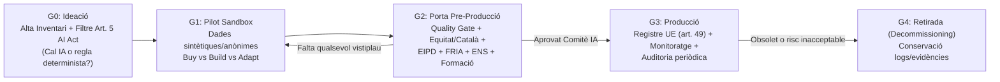

## A. Objectius d'aprenentatge

En completar aquesta lliçó seràs capaç de:

1. **Dissenyar** un **marc corporatiu de governança de la IA** per a una administració local (com la Diputació de Barcelona), alineat amb estàndards internacionals (**ISO/IEC 42001** — Sistema de Gestió d'IA — i **NIST AI RMF**: *Govern, Map, Measure, Manage*).
2. **Establir** un **inventari / registre corporatiu obligatori de sistemes d'IA** que elimini la ***Shadow AI*** (eines d'IA usades pels departaments fora de control) i vinculi cada sistema amb el seu nivell de risc AI Act, categoria ENS, estat EIPD/FRIA, versió i responsable.
3. **Definir** una **matriu de rols i responsabilitats (RACI)** clara dins d'un **Comitè d'IA multidisciplinari** que integri: *Owner* funcional del servei, Enginyeria/MLOps, **DPD** (protecció de dades), **Responsable de Seguretat ENS**, Assessoria Jurídica, Contractació i Representació dels empleats públics (art. 26.7 AI Act!).
4. **Redigir** **clàusules clau de contractació pública responsable de sistemes d'IA** (Llei 9/2017 de Contractes del Sector Públic — LCSP — i clàusules tipus europees de compra pública d'IA): sobirania de dades, *zero-data-retention*, portabilitat anti-*vendor lock-in*, dret d'auditoria, conformitat ENS/AI Act, suport al català i **estratègia *Buy vs. Build vs. Adapt***.
5. **Implementar** en Python pur un **registre corporatiu de governança de models** amb **portes de pas (*Stage-Gates*)** del cicle de vida (`IDEA → PILOT → PRE_PRODUCCIO → PRODUCCIO → RETIRAT`) que bloqueja automàticament la promoció a producció si falten aprovacions de la matriu RACI!

---

## B. Explicació introductòria

Sense governança, la IA en una organització gran es converteix ràpidament en un caos perillós: un departament contracta una eina SaaS sense avisar Seguretat ni el DPD; un altre entrena un model pilot amb dades reals sense versionat; i ningú no sap exactament quants sistemes d'IA estan operant ni qui té autoritat per apagar-los si fallen (**«Shadow AI»**)!

La **governança de models** és el sistema nerviós organitzatiu, normatiu i operatiu que respon a cinc preguntes permanents: **Quins sistemes d'IA tenim?** (Inventari), **Qui en respon?** (RACI i Comitè d'IA), **Com s'aproven abans d'arribar al ciutadà?** (*Stage-Gates*), **Com els comprem sense quedar segrestats per un proveïdor?** (Contractació responsable) i **Com els retirem ordenadament (*decommissioning*)** quan deixen de ser segurs o útils?

---

## C. Explicació tècnica avançada

### 1. Estàndards de referència de governança (*Recomanacions i bones pràctiques*)

1. **ISO/IEC 42001:2023 (AIMS — *AI Management System*)**: primera norma internacional certificable de sistema de gestió d'IA (estructura d'alt nivell PDCA compatible amb ISO 27001 de seguretat de la informació!).
2. **NIST AI RMF (*AI Risk Management Framework*)**: estructura la governança del risc en 4 funcions contínues:
   - **GOVERN** (cultura, polítiques, rols RACI, alfabetització art. 4 AI Act).
   - **MAP** (inventari, context, classificació de risc AI Act/RGPD/ENS).
   - **MEASURE** (mètriques de precisió, biaix, *drift*, *red teaming*).
   - **MANAGE** (mitigació, monitoratge, resposta a incidents i retirada).

### 2. Estructura organitzativa i Matriu RACI del Comitè d'IA

| Decisió / Fita del cicle de vida | *Owner* Funcional | Equip Tècnic / MLOps | DPD (RGPD) | Resp. Seguretat (ENS) | Assessoria Jurídica / Comitè IA |
|---|---|---|---|---|---|
| **Alta a l'inventari i classificació de risc** | **A** (*Accountable*) | **R** (*Responsible*) | **C** (*Consulted*) | **C** | **I / C** |
| **EIPD (art. 35 RGPD) i base jurídica** | **A** | **C** | **C** (assessorament preceptiu!) | **C** | **R** |
| **FRIA (art. 27 AI Act) i registre UE** | **A** | **C** | **C** | **C** | **R / A** (Comitè) |
| **Certificació ENS i *Red Teaming*** | **I** | **R** | **I** | **A** | **I** |
| **Aprovació pas a Producció (*Go-Live*)** | **A** | **R** | **C** (vistiplau RGPD) | **C** (vistiplau ENS) | **A** (en alt risc!) |
| **Activació del botó d'aturada / *Rollback*** | **A / R** | **R** | **I** (72h si bretxa) | **R** (si incident) | **I** |

- **Obligació específica en entorn laboral (art. 26.7 AI Act)**: abans de posar en servei o utilitzar un sistema d'IA d'alt risc en el **lloc de treball**, l'administració ocupadora ha d'**informar els representants dels treballadors i els empleats afectats**!
- **Política anti-*Shadow AI***: en lloc de limitar-se a «prohibir la IA» (cosa que empeny els empleats a usar comptes personals en secret!), la bona governança combina: (1) una **plataforma corporativa segura i homologada** (sobirana/EEE, *zero-data-retention*, integrada amb SSO), (2) **formació obligatòria en alfabetització IA (art. 4 AI Act)**, i (3) controls tècnics DLP/proxy que bloquegen l'enviament de documents interns a serveis no homologats!

### 3. Cicle de vida governat (*Stage-Gates*) i retirada (*Decommissioning*)

Cap model passa directament d'un portàtil a la Seu Electrònica! El cicle exigeix **portes de pas (*Stage-Gates*)**:
1. **G0 — Ideació i Cribratge**: justificació de valor públic (cal realment IA o basta una regla determinista?), comprovació que **NO és pràctica prohibida (art. 5 AI Act)**, alta a l'inventari corporatiu.
2. **G1 — Disseny i Pilot**: entorn *sandbox* amb **dades sintètiques o realment anonimitzades**; arquitectura sobirana; selecció *Buy vs. Build vs. Adapt*.
3. **G2 — Preproducció i Avaluació**: Quality Gate MLOps (precisió, *Sliced Evaluation* per idioma català/castellà i equitat), *Red Teaming*, EIPD + FRIA + ENS aprovades, instruccions d'ús i formació de supervisors (art. 26.2 AI Act).
4. **G3 — Producció i Monitoratge**: *Shadow/Canary*, registre UE (art. 49.3 en alt risc), monitoratge continu de *drift*, costos *FinOps* i revisió anual de governança.
5. **G4 — Retirada (*Decommissioning*)**: pla ordenat de substitució o apagada quan el model queda obsolet, canvia la norma o es detecta risc inacceptable — conservant els artefactes d'auditoria i logs durant el termini legal (>= 6 mesos art. 26.6 AI Act / terminis d'arxiu administratiu)!

### 4. Contractació pública responsable d'IA (*LCSP 9/2017* i *Clàusules Tipus de la Comissió Europea*)

Quan l'Administració licita o compra una solució d'IA (*Buy* o *Adapt*), el plec de prescripcions tècniques (PPT) i clàusules administratives (PCAP) ha d'incorporar:
1. **Compliment normatiu verificable**: conformitat AI Act (marcatge CE, Annex IV, instruccions art. 13 si és alt risc), RGPD (contracte art. 28, ubicació EEE, ***zero-data-retention*** i prohibició d'usar dades municipals per reentrenar models propis del proveïdor!) i **Certificació ENS** de categoria adequada.
2. **Anti-*vendor lock-in* i portabilitat**: APIs obertes compatibles amb estàndards, exportabilitat completa de *prompts*, bases documentals, metadades, logs i dades etiquetades sense costos ocults de sortida (*exit plan*).
3. **Dret d'auditoria i transparència**: obligació de lliurar mètriques desagregades (incloent-hi **qualitat verificada en català**!), suport a proves *black-box* i cooperació amb òrgans de control (APDCAT, AESIA, Sindicatura).
4. **Propietat intel·lectual i responsabilitat**: titularitat pública de les adaptacions/dades pròpies, garantia d'indemnitat davant reclamacions de propietat intel·lectual del proveïdor i penalitats per incompliment d'SLA o bretxes.

---

## D. Diagrames i recursos visuals



| Estratègia | Quan triar-la en l'Administració pública | Avantatges | Riscos a governar |
|---|---|---|---|
| **Buy** (SaaS / producte clau en mà) | Necessitat estàndard comuna (ex. transcripció, ofimàtica corporativa) | Rapidesa i menor càrrega d'equip intern | *Vendor lock-in*, opacitat *black-box*, transferències fora EEE |
| **Adapt** (Open-weights + RAG / *LoRA* intern) | **Cas òptim habitual!** (xatbots d'ordenances, assistents d'expedients, IDP) | **Sobirania total**, dades *on-premise*/EEE, control de *prompts* i costos | Requereix capacitat MLOps/LLMOps i infraestructura GPU |
| **Build** (Entrenar des de zero) | Només models tabulars/clàssics propis (regressió, XGBoost) amb dades internes | Interpretabilitat màxima, 100% controlat i baix cost | **Mai** entrenar un LLM fundacional des de zero en un ajuntament (cost prohibitiu)! |

---

## E. Aplicació a l'Administració pública

1. **Governança intermunicipal (paper de la Diputació de Barcelona)**: un ajuntament de 1.500 habitants no pot tenir un equip MLOps ni un Comitè d'IA propi! Les diputacions i consorcis supramunicipals (com l'AOC o la Xarxa de Governs Locals de la Diputació de Barcelona) aporten un valor extraordinari oferint **plataformes d'IA compartides, ja auditades (ENS + EIPD/FRIA tipus + català natiu)**, **acords marc de contractació pública** amb clàusules responsables i programes d'alfabetització en IA (art. 4 AI Act) per a tot el món local!
2. **Principi de «No IA per defecte»**: una bona governança també sap dir **NO**! Si un procés reglat es resol amb 15 línies de codi determinista (100% auditable, cost zero, zero al·lucinacions), utilitzar un LLM generatiu és una mala decisió d'enginyeria i de governança.
3. **Gestió d'incidents i transparència proactiva**: el Comitè d'IA manté un **Registre Públic d'Algorismes** en llenguatge planer derivat directament de l'inventari corporatiu, reforçant la confiança ciutadana.

---

## F. Exemple pràctic guiat

### Exemple 8.7: Registre corporatiu de governança de models amb portes de pas (*Stage-Gates*) i validació RACI

Aquest script Python pur gestiona l'inventari corporatiu de sistemes d'IA d'una administració i **impedeix tècnicament promoure a `PRODUCCIO`** cap sistema d'alt risc si no consta a l'inventari amb tots els vistiplaus RACI (Owner, DPD, Seguretat ENS, FRIA i Comitè d'IA) o si és una pràctica prohibida!

```python
"""Exemple 8.7: Registre corporatiu de governança IA amb portes Stage-Gate i RACI."""

from dataclasses import dataclass, field


@dataclass
class FitxaSistemaIA:
    sistema_id: str
    nom: str
    owner_funcional: str
    nivell_risc_ai_act: str      # "PROHIBIT" | "ALT_RISC" | "TRANSPARENCIA" | "MINIM"
    categoria_ens: str           # "BAIX" | "MITJA" | "ALT"
    estat: str = "IDEA"          # IDEA | PILOT | PRE_PRODUCCIO | PRODUCCIO | RETIRAT
    vistiplaus: dict[str, bool] = field(default_factory=dict)


def promoure_a_produccio(fitxa: FitxaSistemaIA) -> dict[str, object]:
    if fitxa.nivell_risc_ai_act == "PROHIBIT":
        return {
            "aprovat": False,
            "estat": "BLOQUEJAT_ART5_PROHIBIT",
            "motius": ["Pràctica prohibida per l'art. 5 de l'AI Act: desplegament impossible."],
        }

    requisits_obligatoris = ["owner_funcional", "seguretat_ens", "qualitat_catala_mlops"]
    if fitxa.categoria_ens in ("MITJA", "ALT"):
        requisits_obligatoris.append("certificacio_ens_vigent")
    if fitxa.nivell_risc_ai_act == "ALT_RISC":
        requisits_obligatoris.extend(["dpd_eipd", "comite_ia_fria", "registre_ue_art49"])

    mancants = [r for r in requisits_obligatoris if not fitxa.vistiplaus.get(r, False)]
    if mancants:
        return {
            "aprovat": False,
            "estat": fitxa.estat,
            "motius": [f"Manca vistiplau obligatori RACI: {m}" for m in mancants],
        }

    fitxa.estat = "PRODUCCIO"
    return {"aprovat": True, "estat": fitxa.estat, "motius": ["Totes les portes Stage-Gate superades."]}


if __name__ == "__main__":
    s1 = FitxaSistemaIA(
        sistema_id="IA-2026-01",
        nom="Suport baremació ajuts lloguer",
        owner_funcional="Dir. Habitatge",
        nivell_risc_ai_act="ALT_RISC",
        categoria_ens="ALT",
        estat="PRE_PRODUCCIO",
        vistiplaus={
            "owner_funcional": True,
            "seguretat_ens": True,
            "qualitat_catala_mlops": True,
            "certificacio_ens_vigent": True,
            "dpd_eipd": True,
            "comite_ia_fria": False,   # Pendent!
            "registre_ue_art49": False,  # Pendent!
        },
    )
    s2 = FitxaSistemaIA(
        sistema_id="IA-2026-02",
        nom="Detector emocions empleats atenció telefònica",
        owner_funcional="Dir. RRHH",
        nivell_risc_ai_act="PROHIBIT",
        categoria_ens="ALT",
    )

    print("Promoció s1:", promoure_a_produccio(s1))
    print("Promoció s2:", promoure_a_produccio(s2))
```

#### Interpretació del resultat
- `s1` (alt risc) queda retingut a `PRE_PRODUCCIO` perquè falten els vistiplaus `comite_ia_fria` i `registre_ue_art49`.
- `s2` (reconeixement d'emocions en el lloc de treball — prohibit per l'**art. 5.1.f de l'AI Act**!) és **bloquejat immediatament** abans de malgastar ni un euro en un pilot il·legal!

---

## G. Exercici pràctic per resoldre

### Enunciat i context
En una enquesta interna a una corporació local de 1.200 empleats es descobreix que 180 treballadors utilitzen comptes personals gratuïts d'eines d'IA generativa per redactar informes i resumir actes amb dades reals (*Shadow AI*), i tres àrees han contractat proves SaaS per separat amb contractes d'adhesió sense cap clàusula ENS ni de portabilitat.

### Objectius i requisits
Dissenya un **Pla de Governança de la IA en 90 dies** que contingui:
1. Mesures tècniques i organitzatives per erradicar la ***Shadow AI*** de manera realista (sense bloquejar la innovació legítima).
2. Composició i **matriu RACI** del Comitè d'IA i **inventari corporatiu**.
3. **5 clàusules obligatòries** per a tots els nous plecs de contractació pública d'IA.

:::hint Pista sobre Shadow AI i contractació
La *Shadow AI* no s'elimina només prohibint-la: cal oferir una **alternativa corporativa segura i homologada** + alfabetització obligatòria (art. 4 AI Act) + regularització a l'inventari! I en contractació, pensa en: ENS, zero-data-retention/EEE, anti-vendor lock-in, català i dret d'auditoria!
:::

:::solution Solució comentada
1. **Pla anti-*Shadow AI* (en 3 eixos)**:
   - **Alternativa segura homologada**: desplegar un assistent corporatiu intern (open-weights *on-premise* o núvol EEE amb *zero-data-retention* i SSO) perquè els empleats tinguin una eina útil i lícita.
   - **Alfabetització obligatòria (art. 4 AI Act)**: càpsules pràctiques per a tota la plantilla sobre riscos de PII, al·lucinacions, ús responsable i normes corporatives.
   - **Control i regularització**: directiva corporativa clara, filtres DLP/proxy contra l'enviament de documents interns a serveis no homologats, i finestra d'amnistia per donar d'alta les 3 proves SaaS a l'inventari i sotmetre-les a revisió DPD/ENS (aturant les que tractin dades personals sense garanties!).
2. **Comitè d'IA, inventari i RACI**:
   - **Membres**: Direcció de Sistemes/MLOps, DPD, Responsable de Seguretat ENS, Assessoria Jurídica, Contractació Pública, Òrgan funcional promotor i representació sindical/RRHH (per a sistemes en l'entorn laboral, art. 26.7 AI Act).
   - **Inventari únic**: fitxa obligatòria abans de qualsevol pilot (`G0`) amb classificació AI Act/RGPD/ENS, *owner* nominal, estat del cicle de vida i botó d'aturada assignat.
3. **5 clàusules obligatòries de contractació pública (LCSP)**:
   - **Sobirania i RGPD**: contracte art. 28, ubicació dins l'EEE, *zero-data-retention* i prohibició expressa d'entrenar models del proveïdor amb dades municipals.
   - **Ciberseguretat**: Certificació de Conformitat **ENS** de categoria igual o superior a la del sistema municipal.
   - **Compliment AI Act i auditoria**: marcatge CE/Annex IV/art. 13 si és alt risc, logs exportables >= 6 mesos i dret exprés d'auditoria (sense bloqueig per secret comercial).
   - **Anti-*vendor lock-in***: APIs estàndard, exportabilitat íntegra de dades, *prompts* i etiquetes, i pla de sortida (*exit plan*).
   - **Qualitat lingüística en català**: llindars mínims verificables d'avaluació en català (i castellà) en proves d'acceptació abans de pagar o posar en producció!
:::

---

## H. Test individual

Resol les 10 preguntes sobre governança de models, ISO/IEC 42001, NIST AI RMF, inventari corporatiu i *Shadow AI*, matriu RACI i Comitè d'IA, art. 26.7 AI Act (informació a representants dels treballadors), *Stage-Gates* i retirada, estratègia *Buy/Build/Adapt* i clàusules de contractació pública responsable.

---

## I. Preguntes de desenvolupament

### Pregunta 1
Explica què és la ***Shadow AI*** en una administració pública, quins riscos legals i operatius comporta i per què una estratègia basada **únicament** en la prohibició sol fracassar.

:::model-answer Resposta model i criteris de correcció
- **Definició**: ús no autoritzat ni inventariat d'eines d'IA externes (comptes gratuïts o contractacions departamentals aïllades) per part d'empleats o àrees fora del control de Seguretat, DPD i Governança.
- **Riscos**: fuites de dades personals i categories especials (bretxes notificables en 72 h a l'APDCAT), transferències internacionals il·lícites, reentrenament de models de tercers amb documents reservats, ús inadvertit de pràctiques prohibides (art. 5 AI Act), al·lucinacions en actes públics i duplicació de despesa.
- **Per què falla només prohibir**: si els empleats perceben guanys reals de productivitat però no disposen de cap alternativa corporativa segura, continuen utilitzant eines externes des de dispositius personals en secret (fent el risc encara més invisible!). La solució eficaç combina: **eina corporativa homologada sobirana** + **alfabetització obligatòria (art. 4 AI Act)** + **inventari i controls DLP**.
- **Criteris de correcció (10 punts)**: definició clara (2 punts), riscos jurídics/operatius complets (4 punts), estratègia constructiva de 3 pilars (4 punts).
:::

### Pregunta 2
Dissenya les **5 clàusules essencials** que inclouries al Plec de Prescripcions Tècniques (PPT) d'una licitació pública per adquirir una plataforma d'IA corporativa, justificant el risc concret que mitiga cadascuna.

:::model-answer Resposta model i criteris de correcció
1. **Sobirania, RGPD art. 28 i *zero-data-retention***: ubicació del tractament dins l'EEE i prohibició absoluta d'utilitzar *prompts* o documents municipals per entrenar models del proveïdor (mitiga transferències il·lícites i pèrdua de control de dades).
2. **Certificació de Conformitat ENS (RD 311/2022)**: categoria MITJÀ o ALT equivalent a la del sistema municipal i gestió d'incidents amb CCN-CERT (mitiga vulnerabilitats de ciberseguretat i incompliment obligatori ENS).
3. **Compliment AI Act i dret d'auditoria**: lliurament d'instruccions art. 13, documentació Annex IV, logs exportables >= 6 mesos i dret d'auditoria interna/externa sense oposició de secret comercial (mitiga opacitat i incompliment FRIA/conformitat).
4. **Anti-*vendor lock-in* i pla de sortida**: APIs estàndard, exportació íntegra en formats oberts de documents, *prompts*, metadades i dades etiquetades sense penalitzacions de sortida (mitiga segrest tecnològic i escalades abusives de preu).
5. **Requisits verificables de qualitat en català i equitat**: proves d'acceptació prèvies sobre *Golden Set* propi amb llindars mínims en català/castellà i absència de biaix (mitiga discriminació lingüística i productes de baixa qualitat).
- **Criteris de correcció (10 punts)**: 2 punts per cada clàusula ben formulada i justificada amb el seu risc.
:::

### Pregunta 3
Compara l'estratègia ***Buy vs. Build vs. Adapt*** en una diputació o ajuntament gran i explica quin paper té una diputació en la **governança intermunicipal** dels municipis petits.

:::model-answer Resposta model i criteris de correcció
- ***Buy***: compra de productes clau en mà per a necessitats genèriques (ofimàtica, transcripció); ràpid però amb risc de *vendor lock-in* i dependència normativa del proveïdor.
- ***Adapt*** (opció òptima en la majoria de casos d'IA generativa/documental pública): adoptar models *open-weights* desplegats *on-premise* o en núvol EEE i adaptar-los amb **RAG** o *fine-tuning* lleuger (LoRA) sense entrenar un LLM des de zero; màxima sobirania, transparència i control de costos.
- ***Build***: entrenar des de zero només models clàssics/tabulars (regressió logística, arbres, XGBoost) sobre dades pròpies quan cal màxima interpretabilitat; **mai** entrenar un LLM fundacional des de zero per cost i recursos.
- **Paper de la Diputació (governança intermunicipal)**: els micropobles no disposen de DPD propi a temps complet, equip MLOps ni pressupost d'auditoria; la Diputació actua com a motor cooperatiu oferint **plataformes compartides ja certificades (ENS + EIPD/FRIA tipus)**, **acords marc de compra responsable** i **formació en alfabetització IA (art. 4 AI Act)** per a tots els ens locals!
- **Criteris de correcció (10 punts)**: anàlisi rigorosa de *Buy/Adapt/Build* (6 punts), paper supramunicipal cooperatiu de la Diputació (4 punts).
:::

---

## J. Resum per memoritzar

- **Idees clau**:
  - **Estàndards de governança (bones pràctiques)**: **ISO/IEC 42001** (AIMS certificable) i **NIST AI RMF** (*Govern, Map, Measure, Manage*).
  - **Eixos bàsics**: **Inventari únic obligatori** + **Comitè d'IA multidisciplinari amb matriu RACI** + **Portes *Stage-Gate* (`G0→G4`)** + **Retirada ordenada (*decommissioning*)**.
  - **Anti-*Shadow AI***: plataforma corporativa segura homologada + alfabetització (art. 4 AI Act) + controls DLP (no n'hi ha prou amb prohibir!).
  - **Art. 26.7 AI Act**: obligació d'informar els **representants dels treballadors** abans d'implantar un sistema d'alt risc en l'entorn laboral!
  - **Contractació responsable (LCSP)**: sobirania EEE + *zero-data-retention* + **Certificació ENS** + dret d'auditoria + anti-*vendor lock-in* + qualitat verificada en **català**.
  - **Estratègia òptima**: ***Adapt*** (open-weights sobirà + RAG) per a IA generativa; ***Build*** només per a tabulars interpretables; mai entrenar un LLM fundacional des de zero!
- **Errors freqüents d'examen**:
  - Creure que prohibir ChatGPT per circular interna elimina la *Shadow AI*.
  - Oblidar informar els representants dels treballadors (art. 26.7 AI Act) en sistemes d'alt risc a RRHH.
- **Flashcards associades**: consulta `flashcards/module-08/m08-07-governanca-models.json` (5 targetes).
- **Possibles preguntes d'examen**:
  - Quines 4 funcions defineix el marc NIST AI RMF i quin estàndard ISO regula el sistema de gestió d'IA?
  - Quines 5 clàusules clau exigeixes en una licitació pública d'IA?
