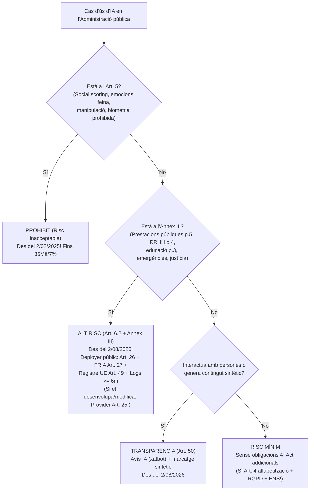

## A. Objectius d'aprenentatge

En completar aquesta lliçó final del temari seràs capaç de:

1. **Dominar** l'estructura completa i l'**enfocament basat en el risc** de l'**AI Act (Reglament UE 2024/1689 del Parlament Europeu i del Consell, de 13 de juny de 2024)**: **risc inacceptable / pràctiques prohibides (art. 5)**, **alt risc (art. 6, Annex I i Annex III)**, **obligacions específiques de transparència (art. 50)**, **risc mínim** i el règim transversal dels **models d'IA d'ús general (GPAI — Capítol V, art. 51–56)**.
2. **Memoritzar i aplicar amb precisió exacta** el **calendari oficial d'aplicació de l'AI Act (art. 113)**: **1/08/2024** (entrada en vigor), **2/02/2025** (pràctiques prohibides art. 5 + alfabetització art. 4), **2/08/2025** (governança + models GPAI + règim sancionador general), **2/08/2026** (aplicació general, alt risc Annex III, obligacions *deployers* art. 26–27 FRIA i transparència art. 50) i **2/08/2027** (alt risc en productes regulats Annex I).
3. **Diferenciar** els rols regulats de l'AI Act (**proveïdor / *provider*** vs. **responsable del desplegament / *deployer***) i saber **quan una administració pública passa a tenir obligacions de proveïdor (art. 25)** (si posa la seva marca, fa una modificació substancial o canvia la finalitat prevista cap a alt risc!).
4. **Identificar** les autoritats de governança europees i espanyoles (**Oficina Europea d'IA**, Comitè Europeu d'IA, **AESIA** — *Agencia Española de Supervisión de la Inteligencia Artificial*, RD 729/2023 —, **APDCAT/AEPD** en protecció de dades i **CCN-CERT** en ENS), així com el **règim sancionador màxim de l'art. 99 AI Act** (35 M€/7%, 15 M€/3%, 7,5 M€/1%).
5. **Implementar** en Python pur un **motor classificatori de compliment normatiu AI Act** que classifica qualsevol cas d'ús municipal en el seu nivell de risc exacte, identifica si l'administració actua com a *deployer* o *provider* (art. 25), comprova la **data d'exigibilitat legal** i genera la llista exacta d'obligacions aplicables!

---

## B. Explicació introductòria

Aquesta lliçó és la **peça de tancament** que uneix tot el Mòdul 8 en un mapa legal únic i coherent. L'**AI Act (Reglament UE 2024/1689)** és la primera llei integral del món sobre intel·ligència artificial i és **directament aplicable** a tots els Estats membres (com a Reglament europeu, no requereix transposició per ser vigent!).

Tanmateix, l'AI Act **no substitueix** les altres lleis: **s'hi suma**! Quan una diputació o un ajuntament català desplega un sistema d'IA, ha d'encaixar simultàniament quatre grans peces del puzle normatiu:
1. **AI Act (Reglament UE 2024/1689)** — seguretat del producte d'IA, classificació de risc, FRIA, supervisió humana i transparència.
2. **RGPD (Reglament UE 2016/679) + LOPDGDD (LO 3/2018)** — protecció de dades personals (controlat a Catalunya per l'**APDCAT**).
3. **ENS (RD 311/2022)** — ciberseguretat del sector públic (guies **CCN-STIC / CCN-CERT**).
4. **Dret administratiu i transparència** — **Llei 39/2015 (LPACAP)**, **Llei 40/2015 (LRJSP art. 41)**, **Llei 9/2017 (LCSP)** i **Llei 19/2014 de transparència de Catalunya**.

---

## C. Explicació tècnica avançada

### 1. La piràmide de risc de l'AI Act (Reglament UE 2024/1689) (*Obligacions legals vigents*)

#### Nivell 1 — Risc inacceptable: Pràctiques prohibides (**Art. 5** — vigent des del **2 de febrer de 2025!**)
Estan **terminantment prohibides** (amb excepcions molt estretes i taxades en certs supòsits policials):
1. **Manipulació subliminar, enganyosa o explotació de vulnerabilitats** (edat, discapacitat, situació socioeconòmica) que distorsioni greument el comportament causant dany significatiu (art. 5.1.a–b).
2. **Puntuació social (*Social Scoring*)**: avaluar o classificar persones segons comportament social o característiques personals provocant tracte perjudicial desproporcionat o fora de context (art. 5.1.c).
3. **Policia predictiva individual basada únicament en perfilat** o trets de personalitat per avaluar el risc de cometre un delicte (art. 5.1.d).
4. **Raspallat (*scraping*) no selectiu d'imatges facials** d'Internet o càmeres CCTV per crear/ampliar bases de dades de reconeixement facial (art. 5.1.e).
5. **Reconeixement d'emocions en el lloc de treball o centres educatius**, excepte per motius mèdics o de seguretat (art. 5.1.f).
6. **Categorització biomètrica** per deduir raça, opinions polítiques, afiliació sindical, creences religioses o orientació sexual (art. 5.1.g).
7. **Identificació biomètrica remota en temps real en espais d'accés públic** amb fins d'aplicació de la llei, **llevat** 3 excepcions estrictíssimes (recerca de víctimes concretes, prevenció d'amenaça terrorista/vida imminent o localització de sospitosos de delictes molt greus taxats) amb **autorització judicial o independent prèvia** (art. 5.1.h).

#### Nivell 2 — Sistemes d'IA d'Alt Risc (**Art. 6, Annex I i Annex III**)
Dues vies de classificació com a alt risc:
- **Via 1 (Art. 6.1 + Annex I)**: component de seguretat d'un producte regulat per normativa d'harmonització de la UE (dispositius mèdics, vehicles, joguines, maquinària, ascensors, aviació — aplicable des del **2/08/2027**).
- **Via 2 (Art. 6.2 + Annex III)** — **MÀXIM INTERÈS PER A L'ADMINISTRACIÓ PÚBLICA!** (aplicable des del **2/08/2026**):
  1. **Biometria** (identificació biomètrica remota no prohibida, categorització sensible, reconeixement d'emocions fora d'entorn prohibit).
  2. **Infraestructures crítiques** (gestió i operació de trànsit rodat, subministrament d'aigua, gas, calefacció i electricitat).
  3. **Educació i formació professional** (accés/admissió, avaluació de resultats d'aprenentatge, detecció de comportament prohibit en exàmens).
  4. **Ocupació, gestió de treballadors i accés a l'autoocupació** (filtratge de currículums, selecció de personal, promocions, acomiadaments, avaluació del rendiment!).
  5. **Accés i gaudi de serveis privats essencials i de SERVEIS I PRESTACIONS PÚBLIQUES ESSENCIALS** (**punt 5.a Annex III**: avaluar l'elegibilitat de persones físiques per a prestacions i serveis d'assistència pública — ajuts socials, beques, habitatge — així com concedir-los, reduir-los, revocar-los o reclamar-los; i **punt 5.d**: classificació/triatge de trucades d'emergència 112/policia/bombers!).
  6. **Aplicació de la llei** (policia).
  7. **Migració, asil i control de fronteres**.
  8. **Administració de justícia i processos democràtics** (incloent-hi influència en votacions electorals!).
- **Excepció de l'art. 6.3 (filtre de risc no significatiu)**: un sistema de l'Annex III pot quedar exclòs d'alt risc **només** si no planteja risc significatiu (p. ex. tasca merament procedimental estreta, millorar una activitat humana prèvia o tasca preparatòria), **MAI** si realitza **elaboració de perfils de persones físiques**, i obligant a documentar i registrar l'avaluació (art. 6.4 i 49.2)!

#### Nivell 3 — Risc específic de transparència (**Art. 50**)
Xatbots ciutadans, generadors de contingut sintètic, *deepfakes* i sistemes d'emocions/biometria no prohibits: obligacions d'avís i marcatge llegible per màquina (aplicable des del **2/08/2026**).

#### Nivell 4 — Risc mínim o nul
Filtres d'spam, classificació interna de documents sense impacte en drets, optimització energètica d'edificis sense infraestructura crítica: sense obligacions addicionals de l'AI Act (tot i que **SÍ** s'aplica l'**art. 4 d'alfabetització en IA**, el RGPD si hi ha dades personals i l'ENS!). Es fomenten codis de conducta voluntaris (art. 95).

#### Règim transversal — Models d'IA d'Ús General (**GPAI — Capítol V, art. 51–56**, vigent des del **2/08/2025**)
Regula els proveïdors de models fundacionals com LLMs (Llama, GPT, Claude, Mistral, Gemini): documentació tècnica, política de respecte als drets d'autor de la UE i **resum prou detallat dels continguts utilitzats per a l'entrenament**. Si el model GPAI presenta **risc sistèmic** (llindar indicatiu de càlcul d'entrenament **\(> 10^{25}\) FLOPs**, art. 51.2), afegeix avaluacions adversarials (*red teaming*), mitigació de riscos sistèmics, notificació d'incidents greus i ciberseguretat reforçada! *(Hi ha exempcions parcials de documentació per a models GPAI open-source lliures, excepte respecte a drets d'autor, resum de dades i models amb risc sistèmic!)*

### 2. Calendari oficial exacte d'aplicació (**Art. 113 AI Act**)

| Fita temporal exacta | Mesos des d'entrada en vigor | Disposicions aplicables |
|---|---|---|
| **1 d'agost de 2024** | `0` (20 dies post-DOUE 12/07/2024) | **Entrada en vigor** oficial del Reglament (UE) 2024/1689 |
| **2 de febrer de 2025** | **+6 mesos** | **Capítols I i II**: **Pràctiques prohibides (art. 5)** i **obligació d'alfabetització en IA (art. 4)** *(JA VIGENT!)* |
| **2 d'agost de 2025** | **+12 mesos** | **Governança** (autoritats nacionals, Oficina d'IA), **models GPAI (Capítol V)** i **règim sancionador** (llevat multes GPAI) *(JA VIGENT!)* |
| **2 d'agost de 2026** | **+24 mesos** | **Aplicació general**: sistemes d'**alt risc de l'Annex III** (serveis públics, RRHH, educació), **obligacions *deployers* (art. 26–27 FRIA)**, **transparència (art. 50)** i entorns controlats de proves (*sandboxes* reguladors)! *(JA VIGENT!)* |
| **2 d'agost de 2027** | **+36 mesos** | Sistemes d'**alt risc integrats en productes regulats de l'Annex I** (art. 6.1: salut, vehicles, maquinària) |

### 3. Rols (*Provider* vs. *Deployer*), Règim sancionador (Art. 99) i Autoritats

- **Quan una administració pública passa de *Deployer* a *Provider* (art. 25 AI Act)?**
  1. Si desenvolupa el sistema d'alt risc *in-house* i el posa en servei sota el seu propi nom o marca.
  2. Si realitza una **modificació substancial** sobre un sistema d'alt risc adquirit a un tercer.
  3. Si **modifica la finalitat prevista** d'un sistema d'IA (inclòs un GPAI!) de manera que es converteixi en un sistema d'alt risc! *(Ex.: adaptar un xatbot genèric de risc mínim per baremar automàticament sol·licituds de prestacions socials de l'Annex III punt 5!)* → En aquest moment, l'Administració assumeix **totes les obligacions de proveïdor** (art. 9–15, Annex IV, conformitat art. 43 i marcatge CE)!
- **Règim sancionador màxim (art. 99 AI Act)**:
  - **Pràctiques prohibides (art. 5)**: fins a **35 M € o el 7%** del volum de negoci mundial anual total (la xifra més alta).
  - **Incompliment d'obligacions clau** (alt risc, *deployers* art. 26–27, transparència art. 50, GPAI): fins a **15 M € o el 3%**.
  - **Informació incorrecta, incompleta o enganyosa** a autoritats o organismes notificats: fins a **7,5 M € o l'1%**.
  - *(Per a **autoritats i organismes públics**, l'art. 99.8 remet a cada Estat membre decidir en quina mesura se'ls imposen multes administratives, sens perjudici de requeriments vinculants, retirada del sistema i responsabilitat patrimonial/administrativa!)*
- **Autoritats a Espanya i Catalunya**:
  - **AESIA** (*Agencia Española de Supervisión de la Inteligencia Artificial*, creada pel RD 729/2023 amb seu a La Corunya): autoritat estatal de supervisió i coordinació en IA.
  - **APDCAT** (Catalunya) / **AEPD** (Estatal): protecció de dades (RGPD/LOPDGDD) i autoritat específica quan l'AI Act assigna supervisió vinculada a protecció de dades/drets fonamentals.
  - **CCN-CERT**: ciberseguretat ENS (RD 311/2022).

---

## D. Diagrames i recursos visuals



| Escala de sancions AI Act (Art. 99) | Infracció | Límit màxim |
|---|---|---|
| **Màxima** | Pràctiques prohibides (**art. 5**) | **35 M € o 7%** volum de negoci mundial |
| **Intermèdia** | Obligacions d'alt risc, *deployers* (art. 26–27), transparència (art. 50), GPAI | **15 M € o 3%** volum de negoci mundial |
| **Menor** | Informació incorrecta o enganyosa a autoritats / organismes notificats | **7,5 M € o 1%** volum de negoci mundial |

---

## E. Aplicació a l'Administració pública

1. **Estem ja en plena aplicació general de l'AI Act!**: a finals de 2026 ja són plenament aplicables **totes** les fites de febrer 2025 (art. 4 alfabetització i art. 5 prohibicions), agost 2025 (governança i GPAI) i **agost 2026 (alt risc Annex III, FRIA art. 27, obligacions *deployers* art. 26 i transparència art. 50)**! Només resta pendent la fita d'agost 2027 per a productes regulats de l'Annex I!
2. **Trampa freqüent de l'art. 25 en administracions**: un equip tècnic d'un ajuntament agafa un model GPAI *open-weights* i el munta en un flux RAG+scoring per prioritzar sol·licituds d'ajuts socials (Annex III punt 5). Encara que el model base fos d'un tercer, en definir la nova finalitat d'alt risc i posar-lo en servei internament, l'**ajuntament esdevé PROVEÏDOR (art. 25)** i ha de complir també els requisits dels art. 9–15 i l'avaluació de conformitat (art. 43)!
3. **Resum del quartet normatiu per a qualsevol pregunta d'examen**:
   - **AI Act (UE 2024/1689)**: risc, alfabetització (art. 4), prohibicions (art. 5), alt risc (Annex III), supervisió (art. 14), *deployers* (art. 26), FRIA (art. 27), registre UE (art. 49), transparència (art. 50).
   - **RGPD (UE 2016/679) + LOPDGDD (3/2018)**: principis (art. 5), base pública (art. 6.1.c/e), art. 9, art. 22, *Privacy by Design* (art. 25), EIPD (art. 35), DPD (art. 37), APDCAT/AEPD.
   - **ENS (RD 311/2022)**: 5 dimensions C-I-D-A-T, categoria màxima BAIX/MITJÀ/ALT, certificació biennal i CCN-CERT.
   - **Procediment i contractació**: LPACAP art. 35 (motivació), LRJSP art. 41 (AAA), LCSP 9/2017 i Llei 19/2014 de transparència de Catalunya.

---

## F. Exemple pràctic guiat

### Exemple 8.8: Motor classificatori de compliment normatiu AI Act (Nivell de risc, rol *Provider/Deployer* art. 25 i obligacions exactes)

Aquest script Python pur implementa un assistent de cribratge normatiu que classifica 4 casos reals d'una administració local catalana segons l'**AI Act (Reglament UE 2024/1689)** i genera automàticament el paquet d'obligacions legals aplicables!

```python
"""Exemple 8.8: Classificador normatiu AI Act per a casos d'ús de l'Administració pública."""

from dataclasses import dataclass


@dataclass
class CasUsPublic:
    nom: str
    es_practica_art5: bool
    ambit_annex_iii: str | None     # ex. "PRESTACIONS_PUBLIQUES_5A" | "OCUPACIO_4" | None
    interactua_o_sintetic_art50: bool
    desenvolupat_o_modificat_inhouse: bool


def classificar_ai_act(cas: CasUsPublic) -> dict[str, object]:
    # 1. Risc inacceptable (Art. 5 — vigent 2/02/2025)
    if cas.es_practica_art5:
        return {
            "cas": cas.nom,
            "nivell_risc": "PROHIBIT_ART_5",
            "aplicable_des_de": "2025-02-02",
            "rol_administracio": "DESPLEGAMENT_IL_LICIT",
            "obligacions": ["PROHIBICIO_ABSOLUTA (Art. 5 AI Act — sancions fins 35M€ / 7%)"],
        }

    # 2. Alt risc Annex III (Art. 6.2 — vigent 2/08/2026)
    if cas.ambit_annex_iii:
        rol = "PROVIDER_I_DEPLOYER (Art. 25)" if cas.desenvolupat_o_modificat_inhouse else "DEPLOYER_PUBLIC"
        obligacions = [
            "Art. 4: Alfabetització IA plantilla (des 2025-02-02)",
            "Art. 26: Supervisió humana competent + instruccions + logs >= 6 mesos",
            "Art. 27: FRIA obligatòria (6 blocs) + notificació AESIA",
            "Art. 49.3: Registre a la base de dades pública de la UE",
        ]
        if cas.ambit_annex_iii == "OCUPACIO_4":
            obligacions.append("Art. 26.7: Informació prèvia a representants dels treballadors")
        if cas.desenvolupat_o_modificat_inhouse:
            obligacions.append("Art. 9-15 + 43: Gestió riscos, dades art. 10, Annex IV i avaluació conformitat CE")
        if cas.interactua_o_sintetic_art50:
            obligacions.append("Art. 50: Avís explícit d'interacció amb IA")
        return {
            "cas": cas.nom,
            "nivell_risc": f"ALT_RISC_ANNEX_III ({cas.ambit_annex_iii})",
            "aplicable_des_de": "2026-08-02",
            "rol_administracio": rol,
            "obligacions": obligacions,
        }

    # 3. Obligacions de transparència (Art. 50 — vigent 2/08/2026)
    if cas.interactua_o_sintetic_art50:
        return {
            "cas": cas.nom,
            "nivell_risc": "TRANSPARENCIA_ART_50",
            "aplicable_des_de": "2026-08-02",
            "rol_administracio": "DEPLOYER_PUBLIC",
            "obligacions": [
                "Art. 4: Alfabetització IA (des 2025-02-02)",
                "Art. 50: Informar que s'interactua amb IA / marcar contingut sintètic",
            ],
        }

    # 4. Risc mínim
    return {
        "cas": cas.nom,
        "nivell_risc": "RISC_MINIM",
        "aplicable_des_de": "2025-02-02 (només Art. 4)",
        "rol_administracio": "DEPLOYER_PUBLIC",
        "obligacions": [
            "Art. 4: Alfabetització IA",
            "Sense obligacions addicionals AI Act (aplicar RGPD + ENS si correspon)",
        ],
    }


if __name__ == "__main__":
    casos = [
        CasUsPublic("Social scoring comportament cívic", True, None, False, False),
        CasUsPublic("Baremació ajuts socials in-house amb LLM+scoring", False, "PRESTACIONS_PUBLIQUES_5A", False, True),
        CasUsPublic("Xatbot informatiu d'horaris i tràmits 010", False, None, True, False),
        CasUsPublic("Optimització climatització edificis municipals", False, None, False, False),
    ]
    for c in casos:
        r = classificar_ai_act(c)
        print(f"- {r['cas']} => {r['nivell_risc']} | Rol: {r['rol_administracio']} | Obligacions: {len(r['obligacions'])}")
```

#### Interpretació del resultat
- *Social scoring* → **`PROHIBIT_ART_5`** (vigent des `2025-02-02`).
- *Baremació ajuts socials in-house* → **`ALT_RISC_ANNEX_III (PRESTACIONS_PUBLIQUES_5A)`**, rol **`PROVIDER_I_DEPLOYER (Art. 25)`** (5 blocs d'obligacions: art. 4, art. 26, FRIA art. 27, registre UE art. 49.3 i requisits de proveïdor art. 9–15 + conformitat art. 43!).
- *Xatbot informatiu 010* → **`TRANSPARENCIA_ART_50`** (2 obligacions: art. 4 i avís art. 50).
- *Climatització edificis* → **`RISC_MINIM`** (només art. 4 + RGPD/ENS si escau).

---

## G. Exercici pràctic per resoldre

### Enunciat i context
El Comitè d'IA de la Diputació de Barcelona avalua 4 propostes simultànies a finals de 2026:
1. **Projecte A**: Sistema de selecció i cribratge de currículums per a borses de treball temporal (adquirit a un proveïdor comercial).
2. **Projecte B**: Sistema de reconeixement facial *en temps real* amb càmeres municipals per detectar automàticament persones que deixen bosses d'escombraries fora dels contenidors.
3. **Projecte C**: Assistent generatiu que crea notes de premsa i imatges il·lustratives per al web institucional.
4. **Projecte D**: Model de manteniment predictiu d'enllumenat públic en parcs (sense dades personals ni infraestructura crítica).

### Objectius i requisits
Per a cadascun dels 4 projectes, determina:
1. Classificació exacta de risc segons l'**AI Act (Reglament UE 2024/1689)** i cita l'article/Annex corresponent.
2. Si està **vigent a finals de 2026** i quines obligacions concretes (AI Act, RGPD/APDCAT i ENS) apliquen.

:::hint Pista sobre els 4 projectes
Compte amb el **Projecte B**: deixar escombraries fora del contenidor és una infracció administrativa menor, MAI una de les 3 excepcions policials extremadament greus de l'art. 5.1.h! I al **Projecte A** (Annex III punt 4), no oblidis la **FRIA (art. 27)** ni la informació als **representants dels treballadors (art. 26.7)**!
:::

:::solution Solució comentada
1. **Projecte A (Cribratge de currículums — borsa de treball)**:
   - **Classificació**: **ALT RISC** (**art. 6.2 + Annex III punt 4**: ocupació i selecció de personal). Plenament vigent des del **2/08/2026**.
   - **Obligacions**: la Diputació actua com a *deployer* públic → verificar marcatge CE/Annex IV del proveïdor, **supervisió humana competent (art. 26.2)** sense decisions únicament automatitzades (art. 22 RGPD), **informar representants dels treballadors (art. 26.7)**, **logs >= 6 mesos (art. 26.6)**, **FRIA + notificació AESIA (art. 27)**, **registre UE (art. 49.3)**, **EIPD + DPD (art. 35 RGPD)** i **Certificació ENS** (mínim MITJÀ).
2. **Projecte B (Reconeixement facial en temps real en via pública per escombraries)**:
   - **Classificació**: **PROHIBIT / RISC INACCEPTABLE** (**art. 5.1.h AI Act** — identificació biomètrica remota en temps real en espais d'accés públic fora de les excepcions taxades de delictes molt greus + vulneració greu de proporcionalitat i art. 9 RGPD!). Vigència des del **2/02/2025**.
   - **Acció**: **Rebuig absolut a G0**; sanció potencial màxima fins a 35 M€ / 7%.
3. **Projecte C (Notes de premsa i imatges sintètiques)**:
   - **Classificació**: **TRANSPARÈNCIA (art. 50 AI Act)** — vigent des del **2/08/2026**.
   - **Obligacions**: marcatge tècnic de contingut sintètic (art. 50.2) i etiquetatge públic dels textos d'interès públic generats per IA **llevat** que se sotmetin a revisió humana i una persona física/jurídica n'assumeixi responsabilitat editorial (art. 50.4); alfabetització IA (art. 4).
4. **Projecte D (Manteniment predictiu d'enllumenat públic en parcs)**:
   - **Classificació**: **RISC MÍNIM** (no afecta drets fonamentals ni és infraestructura crítica d'Annex III punt 2).
   - **Obligacions**: **art. 4 AI Act** (alfabetització), bones pràctiques de governança i **ENS** (categoria BAIX/MITJÀ segons disponibilitat); sense dades personals no aplica el RGPD.
:::

---

## H. Test individual

Resol les 10 preguntes sobre la piràmide de risc de l'AI Act, les pràctiques prohibides (art. 5), els àmbits d'alt risc de l'Annex III, el calendari exacte d'aplicació (art. 113), el règim GPAI (Capítol V), la conversió de *deployer* en *provider* (art. 25), les sancions (art. 99) i les autoritats competents (AESIA, APDCAT, CCN-CERT).

---

## I. Preguntes de desenvolupament

### Pregunta 1
Exposa de manera completa i cronològica el **calendari oficial d'aplicació de l'AI Act (Reglament UE 2024/1689, art. 113)** des de la seva entrada en vigor fins al 2027, indicant exactament quines obligacions entren en vigor en cada fita.

:::model-answer Resposta model i criteris de correcció
- **1 d'agost de 2024**: **Entrada en vigor** oficial (20 dies després de la publicació al DOUE del 12 de juliol de 2024).
- **2 de febrer de 2025 (+6 mesos)**: aplicació dels Capítols I i II — **pràctiques d'IA prohibides (art. 5)** i obligació d'**alfabetització en matèria d'IA (art. 4)** per a proveïdors i *deployers*.
- **2 d'agost de 2025 (+12 mesos)**: normes sobre **governança** (designació d'autoritats nacionals competents, Oficina d'IA), obligacions per a **models d'IA d'ús general (GPAI — Capítol V)** i **règim sancionador** (llevat les multes a proveïdors GPAI).
- **2 d'agost de 2026 (+24 mesos)**: **aplicació general** del Reglament, incloent-hi sistemes d'**alt risc de l'Annex III** (serveis públics essencials, ocupació, educació, etc.), obligacions dels ***deployers* (art. 26)**, **FRIA (art. 27)**, registre UE (art. 49), obligacions de **transparència (art. 50)** i entorns controlats de proves (*sandboxes* reguladors).
- **2 d'agost de 2027 (+36 mesos)**: sistemes d'**alt risc integrats com a components de seguretat en productes regulats de l'Annex I** (art. 6.1).
- **Criteris de correcció (10 punts)**: les 5 dates exactes sense errors (5 punts), contingut normatiu precís de cada fita (5 punts).
:::

### Pregunta 2
Explica quan una administració pública que inicialment actua com a **responsable del desplegament (*deployer*)** passa a assumir totes les obligacions de **proveïdor (*provider*)** segons l'**article 25 de l'AI Act**, i il·lustra-ho amb un exemple municipal realista.

:::model-answer Resposta model i criteris de correcció
- **Supòsits de l'article 25.1 de l'AI Act**: qualsevol distribuïdor, importador, *deployer* o tercer es considera **proveïdor** d'un sistema d'IA d'alt risc (assumint les obligacions dels art. 9–16, documentació Annex IV, avaluació de conformitat art. 43 i marcatge CE) si:
  1. Posa el seu **nom o marca** en un sistema d'IA d'alt risc ja introduït al mercat o posat en servei.
  2. Efectua una **modificació substancial** en un sistema d'alt risc de manera que segueixi essent d'alt risc.
  3. **Modifica la finalitat prevista** d'un sistema d'IA que no era d'alt risc — **inclòs un model GPAI!** — de manera que passi a ser un sistema d'alt risc.
- **Exemple municipal**: un ajuntament pren un model LLM d'ús general (GPAI) o un classificador de textos genèric i l'adapta internament per avaluar i prioritzar l'elegibilitat de famílies en ajuts d'emergència social (Annex III punt 5.a). En haver-ne definit la finalitat d'alt risc, l'ajuntament esdevé *provider* (art. 25) i no n'hi ha prou amb complir l'art. 26–27 de *deployer*: ha de complir també tot el paquet de proveïdor d'alt risc!
- **Criteris de correcció (10 punts)**: els 3 supòsits exactes de l'art. 25.1 (5 punts), conseqüències jurídiques (2,5 punts), exemple municipal clar i rigorós (2,5 punts).
:::

### Pregunta 3
Elabora un **quadre integrat de compliment normatiu** per a una diputació o ajuntament català que coordini les quatre grans peces legals (**AI Act**, **RGPD/LOPDGDD**, **ENS** i **LPACAP/LRJSP**) i identifiqui exactament quina autoritat supervisa cada àmbit.

:::model-answer Resposta model i criteris de correcció
- **AI Act (Reglament UE 2024/1689)**: classificació de risc (art. 5/6/Annex III/art. 50), alfabetització (art. 4), supervisió humana (art. 14 i 26), FRIA (art. 27), logs >= 6 mesos (art. 12 i 26.6), registre UE (art. 49). **Autoritat**: **AESIA** (estatal) + Oficina Europea d'IA.
- **RGPD (UE 2016/679) + LOPDGDD (LO 3/2018)**: principis art. 5, base pública art. 6.1.c/e (+ art. 8 LOPDGDD), categories especials art. 9, decisions automatitzades art. 22, *Privacy by Design* art. 25, EIPD art. 35, DPD obligatori art. 37, bretxes <= 72 h art. 33. **Autoritat**: **APDCAT** (ens locals de Catalunya i Generalitat) / AEPD (estatal).
- **ENS (RD 311/2022)**: 5 dimensions C-I-D-A-T, categoria pel màxim (BAIX/MITJÀ/ALT), Certificació ENS + auditoria biennal en MITJÀ/ALT (extensible a proveïdors!), 4 rols separats. **Autoritat / referent tècnic**: **CCN-CERT** i entitats certificadores acreditades.
- **Dret administratiu i transparència**: **Llei 39/2015 (LPACAP)** art. 35 (motivació dels actes) i art. 53 (drets interessats); **Llei 40/2015 (LRJSP)** art. 41 (AAA: òrgan competent, auditoria codi i impugnació); **Llei 9/2017 (LCSP)** (plecs responsables) i **Llei 19/2014 de transparència de Catalunya** (**GAIP** / Síndic).
- **Criteris de correcció (10 punts)**: cobertura rigorosa de les 4 peces sense inventar articles (6 punts), assignació exacta d'autoritats catalanes/estatals/europees (4 punts).
:::

---

## J. Resum per memoritzar

- **Idees clau de l'AI Act (Reglament UE 2024/1689)**:
  - **4 nivells de risc**: **Prohibit (art. 5)**, **Alt risc (art. 6 + Annex I/III)**, **Transparència (art. 50)**, **Risc mínim** + règim transversal **GPAI (Capítol V; risc sistèmic > \(10^{25}\) FLOPs)**.
  - **Calendari oficial exacte (art. 113)**:
    - **1/08/2024**: entrada en vigor.
    - **2/02/2025**: prohibicions (art. 5) + alfabetització IA (art. 4).
    - **2/08/2025**: governança + GPAI + règim sancionador.
    - **2/08/2026**: aplicació general, **alt risc Annex III**, *deployers* (art. 26–27 FRIA), transparència (art. 50).
    - **2/08/2027**: alt risc integrat en productes regulats (Annex I).
  - **Claus per a l'Administració pública**:
    - **Annex III punt 5.a** (elegibilitat per a prestacions i serveis públics essencials) i **punt 4** (selecció de personal) = **ALT RISC**!
    - **Art. 25**: modificar substancialment o redirigir un GPAI cap a alt risc converteix l'Administració en **PROVEÏDOR**!
    - **Sancions màximes (art. 99)**: **35 M€ / 7%** (art. 5), **15 M€ / 3%** (alt risc/GPAI/art. 50), **7,5 M€ / 1%** (informació falsa).
    - **Autoritats**: **AESIA** (IA), **APDCAT** (protecció de dades ens locals catalans), **AEPD** (estatal), **CCN-CERT** (ENS).
- **Errors freqüents d'examen**:
  - Confondre les dates d'aplicació (recorda: **2 de febrer 2025 → 2 d'agost 2025 → 2 d'agost 2026 → 2 d'agost 2027**!).
  - Creure que l'AI Act deroga o substitueix el RGPD o l'ENS (s'apliquen acumulativament!).
  - Ignorar l'article 25 quan una administració adapta un LLM genèric per a un cas d'alt risc.
- **Flashcards associades**: consulta `flashcards/module-08/m08-08-compliment-normatiu.json` (5 targetes).
- **Possibles preguntes d'examen**:
  - Indica les 5 dates del calendari oficial d'aplicació de l'AI Act.
  - Classifica 4 casos d'ús municipals segons la piràmide de risc de l'AI Act i explica quan un *deployer* passa a ser *provider* (art. 25).
