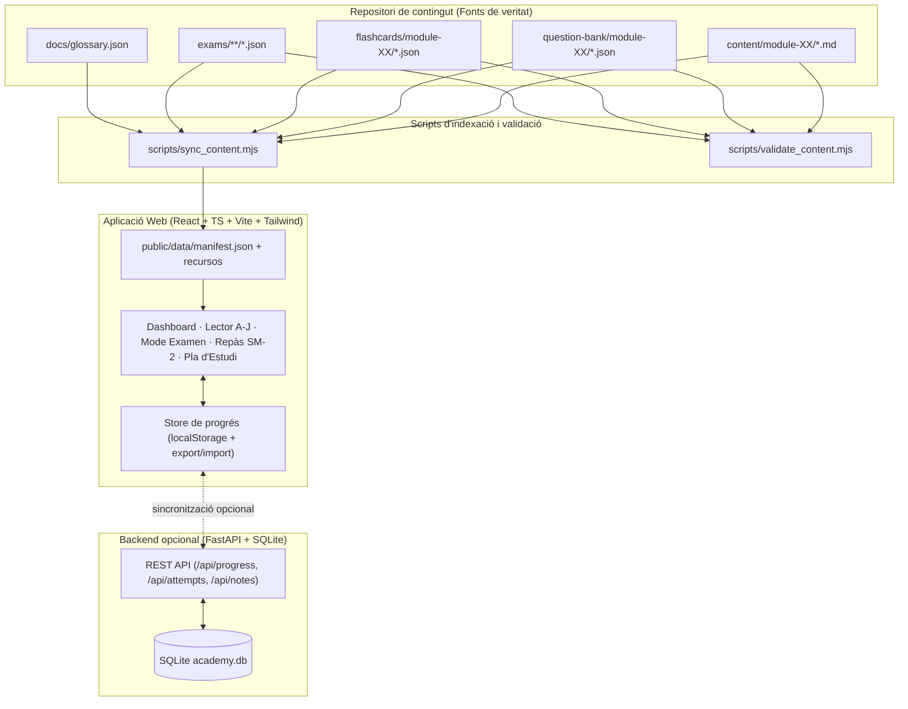

# Arquitectura tècnica i formats de contingut

## 1. Principis de disseny

1. **Separació estricta entre contingut i codi**: les lliçons (`content/`), les preguntes (`question-bank/`), les flashcards (`flashcards/`), els exàmens (`exams/`) i el glossari (`docs/glossary.json`) viuen fora de `frontend/` en formats oberts (Markdown i JSON).
2. **Funcionament 100% local i gratuït**: l'aplicació web pot funcionar directament amb persistència al navegador (`localStorage` + exportació/importació JSON) i, opcionalment, connectar-se al backend local FastAPI + SQLite (`backend/`) per a persistència en disc.
3. **Càrrega eficient sota demanda**: `scripts/sync_content.mjs` genera un manifest d'índex (`frontend/public/data/manifest.json`) i copia/normalitza els recursos estàtics a `frontend/public/data/`, permetent lazy-loading per lliçó i banc de preguntes sense inflar el bundle JavaScript.
4. **Seguretat per defecte**: no s'executa codi Python enviat per l'usuari al backend. Els exercicis i laboratoris Python s'executen localment mitjançant Jupyter Notebooks o scripts en un entorn virtual propi.
5. **Models locals primer**: els laboratoris i el projecte final ofereixen execució local amb Ollama / scikit-learn / Sentence-Transformers; les API comercials són sempre opcionals i mai no inclouen claus al repositori.

## 2. Diagrama d'arquitectura



## 3. Estructura de directoris

```text
.
├── frontend/               # SPA React + TypeScript + Vite + Tailwind CSS
├── backend/                # API FastAPI + SQLite opcional per persistència en disc
├── content/                # Lliçons en Markdown (module-01 .. module-08)
│   └── syllabus.json       # Metadades oficials dels 8 mòduls i 70 conceptes
├── question-bank/          # Banc de preguntes JSON per concepte
├── flashcards/             # Fitxes de memorització JSON per concepte
├── exams/                  # Exàmens de mòdul, simulacres globals, supòsits i simulacres complets
├── labs/                   # 8 laboratoris pràctics Python + Jupyter Notebooks
├── datasets/               # Datasets sintètics compartits (sense dades reals)
├── final-project/          # Projecte pràctic final integrador
├── docs/                   # Documentació d'arquitectura i glossari tècnic
├── scripts/                # Scripts de sincronització i validació automàtica
├── tests/                  # Tests d'integració i validació del repositori
├── AGENTS.md
├── COVERAGE.md
├── PROGRESS.md
├── ROADMAP.md
├── README.md
└── .env.example
```

## 4. Persistència del progrés i repetició espaiada (SM-2)

L'estat de l'estudiant guarda:
- `completedLessons`: mapa de `conceptId -> timestamp`
- `solvedExercises`: mapa de `conceptId -> timestamp`
- `favorites`: llista de `conceptId`
- `notes`: mapa de `conceptId -> text markdown`
- `examAttempts`: historial d'intents (mode, data, configuració, puntuació, encerts, errors, en blanc, temps emprat, desglossament per concepte i respostes individuals)
- `missedQuestions`: conjunt d'IDs de preguntes fallades amb comptador d'errors/encerts per als tests de preguntes fallades i adaptatius
- `srsCards`: estat SM-2 (`easeFactor`, `intervalDays`, `repetitions`, `nextReviewAt`, `lastReviewedAt`) per a cada flashcard i pregunta en repàs
- `studyPlan`: configuració del pla d'estudi (15/30/45/60/90 dies, hores/dia, nivell inicial, data d'inici, tasques completades)

## 5. Decisions tècniques documentades

- **Tailwind CSS v4 + `@tailwindcss/typography`**: facilita una tipografia llegible per a lliçons llargues, taules i blocs de codi.
- **Mermaid renderitzat en client**: permet que els diagrames definits dins del Markdown (` ```mermaid `) es renderitzin com a SVG nítids amb opció d'ampliació i gestió d'errors segura.
- **Blocs pedagògics personalitzats (`:::hint`, `:::solution`, `:::model-answer`, `:::callout-*`)**: un preprocessador Markdown lleuger converteix aquestes directives en components React accessibles (`<details>` / panells interactius) perquè les solucions i respostes model romanguin ocultes fins que l'estudiant decideixi revelar-les.
- **Mode adaptatiu**: calcula una puntuació de domini per concepte combinant taxa d'encert històrica, recència i compleció de lliçó, prioritzant preguntes dels conceptes més febles.
