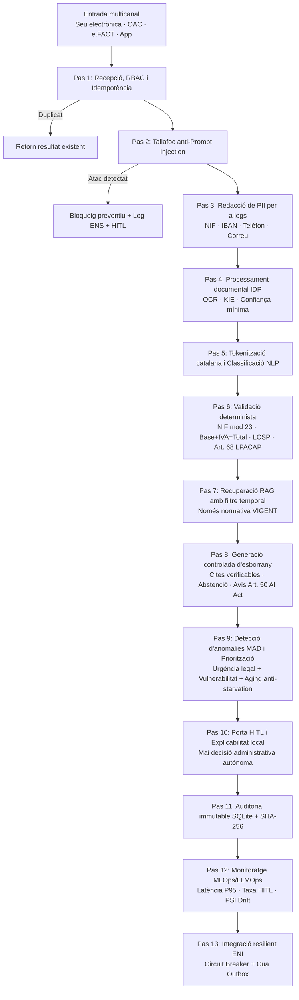

# Projecte Pràctic Final Integrador — Sistema Intel·ligent de Gestió d'Expedients Administratius (SIGEA-IA)

> **Principi fonamental**: SIGEA-IA és un sistema de **suport intel·ligent a la tramitació administrativa** pensat per a una diputació o ens local (context Diputació de Barcelona). **Mai no adopta decisions administratives finals autònomes** (`autonomous_final_decision = False`): tota proposta, requeriment d'esmena o resolució resta subjecta a validació i signatura motivada del personal funcionari competent (art. 22 RGPD, art. 14 AI Act, art. 35 LPACAP i art. 41 LRJSP).

---

## 1. Enunciat i objectiu integrador (8 mòduls, 13 passos)

Dissenya, implementa, documenta i valida un prototip executable de plataforma corporativa capaç d'assistir els ens locals en la recepció, anàlisi documental, classificació, validació formal, consulta normativa vigent, priorització i auditoria d'expedients administratius en català, integrant els **8 mòduls del temari oficial**:

- **Mòdul 1 (Fonaments d'IA)**: classificació supervisada, detecció d'anomalies robusta (MAD) i mètriques d'avaluació.
- **Mòdul 2 (NLP)**: tokenització específica del català (apòstrofs `l'`, `d'`, `s'`), extracció d'entitats/PII i cerca híbrida.
- **Mòdul 3 (Models generatius i RAG)**: recuperació normativa amb filtre obligatori de vigència (`OF-IBI-2026` vs. `OF-IBI-2024` derogada), citació verificable i abstenció controlada fora de domini.
- **Mòdul 4 (IDP / Processament documental)**: lectura OCR amb llindar de confiança, extracció de camps clau (KIE), validació aritmètica (`base + IVA = total`) i validació de lletra NIF (mòdul 23).
- **Mòdul 5 (Assistents i IA conversacional)**: control d'accés RBAC, avís de transparència (art. 50 AI Act), traçabilitat i escalada a supervisió humana (HITL).
- **Mòdul 6 (Automatització intel·ligent)**: idempotència, regles deterministes (art. 118 LCSP, art. 68 LPACAP — esmena en 10 dies hàbils) i priorització híbrida amb *aging* anti-*starvation*.
- **Mòdul 7 (MLOps i LLMOps)**: API REST FastAPI, contenidor Docker no-root, versionat de model/prompt, latència P95, càlcul de *data drift* (PSI) i integració resilient ENI amb *Circuit Breaker* + cua *outbox*.
- **Mòdul 8 (Ús responsable i seguretat)**: tallafoc anti-*Prompt Injection*, redacció automàtica de PII abans dels logs (RGPD + DA 7a LOPDGDD), cadena d'auditoria immutable SHA-256, EIPD, FRIA i ENS.

---

## 2. Arquitectura del sistema i flux complet de 13 passos



---

## 3. Estructura del projecte (`final-project/`)

```text
final-project/
├── README.md                                  # Document mestre integrador (aquest fitxer)
├── run_project.py                             # Execució completa dels 13 passos sobre 12 expedients sintètics
├── requirements.txt                           # Dependències FastAPI/Pydantic/pytest per desplegament API
├── Dockerfile                                 # Contenidor de producció amb usuari no-root (ENS)
├── api/
│   ├── main.py                                # API REST FastAPI (6 endpoints)
│   └── schemas.py                             # Esquemes Pydantic v2
├── src/sigea/
│   ├── __init__.py
│   ├── models.py                              # Model de dades + AuditLedger immutable SQLite/SHA-256
│   └── pipeline.py                            # Motor de referència dels 13 passos + Circuit Breaker ENI
├── data/
│   ├── generate_synthetic_data.py             # Generador 100% sintètic (sense dades reals)
│   ├── expedients_sintetics.json              # 12 expedients sintètics cobrint tots els escenaris límit
│   └── ordenances_sintetiques.json            # Corpus normatiu sintètic (5 vigents + 1 derogada)
├── docs/
│   ├── architecture.md                        # Arquitectura detallada i 4 ADR amb alternatives justificades
│   ├── risk_analysis_and_compliance.md        # AI Act, RGPD, EIPD, FRIA, ENS, matriu de riscos i Model Card
│   └── evaluation_rubric_and_solution.md      # Rúbrica de 100 punts, errors eliminatoris i guia de defensa
└── tests/
    └── test_sigea_pipeline.py                 # 15 tests automatitzats (unittest / pytest)
```

---

## 4. Execució ràpida i verificació local

El nucli de 13 passos i tota la suite de tests s'executen directament amb **Python 3 estàndard** (sense claus d'API ni dependències comercials):

```bash
cd final-project

# 1. Regenerar dades 100% sintètiques (opcional; ja generades)
python3 data/generate_synthetic_data.py

# 2. Executar el flux complet dels 13 passos sobre els 12 expedients sintètics
python3 run_project.py

# 3. Executar tots els tests automatitzats (15/15)
python3 -m unittest discover -s tests -v
```

### Desplegament de l'API REST FastAPI (opcional)

```bash
cd final-project
python3 -m venv .venv && source .venv/bin/activate
pip install -r requirements.txt
uvicorn api.main:app --reload --port 8010
# Documentació OpenAPI interactiva: http://127.0.0.1:8010/docs
```

Endpoints principals exposats:
- `GET /health` — Estat del servei, versió de model i versió de *prompt*.
- `POST /api/v1/expedients/process` — Executa els 13 passos sobre un expedient i retorna esborrany, cites, prioritat, raons HITL i `audit_hash`.
- `GET /api/v1/expedients/{expedient_id}` — Consulta el registre d'auditoria (PII redactada) i decisions humanes associades.
- `POST /api/v1/expedients/{expedient_id}/human-decision` — Registra la decisió motivada del personal funcionari (mínim 15 caràcters, art. 35 LPACAP).
- `GET /api/v1/metrics/mlops` — Informe en viu de latència P95, taxa HITL, PSI de *data drift*, estat de cua *outbox* ENI i integritat SHA-256.
- `GET /api/v1/audit/verify` — Verificació criptogràfica completa de la cadena d'auditoria.

---

## 5. Resum d'alternatives justificades i documentació complementària

- **Arquitectura i ADR** (`docs/architecture.md`): comparativa raonada entre RAG amb filtre temporal vs. *fine-tuning*, validació determinista vs. LLM, monòlit modular vs. microserveis i *on-premise* sobirà vs. API comercial.
- **Compliment, riscos i Model Card** (`docs/risk_analysis_and_compliance.md`): anàlisi AI Act (Annex III, art. 14, 27 FRIA, 50), RGPD (art. 22, 25, 35 EIPD), ENS (RD 311/2022), LPACAP (art. 35 i 68) i LRJSP (art. 41).
- **Avaluació i defensa davant tribunal** (`docs/evaluation_rubric_and_solution.md`): rúbrica detallada sobre 100 punts, llista d'errors eliminatoris i guió de defensa tècnica.
