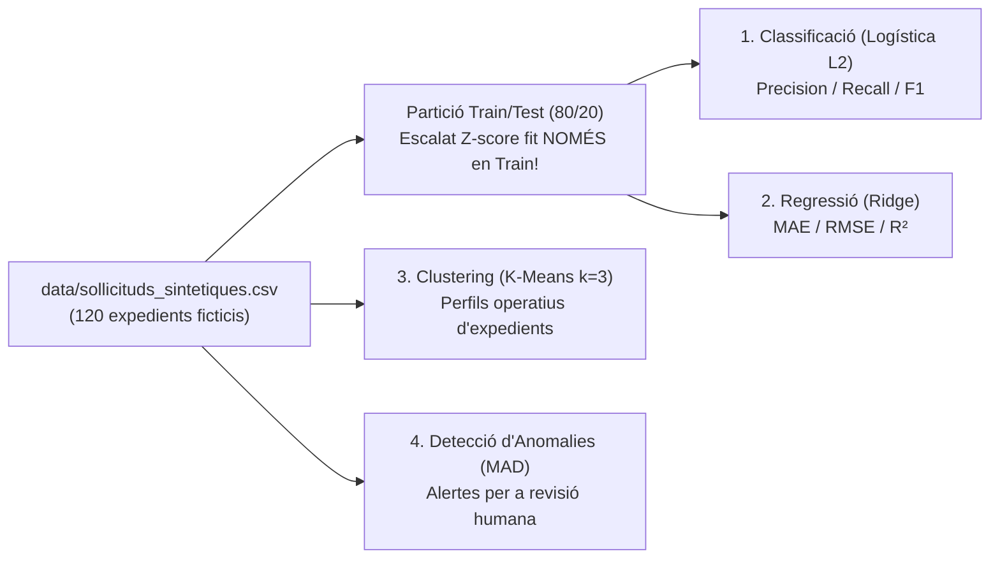

# Laboratori 1: Machine Learning aplicat a l'Administració pública

> **Mòdul 1 — Fonaments d'intel·ligència artificial**  
> **Ruta**: `labs/lab-01-machine-learning`  
> **Dades**: 100% sintètiques i fictícies (sol·licituds municipals simulades). Sense claus d'API externes.

## 1. Objectius del laboratori

En aquest laboratori implementaràs i avaluaràs de punta a punta els **quatre grans problemes clàssics del Machine Learning** sobre un conjunt de dades sintètic de sol·licituds de subvencions i tràmits municipals:

1. **Classificació supervisada**: predir si una sol·licitud requereix **revisió prioritària urgent (`urgent = 1`)** amb regressió logística (descens del gradient L2 amb `NumPy` + alternativa equivalent `scikit-learn`), evitant *Data Leakage* mitjançant escalat ajustat únicament sobre el conjunt d'entrenament (*Pipeline* temporal/estratificat) i calculant **Precision, Recall, F1 i PR-AUC**.
2. **Regressió supervisada**: estimar els **dies previstos de tramitació** d'un expedient mitjançant regressió lineal regularitzada (*Ridge*), avaluant **MAE, RMSE i \(R^2\)**.
3. **Agrupament no supervisat (*Clustering*)**: segmentar municipis/expedients en **3 perfils operatius** amb **K-Means** (*Silhouette Score* aproximat) per dimensionar equips de tramitació.
4. **Detecció d'anomalies**: identificar expedients atípics (imports desproporcionats o temps anòmals) mitjançant puntuació robusta **Z-Score modificat (MAD)** per derivar-los a auditoria humana.

## 2. Arquitectura del flux



## 3. Estructura de fitxers

- `data/sollicituds_sintetiques.csv`: 120 expedients administratius sintètics (sense dades personals reals).
- `src/pipeline.py`: implementació completa en Python + `NumPy`/`Pandas` (sense dependències externes obligatòries; compatible amb `scikit-learn`).
- `run_lab.py`: script executable de ponta a punta que imprimeix totes les mètriques i verificacions.
- `notebook.ipynb`: quadern Jupyter interactiu equivalent pas a pas.
- `tests/test_lab.py`: bateria de tests automatitzats (`unittest` / `pytest`).
- `requirements.txt`: dependències opcionals per a l'entorn local (`numpy`, `pandas`, `scikit-learn`, `pytest`).

## 4. Execució i verificació

Des de l'arrel del repositori:

```bash
# 1. Executar el laboratori complet
python3 labs/lab-01-machine-learning/run_lab.py

# 2. Executar els tests automatitzats (unittest o pytest)
python3 -m unittest discover -s labs/lab-01-machine-learning/tests -v
```

## 5. Reptes d'ampliació per a la prova pràctica

1. **Ajust de llindar orientat al risc**: baixa el llindar de classificació de `0,50` a `0,35` i analitza com creix el *Recall* d'expedients urgents a costa de reduir lleugerament la *Precision*.
2. **Validació creuada estratificada (*Stratified K-Fold*)**: implementa `k = 5` particions a `src/pipeline.py` i compara la mitjana i la desviació estàndard de l'F1.
3. **Comparativa amb `scikit-learn`**: si instal·les `requirements.txt`, compara els coeficients de la nostra regressió logística amb `sklearn.linear_model.LogisticRegression` i `IsolationForest`.
