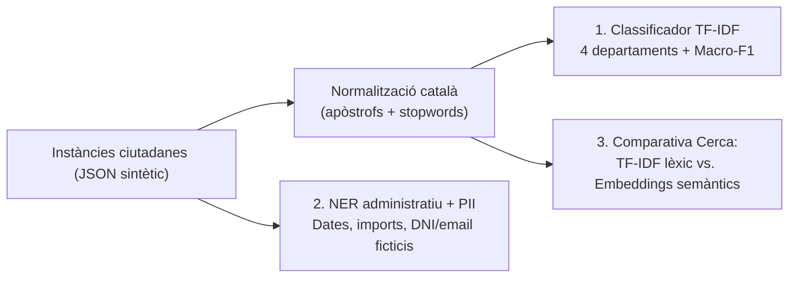

# Laboratori 2: Processament del Llenguatge Natural (NLP) en català

> **Mòdul 2 — Processament del llenguatge natural (NLP)**  
> **Ruta**: `labs/lab-02-nlp`  
> **Dades**: 100% sintètiques i fictícies (instàncies ciutadanes en català).

## 1. Objectius del laboratori

En aquest laboratori construiràs una cadena completa d'NLP en català per a un registre general municipal:

1. **Preprocessament lingüístic en català**: normalització Unicode, tractament d'apòstrofs (`l'`, `d'`, `s'`), filtratge de *stopwords* catalanes i tokenització neta.
2. **Classificació d'instàncies ciutadanes**: classificador **TF-IDF + semblança del cosinus / centroides** sobre 4 departaments (`URBANISME`, `TRIBUTS`, `SERVEIS_SOCIALS`, `VIA_PUBLICA`), avaluat amb **Macro-F1**.
3. **Extracció d'entitats anomenades (NER) i detecció de PII**: extractor híbrid d'entitats administratives (`EXPEDIENT`, `DATA`, `IMPORT`, `MUNICIPI`, `DNI_FICTICI`, `EMAIL_FICTICI`) amb pseudonimització preventiva.
4. **Cerca semàntica vs. lèxica (TF-IDF vs. Embeddings semàntics densos simulats per conceptes)**: demostració empírica de per què una consulta amb sinònims (*«ajut per pagar el pis»* vs. *«subvenció lloguer habitatge»*) falla amb TF-IDF pur (`sim = 0,0`) i es recupera correctament amb embeddings semàntics (`Recall@1 = 100%`)!

## 2. Arquitectura del flux



## 3. Execució i verificació

```bash
python3 labs/lab-02-nlp/run_lab.py
python3 -m unittest discover -s labs/lab-02-nlp/tests -v
```
