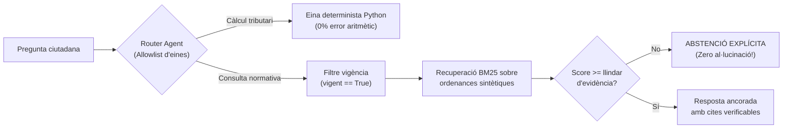

# Laboratori 3: RAG i models generatius aplicats a normativa municipal

> **Mòdul 3 — Models generatius**  
> **Ruta**: `labs/lab-03-rag-generatius`  
> **Dades**: Corpus sintètic d'ordenances municipals (sense claus d'API externes; 100% reproduïble localment i compatible amb Ollama).

## 1. Objectius del laboratori

1. **Assistent normatiu RAG (*Retrieval-Augmented Generation*) complet**: fragmentació (*chunking*) amb metadades de vigència, recuperació híbrida (BM25 simplificat + puntuació de coincidència temàtica), filtratge de vigència (`vigent = True`, descartant ordenances derogades!) i generació de respostes amb **citacions verificables obligatòries** `[DOC_ID, art. X]`.
2. **Detecció de manca d'evidència (*Abstention / Grounding Gate*)**: quan cap fragment recuperat no supera el llindar de rellevància, el sistema **s'absté explícitament** en lloc d'al·lucinar normativa inventada!
3. **Agent amb eines (*Tool Calling*) segur**: router d'eines tipat i en *allowlist* (`consultar_normativa_rag`, `calcular_bonificacio_ibi_determinista`) que delega els càlculs numèrics exactes a una funció determinista en Python (evitant errors aritmètics dels LLMs!).
4. **Avaluador comparatiu RAG vs. *Fine-tuning***: matriu de decisió automatitzada per escollir arquitectura en projectes públics.

## 2. Arquitectura del flux



## 3. Execució i verificació

```bash
python3 labs/lab-03-rag-generatius/run_lab.py
python3 -m unittest discover -s labs/lab-03-rag-generatius/tests -v
```
