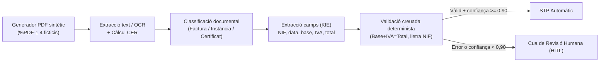

# Laboratori 4: Processament Intel·ligent de Documents (IDP)

> **Mòdul 4 — Processament intel·ligent de documents**  
> **Ruta**: `labs/lab-04-processament-documental`  
> **Dades**: Generador local en Python pur de fitxers **PDF sintètics vàlids (`%PDF-1.4`)** (factures, instàncies i certificats ficticis) sense dades personals reals.

## 1. Objectius del laboratori

1. **Generació de PDFs sintètics vàlids**: creació automàtica de 4 documents PDF reals (`data/pdfs/*.pdf`) en Python pur (sense dependències externes) amb contingut textual extraïble i simulació de degradació OCR (soroll de lectura).
2. **Ingesta i OCR/extracció**: lectura del flux textual del PDF + avaluació de qualitat de lectura (**CER — *Character Error Rate***).
3. **Classificació documental**: identificació automàtica del tipus documental (`FACTURA`, `INSTANCIA`, `CERTIFICAT_EMPADRONAMENT`).
4. **Extracció estructurada de camps (KIE) i validació creuada**: extracció de NIF/CIF, data, base imposable, IVA (21%), total i número d'expedient, amb **comprovació aritmètica determinant** (`base + iva == total`) i verificació de lletra de NIF.
5. **Enrutament STP vs. Derivació humana (HITL)**: els documents vàlids i d'alta confiança passen a **STP (*Straight-Through Processing*)**; qualsevol error aritmètic, NIF invàlid o baixa confiança OCR es deriva automàticament a la **cua de revisió humana**!

## 2. Arquitectura del flux



## 3. Execució i verificació

```bash
python3 labs/lab-04-processament-documental/run_lab.py
python3 -m unittest discover -s labs/lab-04-processament-documental/tests -v
```
