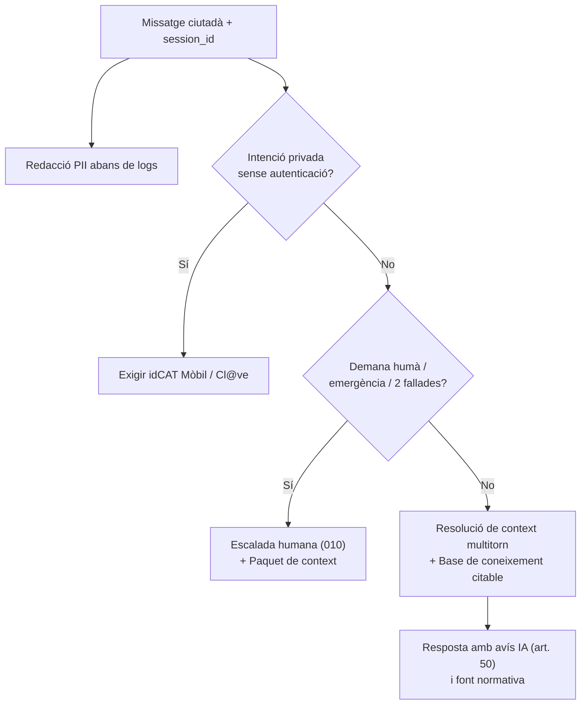

# Laboratori 5: Assistent virtual ciutadà (IA conversacional)

> **Mòdul 5 — Assistents virtuals i IA conversacional**  
> **Ruta**: `labs/lab-05-assistent-virtual`  
> **Dades**: Base de coneixement municipal sintètica (100% fictícia; sense claus externes).

## 1. Objectius del laboratori

En aquest laboratori implementaràs un **assistent conversacional ciutadà multitorn** preparat per a l'Administració pública amb:

1. **Transparència obligatòria (art. 50.1 AI Act)**: avís inicial explícit indicant que s'interactua amb un assistent automàtic d'IA i com parlar amb una persona.
2. **Gestió d'estat i context multitorn (*Slot Filling*)**: memòria de sessió aïllada per `session_id` (sense fugues *cross-tenant*!) que resol preguntes de seguiment com *«I quin termini tinc?»* a partir de la intenció activa del torn anterior.
3. **Detecció d'intencions, gestió d'incertesa i base de coneixement citable**: classificació d'intencions (`IBI_BONIFICACIO`, `OBRES_MENORS`, `EMPADRONAMENT`, `CONSULTA_EXPEDIENT_PRIVAT`, `ESCENARI_SENSIBLE`) amb llindar mínim de confiança.
4. **Control d'accés (RBAC/autenticació)**: bloqueja consultes d'expedients personals si la sessió és anònima (`autenticat = False`), exigint identificació amb `idCAT Mòbil / Cl@ve`.
5. **Escalada humana (*Human Handoff*) i traçabilitat segura**: derivació immediata amb resum estructurat quan l'usuari ho demana, quan hi ha 2 fallades consecutives o davant situacions sensibles d'emergència social, registrant tots els torns amb **PII redactada**.

## 2. Arquitectura del flux



## 3. Execució i verificació

```bash
python3 labs/lab-05-assistent-virtual/run_lab.py
python3 -m unittest discover -s labs/lab-05-assistent-virtual/tests -v
```
