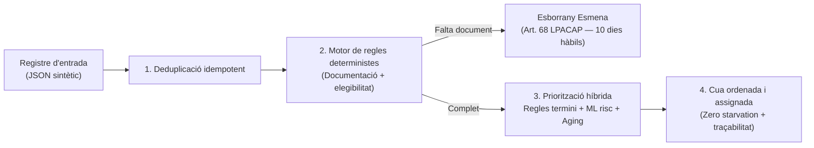

# Laboratori 6: Automatització intel·ligent de processos (Regles + ML)

> **Mòdul 6 — Automatització intel·ligent**  
> **Ruta**: `labs/lab-06-automatitzacio-intelligent`  
> **Dades**: 100% sintètiques i fictícies (expedients d'entrada al Registre General).

## 1. Objectius del laboratori

Implementar un **orquestrador híbrid d'automatització intel·ligent (IPA)** que combina **regles deterministes auditables** (per a requisits legals i esmenes art. 68 LPACAP) amb un **model predictiu lleuger de priorització** (per ordenar càrrega de treball sense *starvation*!):

1. **Recepció idempotent**: deduplicació automàtica per clau d'idempotència (`registre_id`) per evitar expedients duplicats davant reintents de xarxa.
2. **Validació automàtica *Shift-Left* i esmenes (art. 68 LPACAP)**: comprova documentació obligatòria i requisits d'elegibilitat deterministes; si falta un document, genera un **esborrany de requeriment d'esmena (10 dies hàbils)** en lloc de tramitar un expedient incomplet!
3. **Priorització híbrida amb envelliment (*Aging*)**: calcula un score combinant **urgència legal (dies fins a prescripció/termini)**, **puntuació de complexitat/risc (model predictiu)** i **factor d'envelliment** (evitant que els expedients no urgents quedin eterns a la cua — *anti-starvation*!).
4. **Enrutament automàtic amb HITL**: classifica cada expedient en `REQUERIMENT_ESMENA_ART68`, `PRIORITAT_ALTA_HITL`, `TRAMITACIO_ESTANDARD` o `ESCALADA_CAP_SERVEI`.

## 2. Arquitectura del flux



## 3. Execució i verificació

```bash
python3 labs/lab-06-automatitzacio-intelligent/run_lab.py
python3 -m unittest discover -s labs/lab-06-automatitzacio-intelligent/tests -v
```
