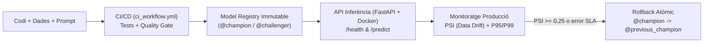

# Laboratori 7: MLOps i LLMOps (API, Docker, Registry, Drift, Rollback i CI/CD)

> **Mòdul 7 — MLOps i LLMOps**  
> **Ruta**: `labs/lab-07-mlops-llmops`  
> **Dades**: 100% sintètiques (experiments, mètriques de producció i distribució amb *Data Drift* simulat).

## 1. Objectius del laboratori

1. **Registre immutable de versions i experiments (estil MLflow Model Registry)**: enregistra runs amb hash de codi, versió de dataset, mètriques i imatge Docker fixada per digest `@sha256` (bloquejant `:latest`!).
2. **Desplegament via API (`src/app.py`) i contenidor `Dockerfile`**: servei HTTP compatible amb **FastAPI** (`GET /health`, `POST /predict`, `POST /rollback`) amb mode executable autònom per a proves locals sense dependències pesades.
3. **Monitoratge de *Data Drift* (PSI exacte) i latència P95/P99**: càlcul exacte del *Population Stability Index* (`< 0,10` estable, `0,10–0,25` moderat, `>= 0,25` alerta greu) i detecció de degradació de cua P99.
4. ***Rollback* atòmic per àlies (`@champion` → `@previous_champion`)**: davant la detecció de *drift* greu o violació d'SLA, reverteix el punter de producció de manera immediata i auditada.
5. **Plantilla de pipeline CI/CD/CT (`ci_workflow.yml`)**: integració contínua amb linters, tests unitaris, *Quality Gate* i aprovació manual humana (*Continuous Delivery*) per a sistemes d'alt risc.

## 2. Arquitectura del flux



## 3. Execució i verificació

```bash
python3 labs/lab-07-mlops-llmops/run_lab.py
python3 -m unittest discover -s labs/lab-07-mlops-llmops/tests -v
```
