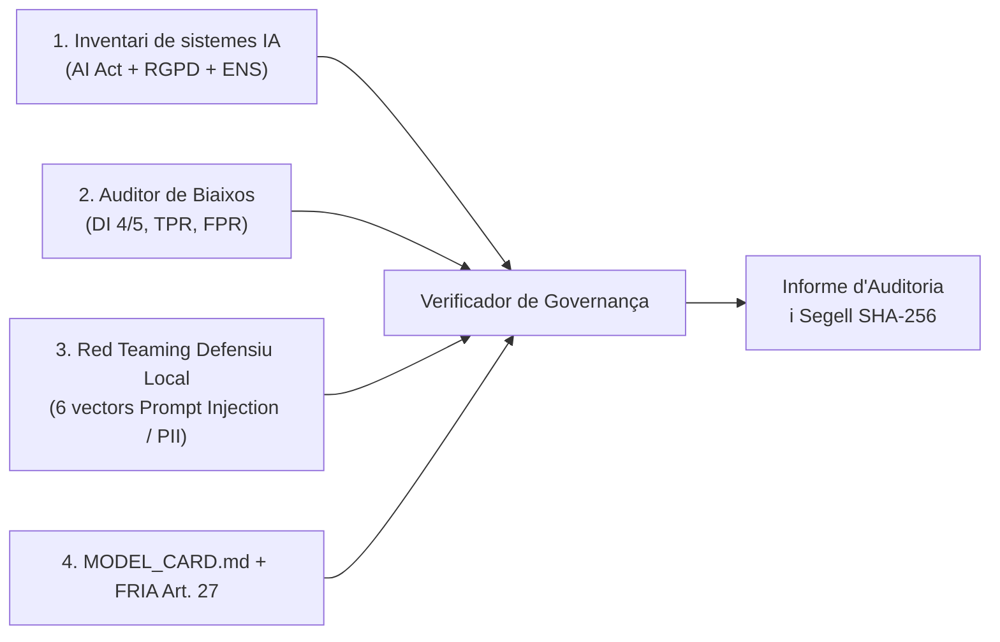

# Laboratori 8: Ús responsable, seguretat i governança de la IA

> **Mòdul 8 — Ús responsable i seguretat de la IA**  
> **Ruta**: `labs/lab-08-seguretat-governanca`  
> **Dades**: 100% sintètiques i fictícies. Proves defensives executades localment sense cap atac extern.

## 1. Objectius del laboratori

Aquest laboratori integrador de governança i seguretat executa 4 auditories automatitzades d'acord amb el marc legal vigent (**AI Act Reglament UE 2024/1689**, **RGPD UE 2016/679**, **LOPDGDD 3/2018** i **ENS RD 311/2022**):

1. **Inventari de riscos i classificació normativa automatitzada**: classifica una cartera sintètica de 4 sistemes d'IA municipals segons la piràmide de risc de l'**AI Act** (art. 5 Prohibit, Annex III Alt Risc + FRIA art. 27, art. 50 Transparència, Risc mínim), el **cribratge EIPD (art. 35 RGPD)** i la **categoria ENS (C-I-D-A-T)**.
2. **Auditoria de biaixos i equitat**: calcula *Disparate Impact* (regla orientativa 4/5 < 0,80), *Equal Opportunity* (bretxa TPR) i *Equalized Odds* (bretxa FPR) sobre un lot sintètic, bloquejant models discriminatoris.
3. **Fitxa de governança (`MODEL_CARD.md`)**: model real reutilitzable de *Model Card* + llista de comprovació FRIA (6 blocs art. 27.1 AI Act).
4. **Proves defensives locals contra *Prompt Injection* directe i indirecte (*Red Teaming* defensiu)**: bateria de 6 casos de prova locals (injecció directa, injecció indirecta dins PDF, intent d'extracció del *system prompt*, exfiltració de PII i escalada d'eines) validant una taxa de bloqueig del **100%**!

## 2. Arquitectura del flux



## 3. Execució i verificació

```bash
python3 labs/lab-08-seguretat-governanca/run_lab.py
python3 -m unittest discover -s labs/lab-08-seguretat-governanca/tests -v
```
